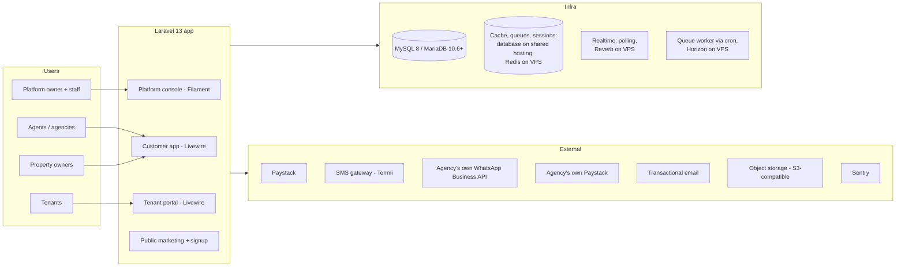

# GoProperty — Architecture

Companion documents: [IMPLEMENTATION_PLAN.md](IMPLEMENTATION_PLAN.md) · [DATABASE_SCHEMA.md](DATABASE_SCHEMA.md) · [BILLING_PAYMENTS.md](BILLING_PAYMENTS.md) · [ONBOARDING_COMPLIANCE.md](ONBOARDING_COMPLIANCE.md) · [PLATFORM_CONSOLE.md](PLATFORM_CONSOLE.md) · [UX_DESIGN.md](UX_DESIGN.md) · [BRANDING_DOCUMENTS.md](BRANDING_DOCUMENTS.md) · [DATA_IMPORT.md](DATA_IMPORT.md) · [AGENT.md](AGENT.md)

## 1. System Context

GoProperty is a single Laravel application serving four distinct audiences through separate route/panel areas, backed by one shared database and queue workers. It must run on **shared hosting** (Profile A) and scale up to a VPS (Profile B) by configuration only — see § 12.

## 2. Tech Stack

| Concern | Choice | Notes |
| --- | --- | --- |
| Framework | Laravel 13, PHP 8.4+ | Strict types everywhere; enums for all statuses |
| Frontend (customer + tenant) | Livewire 4 (built-in single-file components; no separate Volt package), Tailwind CSS 4, Alpine.js | Server-rendered, low-bandwidth friendly, natural AJAX story |
| Frontend (platform console) | Filament 5 (Livewire 4 based) | Admin tables, charts, actions out of the box. Pin exact minor versions in Phase 0 |
| Database | MySQL 8 or MariaDB 10.6+ | InnoDB, `utf8mb4`; money stored as integer kobo. CI runs the test suite on both, because cPanel/Plesk hosts often provide MariaDB |
| Theming | Platform theme from settings → CSS variables consumed by Tailwind 4 and Filament | No asset rebuild to change colours/logos ([PLATFORM_CONSOLE.md § 9](PLATFORM_CONSOLE.md)) |
| Cache / queues / sessions | Shared hosting: `database` drivers, queue worker started by cron. VPS: Redis + Horizon | Separate queues: `default`, `notifications`, `billing`, `pdf`, `media`, `imports` |
| Realtime | Shared hosting: Livewire polling. VPS: Laravel Reverb + polling fallback | Building Group posts, comments, reactions |
| Auth | Laravel starter kit (session). `web` guard + `users` table for all customers (agency staff, owners, tenants); separate `staff` guard + `platform_staff` table for GoProperty staff. 2FA (TOTP + recovery codes) mandatory for staff, required for Tier 2/3 org-owners; passkeys (WebAuthn, Fortify passkeys) for everyone | Tenants are users too — no separate tenant auth system. Sign-in is email **or phone number** + password, or a passkey. No SMS codes anywhere in signup, sign-in, invitations or resets (cost) |
| Roles | spatie/laravel-permission with teams support | Roles are scoped per organization (team = organization) |
| Media | spatie/laravel-medialibrary (`~11.23`, P02-05) | Payment proofs, post images, avatars, branding images → private S3-compatible storage, organization-scoped rows, signed links (§ 9) |
| Audit | spatie/laravel-activitylog | Every mutation on billing, leases, tickets, subscriptions |
| PDF | Driver-based (`App\Pdf\PdfRenderer`, `PDF_DRIVER`): `dompdf` (pure PHP, shared hosting) or headless Chrome through a Gotenberg service over HTTP (VPS; no Node or `proc_open` on the PHP server) | Same table-based Blade templates for both; see [BRANDING_DOCUMENTS.md § 5](BRANDING_DOCUMENTS.md) |
| Spreadsheets | OpenSpout / spatie/simple-excel (streaming) | Low-memory import/export ([DATA_IMPORT.md](DATA_IMPORT.md)) |
| WhatsApp | Meta WhatsApp Cloud API, **agency's own account** (optional) | Templates fetched from the agency's account (§ 6.7) |
| SMS | Termii (or Africa's Talking) | Nigerian routes, DND-aware |
| Email | Mailgun / Postmark / SES | Suppression list handling required |
| Monitoring | Laravel Pulse, Telescope (non-prod), Sentry | Queue depth, slow queries, webhook health |
| Backups | spatie/laravel-backup + managed DB snapshots | Nightly full + hourly binlog to object storage |
| Testing | Pest 4 (incl. browser testing), Larastan (level 6+), Laravel Pint, GitHub Actions | Feature tests for money paths are mandatory |
| Modules | nwidart/laravel-modules | See § 8 |

## 3. Application Surfaces

| Surface | Audience | Route root | Tech |
| --- | --- | --- | --- |
| Marketing + signup | Public | `goproperty.ng/` | Blade + Livewire (pricing, onboarding, org signup, accept invitations, receipt verification) |
| Customer app | Org users (agency staff, property owners managing their own buildings) | `goproperty.ng/o/{org-slug}` | Livewire dashboard |
| Tenant portal | Tenants (across all agencies they rent from) | `goproperty.ng/portal` | Livewire (my leases, bills, payments, tickets, Building Group) |
| Owner portal | Property owners invited by an agency (across agencies) | `goproperty.ng/owner` | Livewire, read-only statements |
| Platform console | Platform owner + staff | `goproperty.ng/{ADMIN_PATH}` (configurable secret path; can move to its own subdomain later) | Filament panel, `staff` guard, own session cookie, mandatory 2FA |

**Decision: one domain with path-based organization slugs and a configurable staff-console path; no subdomain per agency.** Full reasoning, login landing rules and the later white-label option are in [ONBOARDING_COMPLIANCE.md § 1](ONBOARDING_COMPLIANCE.md).

The `users` table holds every customer-side person. What a user can do is a function of (a) their role **within an organization**, (b) whether they are a tenant of any unit, and (c) whether they are an invited owner. GoProperty staff are **not** in `users`: they live in `platform_staff` with their own guard and can reach customer accounts only through audited impersonation ([PLATFORM_CONSOLE.md § 6](PLATFORM_CONSOLE.md)).

## 4. Multi-Tenancy Model

**Decision: single database, row-level tenancy.** Each `organizations` row (the agency or the property owner's business) is an isolated customer. All customer-domain tables carry `organization_id` and resolve their scope through a central `OrganizationContext`.

> **Naming:** in code, "tenant" always means a **renter** (`TenantProfile`). The multi-tenancy concept uses "organization" everywhere (`OrganizationContext`, `BelongsToOrganization`, `SetOrganizationContext`) to avoid confusing the two.

- `App\Tenancy\OrganizationContext` — scoped singleton (fresh for every request and queued job) holding the current organization; set by the `SetOrganizationContext` middleware (`App\Http\Middleware`, alias `organization`) from the `{organization}` slug in the URL after checking membership. Unknown slugs and non-members get the same 404, an old slug redirects (301) to the current one, and the middleware runs before route model binding so models bound from the URL are already scoped. Jobs and commands use `OrganizationContext::run($organization, fn () => …)`, which restores the previous context afterwards; `outside(fn () => …)` runs code with no organization (e.g. a staff permission check while impersonating). Users may belong to several orgs; the **organization switcher** in the app shell lists the organizations whose workspace the user may open (with their role in each), and choosing one (`POST /organizations/{slug}/switch`, 404 for non-members) opens it and stores it as `organization_user.is_default`. After signing in (password, 2FA or passkey), `App\Tenancy\WorkspaceLanding` sends the user to the page they asked for, else to their only workspace, else to the one they chose last, else to the organization picker (`/dashboard`). The picker sends a user who belongs to no organization at all to the signup wizard's organization step, and `/o/{slug}` sends whoever can carry on an unfinished signup to its saved step ([ONBOARDING_COMPLIANCE.md § 2](ONBOARDING_COMPLIANCE.md)).
- **Livewire inside `/o/{slug}`.** Livewire posts updates to its own endpoint, outside the `/o/{slug}` route, so `SetOrganizationContext` is registered as Livewire persistent middleware (`TenancyServiceProvider`): each update replays it for the page's route, setting the same context and refusing non-members with 404. A component also keeps its organization id `#[Locked]` and refuses a context for any other one (first used by the signup wizard, `App\Livewire\Onboarding\SetupWizard`).
- The tenant and owner portals are **cross-organization by nature**: they do not set a single organization context, and instead query through an explicit "records linked to my user" path (`tenant_profiles.user_id = me`, owner links) that is policy-checked per record.
- `App\Tenancy\BelongsToOrganization` trait — boots `OrganizationScope` (`where organization_id = current`) and auto-fills `organization_id` on create. **Fail closed:** querying or creating without a context throws `MissingOrganizationContext` instead of returning every organization's rows, and creating a row in, or moving one to, another organization throws `CrossOrganizationWrite`. Models opt in; nothing queries organization data without it.
- All unique indexes include `organization_id` (e.g. `unique(organization_id, unit_number, property_id)`).
- Cross-org reads (Platform console, aggregate analytics) bypass the scope explicitly through dedicated read models / raw queries in the `Platform` namespace — the only place allowed to do so, guarded by platform middleware. A Larastan rule (`tools/phpstan/Rules/OrganizationScopeBypassRule.php`) fails the build when code outside `App\Platform` or `Modules\Platform` removes `OrganizationScope`, or calls `withoutGlobalScopes()` on an organization-owned model.
- **Roles follow the context.** spatie/laravel-permission runs with teams (team = organization, column `organization_id`). Its team id comes from `App\Tenancy\OrganizationTeamResolver`, which reads `OrganizationContext` on every call and refuses `setPermissionsTeamId()`, so the team can never outlive a request or queued job or drift from the organization being worked in. `User` (`App\Tenancy\HasOrganizationRoles`) also forgets roles loaded for another organization, and refuses role grants outside an organization, to non-members, or of a role another organization defined.
- **Suspended organizations are read-only (one central rule).** While `organizations.status` is `suspended` (staff in the console, or the billing ladder, [BILLING_PAYMENTS.md § 2](BILLING_PAYMENTS.md)) or `cancelled`, members can still sign in, read and export, but every write is refused with a message saying so, from the next request (the status is read from the organization `SetOrganizationContext` loads each request; nothing caches it). `App\Tenancy\OrganizationWriteGuard` applies it in four places, so features are covered without their own check: (1) `SetOrganizationContext` refuses any non-GET request inside `/o/{organization}` (403); (2) `SetOrganizationContext` is Livewire persistent middleware, and a `Livewire\before('call')` hook refuses every component method call except paging, `$refresh`/`$set`, and methods marked `#[AllowedWhileSuspended]` (event listeners are judged by the method they run); (3) members lose every customer permission whose `OrganizationPermission::allowedWhileSuspended()` is false (`HasOrganizationRoles::hasPermissionTo`; kept: the `*.view` permissions (including `compliance.view`, so an owner still sees the Transaction Tier application, and `settings.view` / `payment_settings.view`, so Settings opens read-only), `organization.activity`, `organization.billing` so the subscription can be paid, and `payments.submit_proof`); (4) a `Gate::before` hook denies, for customers, every policy ability that is not a read (`view…`, `export…`, `download…`, `switchTo`) in a suspended organization (the one passed to the check, else the one in context). A non-GET action that only exports, or that the docs allow during suspension (paying the subscription), is marked `#[AllowedWhileSuspended]` on its controller or Livewire method; nothing else may be. Livewire `updated*` hooks must not write (they are not method calls); writes belong in methods that check a policy. `restricted` is not read-only: the features it limits (new leases, properties, units, online payments; [ONBOARDING_COMPLIANCE.md § 5.5](ONBOARDING_COMPLIANCE.md)) check it themselves. Staff permission checks are never affected, and jobs, commands and the billing ladder run as the system and are not blocked (a job acting for a user checks that user's permissions inside `OrganizationContext::run()`, so it is). **Tenant portal (P03):** it sets no organization context, so none of this applies there by itself; the portal must stay read-only for records of a suspended or cancelled organization (check `$record->organization->status->blocksWrites()` in the portal's policies, or run the action inside `OrganizationContext::run()` so the guard applies) **except** uploading a payment proof, which must keep working ([ONBOARDING_COMPLIANCE.md § 3](ONBOARDING_COMPLIANCE.md)).
- **Impersonation limits (one central rule, [PLATFORM_CONSOLE.md § 6](PLATFORM_CONSOLE.md), AGENT.md § 3 rule 9).** While GoProperty staff impersonate a user, `App\Tenancy\ImpersonationGuard` (state in `App\Tenancy\CurrentImpersonation`, set per request by `App\Http\Middleware\ResumeImpersonation`) applies in the same four places, for the impersonated user only: (1) HTTP: sign-in and account-security routes (Settings → Security, Fortify's `user/*`, password confirmation, the verification email, sign-in and sign-up) and actions marked `#[BlockedWhileImpersonating]` are refused, and in a read-only session every non-GET request except Livewire updates and `#[AllowedWhileSuspended]` exports; (2) Livewire: the same `before('call')` hook refuses methods (or whole components) marked `#[BlockedWhileImpersonating]`, and in a read-only session every call except paging, refreshes and exports; (3) permissions: `HasOrganizationRoles::hasPermissionTo` drops every permission `OrganizationPermission::blockedWhileImpersonating()` names, and in a read-only session every one whose `allowedWhileSuspended()` is false; (4) policies: the `Gate::before` hook denies those permissions, abilities named `delete…`, `forceDelete…`, `destroy…`, `remove…`, `purge…` or `void…`, policy methods marked `#[BlockedWhileImpersonating]`, every non-read ability in a read-only session, and any organization other than the session's (so other workspaces answer 404). Refused requests and calls are written to the audit log (`impersonation.blocked`). **How a feature declares itself:** class each new permission in both `allowedWhileSuspended()` and `blockedWhileImpersonating()` (exhaustive matches: the build fails until it is); a money action, bank or Paystack setting (viewing the keys too), billing transfer, sign-in detail, member or role change, delete or import commit/rollback must sit behind a blocked permission, a delete/void-named ability, or `#[BlockedWhileImpersonating]` on its controller method, Livewire method or component, or policy method. A page that shows secrets checks the blocked permission even to view. During a session every audit entry (business changes too) carries `impersonator_staff_id` and `impersonation_session_id` (`App\Audit\AuditContext`). Queued jobs run outside the request, so they carry neither and are not blocked: a blocked action is refused in the request, before anything is dispatched.
- **Cross-tenant probes:** `tests/Feature/Tenancy/CrossTenantAccessTest.php` runs every organization-owned model listed in `Tests\Support\OrganizationScopedModels` through reads, writes, moves, URL binding and a missing context, and fails while any `BelongsToOrganization` model in `app/` or `Modules/` is missing from that list. New models are added there.
- Database-level defense: every tenant-domain controller/Livewire action resolves models through the trait's scope; policies re-check membership (`user Belongs To Organization` + role).
- **Escape hatch for the future:** if an enterprise customer demands physical isolation, the same code runs multi-database (connection switching in the tenancy layer) — but that is explicitly not an MVP concern.

## 5. Roles & Permissions Matrix

Platform side (spatie roles on the `staff` guard; default roles, custom roles and two-person rules in [PLATFORM_CONSOLE.md § 1](PLATFORM_CONSOLE.md)):

| Role | Capabilities (summary) |
| --- | --- |
| `super-admin` | Everything, including staff management and production restore approval |
| `operations-manager` | Customers, suspend/reactivate, grace extensions |
| `compliance-officer` | Transaction Tier reviews, compliance documents and flags |
| `finance-admin` | Plans, platform invoices, bank-transfer confirmation, refunds |
| `support-agent` | Customer lookup, read-only impersonation, resend emails/invoices |
| `technical-admin` | Operations dashboard, queues, webhooks, backups |
| `content-manager` | Email templates, marketing content |
| `analyst` | Analytics, read-only, no PII |

Staff roles are global: no organization on the role or on the assignment (`organization_id` null in the shared spatie tables); `App\Platform\Console\HasStaffRoles` reads and grants them outside any organization context. The permission catalogue is `App\Platform\Staff\StaffPermission` (one permission per console area and action; new features add permissions, never roles) and the default grants are `DefaultStaffRole`. A staff permission check (Gate, `can()`, policies) answers from the staff member's **active** roles, and only for an active account **with 2FA enrolled**: without 2FA a staff member holds no console permission at all. Grants, role edits, invitations and deactivations go through `App\Platform\Staff\StaffRoles` and `StaffLifecycle` (two-person rules, the super-admin floor, audit log); two-person requests through `App\Platform\Approvals\ApprovalService`, where later features register a handler for their action.

Customer side (per-organization roles, spatie teams on the `web` guard; the permission catalogue is `App\Enums\OrganizationPermission` and each role's grants are in `App\Enums\OrganizationRole`, seeded by `OrganizationRolesSeeder`):

| Role | Capabilities |
| --- | --- |
| `org-owner` | Full control of the organization: billing responsibility, staff, buildings, leases, tickets moderation, reports |
| `org-admin` | Day-to-day operations: buildings, units, leases, bills, payments confirmation, tickets (no billing responsibility / no deleting the org) |
| `agent` | Operational staff: manage assigned buildings, units, leases, confirm payments, handle tickets, moderate Building Groups |
| `property-owner` | Read-heavy: view own buildings/units/leases, financial reports for own properties, respond to tickets if no agent assigned |
| `tenant` | Portal only: own leases, bills, payments (upload proof), own tickets, Building Group membership for own buildings |

**Who opens the workspace (`/o/{slug}`).** Only members holding `workspace.access` there: `org-owner`, `org-admin` and `agent` (`OrganizationPolicy::view`, checked by `SetOrganizationContext`). A user whose only roles in an organization are `tenant` or `property-owner` gets the same 404 as a stranger, and the switcher and picker never list that organization: tenants use `/portal` and agency-invited property owners use `/owner` (§ 3, [ONBOARDING_COMPLIANCE.md § 2](ONBOARDING_COMPLIANCE.md)); owners who run their own buildings sign up as their own organization and are its `org-owner`. A member with no role at all is also refused (fail closed).

**Who may grant which role (P01-04, `App\Members\RoleGrants`).** Settings → Members manages the workspace roles only (`org-owner`, `org-admin`, `agent`); tenants and agency-invited property owners get their own invitations. Granting, changing or taking away a role needs `members.manage` (owners and administrators); only an `org-owner` grants or takes away `org-owner`, so an administrator invites, changes and removes administrators and agents but never makes, changes or removes an owner (nor resends or revokes an owner's invitation). An organization always keeps at least one `org-owner`: removing or demoting the last one is refused.

**Settings (P01-05).** Settings → Profile and Branding are seen with `settings.view` and saved with `organization.update` (`org-owner`, `org-admin`; BRANDING_DOCUMENTS.md § 1); from Transaction Tier 2 the registered name and CAC number are locked there (compliance checked them). Settings → Payment collection (bank accounts, later the Paystack connection) is `org-owner` only: `payment_settings.view` to see it, `organization.payment_settings` to change it. Where tenants pay is the change a dishonest insider would want, so administrators cannot make it, as ONBOARDING_COMPLIANCE.md § 4.2 already says for Paystack keys; both permissions are blocked while staff impersonate (the page answers 403, numbers are never shown). `OrganizationPolicy::viewSettings/updateProfile/updateBranding/viewPaymentSettings`, `OrganizationBankAccountPolicy`.

**Property owners (P02-01a).** The Owners pages (`/o/{slug}/owners`, `Modules\Properties`) list, add, edit, archive and restore owner profiles. `owners.view` (`org-owner`, `org-admin`, `agent`; kept while suspended) opens the list and an owner read-only; `owners.manage` (`org-owner`, `org-admin`) adds, edits, archives (soft delete) and restores (`OwnerProfilePolicy`; changes go through `Modules\Properties\Owners\OwnerProfiles`, audited under log `owners`). Agents look owners up but do not keep the records. Property owners and tenants hold neither (they never open the workspace). Neither permission is blocked while staff impersonate, but archiving is (a `delete` ability). An owner who still owns an active building cannot be archived (P02-01b); an owner's page lists the owner's buildings. An owner's ID number (NIN or CAC number) is an encrypted cast, shown masked (`NIN ···2109`) and never sent back to the browser: an empty field keeps the number on file.

**Buildings (P02-01b).** The Buildings pages (`/o/{slug}/buildings`, `/buildings/create`, `/buildings/{building slug}` and `/edit`; `Modules\Properties`) list, add, open, edit, archive and restore buildings, with photos on the building's page. `properties.view` (`org-owner`, `org-admin`, `agent`; kept while suspended) opens the list and a building, archived ones read-only; `properties.manage` (the same three) edits an active building, adds photos, picks the cover and removes photos; `properties.portfolio` (`org-owner`, `org-admin`; new in P02-01b) adds, archives and restores buildings, because which buildings the organization manages (and is billed for) is the owners' and administrators' call, and agents work on existing buildings (P02-03 narrows them to assigned ones). `PropertyPolicy`; changes go through `Modules\Properties\Buildings\Properties` and `PropertyPhotos`, audited under log `properties`. Archiving is a status change (`active` → `archived`), never a delete. A `restricted` organization adds and restores no building but keeps editing ([ONBOARDING_COMPLIANCE.md § 5.5](ONBOARDING_COMPLIANCE.md)). No building permission is blocked while staff impersonate, but archiving (`delete`) and removing a photo (`deletePhoto`) are.

**Units (P02-02).** Units are seen, added and changed on their building's page and the unit pages (`/o/{slug}/buildings/{building slug}/units/create`, `/units/bulk`, `/units/{id}/edit`; `Modules\Properties`), on the building permissions: `properties.view` sees them (archived buildings' units too, read-only); `properties.manage` (`org-owner`, `org-admin`, `agent`) edits a unit of an active building and its manual status; `properties.portfolio` (`org-owner`, `org-admin`) adds units (one or several at once), archives and restores them, because each unit is billed, as with buildings. `UnitPolicy`; changes go through `Modules\Properties\Units\Units` and `CreateUnitsInBulk`, audited under log `properties`. A `restricted` organization adds and restores no unit but keeps editing and archiving ([ONBOARDING_COMPLIANCE.md § 5.5](ONBOARDING_COMPLIANCE.md)); no unit is added to an archived building. Archiving a unit (`delete`) is blocked while staff impersonate; adding and editing are allowed in write mode and audited with both identities. Every unit across the buildings is also listed at `/o/{slug}/units` (P02-03; `UnitPolicy::viewAny`, § 13).

**Agent assignment and narrowing (P02-03).** Owners and administrators (`properties.assign_agents`, new in P02-03; dropped while suspended and while staff impersonate, as it decides what a member sees, like a role change) assign the organization's agents to a building and take them off on the building's page (`Modules\Properties\Assignments\AgentAssignments`, `PropertyPolicy::assignAgents`, audited under log `properties` as `property.agent_assigned` / `property.agent_unassigned`; DATABASE_SCHEMA.md § 3 `agent_building`). Only members holding `agent` and neither `org-owner` nor `org-admin` can be assigned, and only to an active building. **Narrowing is optional, per agent:** an agent with at least one assignment in the organization sees and works on those buildings only; an agent with no assignment sees every building, as owners and administrators always do (an assignment left from when an administrator was an agent is ignored). A narrowed agent's lists (buildings, the unit list, owners, the building filter and owner picker, the status board) are limited by `Assignments\AgentNarrowing`, and every other building, its units and its owner's page answer 404 (`PropertyPolicy`, `UnitPolicy` and `OwnerProfilePolicy` return `Response::denyAsNotFound()`), on pages, Livewire actions and the writers alike. Owners are not assigned themselves: a narrowed agent sees the owners of their buildings only, and may choose only those owners on the building form. Narrowing applies while suspended and while staff impersonate the agent. Removing a member (`App\Members\Members::remove`) sends `App\Members\MemberRemoved` inside its transaction, and the Properties module deletes that member's assignments there (audited, reason `member_removed`), so a returning member starts unassigned. Other modules narrow by building through `Modules\Properties\Contracts\BuildingAccess` (`limitedTo(User)`: null or the building ids; `allows(User, id)`); `PropertyDirectory::activeOptions($for)` and `UnitDirectory::counts($for)` narrow a picker or count shown to a member, and `countBillable()` never narrows. BILLING_PAYMENTS.md § 1.2 limits agent assignment to the Scale plan; it is not gated yet (P06-01).

**Tenants (P02-06b).** Tenant profiles (`Modules\Tenants`, DATABASE_SCHEMA.md § 1) arrive first by import; their pages come in P03-01a. `tenants.view` (`org-owner`, `org-admin`, `agent`; kept while suspended) and `tenants.manage` (the same three, because an agent signing a lease adds its tenant; dropped while suspended) back `TenantProfilePolicy` (viewAny/view, create/update/delete (archive)/restore). Property owners and tenants hold neither. Neither is blocked while staff impersonate, but archiving is (a `delete` ability). Importing tenants needs `imports.manage`, like every import. A tenant's ID number is an encrypted cast, shown masked (`NIN ···2109`).

**Billing transfers (P02-04).** The Billing transfers page (`/o/{slug}/billing-transfers`, `Modules\SaasBilling`) and the accept screen (`/o/{slug}/billing-transfers/{transfer}`) need `organization.billing`, which only `org-owner` holds ([BILLING_PAYMENTS.md § 7](BILLING_PAYMENTS.md) rule 1); its description now says it covers offering the bill and taking one over, so no new permission was added. `BillingTransferRequestPolicy`: `viewAny`/`view` (the offering or the receiving organization), `create` (offer this organization's bill), `cancel` (the offering organization only), `respond` (accept or decline: the receiving organization only). `organization.billing` is kept while suspended (to pay the subscription), but offering, withdrawing and answering are writes, so a suspended organization's owners only see their offers (central guard); it is blocked while staff impersonate, and `create`, `cancel`, `respond`, the page's actions and the emailed-link route also carry `#[BlockedWhileImpersonating]`.

Rules encoded in policies, not controllers:

- Tenants may only ever see resources attached to their own leases/units.
- `agent` visibility can be narrowed by building assignment (`agent_building` pivot) — recommended for larger agencies. Built in P02-03 ("Agent assignment and narrowing" above): optional per agent; an agent with no assignment sees every building.
- Payment confirmation is restricted to org roles; tenants confirm nothing — they only submit proof.
- Ticket visibility: tenant ↔ (assigned agent OR org-admin OR owner-if-no-agent). Threaded replies stay inside that envelope.

## 6. Key Subsystems

### 6.1 Organizations, invitations and billing responsibility

- Signup creates an `Organization` (type `agency`, `property_owner`, or `hybrid`) plus the founding `org-owner` user. An agency may be a company (CAC number captured, KYC-lite at MVP).
- Invitations: token link sent by email, by the agency's WhatsApp, or shared by the agency itself (copy link / QR); the invitee picks a password on acceptance. No SMS codes ([ONBOARDING_COMPLIANCE.md § 2](ONBOARDING_COMPLIANCE.md)). Two kinds:
  1. **User invite** — a person into an org with a role.
  2. **Org invite (billing transfer)** — a property owner invites an agency, or vice versa, and offers to hand over the platform subscription bill. The invitation has `kind = org_billing_transfer`; the receiving org-owner must **accept** — only then does `subscriptions.payer_organization_id` move and the new payer's Paystack mandate/bank instructions take over. Decline or expiry leaves billing unchanged. Full state machine in [BILLING_PAYMENTS.md § 7](BILLING_PAYMENTS.md).
- **How member invitations are built (P01-04).** Settings → Members (`/o/{slug}/settings/members`, `App\Livewire\Workspace\Members`) lists members with their workspace roles and the waiting invitations; owners and administrators see it (`members.view`). With `members.manage` they invite an email address with one or more roles, send an invitation again (new link, new 14 days), revoke it, change a member's roles and remove a member (`App\Members\MemberInvitations`, `App\Members\Members`; policies `InvitationPolicy`, `MembershipPolicy`). The link `/invitations/{token}` (`AcceptInvitationController`, sign-in page layout) is bound to the invited address: a new person sets name, optional mobile number and a password (signup rules) and is signed in; an existing account signs in and comes back to join; any other signed-in account is refused (403). Unknown, used, revoked and expired links get one identical "no longer valid" page (404). The page has only the token, so `App\Members\InvitationAcceptance` reads the invitation's `organization_id` by the token's hash (one unscoped column) and loads the invitation inside that organization's context; a suspended organization takes no new members (`OrganizationWriteGuard`) and the page is refused while staff impersonate (`#[BlockedWhileImpersonating]`). Acceptance writes `invitation_accepted` to the authentication log and `invitation.accepted` to the audit log; every invitation and member change is audited (log `members`, the organization as subject). Removing a member deletes their `organization_user` row and their `model_has_roles` / `model_has_permissions` rows for that organization only. Sends are limited per organization (50 an hour), per inviting user (30 an hour) and per address (5 a day); the email is queued on `notifications` and is the same whether or not the address has an account. P02-04 (billing-transfer invites) adds its kind to the same table with its own link and acceptance (next item); P03-01b (tenant invites by WhatsApp or link/QR) adds its channels to the same table and acceptance.
- **How billing transfers are built (P02-04, `Modules\SaasBilling`; state machine in [BILLING_PAYMENTS.md § 7](BILLING_PAYMENTS.md)).** An owner opens Billing transfers (`/o/{slug}/billing-transfers`, `Livewire\BillingTransfers`), sees the bill as it stands (`Transfers\MonthlyBills`: the plan chosen at signup, else the cheapest for the units, from `App\Marketing\PlanCatalogue`, and the units counted through `Modules\Properties\Contracts\UnitDirectory::countBillable()` inside the organization's context) and offers it to an organization already on GoProperty, named by its web address (`goproperty.ng/o/{slug}`, the bare slug or an old one) or by the email of one of its owners (`Transfers\TransferTargets`; every miss answers the same, and attempts are limited to 10 an hour per organization). `Transfers\BillingTransferService` is the only writer: `initiate` (one open offer per organization; a `billing_transfer_requests` row owned by the offering organization plus a Core invitation of kind `org_billing_transfer` carrying the link's token hash, both expiring in 14 days; each owner of the receiving organization is emailed and notified in the app), `accept` and `decline` (the receiving organization's owner, checked in its own context, then written inside the offering organization's context), `cancel` (the offering organization), `expire` (hourly `Jobs\ExpireBillingTransfers`, and when a link is opened past its date). Each locks the row, refuses a transition the state machine does not allow with nothing changed (`BillingTransferRefused`), keeps the invitation's status in step, is audited (log `billing_transfers`, the transfer as subject) and notifies once by email and in the app (`notifications` table): the receiving owners of an offer and of a withdrawal, the owner who offered (else the offering organization's owners) of an acceptance, a decline or an expiry. The emailed link `/billing-transfers/{token}` (`Http\Controllers\OpenTransferLinkController`) finds the invitation by its token hash as P01-04 does and, for a member of the receiving organization, opens the accept screen there (404 for anyone else; `/invitations/{token}` and Settings → Members ignore this kind). The receiving organization's inbox and accept screen (`/o/{slug}/billing-transfers/{transfer}`, `Livewire\BillingTransferReview`) find its offers through `Transfers\IncomingTransfers` (DATABASE_SCHEMA.md § 1 says how, without removing a scope). The accept screen states "You are taking over the GoProperty subscription bill for {amount}/month from {date}" with the plan and units behind it; accepting passes the amount shown, and the service refuses if the bill changed meanwhile, then records the plan, units and amount. **Built ahead of P06 (P02 decision 5):** accepting records the handover only: no payer column is written (`subscriptions.payer_organization_id`, the payment-method hand-over and `completed_at` are P06-06), `subscription_id` stays empty without a foreign key, and the receiving organization gets no access to the offering organization's buildings or members.
- Property owners who sign up directly are flagged `platform_covered` (the platform owner pays their subscription internally) — the "platform bills itself when the owner signs up" case. The signup wizard sets it for organizations of type `property_owner` (P01-02).

### 6.2 Property hierarchy and allocations

`Organization → Property (building) → Unit (block/apartment)`. A building has one property owner (owner profile) and, when agency-managed, one managing agency (the org itself). Units carry status (`vacant`, `reserved`, `occupied`, `under_maintenance`, `unavailable`), base rent, and service charge defaults. An **allocation is a lease**: there is no allocation without a contract, so occupancy state derives from active leases (kept denormalized on `units.status` for fast lists, updated by lease lifecycle events).

Tenants may hold multiple active leases across buildings and orgs — every lease is scoped to one unit; the tenant's user account is global (one sign-in across agencies), while each organization keeps its own tenant profile (`tenant_profiles`, organization-scoped, unique by phone in the organization), linked to the account through `tenant_profiles.user_id` once the tenant has portal access.

**Built so far.** Buildings (P02-01b) are `Modules\Properties\Models\Property` (DATABASE_SCHEMA.md § 3); the owner profile is optional (an owner running their own organization owns its buildings without one). Archiving sets `status`, so an archived building keeps its history and stays readable; soft deletes are left to import rollback. Other modules read buildings only through `Modules\Properties\Contracts\PropertyDirectory` (`find`, `findMany`, `isActive`, `activeOptions`, `countActive`; plain `PropertySummary` values, current organization only, no permission check: the caller checks its own policy). A building with an occupied or reserved unit is not archived (end the leases first); archiving leaves its units as they are, read-only, and out of the bill through the building's status.

Units (P02-02) are `Modules\Properties\Models\Unit` (DATABASE_SCHEMA.md § 3), added one at a time or several at once (`Units\CreateUnitsInBulk`: a label pattern with `{n}` and a first number, up to 100 units, one transaction with the building row locked; a label the building already has stops the whole add with an error naming each such label, and a label taken by another request meanwhile is stopped by the unique index and rolls everything back). Archiving a unit is a soft delete (the bill counts units that are not soft-deleted, BILLING_PAYMENTS.md § 1.4), refused while a lease holds it; adding a unit with an archived unit's label brings that unit back (restored, audited). The building page shows the occupancy counts, read from `units.status` (occupied out of all units, and each status), and a status board of every unit filtered by status. People set `vacant`, `under_maintenance` and `unavailable`; `occupied` and `reserved` follow leases. Other modules use `Modules\Properties\Contracts\UnitDirectory`: `find`, `findMany` (plain `UnitSummary` values with `Money` amounts), `countsForProperty`, `counts` (`UnitCounts` by status), `countBillable` (the § 1.4 count), `setStatus` (Leasing's statuses, audited with a reason) and `lock` (`SELECT … FOR UPDATE` on the unit row inside the caller's transaction, so two lease activations on one unit wait for each other). Events `Modules\Properties\Events\UnitCreated` (also for a restored unit, `restored = true`) and `UnitDeleted` (archived) are sent after the transaction commits, with plain ids, for P06 metering. Which buildings a member works on (agent narrowing, P02-03, § 5) is `Modules\Properties\Contracts\BuildingAccess`; Leasing, Billing and Tickets narrow their own lists and policies with it.

### 6.3 Leasing engine

- `Lease` fields: unit, tenant profile, `billing_cycle` enum (`daily`, `weekly`, `monthly`, `quarterly`, `semi_annual`, `annual`, `biennial`), start/end dates, rent amount (kobo), deposit, due-day convention (e.g. "same day-of-period"), `auto_renew`, status (`draft` → `active` → `expired`/`terminated`/`renewed`), `renewal_of_lease_id`.
- Cycle arithmetic lives in one class: `App\Leasing\CycleCalculator` — single source of truth for period start/end and `next_due_date`. All invoice generation and reminders consume it; nothing re-implements interval math.
- Renewal: N days before `end_date` (default 60/30/7 reminders), the agent generates a renewal lease (new record referencing the old one, new price negotiable). Same-cycle early renewal keeps history intact; price changes are explicit, not implicit.
- Draft leases hold the unit in `reserved` state for X days (configurable, default 14).

### 6.4 Rent, utility billing and the payment confirmation loop

- **Rent bills** are generated by the scheduler from active leases: a job runs daily, finds leases whose `next_due_date` is within the invoice-lead window (default 7 days), and creates a `Bill (type=rent)` with line items, then advances `next_due_date`.
- **Utility billing**: org-defined utility types (security, water, electricity, waste…) each with default amount and cycle. Per-unit settings override defaults (e.g. prepaid electricity metered per reading — a `utility_readings` table supports metered utilities; flat utilities skip readings). Bills generate the same way rent bills do, with their own cycles independent of the lease cycle.
- **Payments — GoProperty never touches the money.** Tenants pay the organization directly through channels the organization owns ([ONBOARDING_COMPLIANCE.md § 4](ONBOARDING_COMPLIANCE.md)):
  - **Bank transfer** to the org's verified account, with the bill's unique `payment_reference` in the narration. Confirmed by **bank statement import + matching** (reference → high-confidence match; amount + name → suggested match; agent confirms) or, as fallback, by tenant **proof upload** reviewed by an agent.
  - **Org's own Paystack account** (optional): webhook to `/webhooks/paystack/{org-ulid}`, verified with that org's secret key and by server-side transaction fetch, then auto-confirmed. Bills above the org's online-payment cap show bank details only.
  - **Cash / POS** recorded by an agent; receipt sent straight to the tenant.
  One incoming payment can be allocated across several bills (`payment_allocations`); any excess becomes tenant credit. An `agent`/`org-admin` **confirms** or **rejects** (with reason) anything not auto-confirmed. On confirmation:
  1. bill status recomputes (`paid`, `partially_paid`, stays `overdue`);
  2. a numbered **receipt** is generated (PDF, through the PDF driver) and emailed/linked to the tenant;
  3. activity log entry + notification to tenant.
- Overdue handling: a daily job flags `overdue` bills and triggers the reminder ladder (§ 6.7). Late fees are a post-MVP module (see [IMPLEMENTATION_PLAN.md § 7](IMPLEMENTATION_PLAN.md)).

### 6.5 Documents (printouts)

All customer-facing documents carry the **agency's own brand** (name, logo, colours, letterhead, signature/stamp) and are available as a web page and a PDF. Branding settings, layouts and the designed invoice and receipt are specified in [BRANDING_DOCUMENTS.md](BRANDING_DOCUMENTS.md), with reference templates in `docs/design/templates/`:

| Document | Trigger | Contents |
| --- | --- | --- |
| Lease/rent contract | Lease activation (and re-print) | Parties, unit, cycle, schedule, deposit, signatures block |
| Rent invoice | Scheduler bill generation | Tenant, unit, period, amount, org bank details, due date |
| Payment receipt | Payment confirmation | Sequential number, payment details, issuer details |
| Utility bill | Scheduler / manual | Utility type, unit, period, amount |

Numbering: `{PREFIX}-{ORG}-{YYYY}-{seq}` per document type, allocated inside a DB transaction (atomic counter table, never `max(id)+1`).

### 6.6 Maintenance tickets

State machine: `draft → submitted → under_review → in_progress → resolved → closed`, with `reopened` allowed from `resolved`/`closed` (within a window). Raised by tenants (portal) or agents (on behalf). Each ticket has a threaded message board (tenant ↔ agent/owner), attachments, priority, category (plumbing, electrical, structural, cleaning, other) and assignment. `resolved` is set by the agent/owner; the tenant gets a "confirm resolution / reopen" affordance; `closed` ends the thread. Notifications fire on every transition.

### 6.7 Reminders & notifications

- One scheduled entry point (`php artisan reminders:dispatch`) computes due reminders for rent, utilities, lease renewals and overdue bills across all orgs, writes rows into `reminders`, and queues sends. Idempotency: unique key `(remindable, type, channel, due_offset_days)` prevents duplicates on rerun.
- Ladder defaults: rent due at T-30, T-14, T-7, T-3, T-1, T-0 and overdue at +1, +7, +14; lease renewal alerts to agent/owner at T-60, T-30, T-7; utility due at T-3, T-0.
- Channels: email (queued mailables, per-user preference toggles) and SMS (Termii) for tenants — SMS templates kept under 160 chars. SMS reminders are enabled for a tenant only once their phone is **verified** (they opened an invitation or reset link sent to that number by WhatsApp) or **confirmed by the agency** in person; no OTP codes are ever sent. The first SMS to a number names the agency, and repeated delivery failures flag the number on the tenant record. SMS usage counts against the plan's monthly credits ([BILLING_PAYMENTS.md § 1.2](BILLING_PAYMENTS.md)). GoProperty sends **no SMS for signup, sign-in, 2FA, invitations or password reset**.
- **WhatsApp (optional, Growth plan and above):** the agency connects **its own** WhatsApp Business Platform account (Meta Cloud API): WhatsApp Business Account ID, phone number ID, permanent access token and app secret, all stored encrypted and editable only by the org-owner.
  - GoProperty **fetches the agency's approved message templates** from Meta (`GET /{waba-id}/message_templates`), daily and on demand, and shows each with its variables and approval status.
  - The agency **maps** each GoProperty event (bill issued, rent reminder T-7/T-1, overdue, receipt issued, ticket update, renewal notice) to one of its templates, and each template variable to a GoProperty placeholder (`{{ tenant.first_name }}`, `{{ bill.amount }}`, `{{ pay_link }}`). A preview shows the final message.
  - Messages are sent through the Cloud API. Delivery/read statuses arrive at `/webhooks/whatsapp/{org-ulid}` (verify token + `X-Hub-Signature-256` check) and are logged in `notification_deliveries`.
  - If a template is paused/rejected by Meta or a send fails, that event falls back to SMS, then email. Each event's channel order is configurable (e.g. WhatsApp → SMS, email always).
  - Tenant opt-in to WhatsApp is recorded (Meta policy). Meta bills the agency directly; GoProperty does not resell WhatsApp messages.
  - Later: become a Meta Tech Provider and offer Embedded Signup so agencies connect with a few clicks instead of copying IDs.
- Every send lands in `notification_deliveries` (channel, status, provider ref, cost) — the platform console shows delivery health.

### 6.8 Building Group

Per-building discussion board (one group per property, auto-created):

- Posts: author, sanitized rich text (limited toolbar: bold, italic, lists, links), up to 4 images each, pinned flag, moderation status.
- Comments: one level of threading (reply-to), same sanitization, emoji reactions (fixed curated emoji set, one reaction per user per post/comment, toggle).
- Updates by Livewire polling every 20–30 s (works on shared hosting). On VPS hosting, Reverb broadcasts on `group.{id}` private channels (membership-checked) for instant updates, with polling kept as fallback.
- Moderation: agents/org-admins moderate (delete/hide, pin, mute member); tenants are members only. Images validated (type, size ≤ 2 MB, dimension caps) and thumbnailed via media library.

### 6.9 Platform console (Filament)

Hosted at `goproperty.ng/{ADMIN_PATH}` (configurable; can move to its own subdomain). Sections: Customers (orgs, users, subscriptions, impersonation), Compliance (Transaction Tier applications, documents, flag queue, editable tier limits), Billing (platform invoices, Paystack transactions, bank-transfer proof confirmations, refunds), Plans & Features (plan editor and prices, unit tiers, feature flags per plan, per-customer overrides), Staff (configurable roles and permissions), Platform theme, System Operations dashboard, System Analytics dashboard, Backups (DB and files separately; S3-compatible + Google Drive; verify/restore), Email templates, Audit logs, Access logs. Full specification: [PLATFORM_CONSOLE.md](PLATFORM_CONSOLE.md).

### 6.10 Feature enablement

Plans declare features via `plan_feature` (boolean + numeric limit, e.g. `tickets.limit = 500/org/mo`, `building_group = true`). `Feature::enabled('building_group', $organization)` consults plan → per-customer override (`organization_feature_overrides`) → default. UI hides entry points; policies deny the routes; both, always.

### 6.11 Transaction Tiers & compliance monitoring

Every organization has a Transaction Tier (1, 2 or 3) that caps its yearly collection volume and largest single payment. Tier 2 and 3 require CAC and SCUML documents (plus more for Tier 3), reviewed by a `compliance-officer`. A daily job compares rolling 12-month volume and the 12-month forecast from active leases against the tier, and raises flags (80%, 100%, single payment over limit, MLPPA cash thresholds, possible structuring, spikes, expiring documents). Over-limit organizations get an upgrade prompt, then a 30-day grace period, then feature restrictions — tenants' bills, payments and receipts are never blocked. Full rules: [ONBOARDING_COMPLIANCE.md § 5](ONBOARDING_COMPLIANCE.md).

### 6.12 Data import

Agencies import owners, properties, units, tenants, **ongoing leases ("paid until")**, opening balances, utility settings and payment history from Excel/CSV. Every import starts with a **dry run** that validates and previews without saving; commit runs as a queued job in dependency order; batches can be rolled back within 7 days if unused. Imported leases never back-bill and reminders only start from the commit date. Full rules: [DATA_IMPORT.md](DATA_IMPORT.md).

**How it is built (P02-06a, `Modules\Import`).** The engine knows no domain: each kind of record is an *import target* (`Modules\Import\Contracts\ImportTarget`: key, sheet label, commit order, columns, `validate`, `simulate`, `upsert` by `external_ref` or natural key, `rollback`, `usedSince`) that lives in the module owning the records and is registered into `Modules\Import\Contracts\ImportTargets` from that module's provider (`callAfterResolving(ImportTargets::class, …)`), so Import never touches another module's tables. Uploads are media of their `ImportBatch` (collection `imports`: `.xlsx` or `.csv`, content-checked, 20 MB). `Reading\SpreadsheetFile` streams rows with OpenSpout (the reader under spatie/simple-excel), keeping empty rows so row numbers are the spreadsheet's own. `Mapping\MappingSuggester` maps sheets to targets (sheet name, else shared headers) and file columns to target columns (a saved mapping first, then label, key and aliases). `Batches\DryRunner` runs every mapped sheet in commit order through `validate` and `simulate` inside a transaction that is always rolled back; `Contracts\ImportRun` carries the keys a dry run would create, so later rows and sheets can refer to them. The commit is `Jobs\CommitImportSheet` on the `imports` queue: one sheet per job, rows written in chunks of 100, each chunk in one transaction together with the batch's progress and resume point (`commit_cursor`), a new job for the rest of the sheet after 30 s (so every job stays inside the shared host's 50 s), then the next sheet; rows are validated again and skipped with a reason if they no longer pass. `Batches\ErrorWorkbook` writes the problems next to every row; `Templates\TemplateWriter` the template (dropdowns added to the sheet XML, since OpenSpout cannot write data validation). `ImportBatchPolicy`: `imports.view` (history, reports, error workbooks; also impersonating staff and suspended organizations) and `imports.manage` (upload, dry run, commit, rollback; org-owner and org-admin; dropped while suspended and while staff impersonate, and commit and rollback are also `#[BlockedWhileImpersonating]`).

**Targets built so far.** Owners, buildings and units (P02-06c): `Modules\Properties\Import\OwnersImportTarget` (key `owners`, order 10), `PropertiesImportTarget` (key `properties`, sheet "Buildings", order 20) and `UnitsImportTarget` (key `units`, order 30), registered from `PropertiesServiceProvider` (singletons, so one dry run's memory of what the file adds is shared between the sheets). They write the module's own models directly (they are the module's import writers), reusing the buildings writer's `freeSlug()`, `Amenities`, `UnitDetails` limits and `Units::takenMessage()`; like the tenants target they audit restores one by one (`owner.restored`, `property.restored`, `unit.restored`) and leave creates and updates to the batch's `import.committed` counts. Matching: `external_ref` first, then owner by phone, then by display name (a namesake with another phone is a different owner), building by name in the organization, unit by building + label (without case); soft-deleted matches are restored, a building archived on its page (status) is skipped with its units. Units keep P02-02's status rule (occupied/reserved only from leases), send `UnitCreated`/`UnitDeleted` like the units writer, and the dry run warns once about the bill with `UnitDirectory::countBillable()`; the review page prices the total with `PlanCatalogue` (P02 decision 6). `usedSince`: a unit held by a lease; a building holding a unit that is not the batch's; an owner named by a building that is not the batch's. Tenants (P02-06b): `Modules\Tenants\Import\TenantsImportTarget` (key `tenants`, order 40, after owners, properties and units), registered from `TenantsServiceProvider`. The phone number (E.164) is the natural key; matching by `external_ref` first, archived tenants included (restored, audited as `tenant.restored`); an empty cell keeps what is on file; `usedSince` is true once an imported tenant has portal access (P03-13a adds leases, bills and payments). The dry run remembers each valid row under `tenants` and the tenant's E.164 phone, so later sheets (leases) can refer to tenants the file creates.

## 7. Background Jobs & Scheduler

Queues: `default` (webhooks, lifecycle events), `notifications` (email/SMS/WhatsApp), `billing` (invoice generation, metering), `pdf` (document rendering), `media` (thumbnails and WebP versions of uploaded images, P02-05), `imports` (Excel imports). On VPS, Horizon supervises them; on shared hosting a cron-started worker processes them (§ 12). Failures alert Sentry + platform console.

| Schedule | Job |
| --- | --- |
| Daily 00:10 | `bill:generate` — rent + utility bill creation from leases/utility settings |
| Daily 00:25 | `reminders:dispatch` — reminder ladder computation + send |
| Daily 01:00 | `bills:flag-overdue` |
| Daily 02:00 | `leases:expire-and-flag` — end-date transitions, renewal nudges |
| On 1st of month 03:00 | `saas:meter-units` — unit count ledger per org + platform invoice generation (see [BILLING_PAYMENTS.md § 3](BILLING_PAYMENTS.md)) |
| Daily 03:15 | `compliance-document-expiry` — Transaction Tier documents within 30 days of expiry or past it: flagged once per stage, owners emailed (P01-03, `App\Platform\Compliance\DocumentExpiryCheck`) |
| Daily 03:30 | `compliance:evaluate-tiers` — rolling volume, forecast, flags, grace/restriction transitions |
| Daily 04:00 | `metrics:snapshot` — nightly platform analytics summary (`daily_platform_metrics`) |
| Nightly 01:30 | `backup:run --only-db` — encrypted DB dump to S3-compatible + Google Drive |
| Nightly 02:30 | `backup:run --only-files` — media/documents sync to backup storage |
| Daily 03:40 | `import-uploads-purge` — uploaded import files older than 30 days deleted, batches and reports kept (P02-06a, `Modules\Import\Jobs\PurgeImportUploads`, `imports` queue) |
| Hourly at :20 | `billing-transfers-expire` — billing-transfer offers unanswered after 14 days recorded as expired, the offering owner told (P02-04, `Modules\SaasBilling\Jobs\ExpireBillingTransfers`, `billing` queue) |
| Monthly | `backup:verify` — restore latest DB dump to a temporary database and check integrity |
| Hourly | `saas:poll-paystack-pending` — reconciliation fallback for missed webhooks |

All jobs are queued, retryable (backoff), idempotent (unique locks), and log to the audit trail where they mutate money data.

## 8. Module System (expansion architecture)

Built on nwidart/laravel-modules — a modular monolith. Rules:

1. Every bounded feature is a module: `Modules\Properties` (owner profiles, buildings, units; built from P02-01a), `Modules\Import` (spreadsheet imports; built from P02-06a), `Modules\Tenants` (tenant profiles; built from P02-06b), `Modules\Leasing`, `Modules\Billing`, `Modules\Payments`, `Modules\Collections` (bank statements), `Modules\OnlinePayments` (agency Paystack), `Modules\Expenses`, `Modules\Tickets`, `Modules\BuildingGroup`, `Modules\Reminders`, `Modules\SaasBilling` (GoProperty's own billing; billing transfers built from P02-04), `Modules\Platform`, … Core (`app/Core` or the main namespace) holds only tenancy, auth, users, organizations, shared money/document infrastructure.
2. A module owns its routes, migrations, models, policies, Livewire components, views, config, translations and tests. Nothing else may import a module's internals.
3. Modules communicate through **public interfaces and events** only (`Modules\Tickets\Contracts\TicketService`, `PaymentConfirmed` event, etc.). Cross-module queries join nothing across module tables directly.
4. A module may declare **capabilities** (`module.json`: provides/requires) and feature-flag gates; disabling a module for an org hides its UI and routes via middleware — data is retained, never deleted.
5. New expansion (e.g. late fees, owner payouts, e-signatures, WhatsApp bot, tenant online payments) ships as a new module — zero surgery on existing modules beyond registering events.

This keeps the codebase upgradeable across Laravel versions and lets paid add-ons be enabled per customer by the platform owner.

Generating a module: `php artisan module:make Billing`, then `composer dump-autoload` (module classes autoload through `wikimedia/composer-merge-plugin`) and `composer lint`. `config/modules.php` is trimmed for shared hosting: modules share the app's single Vite build, so no per-module `package.json`, `vite.config.js`, asset folders or API routes are generated. Module status lives in `modules_statuses.json` at the app root.

**How a module is built (P02-01a, the first one: `Modules/Properties`).**
- *Layout:* classes in `Modules/<Name>/app` (namespace `Modules\<Name>\…`: `Models`, `Enums`, `Policies`, `Livewire`, services in a folder named for the domain, e.g. `Owners`), migrations in `database/migrations` (loaded by the module's provider, so `migrate` and the installer's `BatchedMigrator` run them with Core's, in file-name order), factories in `database/factories`, views in `resources/views` (`<name>::`; Tailwind scans `Modules/*/resources/views` through an `@source` in `resources/css/app.css`, so module views share the one Vite build), routes in `routes/web.php`, tests in `tests/Feature` and `tests/Unit`. Delete what `module:make` generates and the module does not use (sample controller, seeder, event provider, empty config).
- *Provider:* `Modules\<Name>\Providers\<Name>ServiceProvider` (extends nwidart's `ModuleServiceProvider`) registers the module's policies (`Gate::policy`), its Livewire namespace (`Livewire::addNamespace('<name>', classNamespace: 'Modules\\<Name>\\Livewire')`, so components keep working on Livewire's update requests), and its workspace sidebar items (`callAfterResolving(App\Navigation\WorkspaceNavigation::class, …)`: an `App\Navigation\WorkspaceNavItem` with the route, icon, order and the policy check that shows it). `RouteServiceProvider` loads `routes/web.php` in the `web` group.
- *Workspace pages:* routes in `Route::middleware(['auth', 'verified', 'organization'])->prefix('o/{organization}')->name('workspace.')`, exactly like Core's, so `SetOrganizationContext` runs before route model binding and is replayed for Livewire updates (§ 4).
- *Quality gate:* `phpunit.xml` runs `Modules/*/tests/Unit` and `Modules/*/tests/Feature` in the Unit and Feature suites, `tests/Pest.php` gives module feature tests the same `Tests\TestCase` + `RefreshDatabase` as `tests/Feature` (helpers from `tests/Support` are available), and Larastan analyses `Modules/` except its tests. `tests/Feature/Core/ModuleSkeletonTest.php` fails when a module, or Core, uses another module's internals (anything outside its `Contracts` and `Events`), and `CrossTenantAccessTest` finds organization-owned models in `Modules/` too.
- *Release:* `scripts/release/stage.sh` removes `Modules/*/tests` from packages as it removes `tests/`; `modules_statuses.json` ships.
- *Permissions:* new customer permissions still go in `App\Enums\OrganizationPermission` and `OrganizationRole` (one catalogue for the seeder and the central guards).

## 9. Storage & Media

- S3-compatible object storage (e.g. Cloudflare R2 / DO Spaces) for: payment proofs, bank statements, compliance documents (separate, stricter bucket), Building Group images, generated PDFs. Private buckets; access via short-lived signed URLs only.
- **Compliance documents** (P01-03) have their own disk, `compliance` (local, `storage/app/compliance`) or `compliance-s3` (its own bucket, `COMPLIANCE_S3_*`), chosen by `COMPLIANCE_DISK` (`config/compliance.php`), never the public disk and never the media library: the media library (P02-05) does not absorb them. Each file is encrypted with the application key before it is written (`App\Compliance\ComplianceFiles`), so the bucket only holds ciphertext under random names; the type is sniffed from the content (PDF, JPEG, PNG) with a size cap. Staff open them only through the console's signed (5 minutes), permission-checked (`compliance.view_documents`), audited route; customers never download them. Livewire's plain temporary upload (`livewire-tmp`, excluded from backups) is deleted as soon as the encrypted copy is written or the file is refused. The local disk is in the nightly files backup; restore it with the same `APP_KEY`.
- **Media library** (P02-05, `App\Media`, spatie/laravel-medialibrary 11): every other uploaded file (building and Building Group photos, payment proofs, statements, branding images, spreadsheets for import). How it is built:
  - **Disk:** private `media` (local, `storage/app/media`) or `media-s3` (a private S3-compatible bucket: the installer's `AWS_*` bucket under the `media/` prefix, or its own with `MEDIA_S3_*`), chosen by `MEDIA_DISK`, which defaults to `media-s3` when `FILESYSTEM_DISK=s3` (`config/filesystems.php`, `config/media-library.php`). Files are at `{organization id}/{media uuid}/{random name}.{extension of the sniffed type}`, conversions in `conversions/` below; nothing is public and nothing links to the disk or bucket.
  - **Rows:** `media` (DATABASE_SCHEMA.md) with `organization_id`; `App\Media\Media` extends Spatie's model with `BelongsToOrganization`, so media are read and written only inside an organization like every other customer record (§ 4, probed by `CrossTenantAccessTest`). Owners implement `HasMedia` with `App\Media\HasOrganizationMedia`; files enter only through `App\Media\MediaUploads`, which refuses an owner from another organization and keeps the uploader's file name as a label only, the sha256 of the bytes (`custom_properties`) and, for images, width and height.
  - **Checks** (`App\Media\UploadValidator`, per collection in `config/media.php`): the type is sniffed from the bytes with finfo (the browser's type and the file name are ignored, so a PHP script renamed `.jpg` is refused), only JPEG, PNG, WebP, PDF, `.xlsx` and `.csv` exist as storable types and SVG is refused whatever a collection lists, each collection has its own size cap (`photos` 10 MB, `documents` 10 MB, `branding` 2 MB, `imports` 20 MB), and images must decode as the sniffed type within 8000 px a side and `MEDIA_MAX_MEGAPIXELS` (25). Spreadsheets (P02-06a, collection `imports` only) need a content check, since finfo calls an `.xlsx` a zip and a `.csv` plain text: an `.xlsx` must open as a zip holding an Excel workbook (`[Content_Types].xml` naming a spreadsheet workbook, `xl/workbook.xml`, no macros, at most 5,000 entries and 256 MB unpacked), a `.csv` must be text with no NUL bytes and no `<?`, `<script`, `<html` or similar; anything else keeps its sniffed type and is refused. Use `rule()` in Livewire rules and Form Requests, `check()` before storing.
  - **Conversions:** `thumb` (400 px) and `large` (1600 px) WebP, made with GD (`MEDIA_IMAGE_DRIVER`, or `imagick`), never upscaled, no optimizer binaries (shared hosts lack them), queued on the `media` queue, which the shared-hosting tick runs in its bulk lane. `App\Media\PerformMediaConversions` runs inside the file's organization (jobs start with no context) with a 50 s timeout; a 25-megapixel photo took under 2 s and about 110 MB in the P02-05 test. No PDF or video thumbnails, no responsive images.
  - **Links:** `/media/{organization}/{media uuid}/{conversion?}` (`App\Http\Controllers\MediaController`), signed with the app key and expiring after `MEDIA_URL_LIFETIME` minutes (15); `App\Media\MediaUrls` makes them, and the media library's own `getUrl()` / `getTemporaryUrl()` return the same links (`SignedMediaUrlGenerator`). The link is the permission until it expires, so code makes one only for someone the owning record's policy lets see the file. The route takes the organization from the signed URL, makes it the context, and finds the file by uuid through the organization scope (the P01-04 invitation pattern; no scope removed): a missing, tampered or expired signature, another organization's file, a conversion not made yet and a file missing from the disk all get the same 404. Responses stream the file with no session or cookies, `private` caching no longer than the link lives, `nosniff`, a sandbox CSP and `no-referrer`; images are shown inline, other files download.
  - **Building photos** (P02-01b): collection `photos` on `Modules\Properties\Models\Property`, added through `Modules\Properties\Buildings\PropertyPhotos` (all files of an upload checked before the first is stored; at most 10 an upload and 20 a building), the first one the cover (`properties.photo_media_id`); the building page and list show `thumb` links made after the building's `view` check, the photo opens as `large`.
  - **Spatie's commands** (`media-library:regenerate`, `clean`, `clear`) run with no organization and therefore stop at the scope; do not use them.
- **Organization branding images** (logo, signature, stamp) are media of the organization since P02-05: collection `branding` on the media disk, owned by the `Organization` model, the role in a custom property. `organizations.logo_media_id` and `branding.logo_media_id` / `signature_media_id` / `stamp_media_id` hold the ids (`App\Branding\BrandingSettings` writes both logo ids in one save). Uploads are checked on the server first (`App\Branding\BrandingFiles`: at most 1 MB, type sniffed with finfo, PNG/JPEG/WebP only, never SVG, at most 5000 px a side, minimum width), then decoded and re-encoded as PNG (no hidden payload, no EXIF), trimmed and scaled down, and stored through `MediaUploads`. They are served only through `/o/{slug}/settings/branding/files/{role}/{media uuid}` (workspace members for the logo; signature and stamp only with `settings.view`), and embedded as data URIs in PDFs. Old images are kept (no media row is deleted), since issued documents keep their branding. The P01-05 files (`BRANDING_DISK`, folder `organization-branding/{organization id}/{role}/`) were copied into media rows by migration `2026_11_02_050002`, which leaves the originals in place (its `down()` goes back to them); pruning them waits until P03-05 decides what a document snapshot points at.
- Backups go to a **different** provider/account than live media (S3-compatible) plus Google Drive as secondary — see [PLATFORM_CONSOLE.md § 4](PLATFORM_CONSOLE.md).
- Media library handles conversions (thumbnails, max-dimension variants) and integrity (the sha256 of each original is kept with its row).
- Local disk only for runtime temp (PDF rendering scratch, the media library's conversion scratch in `storage/media-library/temp`), and for the private `media` / `compliance` disks on an install without a bucket (development, or a host where S3 is not set up yet; both are in the nightly files backup).

## 10. Security & Compliance

- NDPA 2023 + GAID 2025 (Nigeria Data Protection Act; replaced the NDPR in Sept 2025) posture: data protection officer, breach notification within 72 hours, consent capture at signup, data export + erasure request flows (platform console tooling), retention policy documented, PII encrypted at rest where sensitive (bank accounts, IDs) via Laravel cast encryption.
- All uploads validated (mime sniffing, size caps, no SVG), served only via signed URLs: the media library's `UploadValidator` and signed `/media` route (§ 9); compliance documents through their own checks and the console's signed route.
- Rate limiting on auth, proof uploads, group posts, SMS triggers (SMS abuse = real money); invitation and reset-link sends limited per tenant, per agency and per IP.
- Platform staff: separate guard, separate console path (or subdomain) with its own session cookie, optional IP allowlist, mandatory 2FA, 30-min idle timeout; all platform actions audited with staff identity; two-person approval for high-risk actions.
- Login pages: passkeys, rate limits + lockout, Cloudflare Turnstile after failures (or always, by setting), no account enumeration, breached-password check, new-device alerts; no custom code on auth pages ([UX_DESIGN.md § 3](UX_DESIGN.md), [PLATFORM_CONSOLE.md § 9.6](PLATFORM_CONSOLE.md)).
- Audit log is append-only with hash chaining; authentication/access log kept for customers and staff ([PLATFORM_CONSOLE.md § 7–8](PLATFORM_CONSOLE.md)).
- Agency Paystack secret keys: encrypted at rest, masked in UI, changeable only by org-owners, never accessible during impersonation.
- Agency bank accounts (P01-05): account numbers are encrypted casts, shown masked (`···6789`), never sent back to the browser or written to the audit log; duplicates are found by an HMAC fingerprint (app key) instead of decrypting. Names are checked with Paystack's account-name lookup using GoProperty's own key (no money moves), limited to 10 lookups an hour per organization because each one reveals an account holder's name. Org-owners only; never during impersonation.
- Compliance documents: encrypted, visible only to compliance roles, every view logged.
- Webhook endpoints: Paystack signature verification, raw-body logging to `webhook_log`, 2xx fast-ack then process on queue.
- Policies on every model action; Livewire components rely on the same policies (never on hidden UI).
- Passwords: bcrypt/argon2id defaults; session fixation protection; HTTPS enforced HSTS.

## 11. Observability & Operations

- **Pulse** (prod, sampled): request latency, slow queries, queue depth, outbound mail/SMS volume.
- **Sentry**: exceptions with org context tag; alerts to Slack/email.
- **Queues**: Horizon on VPS; on shared hosting the console's operations dashboard reads the `jobs`/`failed_jobs` tables. Failed `notifications` jobs replayed manually with a log check first.
- **Webhook health panel**: last received, gaps, replay tool (idempotent handlers make replay safe).
- **Backups**: database and files backed up as separate nightly jobs (`spatie/laravel-backup`, encrypted) to S3-compatible storage and Google Drive; managed MySQL PITR enabled; monthly automatic verify + quarterly manual restore drills on staging. Managed from the console ([PLATFORM_CONSOLE.md § 4](PLATFORM_CONSOLE.md)).
- **DR targets (initial)**: Profile A (shared hosting) RPO 24h (nightly dump; consider a second midday DB backup), RTO 8h. Profile B (VPS) RPO 1h (binlog / PITR), RTO 4h; documented restore runbook in `docs/runbooks/`.

## 12. Environments & Deployment

| Env | Purpose | Notes |
| --- | --- | --- |
| local | Dev | Docker (Laravel Sail) or Herd; seeded demo org/building data |
| staging | Pre-prod, restore drills, load tests | Paystack **test** keys, test SMS sender |
| production | Live | Profile A (shared hosting) or Profile B (VPS) — see below |

CI (GitHub Actions) on every PR: `pint --test`, `larastan`, `pest --parallel`, plus a build of the asset bundle. Deploys: merge to `main` → auto-deploy staging; tagged release → production (migrations run with `--force`, maintenance mode for schema-breaking releases). Cloudflare in front (Nigerian latency + WAF), on either profile.

### 12.1 Hosting profiles

The product owner may launch on shared hosting. The app is built so **every feature works on shared hosting**, and VPS-only components (Redis, Horizon, Reverb, headless Chrome) are switched on by configuration, not code changes.

**One switch:** `HOSTING_PROFILE=shared|vps` (`config/hosting.php`) sets the defaults for `QUEUE_CONNECTION`, `CACHE_STORE`, `SESSION_DRIVER`, `BROADCAST_CONNECTION`, `REALTIME_DRIVER`, `PDF_DRIVER` and `QUEUE_TICK_ENABLED`; each of those variables still overrides it. Code asks about capabilities (`App\Hosting\Realtime`, `App\Pdf\PdfRenderer`), never about the profile. `php artisan goproperty:hosting` shows the active drivers and heartbeats and fails when settings cannot work together (for example `REALTIME_DRIVER=reverb` without `BROADCAST_CONNECTION=reverb`); deploys run it before switching releases. The test suite and CI run on the shared profile.

| Concern | Profile A — Shared hosting | Profile B — VPS (Forge / Ploi / Laravel Cloud) |
| --- | --- | --- |
| Control panel | **cPanel or Plesk** (product owner's choice). Step-by-step setup and deploys: [docs/runbooks/shared-hosting.md](docs/runbooks/shared-hosting.md) | Forge / Ploi / Laravel Cloud |
| Minimum host requirements | PHP 8.4.1 or newer (web + CLI), MySQL 8 or MariaDB 10.6+, cron **every minute**, document root settable to `/public` (or the `split` package layout for `public_html`), free SSL, ≥ 2 GB RAM per account. SSH is helpful but not required; `proc_open`/`exec` optional (only `mysqldump` uses them; a pure-PHP dumper is the fallback). Composer/Node not needed on the server (release zip includes `vendor/` and built assets). Installed with the web or CLI installer ([INSTALLER.md](INSTALLER.md)) | Any small VPS (2 vCPU / 4 GB) + managed or local MySQL |
| Queues | `database` driver; cron runs `schedule:run` every minute, and an in-process tick (`App\Hosting\Queue\QueueTick`) drains the queue within a ~45 s budget (per-lane caps, overlap lock, heartbeat) — no `exec`/`proc_open` ([INSTALLER.md § 8](INSTALLER.md)) | Redis + Horizon, always-on workers (`QUEUE_TICK_ENABLED=false`) |
| Cache / sessions | `database` (or `file`) | Redis |
| Realtime | Livewire polling (every 15 s); `BROADCAST_CONNECTION=null` | Reverb WebSockets + 60 s polling fallback |
| PDF | `dompdf` | Headless Chrome via Gotenberg (`PDF_DRIVER=chrome`, `PDF_CHROME_URL`; dompdf still available) |
| Assets | Built in CI (Vite) and deployed as files — no Node on the server | Same, or built on server |
| Deploy | First install: release zip + installer ([INSTALLER.md](INSTALLER.md)). Updates: the `Deploy` workflow uploads the built release over SSH and runs `migrate --force`, the idempotent install seeders + cache rebuild ([docs/runbooks/shared-hosting.md § 3](docs/runbooks/shared-hosting.md)); without SSH, the zip upgrade runbook ([INSTALLER.md § 10](INSTALLER.md)) | Zero-downtime deploys |
| Backups | spatie/laravel-backup (needs `exec` for `mysqldump`) to S3-compatible + Google Drive; plus the host's own backups | Same + managed DB point-in-time recovery |
| Domains | Single domain, console on secret path | Optional `app.` / ops subdomains |

**Shared-hosting limits to design for:** CPU/memory caps and execution time limits (imports, PDFs and metering always run as small queued chunks), outbound email limits (always send through an API mail provider, never the host's mail), noisy neighbours (keep secrets encrypted; set the document root to `/public`).

**Move to Profile B when any of these happens:** ~50 paying customers or ~5,000 units; queue wait regularly over 5 minutes; Building Group needs instant updates; PDF batches are slow; the host warns about resource use. A small VPS often costs about the same as premium shared hosting, so moving early is reasonable.

## 13. Performance Notes

- Naira amounts as integers; all reporting SQL aggregates on indexed `organization_id` + date columns.
- Dashboard widgets: cached aggregates (5-min TTL) rather than live sums; report queries go to read-replica-ready connection config from day one.
- Building Group: broadcast + polling hybrid keeps low-end Android/2G tenants usable; images lazy-loaded, WebP variants.
- Unit lists paginated server-side; Livewire wire:model.debounce on searches; no N+1 (Larastan + strict `with()` discipline). Built in P02-03: `/o/{slug}/units` (`Modules\Properties\Livewire\UnitIndex`) lists every unit across the buildings, 25 a page, with filters by building, status and type and a debounced search over the unit label and building name, in one query with the buildings eager loaded (a test asserts the same query count for 1 unit and 60 units across 12 buildings); narrowed agents get the same query limited to their buildings.
