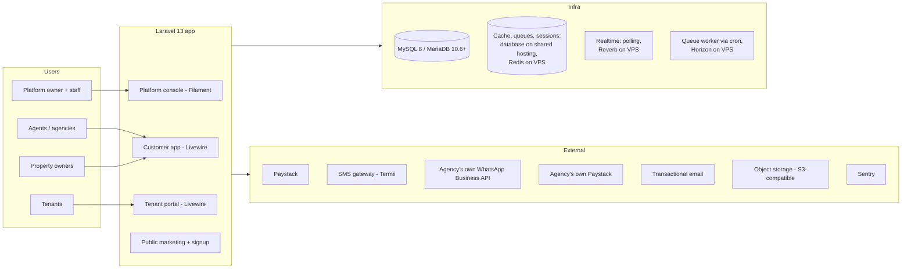

# GoProperty — Architecture

Companion documents: [IMPLEMENTATION_PLAN.md](IMPLEMENTATION_PLAN.md) · [DATABASE_SCHEMA.md](DATABASE_SCHEMA.md) · [BILLING_PAYMENTS.md](BILLING_PAYMENTS.md) · [ONBOARDING_COMPLIANCE.md](ONBOARDING_COMPLIANCE.md) · [PLATFORM_CONSOLE.md](PLATFORM_CONSOLE.md) · [UX_DESIGN.md](UX_DESIGN.md) · [BRANDING_DOCUMENTS.md](BRANDING_DOCUMENTS.md) · [DATA_IMPORT.md](DATA_IMPORT.md) · [AGENT.md](AGENT.md)

## 1. System Context

GoProperty is a single Laravel application serving four distinct audiences through separate route/panel areas, backed by one shared database and queue workers. It must run on **shared hosting** (Profile A) and scale up to a VPS (Profile B) by configuration only — see § 12.

## 2. Tech Stack

| Concern | Choice | Notes |
| --- | --- | --- |
| Framework | Laravel 13, PHP 8.4+ | Strict types everywhere; enums for all statuses |
| Frontend (customer + tenant) | Livewire 4 (built-in single-file components; no separate Volt package), Tailwind CSS 4, Alpine.js | Server-rendered, low-bandwidth friendly, natural AJAX story |
| Frontend (platform console) | Filament 5 (Livewire 4 based) | Admin tables, charts, actions out of the box. Pin exact minor versions in Phase 0 |
| Database | MySQL 8 or MariaDB 10.6+ | InnoDB, `utf8mb4`; money stored as integer kobo. CI runs the test suite on both, because cPanel/Plesk hosts often provide MariaDB |
| Theming | Platform theme from settings → CSS variables consumed by Tailwind 4 and Filament | No asset rebuild to change colours/logos ([PLATFORM_CONSOLE.md § 9](PLATFORM_CONSOLE.md)) |
| Cache / queues / sessions | Shared hosting: `database` drivers, queue worker started by cron. VPS: Redis + Horizon | Separate queues: `default`, `notifications`, `billing`, `pdf`, `imports` |
| Realtime | Shared hosting: Livewire polling. VPS: Laravel Reverb + polling fallback | Building Group posts, comments, reactions |
| Auth | Laravel starter kit (session). `web` guard + `users` table for all customers (agency staff, owners, tenants); separate `staff` guard + `platform_staff` table for GoProperty staff. 2FA (TOTP + recovery codes) mandatory for staff, required for Tier 2/3 org-owners; passkeys (WebAuthn, Fortify passkeys) for everyone | Tenants are users too — no separate tenant auth system. Sign-in is email **or phone number** + password, or a passkey. No SMS codes anywhere in signup, sign-in, invitations or resets (cost) |
| Roles | spatie/laravel-permission with teams support | Roles are scoped per organization (team = organization) |
| Media | spatie/laravel-medialibrary | Payment proofs, post images, avatars → S3-compatible storage |
| Audit | spatie/laravel-activitylog | Every mutation on billing, leases, tickets, subscriptions |
| PDF | Driver-based (`App\Pdf\PdfRenderer`, `PDF_DRIVER`): `dompdf` (pure PHP, shared hosting) or headless Chrome through a Gotenberg service over HTTP (VPS; no Node or `proc_open` on the PHP server) | Same table-based Blade templates for both; see [BRANDING_DOCUMENTS.md § 5](BRANDING_DOCUMENTS.md) |
| Spreadsheets | OpenSpout / spatie/simple-excel (streaming) | Low-memory import/export ([DATA_IMPORT.md](DATA_IMPORT.md)) |
| WhatsApp | Meta WhatsApp Cloud API, **agency's own account** (optional) | Templates fetched from the agency's account (§ 6.7) |
| SMS | Termii (or Africa's Talking) | Nigerian routes, DND-aware |
| Email | Mailgun / Postmark / SES | Suppression list handling required |
| Monitoring | Laravel Pulse, Telescope (non-prod), Sentry | Queue depth, slow queries, webhook health |
| Backups | spatie/laravel-backup + managed DB snapshots | Nightly full + hourly binlog to object storage |
| Testing | Pest 4 (incl. browser testing), Larastan (level 6+), Laravel Pint, GitHub Actions | Feature tests for money paths are mandatory |
| Modules | nwidart/laravel-modules | See § 8 |

## 3. Application Surfaces

| Surface | Audience | Route root | Tech |
| --- | --- | --- | --- |
| Marketing + signup | Public | `goproperty.ng/` | Blade + Livewire (pricing, onboarding, org signup, accept invitations, receipt verification) |
| Customer app | Org users (agency staff, property owners managing their own buildings) | `goproperty.ng/o/{org-slug}` | Livewire dashboard |
| Tenant portal | Tenants (across all agencies they rent from) | `goproperty.ng/portal` | Livewire (my leases, bills, payments, tickets, Building Group) |
| Owner portal | Property owners invited by an agency (across agencies) | `goproperty.ng/owner` | Livewire, read-only statements |
| Platform console | Platform owner + staff | `goproperty.ng/{ADMIN_PATH}` (configurable secret path; can move to its own subdomain later) | Filament panel, `staff` guard, own session cookie, mandatory 2FA |

**Decision: one domain with path-based organization slugs and a configurable staff-console path; no subdomain per agency.** Full reasoning, login landing rules and the later white-label option are in [ONBOARDING_COMPLIANCE.md § 1](ONBOARDING_COMPLIANCE.md).

The `users` table holds every customer-side person. What a user can do is a function of (a) their role **within an organization**, (b) whether they are a tenant of any unit, and (c) whether they are an invited owner. GoProperty staff are **not** in `users`: they live in `platform_staff` with their own guard and can reach customer accounts only through audited impersonation ([PLATFORM_CONSOLE.md § 6](PLATFORM_CONSOLE.md)).

## 4. Multi-Tenancy Model

**Decision: single database, row-level tenancy.** Each `organizations` row (the agency or the property owner's business) is an isolated customer. All customer-domain tables carry `organization_id` and resolve their scope through a central `OrganizationContext`.

> **Naming:** in code, "tenant" always means a **renter** (`TenantProfile`). The multi-tenancy concept uses "organization" everywhere (`OrganizationContext`, `BelongsToOrganization`, `SetOrganizationContext`) to avoid confusing the two.

- `App\Tenancy\OrganizationContext` — scoped singleton (fresh for every request and queued job) holding the current organization; set by the `SetOrganizationContext` middleware (`App\Http\Middleware`, alias `organization`) from the `{organization}` slug in the URL after checking membership. Unknown slugs and non-members get the same 404, an old slug redirects (301) to the current one, and the middleware runs before route model binding so models bound from the URL are already scoped. Jobs and commands use `OrganizationContext::run($organization, fn () => …)`, which restores the previous context afterwards; `outside(fn () => …)` runs code with no organization (e.g. a staff permission check while impersonating). Users may belong to several orgs; the **organization switcher** in the app shell lists the organizations whose workspace the user may open (with their role in each), and choosing one (`POST /organizations/{slug}/switch`, 404 for non-members) opens it and stores it as `organization_user.is_default`. After signing in (password, 2FA or passkey), `App\Tenancy\WorkspaceLanding` sends the user to the page they asked for, else to their only workspace, else to the one they chose last, else to the organization picker (`/dashboard`).
- The tenant and owner portals are **cross-organization by nature**: they do not set a single organization context, and instead query through an explicit "records linked to my user" path (`tenant_profiles.user_id = me`, owner links) that is policy-checked per record.
- `App\Tenancy\BelongsToOrganization` trait — boots `OrganizationScope` (`where organization_id = current`) and auto-fills `organization_id` on create. **Fail closed:** querying or creating without a context throws `MissingOrganizationContext` instead of returning every organization's rows, and creating a row in, or moving one to, another organization throws `CrossOrganizationWrite`. Models opt in; nothing queries organization data without it.
- All unique indexes include `organization_id` (e.g. `unique(organization_id, unit_number, property_id)`).
- Cross-org reads (Platform console, aggregate analytics) bypass the scope explicitly through dedicated read models / raw queries in the `Platform` namespace — the only place allowed to do so, guarded by platform middleware. A Larastan rule (`tools/phpstan/Rules/OrganizationScopeBypassRule.php`) fails the build when code outside `App\Platform` or `Modules\Platform` removes `OrganizationScope`, or calls `withoutGlobalScopes()` on an organization-owned model.
- **Roles follow the context.** spatie/laravel-permission runs with teams (team = organization, column `organization_id`). Its team id comes from `App\Tenancy\OrganizationTeamResolver`, which reads `OrganizationContext` on every call and refuses `setPermissionsTeamId()`, so the team can never outlive a request or queued job or drift from the organization being worked in. `User` (`App\Tenancy\HasOrganizationRoles`) also forgets roles loaded for another organization, and refuses role grants outside an organization, to non-members, or of a role another organization defined.
- **Suspended organizations are read-only (one central rule).** While `organizations.status` is `suspended` (staff in the console, or the billing ladder, [BILLING_PAYMENTS.md § 2](BILLING_PAYMENTS.md)) or `cancelled`, members can still sign in, read and export, but every write is refused with a message saying so, from the next request (the status is read from the organization `SetOrganizationContext` loads each request; nothing caches it). `App\Tenancy\OrganizationWriteGuard` applies it in four places, so features are covered without their own check: (1) `SetOrganizationContext` refuses any non-GET request inside `/o/{organization}` (403); (2) `SetOrganizationContext` is Livewire persistent middleware, and a `Livewire\before('call')` hook refuses every component method call except paging, `$refresh`/`$set`, and methods marked `#[AllowedWhileSuspended]` (event listeners are judged by the method they run); (3) members lose every customer permission whose `OrganizationPermission::allowedWhileSuspended()` is false (`HasOrganizationRoles::hasPermissionTo`; kept: the `*.view` permissions, `organization.activity`, `organization.billing` so the subscription can be paid, and `payments.submit_proof`); (4) a `Gate::before` hook denies, for customers, every policy ability that is not a read (`view…`, `export…`, `download…`, `switchTo`) in a suspended organization (the one passed to the check, else the one in context). A non-GET action that only exports, or that the docs allow during suspension (paying the subscription), is marked `#[AllowedWhileSuspended]` on its controller or Livewire method; nothing else may be. Livewire `updated*` hooks must not write (they are not method calls); writes belong in methods that check a policy. `restricted` is not read-only: the features it limits (new leases, properties, units, online payments; [ONBOARDING_COMPLIANCE.md § 5.5](ONBOARDING_COMPLIANCE.md)) check it themselves. Staff permission checks are never affected, and jobs, commands and the billing ladder run as the system and are not blocked (a job acting for a user checks that user's permissions inside `OrganizationContext::run()`, so it is). **Tenant portal (P03):** it sets no organization context, so none of this applies there by itself; the portal must stay read-only for records of a suspended or cancelled organization (check `$record->organization->status->blocksWrites()` in the portal's policies, or run the action inside `OrganizationContext::run()` so the guard applies) **except** uploading a payment proof, which must keep working ([ONBOARDING_COMPLIANCE.md § 3](ONBOARDING_COMPLIANCE.md)).
- **Cross-tenant probes:** `tests/Feature/Tenancy/CrossTenantAccessTest.php` runs every organization-owned model listed in `Tests\Support\OrganizationScopedModels` through reads, writes, moves, URL binding and a missing context, and fails while any `BelongsToOrganization` model in `app/` or `Modules/` is missing from that list. New models are added there.
- Database-level defense: every tenant-domain controller/Livewire action resolves models through the trait's scope; policies re-check membership (`user Belongs To Organization` + role).
- **Escape hatch for the future:** if an enterprise customer demands physical isolation, the same code runs multi-database (connection switching in the tenancy layer) — but that is explicitly not an MVP concern.

## 5. Roles & Permissions Matrix

Platform side (spatie roles on the `staff` guard; default roles, custom roles and two-person rules in [PLATFORM_CONSOLE.md § 1](PLATFORM_CONSOLE.md)):

| Role | Capabilities (summary) |
| --- | --- |
| `super-admin` | Everything, including staff management and production restore approval |
| `operations-manager` | Customers, suspend/reactivate, grace extensions |
| `compliance-officer` | Transaction Tier reviews, compliance documents and flags |
| `finance-admin` | Plans, platform invoices, bank-transfer confirmation, refunds |
| `support-agent` | Customer lookup, read-only impersonation, resend emails/invoices |
| `technical-admin` | Operations dashboard, queues, webhooks, backups |
| `content-manager` | Email templates, marketing content |
| `analyst` | Analytics, read-only, no PII |

Staff roles are global: no organization on the role or on the assignment (`organization_id` null in the shared spatie tables); `App\Platform\Console\HasStaffRoles` reads and grants them outside any organization context. The permission catalogue is `App\Platform\Staff\StaffPermission` (one permission per console area and action; new features add permissions, never roles) and the default grants are `DefaultStaffRole`. A staff permission check (Gate, `can()`, policies) answers from the staff member's **active** roles, and only for an active account **with 2FA enrolled**: without 2FA a staff member holds no console permission at all. Grants, role edits, invitations and deactivations go through `App\Platform\Staff\StaffRoles` and `StaffLifecycle` (two-person rules, the super-admin floor, audit log); two-person requests through `App\Platform\Approvals\ApprovalService`, where later features register a handler for their action.

Customer side (per-organization roles, spatie teams on the `web` guard; the permission catalogue is `App\Enums\OrganizationPermission` and each role's grants are in `App\Enums\OrganizationRole`, seeded by `OrganizationRolesSeeder`):

| Role | Capabilities |
| --- | --- |
| `org-owner` | Full control of the organization: billing responsibility, staff, buildings, leases, tickets moderation, reports |
| `org-admin` | Day-to-day operations: buildings, units, leases, bills, payments confirmation, tickets (no billing responsibility / no deleting the org) |
| `agent` | Operational staff: manage assigned buildings, units, leases, confirm payments, handle tickets, moderate Building Groups |
| `property-owner` | Read-heavy: view own buildings/units/leases, financial reports for own properties, respond to tickets if no agent assigned |
| `tenant` | Portal only: own leases, bills, payments (upload proof), own tickets, Building Group membership for own buildings |

**Who opens the workspace (`/o/{slug}`).** Only members holding `workspace.access` there: `org-owner`, `org-admin` and `agent` (`OrganizationPolicy::view`, checked by `SetOrganizationContext`). A user whose only roles in an organization are `tenant` or `property-owner` gets the same 404 as a stranger, and the switcher and picker never list that organization: tenants use `/portal` and agency-invited property owners use `/owner` (§ 3, [ONBOARDING_COMPLIANCE.md § 2](ONBOARDING_COMPLIANCE.md)); owners who run their own buildings sign up as their own organization and are its `org-owner`. A member with no role at all is also refused (fail closed).

Rules encoded in policies, not controllers:

- Tenants may only ever see resources attached to their own leases/units.
- `agent` visibility can be narrowed by building assignment (`agent_building` pivot) — recommended for larger agencies.
- Payment confirmation is restricted to org roles; tenants confirm nothing — they only submit proof.
- Ticket visibility: tenant ↔ (assigned agent OR org-admin OR owner-if-no-agent). Threaded replies stay inside that envelope.

## 6. Key Subsystems

### 6.1 Organizations, invitations and billing responsibility

- Signup creates an `Organization` (type `agency`, `property_owner`, or `hybrid`) plus the founding `org-owner` user. An agency may be a company (CAC number captured, KYC-lite at MVP).
- Invitations: token link sent by email, by the agency's WhatsApp, or shared by the agency itself (copy link / QR); the invitee picks a password on acceptance. No SMS codes ([ONBOARDING_COMPLIANCE.md § 2](ONBOARDING_COMPLIANCE.md)). Two kinds:
  1. **User invite** — a person into an org with a role.
  2. **Org invite (billing transfer)** — a property owner invites an agency, or vice versa, and offers to hand over the platform subscription bill. The invitation has `kind = org_billing_transfer`; the receiving org-owner must **accept** — only then does `subscriptions.payer_organization_id` move and the new payer's Paystack mandate/bank instructions take over. Decline or expiry leaves billing unchanged. Full state machine in [BILLING_PAYMENTS.md § 7](BILLING_PAYMENTS.md).
- Property owners who sign up directly can be flagged `platform_covered` (the platform owner pays their subscription internally) — the "platform bills itself when the owner signs up" case.

### 6.2 Property hierarchy and allocations

`Organization → Property (building) → Unit (block/apartment)`. A building has one property owner (owner profile) and, when agency-managed, one managing agency (the org itself). Units carry status (`vacant`, `occupied`, `under_maintenance`, `unavailable`), base rent, and service charge defaults. An **allocation is a lease**: there is no allocation without a contract, so occupancy state derives from active leases (kept denormalized on `units.status` for fast lists, updated by lease lifecycle events).

Tenants may hold multiple active leases across buildings and orgs — every lease is scoped to one unit; the tenant profile is global.

### 6.3 Leasing engine

- `Lease` fields: unit, tenant profile, `billing_cycle` enum (`daily`, `weekly`, `monthly`, `quarterly`, `semi_annual`, `annual`, `biennial`), start/end dates, rent amount (kobo), deposit, due-day convention (e.g. "same day-of-period"), `auto_renew`, status (`draft` → `active` → `expired`/`terminated`/`renewed`), `renewal_of_lease_id`.
- Cycle arithmetic lives in one class: `App\Leasing\CycleCalculator` — single source of truth for period start/end and `next_due_date`. All invoice generation and reminders consume it; nothing re-implements interval math.
- Renewal: N days before `end_date` (default 60/30/7 reminders), the agent generates a renewal lease (new record referencing the old one, new price negotiable). Same-cycle early renewal keeps history intact; price changes are explicit, not implicit.
- Draft leases hold the unit in `reserved` state for X days (configurable, default 14).

### 6.4 Rent, utility billing and the payment confirmation loop

- **Rent bills** are generated by the scheduler from active leases: a job runs daily, finds leases whose `next_due_date` is within the invoice-lead window (default 7 days), and creates a `Bill (type=rent)` with line items, then advances `next_due_date`.
- **Utility billing**: org-defined utility types (security, water, electricity, waste…) each with default amount and cycle. Per-unit settings override defaults (e.g. prepaid electricity metered per reading — a `utility_readings` table supports metered utilities; flat utilities skip readings). Bills generate the same way rent bills do, with their own cycles independent of the lease cycle.
- **Payments — GoProperty never touches the money.** Tenants pay the organization directly through channels the organization owns ([ONBOARDING_COMPLIANCE.md § 4](ONBOARDING_COMPLIANCE.md)):
  - **Bank transfer** to the org's verified account, with the bill's unique `payment_reference` in the narration. Confirmed by **bank statement import + matching** (reference → high-confidence match; amount + name → suggested match; agent confirms) or, as fallback, by tenant **proof upload** reviewed by an agent.
  - **Org's own Paystack account** (optional): webhook to `/webhooks/paystack/{org-ulid}`, verified with that org's secret key and by server-side transaction fetch, then auto-confirmed. Bills above the org's online-payment cap show bank details only.
  - **Cash / POS** recorded by an agent; receipt sent straight to the tenant.
  One incoming payment can be allocated across several bills (`payment_allocations`); any excess becomes tenant credit. An `agent`/`org-admin` **confirms** or **rejects** (with reason) anything not auto-confirmed. On confirmation:
  1. bill status recomputes (`paid`, `partially_paid`, stays `overdue`);
  2. a numbered **receipt** is generated (PDF, through the PDF driver) and emailed/linked to the tenant;
  3. activity log entry + notification to tenant.
- Overdue handling: a daily job flags `overdue` bills and triggers the reminder ladder (§ 6.7). Late fees are a post-MVP module (see [IMPLEMENTATION_PLAN.md § 7](IMPLEMENTATION_PLAN.md)).

### 6.5 Documents (printouts)

All customer-facing documents carry the **agency's own brand** (name, logo, colours, letterhead, signature/stamp) and are available as a web page and a PDF. Branding settings, layouts and the designed invoice and receipt are specified in [BRANDING_DOCUMENTS.md](BRANDING_DOCUMENTS.md), with reference templates in `docs/design/templates/`:

| Document | Trigger | Contents |
| --- | --- | --- |
| Lease/rent contract | Lease activation (and re-print) | Parties, unit, cycle, schedule, deposit, signatures block |
| Rent invoice | Scheduler bill generation | Tenant, unit, period, amount, org bank details, due date |
| Payment receipt | Payment confirmation | Sequential number, payment details, issuer details |
| Utility bill | Scheduler / manual | Utility type, unit, period, amount |

Numbering: `{PREFIX}-{ORG}-{YYYY}-{seq}` per document type, allocated inside a DB transaction (atomic counter table, never `max(id)+1`).

### 6.6 Maintenance tickets

State machine: `draft → submitted → under_review → in_progress → resolved → closed`, with `reopened` allowed from `resolved`/`closed` (within a window). Raised by tenants (portal) or agents (on behalf). Each ticket has a threaded message board (tenant ↔ agent/owner), attachments, priority, category (plumbing, electrical, structural, cleaning, other) and assignment. `resolved` is set by the agent/owner; the tenant gets a "confirm resolution / reopen" affordance; `closed` ends the thread. Notifications fire on every transition.

### 6.7 Reminders & notifications

- One scheduled entry point (`php artisan reminders:dispatch`) computes due reminders for rent, utilities, lease renewals and overdue bills across all orgs, writes rows into `reminders`, and queues sends. Idempotency: unique key `(remindable, type, channel, due_offset_days)` prevents duplicates on rerun.
- Ladder defaults: rent due at T-30, T-14, T-7, T-3, T-1, T-0 and overdue at +1, +7, +14; lease renewal alerts to agent/owner at T-60, T-30, T-7; utility due at T-3, T-0.
- Channels: email (queued mailables, per-user preference toggles) and SMS (Termii) for tenants — SMS templates kept under 160 chars. SMS reminders are enabled for a tenant only once their phone is **verified** (they opened an invitation or reset link sent to that number by WhatsApp) or **confirmed by the agency** in person; no OTP codes are ever sent. The first SMS to a number names the agency, and repeated delivery failures flag the number on the tenant record. SMS usage counts against the plan's monthly credits ([BILLING_PAYMENTS.md § 1.2](BILLING_PAYMENTS.md)). GoProperty sends **no SMS for signup, sign-in, 2FA, invitations or password reset**.
- **WhatsApp (optional, Growth plan and above):** the agency connects **its own** WhatsApp Business Platform account (Meta Cloud API): WhatsApp Business Account ID, phone number ID, permanent access token and app secret, all stored encrypted and editable only by the org-owner.
  - GoProperty **fetches the agency's approved message templates** from Meta (`GET /{waba-id}/message_templates`), daily and on demand, and shows each with its variables and approval status.
  - The agency **maps** each GoProperty event (bill issued, rent reminder T-7/T-1, overdue, receipt issued, ticket update, renewal notice) to one of its templates, and each template variable to a GoProperty placeholder (`{{ tenant.first_name }}`, `{{ bill.amount }}`, `{{ pay_link }}`). A preview shows the final message.
  - Messages are sent through the Cloud API. Delivery/read statuses arrive at `/webhooks/whatsapp/{org-ulid}` (verify token + `X-Hub-Signature-256` check) and are logged in `notification_deliveries`.
  - If a template is paused/rejected by Meta or a send fails, that event falls back to SMS, then email. Each event's channel order is configurable (e.g. WhatsApp → SMS, email always).
  - Tenant opt-in to WhatsApp is recorded (Meta policy). Meta bills the agency directly; GoProperty does not resell WhatsApp messages.
  - Later: become a Meta Tech Provider and offer Embedded Signup so agencies connect with a few clicks instead of copying IDs.
- Every send lands in `notification_deliveries` (channel, status, provider ref, cost) — the platform console shows delivery health.

### 6.8 Building Group

Per-building discussion board (one group per property, auto-created):

- Posts: author, sanitized rich text (limited toolbar: bold, italic, lists, links), up to 4 images each, pinned flag, moderation status.
- Comments: one level of threading (reply-to), same sanitization, emoji reactions (fixed curated emoji set, one reaction per user per post/comment, toggle).
- Updates by Livewire polling every 20–30 s (works on shared hosting). On VPS hosting, Reverb broadcasts on `group.{id}` private channels (membership-checked) for instant updates, with polling kept as fallback.
- Moderation: agents/org-admins moderate (delete/hide, pin, mute member); tenants are members only. Images validated (type, size ≤ 2 MB, dimension caps) and thumbnailed via media library.

### 6.9 Platform console (Filament)

Hosted at `goproperty.ng/{ADMIN_PATH}` (configurable; can move to its own subdomain). Sections: Customers (orgs, users, subscriptions, impersonation), Compliance (Transaction Tier applications, documents, flag queue, editable tier limits), Billing (platform invoices, Paystack transactions, bank-transfer proof confirmations, refunds), Plans & Features (plan editor and prices, unit tiers, feature flags per plan, per-customer overrides), Staff (configurable roles and permissions), Platform theme, System Operations dashboard, System Analytics dashboard, Backups (DB and files separately; S3-compatible + Google Drive; verify/restore), Email templates, Audit logs, Access logs. Full specification: [PLATFORM_CONSOLE.md](PLATFORM_CONSOLE.md).

### 6.10 Feature enablement

Plans declare features via `plan_feature` (boolean + numeric limit, e.g. `tickets.limit = 500/org/mo`, `building_group = true`). `Feature::enabled('building_group', $organization)` consults plan → per-customer override (`organization_feature_overrides`) → default. UI hides entry points; policies deny the routes; both, always.

### 6.11 Transaction Tiers & compliance monitoring

Every organization has a Transaction Tier (1, 2 or 3) that caps its yearly collection volume and largest single payment. Tier 2 and 3 require CAC and SCUML documents (plus more for Tier 3), reviewed by a `compliance-officer`. A daily job compares rolling 12-month volume and the 12-month forecast from active leases against the tier, and raises flags (80%, 100%, single payment over limit, MLPPA cash thresholds, possible structuring, spikes, expiring documents). Over-limit organizations get an upgrade prompt, then a 30-day grace period, then feature restrictions — tenants' bills, payments and receipts are never blocked. Full rules: [ONBOARDING_COMPLIANCE.md § 5](ONBOARDING_COMPLIANCE.md).

### 6.12 Data import

Agencies import owners, properties, units, tenants, **ongoing leases ("paid until")**, opening balances, utility settings and payment history from Excel/CSV. Every import starts with a **dry run** that validates and previews without saving; commit runs as a queued job in dependency order; batches can be rolled back within 7 days if unused. Imported leases never back-bill and reminders only start from the commit date. Full rules: [DATA_IMPORT.md](DATA_IMPORT.md).

## 7. Background Jobs & Scheduler

Queues: `default` (webhooks, lifecycle events), `notifications` (email/SMS/WhatsApp), `billing` (invoice generation, metering), `pdf` (document rendering), `imports` (Excel imports). On VPS, Horizon supervises them; on shared hosting a cron-started worker processes them (§ 12). Failures alert Sentry + platform console.

| Schedule | Job |
| --- | --- |
| Daily 00:10 | `bill:generate` — rent + utility bill creation from leases/utility settings |
| Daily 00:25 | `reminders:dispatch` — reminder ladder computation + send |
| Daily 01:00 | `bills:flag-overdue` |
| Daily 02:00 | `leases:expire-and-flag` — end-date transitions, renewal nudges |
| On 1st of month 03:00 | `saas:meter-units` — unit count ledger per org + platform invoice generation (see [BILLING_PAYMENTS.md § 3](BILLING_PAYMENTS.md)) |
| Daily 03:30 | `compliance:evaluate-tiers` — rolling volume, forecast, flags, grace/restriction transitions |
| Daily 04:00 | `metrics:snapshot` — nightly platform analytics summary (`daily_platform_metrics`) |
| Nightly 01:30 | `backup:run --only-db` — encrypted DB dump to S3-compatible + Google Drive |
| Nightly 02:30 | `backup:run --only-files` — media/documents sync to backup storage |
| Monthly | `backup:verify` — restore latest DB dump to a temporary database and check integrity |
| Hourly | `saas:poll-paystack-pending` — reconciliation fallback for missed webhooks |

All jobs are queued, retryable (backoff), idempotent (unique locks), and log to the audit trail where they mutate money data.

## 8. Module System (expansion architecture)

Built on nwidart/laravel-modules — a modular monolith. Rules:

1. Every bounded feature is a module: `Modules\Leasing`, `Modules\Billing`, `Modules\Tickets`, `Modules\BuildingGroup`, `Modules\Reminders`, `Modules\SaasBilling`, `Modules\Platform`, … Core (`app/Core` or the main namespace) holds only tenancy, auth, users, organizations, shared money/document infrastructure.
2. A module owns its routes, migrations, models, policies, Livewire components, views, config, translations and tests. Nothing else may import a module's internals.
3. Modules communicate through **public interfaces and events** only (`Modules\Tickets\Contracts\TicketService`, `PaymentConfirmed` event, etc.). Cross-module queries join nothing across module tables directly.
4. A module may declare **capabilities** (`module.json`: provides/requires) and feature-flag gates; disabling a module for an org hides its UI and routes via middleware — data is retained, never deleted.
5. New expansion (e.g. late fees, owner payouts, e-signatures, WhatsApp bot, tenant online payments) ships as a new module — zero surgery on existing modules beyond registering events.

This keeps the codebase upgradeable across Laravel versions and lets paid add-ons be enabled per customer by the platform owner.

Generating a module: `php artisan module:make Billing`, then `composer dump-autoload` (module classes autoload through `wikimedia/composer-merge-plugin`) and `composer lint`. `config/modules.php` is trimmed for shared hosting: modules share the app's single Vite build, so no per-module `package.json`, `vite.config.js`, asset folders or API routes are generated. Module status lives in `modules_statuses.json` at the app root. A test keeps modules from importing each other's internals (anything outside `Contracts` and `Events`) once modules exist.

## 9. Storage & Media

- S3-compatible object storage (e.g. Cloudflare R2 / DO Spaces) for: payment proofs, bank statements, compliance documents (separate, stricter bucket), Building Group images, generated PDFs. Private buckets; access via short-lived signed URLs only.
- Backups go to a **different** provider/account than live media (S3-compatible) plus Google Drive as secondary — see [PLATFORM_CONSOLE.md § 4](PLATFORM_CONSOLE.md).
- Media library handles conversions (thumbnails, max-dimension variants) and integrity (checksums).
- Local disk only for runtime temp (PDF rendering scratch).

## 10. Security & Compliance

- NDPA 2023 + GAID 2025 (Nigeria Data Protection Act; replaced the NDPR in Sept 2025) posture: data protection officer, breach notification within 72 hours, consent capture at signup, data export + erasure request flows (platform console tooling), retention policy documented, PII encrypted at rest where sensitive (bank accounts, IDs) via Laravel cast encryption.
- All uploads validated (mime sniffing, size caps, no SVG), served only via signed URLs.
- Rate limiting on auth, proof uploads, group posts, SMS triggers (SMS abuse = real money); invitation and reset-link sends limited per tenant, per agency and per IP.
- Platform staff: separate guard, separate console path (or subdomain) with its own session cookie, optional IP allowlist, mandatory 2FA, 30-min idle timeout; all platform actions audited with staff identity; two-person approval for high-risk actions.
- Login pages: passkeys, rate limits + lockout, Cloudflare Turnstile after failures (or always, by setting), no account enumeration, breached-password check, new-device alerts; no custom code on auth pages ([UX_DESIGN.md § 3](UX_DESIGN.md), [PLATFORM_CONSOLE.md § 9.6](PLATFORM_CONSOLE.md)).
- Audit log is append-only with hash chaining; authentication/access log kept for customers and staff ([PLATFORM_CONSOLE.md § 7–8](PLATFORM_CONSOLE.md)).
- Agency Paystack secret keys: encrypted at rest, masked in UI, changeable only by org-owners, never accessible during impersonation.
- Compliance documents: encrypted, visible only to compliance roles, every view logged.
- Webhook endpoints: Paystack signature verification, raw-body logging to `webhook_log`, 2xx fast-ack then process on queue.
- Policies on every model action; Livewire components rely on the same policies (never on hidden UI).
- Passwords: bcrypt/argon2id defaults; session fixation protection; HTTPS enforced HSTS.

## 11. Observability & Operations

- **Pulse** (prod, sampled): request latency, slow queries, queue depth, outbound mail/SMS volume.
- **Sentry**: exceptions with org context tag; alerts to Slack/email.
- **Queues**: Horizon on VPS; on shared hosting the console's operations dashboard reads the `jobs`/`failed_jobs` tables. Failed `notifications` jobs replayed manually with a log check first.
- **Webhook health panel**: last received, gaps, replay tool (idempotent handlers make replay safe).
- **Backups**: database and files backed up as separate nightly jobs (`spatie/laravel-backup`, encrypted) to S3-compatible storage and Google Drive; managed MySQL PITR enabled; monthly automatic verify + quarterly manual restore drills on staging. Managed from the console ([PLATFORM_CONSOLE.md § 4](PLATFORM_CONSOLE.md)).
- **DR targets (initial)**: Profile A (shared hosting) RPO 24h (nightly dump; consider a second midday DB backup), RTO 8h. Profile B (VPS) RPO 1h (binlog / PITR), RTO 4h; documented restore runbook in `docs/runbooks/`.

## 12. Environments & Deployment

| Env | Purpose | Notes |
| --- | --- | --- |
| local | Dev | Docker (Laravel Sail) or Herd; seeded demo org/building data |
| staging | Pre-prod, restore drills, load tests | Paystack **test** keys, test SMS sender |
| production | Live | Profile A (shared hosting) or Profile B (VPS) — see below |

CI (GitHub Actions) on every PR: `pint --test`, `larastan`, `pest --parallel`, plus a build of the asset bundle. Deploys: merge to `main` → auto-deploy staging; tagged release → production (migrations run with `--force`, maintenance mode for schema-breaking releases). Cloudflare in front (Nigerian latency + WAF), on either profile.

### 12.1 Hosting profiles

The product owner may launch on shared hosting. The app is built so **every feature works on shared hosting**, and VPS-only components (Redis, Horizon, Reverb, headless Chrome) are switched on by configuration, not code changes.

**One switch:** `HOSTING_PROFILE=shared|vps` (`config/hosting.php`) sets the defaults for `QUEUE_CONNECTION`, `CACHE_STORE`, `SESSION_DRIVER`, `BROADCAST_CONNECTION`, `REALTIME_DRIVER`, `PDF_DRIVER` and `QUEUE_TICK_ENABLED`; each of those variables still overrides it. Code asks about capabilities (`App\Hosting\Realtime`, `App\Pdf\PdfRenderer`), never about the profile. `php artisan goproperty:hosting` shows the active drivers and heartbeats and fails when settings cannot work together (for example `REALTIME_DRIVER=reverb` without `BROADCAST_CONNECTION=reverb`); deploys run it before switching releases. The test suite and CI run on the shared profile.

| Concern | Profile A — Shared hosting | Profile B — VPS (Forge / Ploi / Laravel Cloud) |
| --- | --- | --- |
| Control panel | **cPanel or Plesk** (product owner's choice). Step-by-step setup and deploys: [docs/runbooks/shared-hosting.md](docs/runbooks/shared-hosting.md) | Forge / Ploi / Laravel Cloud |
| Minimum host requirements | PHP 8.4.1 or newer (web + CLI), MySQL 8 or MariaDB 10.6+, cron **every minute**, document root settable to `/public` (or the `split` package layout for `public_html`), free SSL, ≥ 2 GB RAM per account. SSH is helpful but not required; `proc_open`/`exec` optional (only `mysqldump` uses them; a pure-PHP dumper is the fallback). Composer/Node not needed on the server (release zip includes `vendor/` and built assets). Installed with the web or CLI installer ([INSTALLER.md](INSTALLER.md)) | Any small VPS (2 vCPU / 4 GB) + managed or local MySQL |
| Queues | `database` driver; cron runs `schedule:run` every minute, and an in-process tick (`App\Hosting\Queue\QueueTick`) drains the queue within a ~45 s budget (per-lane caps, overlap lock, heartbeat) — no `exec`/`proc_open` ([INSTALLER.md § 8](INSTALLER.md)) | Redis + Horizon, always-on workers (`QUEUE_TICK_ENABLED=false`) |
| Cache / sessions | `database` (or `file`) | Redis |
| Realtime | Livewire polling (every 15 s); `BROADCAST_CONNECTION=null` | Reverb WebSockets + 60 s polling fallback |
| PDF | `dompdf` | Headless Chrome via Gotenberg (`PDF_DRIVER=chrome`, `PDF_CHROME_URL`; dompdf still available) |
| Assets | Built in CI (Vite) and deployed as files — no Node on the server | Same, or built on server |
| Deploy | First install: release zip + installer ([INSTALLER.md](INSTALLER.md)). Updates: the `Deploy` workflow uploads the built release over SSH and runs `migrate --force` + cache rebuild ([docs/runbooks/shared-hosting.md § 3](docs/runbooks/shared-hosting.md)); without SSH, the zip upgrade runbook ([INSTALLER.md § 10](INSTALLER.md)) | Zero-downtime deploys |
| Backups | spatie/laravel-backup (needs `exec` for `mysqldump`) to S3-compatible + Google Drive; plus the host's own backups | Same + managed DB point-in-time recovery |
| Domains | Single domain, console on secret path | Optional `app.` / ops subdomains |

**Shared-hosting limits to design for:** CPU/memory caps and execution time limits (imports, PDFs and metering always run as small queued chunks), outbound email limits (always send through an API mail provider, never the host's mail), noisy neighbours (keep secrets encrypted; set the document root to `/public`).

**Move to Profile B when any of these happens:** ~50 paying customers or ~5,000 units; queue wait regularly over 5 minutes; Building Group needs instant updates; PDF batches are slow; the host warns about resource use. A small VPS often costs about the same as premium shared hosting, so moving early is reasonable.

## 13. Performance Notes

- Naira amounts as integers; all reporting SQL aggregates on indexed `organization_id` + date columns.
- Dashboard widgets: cached aggregates (5-min TTL) rather than live sums; report queries go to read-replica-ready connection config from day one.
- Building Group: broadcast + polling hybrid keeps low-end Android/2G tenants usable; images lazy-loaded, WebP variants.
- Unit lists paginated server-side; Livewire wire:model.debounce on searches; no N+1 (Larastan + strict `with()` discipline).
