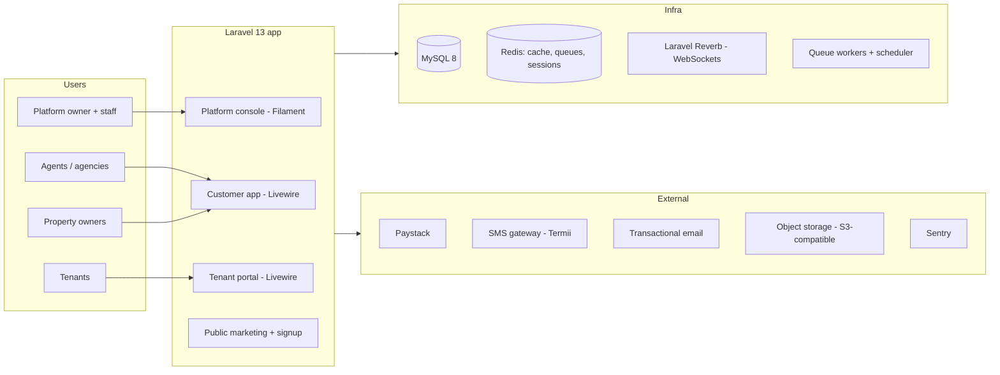

# GoProperty — Architecture

Companion documents: [IMPLEMENTATION_PLAN.md](IMPLEMENTATION_PLAN.md) · [DATABASE_SCHEMA.md](DATABASE_SCHEMA.md) · [BILLING_PAYMENTS.md](BILLING_PAYMENTS.md) · [ONBOARDING_COMPLIANCE.md](ONBOARDING_COMPLIANCE.md) · [PLATFORM_CONSOLE.md](PLATFORM_CONSOLE.md) · [UX_DESIGN.md](UX_DESIGN.md) · [AGENT.md](AGENT.md)

## 1. System Context

GoProperty is a single Laravel application serving four distinct audiences through separate route/panel areas, backed by one shared database, Redis, and a queue worker fleet.

## 2. Tech Stack

| Concern | Choice | Notes |
| --- | --- | --- |
| Framework | Laravel 13, PHP 8.4+ | Strict types everywhere; enums for all statuses |
| Frontend (customer + tenant) | Livewire 3 + Volt, Tailwind CSS, Alpine.js | Server-rendered, low-bandwidth friendly, natural AJAX story |
| Frontend (platform console) | Filament 4 | Admin tables, charts, actions out of the box |
| Database | MySQL 8 | InnoDB, `utf8mb4`; money stored as integer kobo |
| Cache / queues / sessions | Redis + Horizon | Separate queues: `default`, `notifications`, `billing`, `pdf` |
| Realtime | Laravel Reverb | Building Group posts, comments, reactions; polling fallback |
| Auth | Laravel starter kit (session). `web` guard + `users` table for all customers (agency staff, owners, tenants); separate `staff` guard + `platform_staff` table for GoProperty staff. 2FA mandatory for staff, required for Tier 2/3 org-owners | Tenants are users too — no separate tenant auth system. Tenants can log in with phone + OTP |
| Roles | spatie/laravel-permission with teams support | Roles are scoped per organization (team = organization) |
| Media | spatie/laravel-medialibrary | Payment proofs, post images, avatars → S3-compatible storage |
| Audit | spatie/laravel-activitylog | Every mutation on billing, leases, tickets, subscriptions |
| PDF | Browsershot (headless Chrome) with Blade templates | Branded contracts, invoices, receipts, utility bills |
| SMS | Termii (or Africa's Talking) | Nigerian routes, DND-aware |
| Email | Mailgun / Postmark / SES | Suppression list handling required |
| Monitoring | Laravel Pulse, Telescope (non-prod), Sentry | Queue depth, slow queries, webhook health |
| Backups | spatie/laravel-backup + managed DB snapshots | Nightly full + hourly binlog to object storage |
| Testing | Pest, Larastan (level 6+), Laravel Pint, GitHub Actions | Feature tests for money paths are mandatory |
| Modules | nwidart/laravel-modules | See § 8 |

## 3. Application Surfaces

| Surface | Audience | Route root | Tech |
| --- | --- | --- | --- |
| Marketing + signup | Public | `goproperty.ng/` | Blade + Livewire (pricing, onboarding, org signup, accept invitations, receipt verification) |
| Customer app | Org users (agency staff, property owners managing their own buildings) | `app.goproperty.ng/o/{org-slug}` | Livewire dashboard |
| Tenant portal | Tenants (across all agencies they rent from) | `app.goproperty.ng/portal` | Livewire (my leases, bills, payments, tickets, Building Group) |
| Owner portal | Property owners invited by an agency (across agencies) | `app.goproperty.ng/owner` | Livewire, read-only statements |
| Platform console | Platform owner + staff | `admin.goproperty.ng` | Filament panel, `staff` guard, own session cookie, mandatory 2FA |

**Decision: one login domain with path-based organization slugs, no subdomain per agency.** Full reasoning, login landing rules and the later white-label option are in [ONBOARDING_COMPLIANCE.md § 1](ONBOARDING_COMPLIANCE.md).

The `users` table holds every customer-side person. What a user can do is a function of (a) their role **within an organization**, (b) whether they are a tenant of any unit, and (c) whether they are an invited owner. GoProperty staff are **not** in `users`: they live in `platform_staff` with their own guard and can reach customer accounts only through audited impersonation ([PLATFORM_CONSOLE.md § 6](PLATFORM_CONSOLE.md)).

## 4. Multi-Tenancy Model

**Decision: single database, row-level tenancy.** One `organizations` row is a tenant (the agency or the property owner's business). All customer-domain tables carry `organization_id` and resolve their scope through a central `TenantContext`.

- `App\Tenancy\TenantContext` — singleton holding the current organization; set by `SetTenantContext` middleware from the `{org-slug}` in the URL after checking membership (non-members get 404). Users may belong to several orgs; a switcher exists in the app shell.
- The tenant and owner portals are **cross-organization by nature**: they do not set a single organization context, and instead query through an explicit "records linked to my user" path (`tenant_profiles.user_id = me`, owner links) that is policy-checked per record.
- `App\Tenancy\BelongsToTenant` trait — boots a global scope (`where organization_id = current`) and auto-fills `organization_id` on create. Models opt in; nothing queries tenant data without it.
- All unique indexes include `organization_id` (e.g. `unique(organization_id, unit_number, property_id)`).
- Cross-org reads (Platform console, aggregate analytics) bypass the scope explicitly through dedicated read models / raw queries in the `Platform` namespace — the only place allowed to do so, guarded by platform middleware.
- Database-level defense: every tenant-domain controller/Livewire action resolves models through the trait's scope; policies re-check membership (`user Belongs To Organization` + role).
- **Escape hatch for the future:** if an enterprise customer demands physical isolation, the same code runs multi-database (connection switching in the tenancy layer) — but that is explicitly not an MVP concern.

## 5. Roles & Permissions Matrix

Platform side (spatie roles on the `staff` guard; full matrix, designations and two-person rules in [PLATFORM_CONSOLE.md § 1](PLATFORM_CONSOLE.md)):

| Role | Capabilities (summary) |
| --- | --- |
| `super-admin` | Everything, including staff management and production restore approval |
| `operations-manager` | Customers, suspend/reactivate, grace extensions |
| `compliance-officer` | Transaction Tier reviews, compliance documents and flags |
| `finance-admin` | Plans, platform invoices, bank-transfer confirmation, refunds |
| `support-agent` | Customer lookup, read-only impersonation, resend emails/invoices |
| `technical-admin` | Operations dashboard, queues, webhooks, backups |
| `content-manager` | Email templates, marketing content |
| `analyst` | Analytics, read-only, no PII |

Customer side (per-organization roles):

| Role | Capabilities |
| --- | --- |
| `org-owner` | Full control of the organization: billing responsibility, staff, buildings, leases, tickets moderation, reports |
| `org-admin` | Day-to-day operations: buildings, units, leases, bills, payments confirmation, tickets (no billing responsibility / no deleting the org) |
| `agent` | Operational staff: manage assigned buildings, units, leases, confirm payments, handle tickets, moderate Building Groups |
| `property-owner` | Read-heavy: view own buildings/units/leases, financial reports for own properties, respond to tickets if no agent assigned |
| `tenant` | Portal only: own leases, bills, payments (upload proof), own tickets, Building Group membership for own buildings |

Rules encoded in policies, not controllers:

- Tenants may only ever see resources attached to their own leases/units.
- `agent` visibility can be narrowed by building assignment (`agent_building` pivot) — recommended for larger agencies.
- Payment confirmation is restricted to org roles; tenants confirm nothing — they only submit proof.
- Ticket visibility: tenant ↔ (assigned agent OR org-admin OR owner-if-no-agent). Threaded replies stay inside that envelope.

## 6. Key Subsystems

### 6.1 Organizations, invitations and billing responsibility

- Signup creates an `Organization` (type `agency`, `property_owner`, or `hybrid`) plus the founding `org-owner` user. An agency may be a company (CAC number captured, KYC-lite at MVP).
- Invitations: email + token link; the invitee picks a password on acceptance. Two kinds:
  1. **User invite** — a person into an org with a role.
  2. **Org invite (billing transfer)** — a property owner invites an agency, or vice versa, and offers to hand over the platform subscription bill. The invitation has `kind = org_billing_transfer`; the receiving org-owner must **accept** — only then does `subscriptions.payer_organization_id` move and the new payer's Paystack mandate/bank instructions take over. Decline or expiry leaves billing unchanged. Full state machine in [BILLING_PAYMENTS.md § 7](BILLING_PAYMENTS.md).
- Property owners who sign up directly can be flagged `platform_covered` (the platform owner pays their subscription internally) — the "platform bills itself when the owner signs up" case.

### 6.2 Property hierarchy and allocations

`Organization → Property (building) → Unit (block/apartment)`. A building has one property owner (owner profile) and, when agency-managed, one managing agency (the org itself). Units carry status (`vacant`, `occupied`, `under_maintenance`, `unavailable`), base rent, and service charge defaults. An **allocation is a lease**: there is no allocation without a contract, so occupancy state derives from active leases (kept denormalized on `units.status` for fast lists, updated by lease lifecycle events).

Tenants may hold multiple active leases across buildings and orgs — every lease is scoped to one unit; the tenant profile is global.

### 6.3 Leasing engine

- `Lease` fields: unit, tenant profile, `billing_cycle` enum (`daily`, `weekly`, `monthly`, `quarterly`, `semi_annual`, `annual`, `biennial`), start/end dates, rent amount (kobo), deposit, due-day convention (e.g. "same day-of-period"), `auto_renew`, status (`draft` → `active` → `expired`/`terminated`/`renewed`), `renewal_of_lease_id`.
- Cycle arithmetic lives in one class: `App\Leasing\CycleCalculator` — single source of truth for period start/end and `next_due_date`. All invoice generation and reminders consume it; nothing re-implements interval math.
- Renewal: N days before `end_date` (default 60/30/7 reminders), the agent generates a renewal lease (new record referencing the old one, new price negotiable). Same-cycle early renewal keeps history intact; price changes are explicit, not implicit.
- Draft leases hold the unit in `reserved` state for X days (configurable, default 14).

### 6.4 Rent, utility billing and the payment confirmation loop

- **Rent bills** are generated by the scheduler from active leases: a job runs daily, finds leases whose `next_due_date` is within the invoice-lead window (default 7 days), and creates a `Bill (type=rent)` with line items, then advances `next_due_date`.
- **Utility billing**: org-defined utility types (security, water, electricity, waste…) each with default amount and cycle. Per-unit settings override defaults (e.g. prepaid electricity metered per reading — a `utility_readings` table supports metered utilities; flat utilities skip readings). Bills generate the same way rent bills do, with their own cycles independent of the lease cycle.
- **Payments — GoProperty never touches the money.** Tenants pay the organization directly through channels the organization owns ([ONBOARDING_COMPLIANCE.md § 4](ONBOARDING_COMPLIANCE.md)):
  - **Bank transfer** to the org's verified account, with the bill's unique `payment_reference` in the narration. Confirmed by **bank statement import + matching** (reference → high-confidence match; amount + name → suggested match; agent confirms) or, as fallback, by tenant **proof upload** reviewed by an agent.
  - **Org's own Paystack account** (optional): webhook to `/webhooks/paystack/{org-ulid}`, verified with that org's secret key and by server-side transaction fetch, then auto-confirmed. Bills above the org's online-payment cap show bank details only.
  - **Cash / POS** recorded by an agent; receipt sent straight to the tenant.
  One incoming payment can be allocated across several bills (`payment_allocations`); any excess becomes tenant credit. An `agent`/`org-admin` **confirms** or **rejects** (with reason) anything not auto-confirmed. On confirmation:
  1. bill status recomputes (`paid`, `partially_paid`, stays `overdue`);
  2. a numbered **receipt** is generated (PDF, Browsershot) and emailed/linked to the tenant;
  3. activity log entry + notification to tenant.
- Overdue handling: a daily job flags `overdue` bills and triggers the reminder ladder (§ 6.7). Late fees are a post-MVP module (see [IMPLEMENTATION_PLAN.md § 7](IMPLEMENTATION_PLAN.md)).

### 6.5 Documents (printouts)

All customer-facing documents are server-generated PDFs from branded Blade templates (org logo, colors, bank account details on invoices):

| Document | Trigger | Contents |
| --- | --- | --- |
| Lease/rent contract | Lease activation (and re-print) | Parties, unit, cycle, schedule, deposit, signatures block |
| Rent invoice | Scheduler bill generation | Tenant, unit, period, amount, org bank details, due date |
| Payment receipt | Payment confirmation | Sequential number, payment details, issuer details |
| Utility bill | Scheduler / manual | Utility type, unit, period, amount |

Numbering: `{PREFIX}-{ORG}-{YYYY}-{seq}` per document type, allocated inside a DB transaction (atomic counter table, never `max(id)+1`).

### 6.6 Maintenance tickets

State machine: `draft → submitted → under_review → in_progress → resolved → closed`, with `reopened` allowed from `resolved`/`closed` (within a window). Raised by tenants (portal) or agents (on behalf). Each ticket has a threaded message board (tenant ↔ agent/owner), attachments, priority, category (plumbing, electrical, structural, cleaning, other) and assignment. `resolved` is set by the agent/owner; the tenant gets a "confirm resolution / reopen" affordance; `closed` ends the thread. Notifications fire on every transition.

### 6.7 Reminders & notifications

- One scheduled entry point (`php artisan reminders:dispatch`) computes due reminders for rent, utilities, lease renewals and overdue bills across all orgs, writes rows into `reminders`, and queues sends. Idempotency: unique key `(remindable, type, channel, due_offset_days)` prevents duplicates on rerun.
- Ladder defaults: rent due at T-30, T-14, T-7, T-3, T-1, T-0 and overdue at +1, +7, +14; lease renewal alerts to agent/owner at T-60, T-30, T-7; utility due at T-3, T-0.
- Channels: email (queued mailables, per-user preference toggles) and SMS (Termii) for tenants — SMS templates kept under 160 chars, tenant phone verification via OTP before SMS is enabled for that tenant.
- Every send lands in `notification_deliveries` (channel, status, provider ref, cost) — the platform console shows delivery health.

### 6.8 Building Group

Per-building discussion board (one group per property, auto-created):

- Posts: author, sanitized rich text (limited toolbar: bold, italic, lists, links), up to 4 images each, pinned flag, moderation status.
- Comments: one level of threading (reply-to), same sanitization, emoji reactions (fixed curated emoji set, one reaction per user per post/comment, toggle).
- Realtime via Reverb broadcast on `group.{id}` private channel (membership-checked); Livewire components also poll every 30s as a low-bandwidth fallback and for offline catches.
- Moderation: agents/org-admins moderate (delete/hide, pin, mute member); tenants are members only. Images validated (type, size ≤ 2 MB, dimension caps) and thumbnailed via media library.

### 6.9 Platform console (Filament)

Hosted at `admin.goproperty.ng`. Sections: Customers (orgs, users, subscriptions, impersonation), Compliance (Transaction Tier applications, documents, flag queue), Billing (platform invoices, Paystack transactions, bank-transfer proof confirmations, refunds), Plans & Features (plan editor, unit tiers, feature flags per plan, per-customer overrides), Staff (roles, designations, departments), System Operations dashboard, System Analytics dashboard, Backups (DB and files separately; S3-compatible + Google Drive; verify/restore), Email templates, Audit logs, Access logs. Full specification: [PLATFORM_CONSOLE.md](PLATFORM_CONSOLE.md).

### 6.10 Feature enablement

Plans declare features via `plan_feature` (boolean + numeric limit, e.g. `tickets.limit = 500/org/mo`, `building_group = true`). `Feature::enabled('building_group', $organization)` consults plan → per-customer override (`organization_feature_overrides`) → default. UI hides entry points; policies deny the routes; both, always.

### 6.11 Transaction Tiers & compliance monitoring

Every organization has a Transaction Tier (1, 2 or 3) that caps its yearly collection volume and largest single payment. Tier 2 and 3 require CAC and SCUML documents (plus more for Tier 3), reviewed by a `compliance-officer`. A daily job compares rolling 12-month volume and the 12-month forecast from active leases against the tier, and raises flags (80%, 100%, single payment over limit, MLPPA cash thresholds, possible structuring, spikes, expiring documents). Over-limit organizations get an upgrade prompt, then a 30-day grace period, then feature restrictions — tenants' bills, payments and receipts are never blocked. Full rules: [ONBOARDING_COMPLIANCE.md § 5](ONBOARDING_COMPLIANCE.md).

## 7. Background Jobs & Scheduler

Queues: `default` (webhooks, lifecycle events), `notifications` (email/SMS), `billing` (invoice generation, metering), `pdf` (document rendering). Horizon supervises all four; failures alert Sentry + platform console.

| Schedule | Job |
| --- | --- |
| Daily 00:10 | `bill:generate` — rent + utility bill creation from leases/utility settings |
| Daily 00:25 | `reminders:dispatch` — reminder ladder computation + send |
| Daily 01:00 | `bills:flag-overdue` |
| Daily 02:00 | `leases:expire-and-flag` — end-date transitions, renewal nudges |
| On 1st of month 03:00 | `saas:meter-units` — unit count ledger per org + platform invoice generation (see [BILLING_PAYMENTS.md § 3](BILLING_PAYMENTS.md)) |
| Daily 03:30 | `compliance:evaluate-tiers` — rolling volume, forecast, flags, grace/restriction transitions |
| Daily 04:00 | `metrics:snapshot` — nightly platform analytics summary (`daily_platform_metrics`) |
| Nightly 01:30 | `backup:run --only-db` — encrypted DB dump to S3-compatible + Google Drive |
| Nightly 02:30 | `backup:run --only-files` — media/documents sync to backup storage |
| Monthly | `backup:verify` — restore latest DB dump to a temporary database and check integrity |
| Hourly | `saas:poll-paystack-pending` — reconciliation fallback for missed webhooks |

All jobs are queued, retryable (backoff), idempotent (unique locks), and log to the audit trail where they mutate money data.

## 8. Module System (expansion architecture)

Built on nwidart/laravel-modules — a modular monolith. Rules:

1. Every bounded feature is a module: `Modules\Leasing`, `Modules\Billing`, `Modules\Tickets`, `Modules\BuildingGroup`, `Modules\Reminders`, `Modules\SaasBilling`, `Modules\Platform`, … Core (`app/Core` or the main namespace) holds only tenancy, auth, users, organizations, shared money/document infrastructure.
2. A module owns its routes, migrations, models, policies, Livewire components, views, config, translations and tests. Nothing else may import a module's internals.
3. Modules communicate through **public interfaces and events** only (`Modules\Tickets\Contracts\TicketService`, `PaymentConfirmed` event, etc.). Cross-module queries join nothing across module tables directly.
4. A module may declare **capabilities** (`module.json`: provides/requires) and feature-flag gates; disabling a module for an org hides its UI and routes via middleware — data is retained, never deleted.
5. New expansion (e.g. late fees, owner payouts, e-signatures, WhatsApp bot, tenant online payments) ships as a new module — zero surgery on existing modules beyond registering events.

This keeps the codebase upgradeable across Laravel versions and lets paid add-ons be enabled per customer by the platform owner.

## 9. Storage & Media

- S3-compatible object storage (e.g. Cloudflare R2 / DO Spaces) for: payment proofs, bank statements, compliance documents (separate, stricter bucket), Building Group images, generated PDFs. Private buckets; access via short-lived signed URLs only.
- Backups go to a **different** provider/account than live media (S3-compatible) plus Google Drive as secondary — see [PLATFORM_CONSOLE.md § 4](PLATFORM_CONSOLE.md).
- Media library handles conversions (thumbnails, max-dimension variants) and integrity (checksums).
- Local disk only for runtime temp (PDF rendering scratch).

## 10. Security & Compliance

- NDPA 2023 + GAID 2025 (Nigeria Data Protection Act; replaced the NDPR in Sept 2025) posture: data protection officer, breach notification within 72 hours, consent capture at signup, data export + erasure request flows (platform console tooling), retention policy documented, PII encrypted at rest where sensitive (bank accounts, IDs) via Laravel cast encryption.
- All uploads validated (mime sniffing, size caps, no SVG), served only via signed URLs.
- Rate limiting on auth, proof uploads, group posts, SMS triggers (SMS abuse = real money); OTP attempt limits.
- Platform staff: separate guard, separate subdomain and cookie, mandatory 2FA, 30-min idle timeout; all platform actions audited with staff identity; two-person approval for high-risk actions.
- Login pages: rate limits + lockout, Cloudflare Turnstile after failures, no account enumeration, breached-password check, new-device alerts ([UX_DESIGN.md § 3](UX_DESIGN.md)).
- Audit log is append-only with hash chaining; authentication/access log kept for customers and staff ([PLATFORM_CONSOLE.md § 7–8](PLATFORM_CONSOLE.md)).
- Agency Paystack secret keys: encrypted at rest, masked in UI, changeable only by org-owners, never accessible during impersonation.
- Compliance documents: encrypted, visible only to compliance roles, every view logged.
- Webhook endpoints: Paystack signature verification, raw-body logging to `webhook_log`, 2xx fast-ack then process on queue.
- Policies on every model action; Livewire components rely on the same policies (never on hidden UI).
- Passwords: bcrypt/argon2id defaults; session fixation protection; HTTPS enforced HSTS.

## 11. Observability & Operations

- **Pulse** (prod, sampled): request latency, slow queries, queue depth, outbound mail/SMS volume.
- **Sentry**: exceptions with org context tag; alerts to Slack/email.
- **Horizon**: queue throughput + failed-job triage; failed `notifications` jobs replayed manually with a log check first.
- **Webhook health panel**: last received, gaps, replay tool (idempotent handlers make replay safe).
- **Backups**: database and files backed up as separate nightly jobs (`spatie/laravel-backup`, encrypted) to S3-compatible storage and Google Drive; managed MySQL PITR enabled; monthly automatic verify + quarterly manual restore drills on staging. Managed from the console ([PLATFORM_CONSOLE.md § 4](PLATFORM_CONSOLE.md)).
- **DR targets (initial)**: RPO 1h (binlog), RTO 4h; documented restore runbook in `docs/runbooks/`.

## 12. Environments & Deployment

| Env | Purpose | Notes |
| --- | --- | --- |
| local | Dev | Docker (Laravel Sail) or Herd; seeded demo org/building data |
| staging | Pre-prod, restore drills, load tests | Paystack **test** keys, test SMS sender |
| production | Live | Forge or Ploi provisioned VPS + managed MySQL + Redis; zero-downtime deploy |

CI (GitHub Actions) on every PR: `pint --test`, `larastan`, `pest --parallel`, plus a build of the asset bundle. Deploys: merge to `main` → auto-deploy staging; tagged release → production (migrations run with `--force`, maintenance mode for schema-breaking releases). Cloudflare in front (Nigerian latency + WAF).

## 13. Performance Notes

- Naira amounts as integers; all reporting SQL aggregates on indexed `organization_id` + date columns.
- Dashboard widgets: cached aggregates (5-min TTL) rather than live sums; report queries go to read-replica-ready connection config from day one.
- Building Group: broadcast + polling hybrid keeps low-end Android/2G tenants usable; images lazy-loaded, WebP variants.
- Unit lists paginated server-side; Livewire wire:model.debounce on searches; no N+1 (Larastan + strict `with()` discipline).
