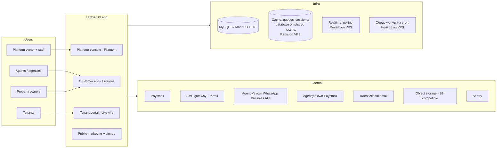

# GoProperty — Architecture

Companion documents: [IMPLEMENTATION_PLAN.md](IMPLEMENTATION_PLAN.md) · [DATABASE_SCHEMA.md](DATABASE_SCHEMA.md) · [BILLING_PAYMENTS.md](BILLING_PAYMENTS.md) · [ONBOARDING_COMPLIANCE.md](ONBOARDING_COMPLIANCE.md) · [PLATFORM_CONSOLE.md](PLATFORM_CONSOLE.md) · [UX_DESIGN.md](UX_DESIGN.md) · [BRANDING_DOCUMENTS.md](BRANDING_DOCUMENTS.md) · [DATA_IMPORT.md](DATA_IMPORT.md) · [AGENT.md](AGENT.md)

## 1. System Context

GoProperty is a single Laravel application serving four distinct audiences through separate route/panel areas, backed by one shared database and queue workers. It must run on **shared hosting** (Profile A) and scale up to a VPS (Profile B) by configuration only — see § 12.

## 2. Tech Stack

| Concern | Choice | Notes |
| --- | --- | --- |
| Framework | Laravel 13, PHP 8.4+ | Strict types everywhere; enums for all statuses |
| Frontend (customer + tenant) | Livewire 4 (built-in single-file components; no separate Volt package), Tailwind CSS 4, Alpine.js | Server-rendered, low-bandwidth friendly, natural AJAX story |
| Frontend (platform console) | Filament 5 (Livewire 4 based) | Admin tables, charts, actions out of the box. Pin exact minor versions in Phase 0 |
| Database | MySQL 8 or MariaDB 10.6+ | InnoDB, `utf8mb4`; money stored as integer kobo. CI runs the test suite on both, because cPanel/Plesk hosts often provide MariaDB |
| Theming | Platform theme from settings → CSS variables consumed by Tailwind 4 and Filament | No asset rebuild to change colours/logos ([PLATFORM_CONSOLE.md § 9](PLATFORM_CONSOLE.md)) |
| Cache / queues / sessions | Shared hosting: `database` drivers, queue worker started by cron. VPS: Redis + Horizon | Separate queues: `default`, `notifications`, `billing`, `pdf`, `media`, `imports` |
| Realtime | Shared hosting: Livewire polling. VPS: Laravel Reverb + polling fallback | Building Group posts, comments, reactions |
| Auth | Laravel starter kit (session). `web` guard + `users` table for all customers (agency staff, owners, tenants); separate `staff` guard + `platform_staff` table for GoProperty staff. 2FA (TOTP + recovery codes) mandatory for staff, required for Tier 2/3 org-owners; passkeys (WebAuthn, Fortify passkeys) for everyone | Tenants are users too — no separate tenant auth system. Sign-in is email **or phone number** + password, or a passkey. No SMS codes anywhere in signup, sign-in, invitations or resets (cost) |
| Roles | spatie/laravel-permission with teams support | Roles are scoped per organization (team = organization) |
| Media | spatie/laravel-medialibrary (`~11.23`, P02-05) | Payment proofs, post images, avatars, branding images → private S3-compatible storage, organization-scoped rows, signed links (§ 9) |
| Audit | spatie/laravel-activitylog | Every mutation on billing, leases, tickets, subscriptions |
| PDF | Driver-based (`App\Pdf\PdfRenderer`, `PDF_DRIVER`): `dompdf` (pure PHP, shared hosting) or headless Chrome through a Gotenberg service over HTTP (VPS; no Node or `proc_open` on the PHP server) | Same table-based Blade templates for both; see [BRANDING_DOCUMENTS.md § 5](BRANDING_DOCUMENTS.md) |
| Spreadsheets | OpenSpout / spatie/simple-excel (streaming) | Low-memory import/export ([DATA_IMPORT.md](DATA_IMPORT.md)) |
| WhatsApp | Meta WhatsApp Cloud API, **agency's own account** (optional) | Templates fetched from the agency's account (§ 6.7) |
| SMS | Termii (or Africa's Talking) | Nigerian routes, DND-aware |
| Email | Mailgun / Postmark / SES | Suppression list handling required |
| Monitoring | Laravel Pulse, Telescope (non-prod), Sentry | Queue depth, slow queries, webhook health |
| Backups | spatie/laravel-backup + managed DB snapshots | Nightly full + hourly binlog to object storage |
| Testing | Pest 4 (incl. browser testing), Larastan (level 6+), Laravel Pint, GitHub Actions | Feature tests for money paths are mandatory |
| Modules | nwidart/laravel-modules | See § 8 |

## 3. Application Surfaces

| Surface | Audience | Route root | Tech |
| --- | --- | --- | --- |
| Marketing + signup | Public | `goproperty.ng/` | Blade + Livewire (pricing, onboarding, org signup, accept invitations, receipt verification) |
| Customer app | Org users (agency staff, property owners managing their own buildings) | `goproperty.ng/o/{org-slug}` | Livewire dashboard |
| Tenant portal | Tenants (across all agencies they rent from) | `goproperty.ng/portal` | Livewire (my leases, bills, payments, tickets, Building Group) |
| Owner portal | Property owners invited by an agency, or who handed their buildings to an agency (across agencies; P03-15) | `goproperty.ng/owner` | Livewire, read-only statements |
| Platform console | Platform owner + staff | `goproperty.ng/{ADMIN_PATH}` (configurable secret path; can move to its own subdomain later) | Filament panel, `staff` guard, own session cookie, mandatory 2FA |

**Decision: one domain with path-based organization slugs and a configurable staff-console path; no subdomain per agency.** Full reasoning, login landing rules and the later white-label option are in [ONBOARDING_COMPLIANCE.md § 1](ONBOARDING_COMPLIANCE.md).

The `users` table holds every customer-side person. What a user can do is a function of (a) their role **within an organization**, (b) whether they are a tenant of any unit, and (c) whether they are an invited owner. GoProperty staff are **not** in `users`: they live in `platform_staff` with their own guard and can reach customer accounts only through audited impersonation ([PLATFORM_CONSOLE.md § 6](PLATFORM_CONSOLE.md)).

## 4. Multi-Tenancy Model

**Decision: single database, row-level tenancy.** Each `organizations` row (the agency or the property owner's business) is an isolated customer. All customer-domain tables carry `organization_id` and resolve their scope through a central `OrganizationContext`.

> **Naming:** in code, "tenant" always means a **renter** (`TenantProfile`). The multi-tenancy concept uses "organization" everywhere (`OrganizationContext`, `BelongsToOrganization`, `SetOrganizationContext`) to avoid confusing the two.

- `App\Tenancy\OrganizationContext` — scoped singleton (fresh for every request and queued job) holding the current organization; set by the `SetOrganizationContext` middleware (`App\Http\Middleware`, alias `organization`) from the `{organization}` slug in the URL after checking membership. Unknown slugs and non-members get the same 404, an old slug redirects (301) to the current one, and the middleware runs before route model binding so models bound from the URL are already scoped. Jobs and commands use `OrganizationContext::run($organization, fn () => …)`, which restores the previous context afterwards; `outside(fn () => …)` runs code with no organization (e.g. a staff permission check while impersonating). Users may belong to several orgs; the **organization switcher** in the app shell lists the organizations whose workspace the user may open (with their role in each), and choosing one (`POST /organizations/{slug}/switch`, 404 for non-members) opens it and stores it as `organization_user.is_default`. After signing in (password, 2FA or passkey), `App\Tenancy\WorkspaceLanding` sends the user to the page they asked for, else to their only workspace, else to the one they chose last, else to the organization picker (`/dashboard`). The picker sends a user who belongs to no organization at all to the signup wizard's organization step, and `/o/{slug}` sends whoever can carry on an unfinished signup to its saved step ([ONBOARDING_COMPLIANCE.md § 2](ONBOARDING_COMPLIANCE.md)).
- **Livewire inside `/o/{slug}`.** Livewire posts updates to its own endpoint, outside the `/o/{slug}` route, so `SetOrganizationContext` is registered as Livewire persistent middleware (`TenancyServiceProvider`): each update replays it for the page's route, setting the same context and refusing non-members with 404. A component also keeps its organization id `#[Locked]` and refuses a context for any other one (first used by the signup wizard, `App\Livewire\Onboarding\SetupWizard`).
- The tenant and owner portals are **cross-organization by nature**: they do not set a single organization context, and instead query through an explicit "records linked to my user" path (`tenant_profiles.user_id = me`, owner links) that is policy-checked per record. For tenants the path is `Modules\Tenants\Portal\PortalTenancies` (P03-11a) on `LinkedTenantProfiles` (P03-01b): one unscoped read of `tenant_profiles` (`organization_id`, `id`) by `user_id`, archived profiles left out — the P01-04 / P02-04 lookup pattern, no scope removed; then, for each of those organizations, `OrganizationContext::run` with the scope in place: the profiles are loaded again and kept only when `TenantProfilePolicy::viewAsTenant` allows them, and everything else (leases, units, bills, and since P03-11b receipts, proofs and the documents' kept files) is read there through the other modules' contracts (`TenantLeases`, `UnitDirectory`, `PropertyDirectory`, Billing's `TenantBills`, Payments' `TenantReceipts` / `TenantProofs`, Leasing's `TenantLeaseContracts`), limited to those profile ids. A record page finds its record with `PortalTenancies::first()` among the user's own profiles, so another tenant's or organization's id answers the same 404 as a missing one. While staff impersonate the user, only the session's organization is opened (PLATFORM_CONSOLE.md § 6). Tenants never get an `organization_user` row (P03 decision 4), so `WorkspaceLanding` and the picker (`/dashboard`) send someone with no workspace to the portal they belong in through `App\Tenancy\PortalLanding`, where modules register their portal from their providers (the Tenants module: "has a tenant profile somewhere" → `/portal`; the Properties module, P03-15: "is linked to an owner profile somewhere" → `/owner`): someone who belongs in one portal lands there, someone who belongs in several (a tenant who also owns buildings) gets the picker listing them, and only someone with none continues signup. **For owners (P03-15)** the path is `Modules\Properties\OwnerPortal\OwnerPortfolios` on `LinkedOwnerProfiles`: one unscoped read of `owner_profiles` (`organization_id`, `id`) by `user_id`, archived profiles left out (decision 2's lookup pattern, no scope removed); then, per organization, `OrganizationContext::run` with the scope in place: the profiles are loaded again and kept only when `OwnerProfilePolicy::viewAsOwner` allows them (linked to the user, not archived, and the user holds `property-owner` there), and everything else is read there limited to those profiles' buildings — buildings and units from the module itself, leases through Leasing's `OwnerLeases`, bills through Billing's `OwnerBills`, tenants' names through `TenantDirectory` (`OwnerPortal\OwnerPortalRecords`). A building, lease or bill page finds its record among the user's own buildings, so another owner's or organization's id answers 404; while staff impersonate the user only the session's organization is opened. Owners do get an `organization_user` row, holding `property-owner` only (§ 5), which never opens the workspace.
- `App\Tenancy\BelongsToOrganization` trait — boots `OrganizationScope` (`where organization_id = current`) and auto-fills `organization_id` on create. **Fail closed:** querying or creating without a context throws `MissingOrganizationContext` instead of returning every organization's rows, and creating a row in, or moving one to, another organization throws `CrossOrganizationWrite`. Models opt in; nothing queries organization data without it. **The one sanctioned move (P03-14):** a management handover (or its one-way return, P04-04) moves buildings' live records between organizations through `App\Tenancy\Moves` — `OrganizationMoves::run()` (inside the handover's transaction; only the Handovers module calls it, a test holds the rest of the code to that) hands a `BuildingMove` to each module's `MovesBuildingRecords`, and `BuildingMove::reassign()` rewrites `organization_id` only while that move runs, only on organization-owned rows that are in the organization the buildings leave (queried through its scope), refusing the whole move otherwise. The scope and the save guard are unchanged (§ 6.1).
- All unique indexes include `organization_id` (e.g. `unique(organization_id, unit_number, property_id)`).
- Cross-org reads (Platform console, aggregate analytics) bypass the scope explicitly through dedicated read models / raw queries in the `Platform` namespace — the only place allowed to do so, guarded by platform middleware. A Larastan rule (`tools/phpstan/Rules/OrganizationScopeBypassRule.php`) fails the build when code outside `App\Platform` or `Modules\Platform` removes `OrganizationScope`, or calls `withoutGlobalScopes()` on an organization-owned model.
- **Roles follow the context.** spatie/laravel-permission runs with teams (team = organization, column `organization_id`). Its team id comes from `App\Tenancy\OrganizationTeamResolver`, which reads `OrganizationContext` on every call and refuses `setPermissionsTeamId()`, so the team can never outlive a request or queued job or drift from the organization being worked in. `User` (`App\Tenancy\HasOrganizationRoles`) also forgets roles loaded for another organization, and refuses role grants outside an organization, to non-members, or of a role another organization defined.
- **Suspended organizations are read-only (one central rule).** While `organizations.status` is `suspended` (staff in the console, or the billing ladder, [BILLING_PAYMENTS.md § 2](BILLING_PAYMENTS.md)) or `cancelled`, members can still sign in, read and export, but every write is refused with a message saying so, from the next request (the status is read from the organization `SetOrganizationContext` loads each request; nothing caches it). `App\Tenancy\OrganizationWriteGuard` applies it in four places, so features are covered without their own check: (1) `SetOrganizationContext` refuses any non-GET request inside `/o/{organization}` (403); (2) `SetOrganizationContext` is Livewire persistent middleware, and a `Livewire\before('call')` hook refuses every component method call except paging, `$refresh`/`$set`, and methods marked `#[AllowedWhileSuspended]` (event listeners are judged by the method they run); (3) members lose every customer permission whose `OrganizationPermission::allowedWhileSuspended()` is false (`HasOrganizationRoles::hasPermissionTo`; kept: the `*.view` permissions (including `compliance.view`, so an owner still sees the Transaction Tier application, and `settings.view` / `payment_settings.view`, so Settings opens read-only), `organization.activity`, `organization.billing` so the subscription can be paid, and `payments.submit_proof`); (4) a `Gate::before` hook denies, for customers, every policy ability that is not a read (`view…`, `export…`, `download…`, `switchTo`) in a suspended organization (the one passed to the check, else the one in context), unless the policy method carries `#[AllowedWhileSuspended]` (since P03-09 only `PaymentProofPolicy::submitAsTenant`, a tenant's proof of payment). A non-GET action that only exports, or that the docs allow during suspension (paying the subscription), is marked `#[AllowedWhileSuspended]` on its controller or Livewire method; nothing else may be. Livewire `updated*` hooks must not write (they are not method calls); writes belong in methods that check a policy. `restricted` is not read-only: the features it limits (new leases, properties, units, online payments; [ONBOARDING_COMPLIANCE.md § 5.5](ONBOARDING_COMPLIANCE.md)) check it themselves. Staff permission checks are never affected, and jobs, commands and the billing ladder run as the system and are not blocked (a job acting for a user checks that user's permissions inside `OrganizationContext::run()`, so it is). **Tenant portal (P03):** it sets no organization context, so none of this applies there by itself; the portal must stay read-only for records of a suspended or cancelled organization (check `$record->organization->status->blocksWrites()` in the portal's policies, or run the action inside `OrganizationContext::run()` so the guard applies) **except** uploading a payment proof, which must keep working ([ONBOARDING_COMPLIANCE.md § 3](ONBOARDING_COMPLIANCE.md)): `Modules\Payments\Contracts\PaymentProofs` runs inside the bill's organization and its ability (`PaymentProofPolicy::submitAsTenant`) carries `#[AllowedWhileSuspended]` (P03-09).
- **Impersonation limits (one central rule, [PLATFORM_CONSOLE.md § 6](PLATFORM_CONSOLE.md), AGENT.md § 3 rule 9).** While GoProperty staff impersonate a user, `App\Tenancy\ImpersonationGuard` (state in `App\Tenancy\CurrentImpersonation`, set per request by `App\Http\Middleware\ResumeImpersonation`) applies in the same four places, for the impersonated user only: (1) HTTP: sign-in and account-security routes (Settings → Security, Fortify's `user/*`, password confirmation, the verification email, sign-in and sign-up) and actions marked `#[BlockedWhileImpersonating]` are refused, and in a read-only session every non-GET request except Livewire updates and `#[AllowedWhileSuspended]` exports; (2) Livewire: the same `before('call')` hook refuses methods (or whole components) marked `#[BlockedWhileImpersonating]`, and in a read-only session every call except paging, refreshes and exports; (3) permissions: `HasOrganizationRoles::hasPermissionTo` drops every permission `OrganizationPermission::blockedWhileImpersonating()` names, and in a read-only session every one whose `allowedWhileSuspended()` is false; (4) policies: the `Gate::before` hook denies those permissions, abilities named `delete…`, `forceDelete…`, `destroy…`, `remove…`, `purge…` or `void…`, policy methods marked `#[BlockedWhileImpersonating]`, every non-read ability in a read-only session, and any organization other than the session's (so other workspaces answer 404). Refused requests and calls are written to the audit log (`impersonation.blocked`). **How a feature declares itself:** class each new permission in both `allowedWhileSuspended()` and `blockedWhileImpersonating()` (exhaustive matches: the build fails until it is); a money action, bank or Paystack setting (viewing the keys too), billing transfer, sign-in detail, member or role change, delete or import commit/rollback must sit behind a blocked permission, a delete/void-named ability, or `#[BlockedWhileImpersonating]` on its controller method, Livewire method or component, or policy method. A page that shows secrets checks the blocked permission even to view. During a session every audit entry (business changes too) carries `impersonator_staff_id` and `impersonation_session_id` (`App\Audit\AuditContext`). Queued jobs run outside the request, so they carry neither and are not blocked: a blocked action is refused in the request, before anything is dispatched.
- **Cross-tenant probes:** `tests/Feature/Tenancy/CrossTenantAccessTest.php` runs every organization-owned model listed in `Tests\Support\OrganizationScopedModels` through reads, writes, moves, URL binding and a missing context, and fails while any `BelongsToOrganization` model in `app/` or `Modules/` is missing from that list. New models are added there.
- Database-level defense: every tenant-domain controller/Livewire action resolves models through the trait's scope; policies re-check membership (`user Belongs To Organization` + role).
- **Escape hatch for the future:** if an enterprise customer demands physical isolation, the same code runs multi-database (connection switching in the tenancy layer) — but that is explicitly not an MVP concern.

## 5. Roles & Permissions Matrix

Platform side (spatie roles on the `staff` guard; default roles, custom roles and two-person rules in [PLATFORM_CONSOLE.md § 1](PLATFORM_CONSOLE.md)):

| Role | Capabilities (summary) |
| --- | --- |
| `super-admin` | Everything, including staff management and production restore approval |
| `operations-manager` | Customers, suspend/reactivate, grace extensions |
| `compliance-officer` | Transaction Tier reviews, compliance documents and flags |
| `finance-admin` | Plans, platform invoices, bank-transfer confirmation, refunds |
| `support-agent` | Customer lookup, read-only impersonation, resend emails/invoices |
| `technical-admin` | Operations dashboard, queues, webhooks, backups |
| `content-manager` | Email templates, marketing content |
| `analyst` | Analytics, read-only, no PII |

Staff roles are global: no organization on the role or on the assignment (`organization_id` null in the shared spatie tables); `App\Platform\Console\HasStaffRoles` reads and grants them outside any organization context. The permission catalogue is `App\Platform\Staff\StaffPermission` (one permission per console area and action; new features add permissions, never roles) and the default grants are `DefaultStaffRole`. A staff permission check (Gate, `can()`, policies) answers from the staff member's **active** roles, and only for an active account **with 2FA enrolled**: without 2FA a staff member holds no console permission at all. Grants, role edits, invitations and deactivations go through `App\Platform\Staff\StaffRoles` and `StaffLifecycle` (two-person rules, the super-admin floor, audit log); two-person requests through `App\Platform\Approvals\ApprovalService`, where later features register a handler for their action.

Customer side (per-organization roles, spatie teams on the `web` guard; the permission catalogue is `App\Enums\OrganizationPermission` and each role's grants are in `App\Enums\OrganizationRole`, seeded by `OrganizationRolesSeeder`):

| Role | Capabilities |
| --- | --- |
| `org-owner` | Full control of the organization: billing responsibility, management handovers (`handovers.manage`, P03-14), staff, buildings, leases, tickets moderation, reports, owner statements (`owner_statements.view` / `.manage`, P08-05) |
| `org-admin` | Day-to-day operations: buildings, units, leases, bills, payments confirmation, tickets, owner statements (terms and Settled / Unsettled, P08-05) (no billing responsibility / no deleting the org) |
| `agent` | Operational staff: manage assigned buildings, units, leases, confirm payments, handle tickets, moderate Building Groups |
| `property-owner` | Read-heavy: view own buildings/units/leases, financial reports for own properties, respond to tickets if no agent assigned |
| `tenant` | Portal only: own leases, bills, payments (upload proof), own tickets, Building Group membership for own buildings |

**Who opens the workspace (`/o/{slug}`).** Only members holding `workspace.access` there: `org-owner`, `org-admin` and `agent` (`OrganizationPolicy::view`, checked by `SetOrganizationContext`). A user whose only roles in an organization are `tenant` or `property-owner` gets the same 404 as a stranger, and the switcher and picker never list that organization: tenants use `/portal` and agency-invited property owners use `/owner` (§ 3, [ONBOARDING_COMPLIANCE.md § 2](ONBOARDING_COMPLIANCE.md)); owners who run their own buildings sign up as their own organization and are its `org-owner`. A member with no role at all is also refused (fail closed).

**Who may grant which role (P01-04, `App\Members\RoleGrants`).** Settings → Members manages the workspace roles only (`org-owner`, `org-admin`, `agent`); tenants and agency-invited property owners get their own invitations. Granting, changing or taking away a role needs `members.manage` (owners and administrators); only an `org-owner` grants or takes away `org-owner`, so an administrator invites, changes and removes administrators and agents but never makes, changes or removes an owner (nor resends or revokes an owner's invitation). An organization always keeps at least one `org-owner`: removing or demoting the last one is refused.

**Settings (P01-05).** Settings → Profile and Branding are seen with `settings.view` and saved with `organization.update` (`org-owner`, `org-admin`; BRANDING_DOCUMENTS.md § 1); from Transaction Tier 2 the registered name and CAC number are locked there (compliance checked them). Settings → Payment collection (bank accounts) and Settings → Online payments (the organization's own Paystack connection, `Modules\OnlinePayments`, P03-08; `PaystackConnectionPolicy` `viewAny`/`manage`) are `org-owner` only: `payment_settings.view` to see them, `organization.payment_settings` to change them. Where tenants pay is the change a dishonest insider would want, so administrators cannot make it, as ONBOARDING_COMPLIANCE.md § 4.2 already says for Paystack keys; both permissions are blocked while staff impersonate (the page answers 403, numbers are never shown). `OrganizationPolicy::viewSettings/updateProfile/updateBranding/viewPaymentSettings`, `OrganizationBankAccountPolicy`.

**Property owners (P02-01a).** The Owners pages (`/o/{slug}/owners`, `Modules\Properties`) list, add, edit, archive and restore owner profiles. `owners.view` (`org-owner`, `org-admin`, `agent`; kept while suspended) opens the list and an owner read-only; `owners.manage` (`org-owner`, `org-admin`) adds, edits, archives (soft delete) and restores (`OwnerProfilePolicy`; changes go through `Modules\Properties\Owners\OwnerProfiles`, audited under log `owners`). Agents look owners up but do not keep the records. Property owners and tenants hold neither (they never open the workspace). Neither permission is blocked while staff impersonate, but archiving is (a `delete` ability). An owner who still owns an active building cannot be archived (P02-01b); an owner's page lists the owner's buildings. An owner's ID number (NIN or CAC number) is an encrypted cast, shown masked (`NIN ···2109`) and never sent back to the browser: an empty field keeps the number on file.

**Owner portal access (P03-15).** The "Owner portal" section of an owner's page (`Modules\Properties\Livewire\OwnerPortalAccess`) invites the owner (email, the agency's WhatsApp stand-in, or "Show link and QR code"), sends the invitation again or revokes it, and once the owner has an account shows which account follows the buildings and offers **Remove access** (the profile is unlinked; the account loses `property-owner` there, and its membership when it holds nothing else there). It needs `owners.manage` (`org-owner`, `org-admin`; no new permission), checked by `OwnerProfilePolicy::managePortalAccess` (active owners only), which carries `#[BlockedWhileImpersonating]` like every action of the section (who signs in to an owner's records is a credential matter); the invitation link page is blocked in a support session too, and a suspended organization changes nothing (the central guard: it is a write). Agents (`owners.view`) see the section without its buttons. Accepting makes the person a member holding **`property-owner` only** (`organization_user` + the role, through `OwnerPortal\OwnerLinks`), so the workspace answers 404 to them as before, Settings → Members does not list them (`App\Members\MemberList` leaves out members holding only non-workspace roles), and they may still be invited to work there (`MemberInvitations` counts them as members only when they hold a workspace role or none).

**Owner portal (P03-15, first cut).** `/owner` (`Modules\Properties\Livewire\OwnerPortal`, the Properties module's routes; Core's placeholder view is gone), read-only across every organization that manages buildings of the user (§ 4): the home (`/owner`, `OwnerHome`: one card per organization in its **current** colours and logo, with the owner's buildings, their units and occupancy — occupied, vacant, other; archived buildings stay listed as "No longer managed"; someone with none sees "No properties yet"), a building (`/owner/buildings/{id}`, `OwnerBuildingShow`: units with their status and active lease, the latest 50 bills with their status), a lease (`/owner/leases/{id}`, `OwnerLeaseShow`: terms and bills; drafts never) and a bill (`/owner/bills/{id}`, `OwnerBillShow`: status, period, amounts paid and still owed, lines). **How much an owner sees of a tenant: the name only** (on leases and bills, as issued on a bill) — never a phone number, email address, ID, next of kin or KYC status, no payment reference, pay page, bank details, invoice or receipt (those carry the tenant's contacts), so the agency's duty to its tenants holds. `property-owner`'s catalogue grants (`properties.view`, `leases.view`, `bills.view`, …) are not used by the portal; its identity is the permission (`viewAsOwner`). **Nothing is editable:** only GET routes, and every Livewire method call to the portal's pages is refused with 403 (`Contracts\ReadOnlyOwnerPage`, moved there in P08-05 so other modules' owner pages use it too; a `Livewire\before('call')` hook in the module's provider; a refresh only). Since P08-05 the lease page also shows the tenant's phone and email when the agency shares tenants' contact details with that owner (OwnerStatements' `Contracts\TenantContactSharing`), and the home links to the statements. Charts stay in P08.

**Owner statements (P08-05).** `Modules\OwnerStatements` (BILLING_PAYMENTS.md § 7.9; product owner 2026-10-28). It reads the other modules only through contracts added for it: Properties `Contracts\OwnerPortalAccess` (the owner portal's "linked to my user" path: the user's owner profiles, each allowed by `OwnerProfilePolicy::viewAsOwner`, and `within()` to run inside that profile's organization) and `Contracts\OwnerProfileDirectory` (an owner and its buildings, archived ones too); Billing `OwnerBills::issuedBetween()` / `findMany()` (and `OwnerBill::$type`); Payments `Contracts\OwnerCollections` (what counts and when: confirmed payments' allocations at `confirmed_at`, credit applied at its entry's time, voided receipts' allocations negative at `voided_at`); Leasing `OwnerLeases::endingBetween()` (`EndingLease`: the draft renewal, auto-renew); Expenses `Contracts\OwnerChargedExpenses`; Tenants' `TenantDirectory` (names, and contacts only when shared). It offers `Contracts\SettledMonths` (Expenses refuses to charge into, or change a charged expense in, a settled month) and `Contracts\TenantContactSharing` (Properties' lease page).
- **Working out a month** (`Statements\StatementBuilder`): per building of the owner, money collected for its bills (utility bills → utilities; rent, opening-balance and other → rent; per unit as named on the bill), bills issued in the month, charged expenses by `spent_on`; commission per building from the owner's terms (`StatementTermsBook`), totals summed; several months from one read of each source. `Statements\OwnerStatements` gives a month (the settled snapshot, else live), a list of months and the upcoming renewals (active leases ending today to 90 days on, Lagos).
- **Agency pages** (workspace, `owner_statements.view`; owners and administrators; agents never; a member narrowed by `BuildingAccess` would need every building of the owner): an owner's page → **Statements** (`/o/{slug}/owners/{id}/statements`, `Livewire\OwnerStatementIndex`: the terms form, the last 12 months with net due and Settled / Unsettled — list export `owner_statements` —, upcoming renewals) and a month (`…/statements/{YYYY-MM}`, `OwnerStatementShow`: the statement, "Statement (PDF)", "Mark settled" with date paid and reference, "Mark unsettled" with a reason). Changing terms and marking need `owner_statements.manage` (owners and administrators; refused while suspended and always while staff impersonate; the Livewire methods also carry `#[BlockedWhileImpersonating]`); `Statements\Settlements` and `StatementTermsBook` check the policy again, lock the row (made on first use under its natural key) and audit (log `owner-statements`: `owner_statement.settled`, `.unsettled`, `.terms_changed`).
- **Owner pages** (`/owner/statements`, `Livewire\Portal\PortalStatements`: per agency in its current colours, the commission, upcoming renewals with links to the leases, the last 12 months; `/owner/statements/{owner profile id}/{YYYY-MM}`, `PortalStatementMonth`; `…/pdf`): found through `OwnerPortalAccess::within()`, so another owner's profile or month is 404; `ReadOnlyOwnerPage` (no method call); tenants by name only (contacts only in the renewals, when shared). Phone first: cards, 44 px targets, no autofocus.
- **Repairs** (P04-02, the Tickets module's routes; "Repairs" on the home): `/owner/tickets` (`Livewire\Owner\OwnerTicketIndex`: per agency and owner profile in its current colours, the sent tickets of the owner's buildings — number, title, category, priority, status, unit, sent / resolved / closed dates) and `/owner/tickets/{id}` (`OwnerTicketShow`: the ticket, the tenant by name — phone and email only when the agency shares them, OwnerStatements' `TenantContactSharing` —, who handles it, the history, and the conversation), found through `Owner\OwnerTickets` (OwnerPortalAccess + OwnerProfileDirectory::buildingsOf), so another owner's or organization's ticket, a draft or a missing one is 404. Both pages are `ReadOnlyOwnerPage`; the reply form is its own component (`Livewire\Owner\OwnerTicketConversation`, the owner portal's only writing component), shown only while no agent is assigned, the ticket is open and the agency is not on hold; the writer refuses it otherwise. Files open through `/owner/tickets/{id}/files/{media}` (never an internal note's).
- **PDF** (`Documents\OwnerStatementDocument`, `StatementPdfs`, `Http\Controllers\OwnerStatementPdfController`; BRANDING_DOCUMENTS.md § 4): a settled month's kept once in the settlement's `issued_documents` (key `owner-statement-v{version}`) and served through a signed link; an unsettled month's rendered on each download. Not blocked while staff impersonate (figures and names only).

**Buildings (P02-01b).** The Buildings pages (`/o/{slug}/buildings`, `/buildings/create`, `/buildings/{building slug}` and `/edit`; `Modules\Properties`) list, add, open, edit, archive and restore buildings, with photos on the building's page. `properties.view` (`org-owner`, `org-admin`, `agent`; kept while suspended) opens the list and a building, archived ones read-only; `properties.manage` (the same three) edits an active building, adds photos, picks the cover and removes photos; `properties.portfolio` (`org-owner`, `org-admin`; new in P02-01b) adds, archives and restores buildings, because which buildings the organization manages (and is billed for) is the owners' and administrators' call, and agents work on existing buildings (P02-03 narrows them to assigned ones). `PropertyPolicy`; changes go through `Modules\Properties\Buildings\Properties` and `PropertyPhotos`, audited under log `properties`. Archiving is a status change (`active` → `archived`), never a delete. A `restricted` organization adds and restores no building but keeps editing ([ONBOARDING_COMPLIANCE.md § 5.5](ONBOARDING_COMPLIANCE.md)). No building permission is blocked while staff impersonate, but archiving (`delete`) and removing a photo (`deletePhoto`) are.

**Units (P02-02).** Units are seen, added and changed on their building's page and the unit pages (`/o/{slug}/buildings/{building slug}/units/create`, `/units/bulk`, `/units/{id}/edit`; `Modules\Properties`), on the building permissions: `properties.view` sees them (archived buildings' units too, read-only); `properties.manage` (`org-owner`, `org-admin`, `agent`) edits a unit of an active building and its manual status; `properties.portfolio` (`org-owner`, `org-admin`) adds units (one or several at once), archives and restores them, because each unit is billed, as with buildings. `UnitPolicy`; changes go through `Modules\Properties\Units\Units` and `CreateUnitsInBulk`, audited under log `properties`. A `restricted` organization adds and restores no unit but keeps editing and archiving ([ONBOARDING_COMPLIANCE.md § 5.5](ONBOARDING_COMPLIANCE.md)); no unit is added to an archived building. Archiving a unit (`delete`) is blocked while staff impersonate; adding and editing are allowed in write mode and audited with both identities. Every unit across the buildings is also listed at `/o/{slug}/units` (P02-03; `UnitPolicy::viewAny`, § 13).

**Agent assignment and narrowing (P02-03).** Owners and administrators (`properties.assign_agents`, new in P02-03; dropped while suspended and while staff impersonate, as it decides what a member sees, like a role change) assign the organization's agents to a building and take them off on the building's page (`Modules\Properties\Assignments\AgentAssignments`, `PropertyPolicy::assignAgents`, audited under log `properties` as `property.agent_assigned` / `property.agent_unassigned`; DATABASE_SCHEMA.md § 3 `agent_building`). Only members holding `agent` and neither `org-owner` nor `org-admin` can be assigned, and only to an active building. **Narrowing is optional, per agent:** an agent with at least one assignment in the organization sees and works on those buildings only; an agent with no assignment sees every building, as owners and administrators always do (an assignment left from when an administrator was an agent is ignored). A narrowed agent's lists (buildings, the unit list, owners, the building filter and owner picker, the status board) are limited by `Assignments\AgentNarrowing`, and every other building, its units and its owner's page answer 404 (`PropertyPolicy`, `UnitPolicy` and `OwnerProfilePolicy` return `Response::denyAsNotFound()`), on pages, Livewire actions and the writers alike. Owners are not assigned themselves: a narrowed agent sees the owners of their buildings only, and may choose only those owners on the building form. Narrowing applies while suspended and while staff impersonate the agent. Removing a member (`App\Members\Members::remove`) sends `App\Members\MemberRemoved` inside its transaction, and the Properties module deletes that member's assignments there (audited, reason `member_removed`), so a returning member starts unassigned. Other modules narrow by building through `Modules\Properties\Contracts\BuildingAccess` (`limitedTo(User)`: null or the building ids; `allows(User, id)`); `PropertyDirectory::activeOptions($for)` and `UnitDirectory::counts($for)` narrow a picker or count shown to a member, and `countBillable()` never narrows. BILLING_PAYMENTS.md § 1.2 limits agent assignment to the Scale plan; it is not gated yet (P06-01).

**Tenants (P02-06b, P03-01a).** Tenant profiles (`Modules\Tenants`, DATABASE_SCHEMA.md § 1) come by import or from the Tenants pages: the list (`/o/{slug}/tenants`, `Livewire\TenantIndex`: 25 a page on the server, debounced search over name, phone and email, filters by KYC status, portal access and Active / Archived, all in the URL; exported through `Lists\TenantList`), add (`/tenants/create`) and edit (`/tenants/{id}/edit`, `Livewire\TenantForm`), and the tenant's record (`/tenants/{id}`, `Livewire\TenantShow`: contact, next of kin, KYC status and masked ID, portal access, and a "Leases and bills" section that P03-03a and P03-04b fill; an archived tenant's record opens read-only with Restore). `tenants.view` (`org-owner`, `org-admin`, `agent`; kept while suspended) and `tenants.manage` (the same three, because an agent signing a lease adds its tenant; dropped while suspended) back `TenantProfilePolicy` (viewAny/view, export, create/update/delete (archive)/restore). Changes go through `Modules\Tenants\Profiles\TenantProfiles`, audited under log `tenants` (`tenant.created`, `tenant.updated` naming the changed fields, never the ID number, `tenant.archived`, `tenant.restored`); archiving is a soft delete only. The phone number is unique in the organization, archived tenants included: a number of an active tenant is refused with that tenant's name, and adding a tenant with an archived tenant's number offers to restore that tenant instead (P02 decision 3). KYC status "being checked" or "verified" needs an ID on file, and a new ID on a checked tenant makes them "not verified" again unless the same save sets the status. Property owners and tenants hold neither permission. Neither is blocked while staff impersonate, but archiving is (a `delete` ability) and so is exporting the list (`export`, `#[BlockedWhileImpersonating]`: people's contact details). Importing tenants needs `imports.manage`, like every import. A tenant's ID number is an encrypted cast, shown masked (`NIN ···2109`) and never sent back to the browser: an empty field keeps the number on file. **Narrowing:** tenant pages narrow agents through `Modules\Tenants\Access\TenantNarrowing` on `Modules\Properties\Contracts\BuildingAccess` (policy `view`/`update`/`delete`/`restore` answer 404 outside it, and the list query uses it). A tenant has a building only through a lease (any status, read through the Leasing module's `Modules\Leasing\Contracts\TenantLeases`, P03-03a): a narrowed agent sees the tenants without a lease and the tenants with a lease in one of their buildings (list, export, record pages, the lease form's tenant picker), and every other tenant answers 404; the record page lists only the leases in the member's buildings. Archiving a tenant is refused while a draft or active lease holds a unit for them (`TenantProfiles::archive`, asked through the same contract with the tenant's row locked), and a tenants import is "used" (no rollback) once one of its tenants has a lease. Other modules read tenants through `Modules\Tenants\Contracts\TenantDirectory` (`find`, optionally as a member; `findMany`, archived included; `search`; `activeOptions` for a picker, narrowed; `lockActive` inside a transaction; `narrowingAllows` and `narrowedIdsQuery` (P03-10a): the narrowing alone, without a permission check, for records that follow a tenant, such as payments).

**Leases (P03-03a).** The Leases pages (`Modules\Leasing`): the list (`/o/{slug}/leases`, `Livewire\LeaseIndex`: 25 a page on the server, debounced search over the contract number and the tenant's name, phone or email, filters by status, building, billing cycle and "ending soon", all in the URL; exported through `Lists\LeaseList`), a new lease (`/leases/create`, optionally `?unit=` and `?tenant=` from those records' pages) and a draft's edit page (`/leases/{id}/edit`, `Livewire\LeaseForm`), the renewal form (`/leases/{id}/renew`) and the lease's page (`/leases/{id}`, `Livewire\LeaseShow`: terms, contract number, the deposit ledger, the lease it renews and the one that renews it; Activate, Edit draft, Renew, Cancel draft / End lease with a reason, record the deposit refunded or kept). `leases.view` (`org-owner`, `org-admin`, `agent`; kept while suspended) and `leases.manage` (the same three: agents sign leases for their buildings) back `LeasePolicy` (viewAny/view, export, create, update (a draft), activate (a draft), renew (an active lease), terminate (a draft or an active lease), settleDeposit (an ended lease)); no new permission. Every change goes through `Modules\Leasing\Leases\LeaseService` (§ 6.3), which checks the policy again and audits under log `leases`. A `restricted` organization makes no new leases (no draft, renewal or activation; [ONBOARDING_COMPLIANCE.md § 5.5](ONBOARDING_COMPLIANCE.md)) but still ends them. While staff impersonate, a read-only session changes nothing and settling a deposit (a money record) is refused in both modes (`#[BlockedWhileImpersonating]`); drafting, activating, renewing and ending leases are allowed in write mode and audited with both identities, and the list exports (names only, no contact details). Narrowing: an agent assigned to buildings sees and works on those buildings' leases only (`BuildingAccess` on `leases.property_id`: list, export, pages, every action and the writer, which also refuses a unit of another building); anything else answers 404.

**Tenant portal access (P03-01b).** The "Portal access" section of a tenant's record (`Modules\Tenants\Livewire\TenantPortalAccess`) invites the tenant, sends the invitation again or revokes it, confirms the tenant's phone number in person, and creates or revokes a one-time sign-in link (§ 6.1). It needs `tenants.portal_access` (new; `org-owner`, `org-admin`, `agent`, since agents sign leases and hand over keys), `TenantProfilePolicy::managePortalAccess` (active tenants only, narrowed like the record). These decide who signs in to an account, so the permission is dropped while suspended and **blocked while staff impersonate** (and the policy method and every Livewire action carry `#[BlockedWhileImpersonating]`); the public link pages are blocked in a support session too. Tenants hold no workspace role from it: an invitation adds no `organization_user` row.

**Bills (P03-04b).** The Bills pages (`Modules\Billing`): the list (`/o/{slug}/bills`, `Livewire\BillIndex`: 25 a page on the server, latest due date first, debounced search over the bill number, the payment reference (as typed: case, spaces and dashes ignored) and the tenant's name, phone or email, filters by status (OVERDUE included), type and building, and by lease or tenant from those pages (the lease page links to its bills), all in the URL; exported through `Lists\BillList`) and the bill's page (`/bills/{id}`, `Livewire\BillShow`: status badge, tenant, unit, period, due date, lines, paid and outstanding, the payment reference, the lease; Void with a reason). `bills.view` (`org-owner`, `org-admin`, `agent`; kept while suspended) and `bills.manage` (the same three) back `BillPolicy` (viewAny/view, export, void (a bill not yet void with no payment applied)); no new permission. Bills are generated, not typed (§ 6.4); voiding goes through `Modules\Billing\Bills\BillService`, which checks the policy again, locks the bill, refuses a void bill or one with money applied, and audits under log `bills` (`bill.voided` with the reason); a void bill asks for nothing and accepts no payment. A suspended organization sees and exports its bills but voids none (`bills.manage` is dropped). While staff impersonate, voiding is refused in both modes (`bills.manage` is blocked and `void` is a `void…` ability; PLATFORM_CONSOLE.md § 6); the list exports (tenant names and amounts, no contact details). Narrowing: an agent assigned to buildings sees those buildings' bills only (`BuildingAccess` on `bills.property_id`: list, export, page, void); anything else answers 404.

**Utilities (P03-06a).** The Utilities pages (`Modules\Billing`): utility types (`/o/{slug}/utilities`, `Livewire\UtilityTypeIndex`: 25 a page, active first, search over name and code, filters by status and charging; add and edit at `/utilities/types/create` and `/utilities/types/{id}/edit`, `UtilityTypeForm`; archive and restore on the list), the units' utilities (`/utilities/units`, `UtilitySettingIndex`: which utility each unit pays, at what amount and cycle, on or off, a metered one's latest reading; filters by building, utility, status and unit; "Add to units" at `/utilities/units/add`, `UtilitySettingForm`: a building, a utility and its units — all of them at first — with the overrides; one unit's at `/utilities/units/{id}/edit`) and meter readings (`/utilities/readings`, `UtilityReadingIndex`: newest first, filters by building, utility and meter; "Record a reading" at `/utilities/readings/record?meter=`, `UtilityReadingForm`, with the last reading shown and an optional photo; the latest reading of a meter corrected or removed at `/utilities/readings/{id}/edit`; the photo through `/utilities/readings/{id}/photo`, a signed link after the policy check); each list exports (`Lists\UtilityTypeList`, `UtilitySettingList`, `UtilityReadingList`). Three new permissions: **`utilities.view`** (`org-owner`, `org-admin`, `agent`; kept while suspended) sees all three and exports them; **`utilities.manage`** (`org-owner`, `org-admin`; dropped while suspended) adds, edits, archives and restores utility types and decides which units pay which utility at what amount and cycle — pricing, kept by owners and administrators as building portfolio decisions are; **`utilities.record_readings`** (`org-owner`, `org-admin`, `agent`; dropped while suspended) records meter readings and corrects or removes the latest one of a meter before it is billed. None is blocked while staff impersonate (a write session records and corrects readings, audited with both identities; a read-only session changes nothing), but archiving a type and removing a reading are `delete` abilities, refused in both modes; the lists hold no contact details and export during a session. `UtilityTypePolicy` (organization-wide, not narrowed), `UnitUtilitySettingPolicy` (viewAny/view, export, create, update, `recordReading`: a switched-on metered utility of an active type) and `UtilityReadingPolicy` (viewAny/view, export, `viewPhoto`, create, update and delete: the latest kept reading of its meter, not billed). Every change goes through `Utilities\UtilityTypes`, `Utilities\UnitUtilitySettings` or `Utilities\MeterReadings`, which check the policies again and audit under log `utilities`. Narrowing: an agent assigned to buildings sees and reads only those buildings' meters (`BuildingAccess` on `unit_utility_settings.property_id`; a reading follows its setting): lists, exports, the record page's meter picker, pages and writers; anything else answers 404. Another organization's type, setting or reading answers 404.

**Payments (P03-10a).** The Payments pages (`Modules\Payments`): the list (`/o/{slug}/payments`, `Livewire\PaymentIndex`: 25 a page on the server, debounced search over the tenant's name, phone or email, the payer's name and the reference, filters by status, method and source, and by tenant or bill, all in the URL; **"To confirm"** is the confirmation queue: payments waiting for confirmation, oldest paid first; exported through `Lists\PaymentList`), "Record a payment" (`/payments/create`, optionally `?tenant=` or `?bill=`, `Livewire\PaymentForm`: a bank transfer, cash or POS for a tenant and optionally one of their open bills; "Record for confirmation" or "Record and confirm") and the payment's page (`/payments/{id}`, `Livewire\PaymentShow`: what confirming would settle, Confirm with a note, Reject with a reason; once confirmed, the bills it settled and the credit it left; the tenant's credit). `payments.view` (`org-owner`, `org-admin`, `agent`; property owners later in their portal; kept while suspended) and `payments.confirm` ("record, confirm and reject", the same three) back `PaymentPolicy` (viewAny/view, export, create (record), confirm and reject (a payment still waiting), update and delete: never); no new permission. Every change goes through `Modules\Payments\Payments\PaymentService` (§ 6.4), which checks the policy again and audits under log `payments`. Tenants confirm nothing (they only submit proof, P03-09). **Suspended organizations:** members only read and export (`payments.confirm` is dropped and every write refused by the central guard), so nothing is recorded, confirmed or rejected by hand until the organization is reactivated; the system keeps working — payments recorded through `Contracts\PaymentRecorder` without a member (a verified Paystack webhook, P03-08: the money already arrived in the organization's own account) are still recorded and confirmed, and new bills still take the tenant's credit — so tenants are not punished (ONBOARDING_COMPLIANCE.md § 3; a `restricted` organization keeps recording and confirming, § 5.5). While staff impersonate, recording, confirming and rejecting are refused in both modes (`payments.confirm` is blocked, and `create`, `confirm`, `reject` and the page actions carry `#[BlockedWhileImpersonating]`; PLATFORM_CONSOLE.md § 6); the list exports (tenant and payer names and amounts, no contact details). Narrowing: a payment follows its tenant: an agent assigned to buildings sees the payments of the tenants they see (`Modules\Tenants\Contracts\TenantDirectory::narrowingAllows` / `narrowedIdsQuery`, on `BuildingAccess`) and anything else answers 404; they record payments only for those tenants and their buildings' bills, and their confirmations settle only bills of their buildings (the rest goes to the tenant's credit).

**Proofs of payment (P03-09).** A proof (a transfer screenshot, a photo of a teller slip, a PDF) records a bank transfer waiting for confirmation (source `proof_upload`) with the file attached; it is reviewed by confirming or rejecting that payment in the confirmation queue. **Tenants** submit one only for their own bills, from the portal (`Modules\Payments\Contracts\PaymentProofs`, for P03-11b): `PaymentProofPolicy::submitAsTenant` proves it with the portal identity (the bill's tenant record is linked to the user, `tenant_profiles.user_id`, P03-01b, and not archived; anything else is 404; a void or paid bill is refused) — tenants hold no workspace role (P03 decision 4), so `payments.submit_proof` stays unused by them. It keeps working while the organization is suspended (the ability carries `#[AllowedWhileSuspended]`; ONBOARDING_COMPLIANCE.md § 3) and is refused while staff impersonate the user. **Members** with `payments.confirm` (owner, admin, agent; narrowed like payments) upload a proof the tenant sent them (`/o/{slug}/payments/proofs/create`, `Livewire\ProofForm`) and archive one; `payments.view` sees proofs and opens their file (`PaymentProofPolicy::viewFile`, `#[BlockedWhileImpersonating]`: a screenshot shows the payer's bank details). Proofs are evidence: `update`, `delete` and `forceDelete` always answer no; "remove" archives (`archive`, with a reason, the file kept). In a suspended organization members only read (and open the file); while staff impersonate, uploading, archiving and the file are refused in both modes, the typed details stay visible.

**Receipts (P03-10b).** The Receipts pages (`Modules\Payments`): the list (`/o/{slug}/receipts`, `Livewire\ReceiptIndex`: 25 a page on the server, newest first, debounced search over the receipt number and the tenant's name, phone or email, filters by status — **"Voids to approve"** (`void_requested`) is the approvers' queue — and by tenant, all in the URL; exported through `Lists\ReceiptList`), the receipt's page (`/receipts/{id}`, `Livewire\ReceiptShow`: number, status, amount, tenant, the payment, what it was applied to, who confirmed it, the verification code; the void request, approval or single-approver void) and the receipt as printed (`/receipts/{id}/document` the web page, `/receipts/{id}/pdf` the kept PDF as issued, `/receipts/{id}/void.pdf` the VOID copy once voided; `Http\Controllers\ReceiptDocumentController`, signed `MediaUrls` links). `ReceiptPolicy`: `viewAny`/`view`/`export` on `payments.view` (kept while suspended); `viewDocument` likewise but `#[BlockedWhileImpersonating]` (the printed receipt carries the tenant's phone and email, as the lease contract and the invoice); `voidRequest` on `payments.confirm` (owners, administrators, agents); `voidApprove` on the new **`receipts.approve_void`** (`org-owner`, `org-admin`; dropped while suspended, blocked while staff impersonate) and **never the member who asked** (P03 decision 4: a second approver); `voidAlone` for the organization's only `receipts.approve_void` holder (a single owner with no administrator: decision 4's single-approver path, flagged `single_approver`); `voidDismiss` (the requester withdraws, or an approver declines); no update or delete. All void abilities start with `void`, so the central guards refuse them while staff impersonate (PLATFORM_CONSOLE.md § 6: "voiding receipts") and in a suspended organization; they and the page actions also carry `#[BlockedWhileImpersonating]`. The list exports while impersonating (receipt numbers, tenant names, amounts and void reasons, no contact details). Narrowing: a receipt follows its tenant, as payments do (`TenantDirectory::narrowingAllows` / `narrowedIdsQuery`); anything else answers 404. Members who may approve are told of each request (`Notifications\ReceiptVoidRequested`, in the app and by email). `App\Members\Members::holdersOf($permission)` lists the members whose roles grant a permission (who may approve).

**Tenant portal (P03-11a).** `/portal` (`Modules\Tenants\Livewire\Portal`, the Tenants module's routes; Core's placeholder view is gone): the home (`/portal`, `PortalHome`: one card per agency the user rents from, in that agency's colours — what is owed with the next bill to pay, the homes leased there (draft leases left out) and the latest bills; someone who rents nothing sees "No rentals yet"), my bills (`/portal/bills`, `PortalBills`: per agency, under the logo of its newest bill, the bills still to pay (due first first) then the paid and void ones; each bill keeps the branding it was issued with, from its snapshot), a bill (`/portal/bills/{id}`, `PortalBillShow`: the branding as issued, status, amount to pay and due date, lines, and how to pay — the organization's primary usable bank account with the payment reference for the narration, the online options of Billing's `PaymentOptions` slot (P03-08's Paystack), and the public pay page `/pay/{reference}` to share; a void bill says not to pay it), its invoice as a web page (`/portal/bills/{id}/invoice`, `Http\Controllers\PortalInvoiceController`, the same invoice members open; the PDF is P03-11b's) and a lease (`/portal/leases/{id}`, `PortalLeaseShow`: the home, terms and the lease's bills). Everything is read through the "linked to my user" path (§ 4, `Portal\PortalTenancies`, `Portal\PortalRentals`) and checked on every request by `TenantProfilePolicy::viewAsTenant` for the record's tenant: the profile is linked to the user (`tenant_profiles.user_id`) and not archived; anything else answers 404 (Response::denyAsNotFound). Tenants hold no workspace role (P03 decision 4), so this identity is the permission; no new `OrganizationPermission`. The invoice checks `viewInvoiceAsTenant`, which carries `#[BlockedWhileImpersonating]` (it prints the tenant's phone and email, as `BillPolicy::viewInvoice`), and so does the controller method. The pages only read: a suspended or cancelled organization's records stay visible, with a "read-only for now" notice (§ 4), and still take payment proofs (P03-11b, below). A user who is a member somewhere and a tenant elsewhere sees each in its place: the workspace at `/o/{slug}` and the rentals under "My rentals"; the portal never lists records the user only manages as a member. "Add an email" for phone-only accounts is not built yet (a follow-up: it needs a pending-email flow so the portal never locks while the address waits for verification).

**Tenant portal: proofs, receipts, documents (P03-11b).** Four tabs on every portal page (Home, My bills, Payments, Documents; two a row at 360 px, 44 px targets; a fifth, Repairs, since P04-01, the tabs now coming from Core's `App\Navigation\PortalTabs`). **Send a proof** (`/portal/bills/{id}/proof`, `Livewire\Portal\PortalProofForm`, linked from the bill's page under "Paid already?" and from the home card): amount (the amount owed to start with), date paid (today), sender's name (the account's name), bank (the bank list), optional narration and note, and the file; it goes through `Portal\PortalPayments` (the bill found among the user's own, `viewAsTenant`) to Payments' `Contracts\PaymentProofs::submitForBill` (P03-09: `submitAsTenant`, the file checked from its bytes, a bank transfer waiting for the agency's confirmation, the duplicate flag kept for the reviewer and never shown to the tenant). It works while the organization is suspended or cancelled (the save method carries `#[AllowedWhileSuspended]`; ONBOARDING_COMPLIANCE.md § 3) and never while staff impersonate (`#[BlockedWhileImpersonating]`, and `maySubmit` is false: the page says a support session cannot send one). The P03-09 limits (5 a bill an hour, 20 a tenant a day) and the page's own 10 tries a minute per user show as plain messages on the form; a bill paid or cancelled meanwhile says so; the page itself is throttled 60 a minute. **My payments** (`/portal/payments`, `PortalPayments`): per agency, the receipts issued to the user (newest first, valid or voided) and the proofs they sent or a member uploaded for them, each with where it stands (waiting for review, accepted with a link to its receipt, rejected with the agency's reason, archived); a bill's page lists the proofs sent for it. **A receipt** (`/portal/receipts/{id}`, `PortalReceiptShow`): the agency's branding as issued, amount, how and when it was paid, how it was confirmed and by whom, the bills it paid (linked), the balance and credit after it, the verify link and code (`/verify/{code}`), a voided receipt's date and reason, and "View the receipt" (web page), "Download the PDF", "VOID copy (PDF)". **My documents** (`/portal/documents`, `PortalDocuments`): per agency, the tenancy agreements (activated leases), every invoice (the VOID copy for a void bill) and every receipt with its VOID copy. **Files** (`Http\Controllers\PortalDocumentController`, throttled 60 a minute: `/portal/bills/{id}/invoice.pdf`, `/portal/leases/{id}/contract`, `/portal/receipts/{id}/document`, `/pdf`, `/void.pdf`, `/portal/proofs/{id}/file`) are found among the user's own records (`Portal\PortalDocuments`), checked against the new `TenantProfilePolicy::downloadAsTenant` (= `viewAsTenant`, `#[BlockedWhileImpersonating]`; a `download…` ability, so allowed while suspended) and sent as a short-lived signed `MediaUrls` link (`no-store`) to the kept evidence file — the same file members open, rendered once (`DocumentRenderer::stored()`), a contract issued on first open for a lease activated before contracts existed, as the members' re-print does. Anyone else's record, or a missing one, answers 404; while staff impersonate every file answers 403 (audited in write mode) and the pages show the lists without links. The modules' new contracts are narrow and take the user's tenant profile ids: Payments' `TenantReceipts` (`forTenants`, `find`, `page`, `pdf`) and `TenantProofs` (`forTenants`, `file`), Leasing's `TenantLeaseContracts::pdf`, Billing's `TenantBills::invoicePdf`. Lists are not paginated (a tenant's own records; a follow-up if years of monthly receipts make them long). **360 px:** a real-browser pass lays out every portal page (and the portal's invitation and sign-in link pages) at 360 CSS pixels through Gotenberg's Chrome (`Tests\Support\NarrowScreen::inspect`): no sideways scrolling, no visible tap target under 44 × 44 px (links inside a sentence exempt, as in WCAG 2.5.8); for it the mobile app header's menu and profile buttons, and the sign-in layout's brand link, password eye, top-bar link and footer links, became 44 px targets.

**Bank statements (P03-07a).** The Bank statements pages (`Modules\Collections`): the list (`/o/{slug}/statements`, `Livewire\StatementIndex`: the uploaded statements, newest first, 25 a page, filtered by bank account and status in the URL; exported through `Lists\StatementList`), "Upload a statement" (`/statements/upload`, `Livewire\StatementUpload`: the bank account and the file, then which column holds what, with the account's saved mapping or one worked out from the headers and the first rows shown; nothing is stored before Import) and a statement's page (`/statements/{id}`, `Livewire\StatementShow`: the import report — transactions read, new lines, credits to match, debits kept but never matched, duplicates skipped, unreadable rows with the reason — and its lines, 50 a page, filtered by direction, match status and a search, exported through `Lists\StatementLineList`; "Uploaded file" gives a signed link to the kept file). Two new permissions, `statements.view` (see the statements, their lines and export both lists; kept while suspended; not blocked while impersonating) and `statements.import` (upload; dropped while suspended and blocked while staff impersonate), held by `org-owner` and `org-admin` only, back `BankStatementImportPolicy` (viewAny/view, export, create, downloadFile; update and delete: never). **Agents hold neither**, narrowed or not: a statement is the whole account's history (every building's rent and the agency's own outgoings) and its lines carry no building to narrow by (P02-03); payments matched from it reach agents through the payments pages, narrowed by tenant. Uploads go through `Statements\StatementImports` (policy again, audited under log `statements`). While staff impersonate they may look at statements and export the lists (dates, narrations, amounts; no contact details) but never upload (`create` and the page actions carry `#[BlockedWhileImpersonating]`) nor download the uploaded file (`downloadFile`, `#[BlockedWhileImpersonating]`: it prints the full account number, which Settings → Payment collection never shows them). Another organization's statement answers 404. **Matching (P03-07b):** a third permission, `statements.match` (owners and administrators; dropped while suspended; blocked while staff impersonate), confirms a statement's high-confidence matches in bulk, matches a credit by hand (split across bills too) and asks for matching again on the statement page; agents meet matched credits only as payments waiting for confirmation of their tenants in the payments queue, showing the line's date, amount and narration (product owner decision 10; § 6.4 "How statement matching is built").

**Expenses (P03-12).** The Expenses pages (`Modules\Expenses`): the list (`/o/{slug}/expenses`, `Livewire\ExpenseIndex`: 25 a page on the server, latest date paid first, debounced search over what was paid for, who was paid and the reference, filters by category, building or "no building (the organization's own)", a date range and Active / Archived, all in the URL, with the total of what the filters keep and a "No receipt" mark; exported through `Lists\ExpenseList`), "Record an expense" (`/expenses/create`, optionally `?building=`) and its edit page (`/expenses/{id}/edit`, `Livewire\ExpenseForm`: building and unit through the Properties contracts, category, description, amount in naira, date paid (not in the future, Lagos), paid to, method, reference, note, and receipt files when recording) and the expense's page (`/expenses/{id}`, `Livewire\ExpenseShow`: the payment, who recorded and last changed it, its receipts with thumbnails, add receipts, archive a receipt with a reason, archive the expense with a reason, restore; an archived expense opens read-only). Four permissions back `ExpensePolicy`: **`expenses.view`** (`org-owner`, `org-admin`, `agent`; kept while suspended) sees the buildings' expenses and their receipts; **`expenses.view_organization`** (`org-owner`, `org-admin`; kept while suspended) also sees the organization's own expenses, linked to no building (office costs, salaries) — **agents never see those, narrowed or not**, and such an expense answers 404 to them; **`expenses.record`** (`org-owner`, `org-admin`, `agent`; dropped while suspended) records and edits expenses and adds receipts (an expense with no building needs `expenses.view_organization` too, `createUnlinked`); **`expenses.manage`** (`org-owner`, `org-admin`; dropped while suspended) archives and restores expenses and archives receipts. Abilities: `viewAny`/`view`/`export`/`viewOrganizationExpenses`, `viewReceiptFile`, `create`/`createUnlinked`, `update` and `attachReceipt` (not an archived expense), `archiveReceipt`, `delete` (archive)/`restore`, `forceDelete` never. Every change goes through `Recording\ExpenseBook` (policy again; building of this organization, active for a new link, the member's own for a narrowed agent (404 otherwise), unit of that building; names kept on the row; audited under log `expenses`: `expense.recorded`, `.updated` naming the changed fields and the amounts before and after, `.archived` and `.restored` with the reason, `.receipt_added`, `.receipt_archived`; never the description or note). **Receipts are evidence** (§ 9): files go through `App\Media\MediaUploads` into the expense's own collection `expense_receipts` (JPEG, PNG, WebP or PDF sniffed from the bytes, never SVG, 10 MB; every file of an upload checked before the first is stored; at most 5 an upload and 10 kept an expense), one `expense_receipts` row each; "remove" archives the row with a reason and keeps the file, still listed and openable; nothing deletes a receipt or an expense for good. Files open only through `/expenses/{id}/receipts/{receipt}` (and `/thumb`; `Http\Controllers\ExpenseReceiptFileController`, throttled): policy, then a signed `MediaUrls` link. **Impersonation:** recording an expense is the organization's own bookkeeping, not tenant money, so no expense permission is blocked: in write mode staff may record and edit expenses (audited with both identities); archiving (`delete`), adding and archiving receipts (`attachReceipt`, `archiveReceipt` and the page actions carry `#[BlockedWhileImpersonating]`) and opening a receipt file (`viewReceiptFile`: a receipt may show a payee's bank details or phone) are refused in both modes; the list exports (descriptions, payees, amounts; no contact details). **Narrowing:** an agent assigned to buildings sees and works on those buildings' expenses only (`BuildingAccess` on `expenses.property_id`: list, export, pages, files, every action and the writer, which also refuses moving an expense to another building); an agent with no assignment sees every building's expenses. Property owners see expenses in their reports later (P08). The `expenses` feature key (DATABASE_SCHEMA.md `plan_feature`; BILLING_PAYMENTS.md § 1.2 does not say which plans include expenses) is not gated yet (P06-01). **Management handover (P03-14):** expenses are the recording organization's history and never move (BILLING_PAYMENTS.md § 7.4).

**Management handovers (P03-14, [BILLING_PAYMENTS.md § 7](BILLING_PAYMENTS.md)).** The Handovers page (`/o/{slug}/handovers`, `Modules\Handovers`) and a handover's page (`/o/{slug}/handovers/{handover}`, the accept screen while it waits) need `handovers.manage`, which only `org-owner` holds ([BILLING_PAYMENTS.md § 7.7](BILLING_PAYMENTS.md) rule 1); it is blocked while staff impersonate and not kept while the organization is suspended (handovers are writes). `ManagementHandoverPolicy`: `viewAny`/`view` (the offering or the receiving organization), `create` (offer: a landlord's organization, type `property_owner` or `hybrid`), `cancel` (the offering organization only), `respond` (accept or decline: the receiving organization only), `giveNotice` / `withdrawNotice` (either side; the service lets only the side that gave notice withdraw it), `settleCredit` (either side, each its own part: the landlord chooses and records refunds, the agency confirms passed-on credit arrived); every write ability, the pages' actions and the emailed-link route carry `#[BlockedWhileImpersonating]`. P02-04's Billing transfers pages (`/o/{slug}/billing-transfers…`) redirect to the Handovers page; `organization.billing` covers paying the subscription and changing plan only.

**Maintenance tickets (P04-01).** The permissions are the catalogue's since P01: `tickets.view` (see sent tickets, export the list; kept while suspended), `tickets.create` (raise one on a tenant's behalf or for a unit with no tenant), `tickets.manage` (move, assign, category and priority, reopen at any time) — all three held by `org-owner`, `org-admin` and `agent` and dropped while suspended except `tickets.view`; `tickets.respond` is P04-02's. **None is blocked while staff impersonate** (tickets carry no money, credentials or contact details; the list exports tenant names only): a read-only session changes nothing, a write session raises and works tickets, audited with both identities. `TicketPolicy` (`viewAny`/`view`/`export`, `create`, `changeStatus`, `update`; `delete` and `forceDelete` never). Narrowing: an agent assigned to buildings sees, works and assigns those buildings' tickets only (`BuildingAccess` on `tickets.property_id`: list, export, page, every action, the writer, which also refuses a unit of another building); anything else answers 404, and so does a tenant's unsent draft to every member. Owners and administrators see every ticket, unassigned ones included. **Tenants** hold no workspace role (P03 decision 4): their identity is the permission — `viewAsTenant`, `createAsTenant`, `updateAsTenant`, `closeAsTenant`, `reopenAsTenant` allow a ticket whose tenant record is one of the user's own there (`Modules\Tenants\Contracts\TenantPortalAccess`: linked, not archived, only the support session's organization while impersonated); anything else is 404. A suspended or cancelled organization's tickets are read-only for members and tenants alike (the central guard refuses those write abilities; the portal says why and hides "Report a problem"), while tickets-auto-close, the system's, still runs. Property owners (`/owner`): see "Ticket threads (P04-02)" below.

**Ticket threads (P04-02).** No new permission: members holding `tickets.respond` (`org-owner`, `org-admin`, `agent`; dropped while suspended, not blocked while impersonating, as P01 classed it) reply and add **internal notes** (`TicketPolicy::reply`, `addInternalNote`, with the agent narrowing above), and whoever sees the ticket in the workspace sees the notes (`viewInternalNotes`). The ticket's tenant replies from the portal (`replyAsTenant`, their identity as above). The **building's owner** (`property-owner`; on the owner portal their identity is the permission, as on its other pages: the ticket's building belongs to one of the user's owner profiles there, read through Properties' `OwnerPortalAccess` and `PropertyDirectory`, `Owner\OwnerTickets`) sees the building's sent tickets (`viewAsOwner`; never a draft) and **replies only while no agent is assigned** (`replyAsOwner`, refused with a reason once one is; the writer checks again on the locked ticket, so an assignment made meanwhile wins). **Internal notes are enforced server-side:** `Messages\TicketThread` leaves them (and their files) out of the tenant's and the owner's queries, so no page, Livewire payload (a refresh or a crafted update included), file link, export or contract carries one; no ability lets a tenant or an owner write one; the tickets export and `Contracts\TicketService` carry no message at all. Files: adding them (`attachFiles`) and opening them (`downloadAttachment`, `downloadAttachmentAsTenant`, `downloadAttachmentAsOwner`) carry `#[BlockedWhileImpersonating]` — staff in a support session read the thread, internal notes included, and in write mode reply and add notes (audited with both identities), but never add or open a file, like every other uploaded file (PLATFORM_CONSOLE.md § 6). In a suspended organization the thread is read-only for members, tenants and owners (the central guard refuses every writing ability), and files still open (a read).

Rules encoded in policies, not controllers:

- Tenants may only ever see resources attached to their own leases/units.
- `agent` visibility can be narrowed by building assignment (`agent_building` pivot) — recommended for larger agencies. Built in P02-03 ("Agent assignment and narrowing" above): optional per agent; an agent with no assignment sees every building.
- Payment confirmation is restricted to org roles; tenants confirm nothing — they only submit proof.
- Ticket visibility: tenant ↔ (assigned agent OR org-admin OR owner-if-no-agent). Threaded replies stay inside that envelope. As built (P04-01): the tenant whose record the ticket names; owners and administrators; agents through building narrowing (`BuildingAccess`: an agent assigned to buildings sees those buildings' tickets, assigned to them or not; an unassigned agent sees all), as for leases and bills; the property owner's part ("owner-if-no-agent") comes with P04-02/P04-03.
- Ticket notifications (P04-03) stay inside that envelope: the ticket's tenant, and the assigned member or — unassigned — the owners and administrators who may see the ticket (`TicketPolicy::view`, so narrowing applies); never the person who acted, never agents of other buildings, property owners (in P04) or another organization's members.

## 6. Key Subsystems

### 6.1 Organizations, invitations and billing responsibility

- Signup creates an `Organization` (type `agency`, `property_owner`, or `hybrid`) plus the founding `org-owner` user. An agency may be a company (CAC number captured, KYC-lite at MVP).
- Invitations: token link sent by email, by the agency's WhatsApp, or shared by the agency itself (copy link / QR); the invitee picks a password on acceptance. No SMS codes ([ONBOARDING_COMPLIANCE.md § 2](ONBOARDING_COMPLIANCE.md)). Two kinds:
  1. **User invite** — a person into an org with a role.
  2. **Org invite (management handover)** — a landlord's organization offers chosen buildings to an agency (or an agency returns buildings to the landlord's own organization). The receiving org-owner must **accept**; only then do the buildings and their live records move into the receiving organization, whose own subscription then counts their units. The landlord becomes a `property-owner` there and sees the buildings through `/owner`. Decline or expiry moves nothing. Either side can end an active handover with notice, and the buildings go back. Full rules and state machine in [BILLING_PAYMENTS.md § 7](BILLING_PAYMENTS.md) (product owner decision 2026-10-27, replacing the billing responsibility transfer; built in P03-14 from P02-04's offer flow). The invitation kind `org_billing_transfer` becomes the handover's link.
- **How member invitations are built (P01-04).** Settings → Members (`/o/{slug}/settings/members`, `App\Livewire\Workspace\Members`) lists members with their workspace roles and the waiting invitations; owners and administrators see it (`members.view`). With `members.manage` they invite an email address with one or more roles, send an invitation again (new link, new 14 days), revoke it, change a member's roles and remove a member (`App\Members\MemberInvitations`, `App\Members\Members`; policies `InvitationPolicy`, `MembershipPolicy`). The link `/invitations/{token}` (`AcceptInvitationController`, sign-in page layout) is bound to the invited address: a new person sets name, optional mobile number and a password (signup rules) and is signed in; an existing account signs in and comes back to join; any other signed-in account is refused (403). Unknown, used, revoked and expired links get one identical "no longer valid" page (404). The page has only the token, so `App\Members\InvitationAcceptance` reads the invitation's `organization_id` by the token's hash (one unscoped column) and loads the invitation inside that organization's context; a suspended organization takes no new members (`OrganizationWriteGuard`) and the page is refused while staff impersonate (`#[BlockedWhileImpersonating]`). Acceptance writes `invitation_accepted` to the authentication log and `invitation.accepted` to the audit log; every invitation and member change is audited (log `members`, the organization as subject). Removing a member deletes their `organization_user` row and their `model_has_roles` / `model_has_permissions` rows for that organization only. Sends are limited per organization (50 an hour), per inviting user (30 an hour) and per address (5 a day); the email is queued on `notifications` and is the same whether or not the address has an account. P02-04 (billing-transfer invites) adds its kind to the same table with its own link and acceptance (next item); P03-01b (tenant invites by WhatsApp or link/QR) adds its channels to the same table and acceptance.
- **How tenant invitations and sign-in links are built (P03-01b, `Modules\Tenants\Portal`; [ONBOARDING_COMPLIANCE.md § 2](ONBOARDING_COMPLIANCE.md) "Tenants").** Both are Core `invitations` rows of their own kind (`tenant`, `sign_in_link`; DATABASE_SCHEMA.md § 1) with the tenant's `tenant_profile_id`, only the token's SHA-256 stored, found from the token as P01-04 does (organization by the hash, then everything inside its context, so a link only ever reaches its own organization's tenant). `TenantInvitations` invites a tenant (one live invitation per tenant; not when they have an account or are archived) by **email** (`TenantPortalInvitation`, mail only, queued on `notifications`, encrypted), by the agency's **WhatsApp** (`App\WhatsApp\SendWhatsAppMessage` through the `WhatsAppSender` contract, § 6.7; offered only when `available()`) or as a **link / QR code** shown once on the record (copy, print); 14 days, single use; sending again by any channel makes a new link and kills the old one; revoking kills it. The link `/portal/invitations/{token}` (`Http\Controllers\PortalInvitationController`, sign-in page layout, `#[BlockedWhileImpersonating]`, 30 openings and 10 uses a minute per IP) is bound to what it was sent to: the address (email) or the tenant's number (WhatsApp, link). **It never opens an existing account:** an account that already has that address or number must sign in first (password, passkey, 2FA as usual) and then joins; a signed-in account joins only if it is that account, or has no address / no number yet and nobody else holds it (it then gains it); anyone else is refused (403). A new account gets only what the link proves: the confirmed address for email (plus the tenant's number if no account holds it), the number for WhatsApp (verified, `whatsapp_link`) and link (not verified until the agency confirms it in person, `agency_confirmed`, `PhoneConfirmations`); a phone-only account signs in with number and password. Accepting (`PortalInvitationAcceptance`, one transaction on the locked invitation and tenant) sets `tenant_profiles.user_id`, writes `invitation_accepted` to the authentication log and `tenant.portal_access_granted` to the audit log, and lands on `/portal/welcome` (optional passkey under Settings → Security, the password just confirmed) then `/portal`; a suspended organization links nobody. The **one-time sign-in link** (`SignInLinks`, P03 decision 4) is for a tenant who cannot sign in: 24 hours, single use, a new one cancels the last, shown as link / QR or sent by WhatsApp (which then verifies the number); `/portal/sign-in/{token}` changes nothing on GET (link previews cannot use it up), and its POST signs the tenant in and may set a new password. An agency gets one only for an account that is nothing but its tenant — phone-only, no 2FA, no workspace membership anywhere, not a tenant of another organization — checked when made and again when used; creating it is in the authentication log (`agency_signin_link_created`), and creating, using and revoking are audited. Sends are limited per organization, per member and per tenant (invitations 50/h, 30/h, 5/day; sign-in links 30/h, 20/h, 5/day). Every change is audited under log `tenants` with the tenant as subject, never with the link.
- **How owner invitations are built (P03-15, `Modules\Properties\OwnerPortal`; the tenant invitations' design).** A Core `invitations` row of kind `owner` with the owner's `owner_profile_id`, `roles` `[property-owner]`, only the token's SHA-256 stored, found from the token as P01-04 does (organization by the hash, then everything inside its context, so a link only ever reaches its own organization's owner). `OwnerInvitations` invites an owner (one live invitation per owner; not when they already have access or are archived) by **email** (`Notifications\OwnerPortalInvitation`, mail only, queued on `notifications`, encrypted), by the agency's **WhatsApp** (`App\WhatsApp\SendWhatsAppMessage`, event `owner_invitation`; offered only when `available()`, decision 3) or as a **link / QR code** shown once; WhatsApp and link need the owner's phone number (the link is bound to it); 14 days, single use; sending again by any channel makes a new link and kills the old one; revoking kills it. The link `/owner/invitations/{token}` (`Http\Controllers\OwnerInvitationController`, sign-in page layout, `#[BlockedWhileImpersonating]`, the tenant links' per-IP buckets: 30 openings and 10 uses a minute) follows the tenant invitation's **no-account-takeover rules** (the address or number it went to must be the signed-in account's, or one that account lacks and nobody holds; an account that holds it signs in first; a new account gets only what the link proves; a WhatsApp link verifies the number) and one more: an account already linked to another owner profile of the same organization is refused (one per user there; `owner_profiles` unique `(organization_id, user_id)`). `OwnerInvitationAcceptance` (one transaction on the locked invitation and owner) links them through `OwnerLinks`, writes `invitation_accepted` to the authentication log and `owner.portal_access_granted` to the audit log, and lands on `/owner/welcome` (optional passkey) then `/owner`; a suspended organization links nobody. Sends are limited per organization, per member and per owner (50/h, 30/h, 5/day). Every change is audited under log `owners` with the owner as subject, never with the link. `/invitations/{token}`, `/portal/invitations/{token}` and Settings → Members ignore this kind.
- **How the management handover is built (P03-14, `Modules\Handovers`; rules in [BILLING_PAYMENTS.md § 7](BILLING_PAYMENTS.md), the as-built summary in § 7.8).** It reworks P02-04's billing transfers (`Modules\SaasBilling`: offer by web address or an owner's email, inbox, accept screen with the amount, 14-day expiry, notifications, the token-hash link); SaasBilling keeps only the monthly bill quote (`Contracts\SubscriptionQuotes`, `Quotes\MonthlyBills`: the plan chosen at signup, else the cheapest for the units, from `App\Marketing\PlanCatalogue`, units through Properties' `UnitDirectory::countBillable()`). `Handovers\HandoverService` is the only writer of `management_handovers` (offer, accept, decline, cancel, expire, give and withdraw notice, end); each step checks `ManagementHandoverPolicy` in the actor's own organization, locks the row inside the offering organization's context (the row is the offering organization's; the receiving side reads it through `Handovers\IncomingHandovers`, ids then load in context, no scope removed), refuses what § 7.2 does not allow with nothing changed (`HandoverRefused`), is audited (log `handovers`) and tells both organizations' owners once (`Notifications\HandoverOffered` with the link to the receiving owners, `HandoverChanged` otherwise; mail + in-app, queued on `notifications`). The link `/handovers/{token}` (`Http\Controllers\OpenHandoverLinkController`) is a Core invitation of kind `org_billing_transfer` with `management_handover_id`, found by its token hash as P01-04 does; only a member of the receiving organization gets the accept screen (404 for anyone else; a pending offer past its date is expired there). **The move:** accepting (and, after notice, the hourly `handovers-end` job) calls `App\Tenancy\Moves\OrganizationMoves::run()` inside the same transaction: each module that owns building-linked live records implements `App\Tenancy\Moves\MovesBuildingRecords` and registers it into `BuildingRecordMovers` from its provider, like import targets (§ 6.12) — Properties (`Handover\BuildingsMover`: buildings, units, slug and reference clashes, agent assignments dropped, the landlord's owner profile linked with `OwnerLinks::link()` / unlinked on the return), Tenants (`Handover\TenantsMover`: the moved leases' tenants placed on their original record from an earlier handover first (`BuildingMove::knownTenantIn()`, from `Handovers\TenantOrigins`; P04-04), else matched by phone, else copied, with the portal link; reads Leasing's `Contracts\LiveLeases`; and `Handover\LeftPortalLinksRevoker`, order 35, cancelling the pending portal invitations and sign-in links on the side the tenants left), Leasing (`Handover\LeasesMover`: draft and active leases with their deposits), Billing (`Handover\UtilitiesMover`: utility settings and readings, types matched or made), and Core's media library last (`App\Media\MediaMover`: moved records' files copied to the new organization's folder, the old folder removed after the commit). Records change organization only through `BuildingMove::reassign()` (§ 4); any failure rolls back everything, and copied files are removed. History (bills, receipts, payments, credit, documents, expenses, audit entries) never moves. **Tenant credit** (P03 decision 11) is settled per tenant on the handover's page through `Handovers\HandoverCredits` and Payments' `Contracts\HandoverCredits`. **The one-way return (P04-04, BILLING § 7.1, § 7.8):** `management_handovers.kind = return`, offered by an agency (`HandoverService::offerReturn`, only to an organization the buildings' linked owner runs), accepted by the landlord's owner as `MoveDirection::OneWayReturn` (the same movers; Properties gives the buildings the landlord's owner record in their own organization and unlinks the agency's), ending `returned`, final. **Moved tenants:** Core's `App\Tenancy\Moves\MovedTenants` (implemented by `Handovers\MovedTenantRecords`, bound from its provider) tells the Tenants module where a record's tenant moved, so `Tenants\Profiles\MovedTenantArchive` shows "Moved to {organization} on {date}", refuses archiving while bills or credit remain and archives the record once both are clear (on `PaymentConfirmed`, `BillVoided` and Core's `MovedTenantsChanged`, after commit, plus the daily `tenants-archive-moved` sweep). Core holds this contract (not Handovers) so the Tenants module does not depend on the Handovers module that depends on it. The console lists pending and ending handovers (`App\Platform\Filament\Resources\Handovers`, read-only, `customers.view`).
- Property owners who sign up directly are flagged `platform_covered` (the platform owner pays their subscription internally) — the "platform bills itself when the owner signs up" case. The signup wizard sets it for organizations of type `property_owner` (P01-02).

### 6.2 Property hierarchy and allocations

`Organization → Property (building) → Unit (block/apartment)`. A building has one property owner (owner profile) and, when agency-managed, one managing agency (the org itself). Units carry status (`vacant`, `reserved`, `occupied`, `under_maintenance`, `unavailable`), base rent, and service charge defaults. An **allocation is a lease**: there is no allocation without a contract, so occupancy state derives from active leases (kept denormalized on `units.status` for fast lists, updated by lease lifecycle events).

Tenants may hold multiple active leases across buildings and orgs — every lease is scoped to one unit; the tenant's user account is global (one sign-in across agencies), while each organization keeps its own tenant profile (`tenant_profiles`, organization-scoped, unique by phone in the organization), linked to the account through `tenant_profiles.user_id` once the tenant has portal access.

**Built so far.** Buildings (P02-01b) are `Modules\Properties\Models\Property` (DATABASE_SCHEMA.md § 3); the owner profile is optional (an owner running their own organization owns its buildings without one). Archiving sets `status`, so an archived building keeps its history and stays readable; soft deletes are left to import rollback. Other modules read buildings only through `Modules\Properties\Contracts\PropertyDirectory` (`find`, `findMany`, `isActive`, `activeOptions`, `countActive`; plain `PropertySummary` values, current organization only, no permission check: the caller checks its own policy). A building with an occupied or reserved unit is not archived (end the leases first); archiving leaves its units as they are, read-only, and out of the bill through the building's status.

Units (P02-02) are `Modules\Properties\Models\Unit` (DATABASE_SCHEMA.md § 3), added one at a time or several at once (`Units\CreateUnitsInBulk`: a label pattern with `{n}` and a first number, up to 100 units, one transaction with the building row locked; a label the building already has stops the whole add with an error naming each such label, and a label taken by another request meanwhile is stopped by the unique index and rolls everything back). Archiving a unit is a soft delete (the bill counts units that are not soft-deleted, BILLING_PAYMENTS.md § 1.4), refused while a lease holds it; adding a unit with an archived unit's label brings that unit back (restored, audited). The building page shows the occupancy counts, read from `units.status` (occupied out of all units, and each status), and a status board of every unit filtered by status. People set `vacant`, `under_maintenance` and `unavailable`; `occupied` and `reserved` follow leases. Other modules use `Modules\Properties\Contracts\UnitDirectory`: `find`, `findMany` (plain `UnitSummary` values with `Money` amounts), `countsForProperty`, `counts` (`UnitCounts` by status), `countBillable` (the § 1.4 count), `setStatus` (Leasing's statuses, audited with a reason) and `lock` (`SELECT … FOR UPDATE` on the unit row inside the caller's transaction, so two lease activations on one unit wait for each other). Events `Modules\Properties\Events\UnitCreated` (also for a restored unit, `restored = true`) and `UnitDeleted` (archived) are sent after the transaction commits, with plain ids, for P06 metering. `UnitDirectory::inProperty()` lists a building's live units for a picker (the lease form). Occupied and reserved follow the Leasing module's lease events (`Units\FollowLeases`, P03-03a, § 6.3). Which buildings a member works on (agent narrowing, P02-03, § 5) is `Modules\Properties\Contracts\BuildingAccess`; Leasing, Billing and Tickets narrow their own lists and policies with it.

### 6.3 Leasing engine

- `Lease` fields: unit, tenant profile, `billing_cycle` enum (`daily`, `weekly`, `monthly`, `quarterly`, `semi_annual`, `annual`, `biennial`; `Modules\Leasing\Contracts\BillingCycle`, labels Daily … Every two years), start/end dates, rent amount (kobo), deposit, `due_day_offset` (days after the period start the bill is due, default 0), `next_billing_date` (the next period start to bill), `auto_renew`, status (`draft` → `active` → `expired`/`terminated`/`renewed`), `renewal_of_lease_id`.
- Cycle arithmetic lives in one class: `Modules\Leasing\CycleCalculator` (AGENT.md § 3 rule 3; built in P03-02) — single source of truth for period start/end, the next period start (what `next_billing_date` advances to), the period containing a date, the number of periods between dates, the due date and the bill-generation date. Other modules type-hint `Modules\Leasing\Contracts\CycleCalculator` (bound in `LeasingServiceProvider`). All invoice generation and reminders consume it; nothing re-implements interval math: `CycleMathBoundaryTest` bans Carbon `add…`/`sub…` by days or longer, `modify()`, interval classes, `strtotime()` and `mktime()` anywhere in `Modules/Leasing` and `Modules/Billing` (tests aside) except the calculator. The rules (decision 1 of P03, [docs/plans/P02-P03-subtasks.md](docs/plans/P02-P03-subtasks.md)):
  - **Anchor.** Periods count from the lease start (period 0 starts on it). Period *n* is computed from the anchor, never by stepping from the previous period, so nothing drifts.
  - **Daily and weekly** cycles are plain counts of 1 or 7 days (a lease starting on a Sunday bills Sunday to Saturday).
  - **Month-based cycles** (monthly 1, quarterly 3, semi-annual 6, annual 12, biennial 24 months) start on the anchor's day of the month. A month too short for that day starts on its last day, and the next period goes back to the anchor day: monthly from 31 Jan 2028 → 29 Feb → 31 Mar → 30 Apr → 31 May; quarterly from 30 Aug 2027 → 30 Nov → 29 Feb 2028 → 30 May. A 29 Feb start bills yearly on 28 Feb in common years and 29 Feb in leap years (2100 is a common year).
  - **Period end** = the next period's start − 1 day (31 Jan 2028 monthly: 31 Jan–28 Feb, then 29 Feb–30 Mar).
  - **Lead window.** A period's bill is generated `lead_days` before the period starts (an organization setting, default 7, § 6.4); **due date** = period start + `due_day_offset` days (default 0: due on the first day of the period).
  - Dates are calendar days: the time of day is ignored and results are midnight in the given date's time zone.
- Renewal: N days before `end_date` (default 60/30/7 reminders), the agent generates a renewal lease (new record referencing the old one, new price negotiable). Same-cycle early renewal keeps history intact; price changes are explicit, not implicit.
- Draft leases hold the unit in `reserved` state for X days (configurable, default 14).

**How the lease engine is built (P03-03a).** `Modules\Leasing\Models\Lease` (DATABASE_SCHEMA.md § 3 `leases`), written only by `Modules\Leasing\Leases\LeaseService` (AGENT.md § 3 rule 5); every step runs as `DB::transaction($callback, 3)`, locks the unit row first (`Modules\Properties\Contracts\UnitDirectory::lock`), then the lease rows (a new draft locks the tenant's row first, `TenantDirectory::lockActive`), refuses a move `LeaseStatus` does not allow (`LeaseRefused`, a `ValidationException`) and changes nothing then.
- **States** (`LeaseStatus`): `draft` → `active` (activate), `draft` → `terminated` (a draft cancelled with a reason), `draft` → `expired` (its hold ran out), `active` → `terminated` (ended early with a reason), `active` → `expired` (after the end date), `active` → `renewed` (its renewal was activated); `expired`, `terminated` and `renewed` are final.
- **Draft.** For a tenant the member sees and a unit of an active building the member works on, not under maintenance or unavailable. Every draft holds its unit until `reserved_until` = today (Lagos) + the organization setting `leasing.reservation_days` (default 14, 1–90). The unit is `reserved` while only drafts wait for it; a draft may also wait for a let unit (the next tenant) and is activated once that lease ends. A draft's terms can change; its tenant and unit cannot.
- **Activate.** Refused while another lease is active on the unit (and by the database too: the generated column `leases.active_unit_id` is unique). Gives the contract number (`App\Documents\DocumentNumberer::next(DocumentType::LeaseContract)` inside the transaction, so a refused or failed activation uses up no number) and the first period to bill (`next_billing_date`: the start date, or with `paid_until` the first period start after it, `CycleCalculator::nextPeriodStart`), and records the deposit taken. A draft past its hold that the daily job has not yet expired can still be activated if the unit is free.
- **Renew.** A new draft for the same tenant and unit, `renewal_of_lease_id` = the active lease, starting after it ends (the form suggests the day after, for as many periods; rent and cycle as before, changed explicitly). One renewal at a time. Activating it marks the old lease `renewed` and carries the deposit held over to it (ledger entries); the renewed lease still bills to its own end date. A renewal whose lease meanwhile expired is activated like any lease (its deposit still carried); one whose lease was terminated or renewed otherwise is refused.
- **Deposit** (P03 decision 5): records only, in `lease_deposit_entries` (`held` at activation, `carried_out`/`carried_in` on renewal, `refunded` and `kept` with a note once the lease has ended); never changed or deleted. No money moves through GoProperty (AGENT.md § 3 rule 8).
- **Unit status.** Each change sends a `Modules\Leasing\Events` event inside its transaction (`LeaseDrafted`, `LeaseActivated`, `LeaseRenewed`, `LeaseTerminated`, `LeaseExpired`; `LeaseEndingSoon` from the daily job) carrying the status the unit must have now, worked out under the unit's lock from every lease of the unit: `occupied` while a lease is active, `reserved` while only drafts wait, `vacant` once none holds it (a status people set is never overwritten with vacant). The Properties module listens (`Units\FollowLeases`) and sets it through its units writer (audited, reason `lease_activated:{id}`…), so the lease and its unit change together or not at all. Listeners that should act only after commit implement `ShouldHandleEventsAfterCommit`.
- **Import** (P03-13a, [DATA_IMPORT.md § 3](DATA_IMPORT.md)): `LeaseService::importOngoing()` writes the Leases sheet's rows. An ongoing lease is `active` at once under the unit's lock like an activation (one active lease per unit; a unit under maintenance or unavailable is refused) but is not one: it sends `LeaseImported` (the unit becomes `occupied` through the same Properties listener), never `LeaseActivated`, so no contract is issued (the lease page issues it on first download) and nobody is told. `next_billing_date` comes from `Import\OngoingLeaseDates`: the period after "paid until" (the start when empty), but never a period that started before the import day, so nothing past is billed and no bill is past due when issued; month-to-month leases run monthly, auto-renewing, twelve periods from the current one. A past lease is `expired` history (no billing, the unit left alone). The deposit is a `held` entry; the contract number is the file's or the organization's next. `rollBackImport()` soft deletes a batch's leases under each unit's lock and sends `LeaseImportRolledBack` (the unit is freed when nothing else holds it); the deposit entries stay.
- **Daily job** `leases:expire-and-flag` (§ 7; `Jobs\ExpireAndFlagLeases`, `Schedule::job`, `default` queue, 02:00): per organization with drafts or active leases, inside its context: drafts past their hold expire (the unit is released: a stale reservation), active leases past their end date (Lagos) expire, and active leases ending within `leasing.ending_soon_days` (default 60) with no renewal are flagged once (`ending_soon_flagged_at`, `LeaseEndingSoon`). A lease marked `auto_renew` is not expired: it stays active and is flagged (no automatic renewal is built). Idempotent; stops after 40 s and queues itself again.
- **For other modules:** `Contracts\LeaseBillingSchedule` (Billing, P03-04b: `due($date, $leadDays)` active and renewed leases whose next period starts by `$date + lead`, `find`, `lock($id)` (the lease's row locked until the caller's transaction ends, returned as it is now if billable; added in P03-04b so two bill runs on one lease wait for each other), `advance($id, $periodStart)` idempotent; values in `BillableLease`), `Contracts\TenantLeases` (the Tenants module: `buildingsOf`, `tenantIdsQuery`, `holdsUnit`, `forTenant` → `LeaseSummary`). `CycleCalculator::daysAfter()` does day counts (holds, the day after an end).

### 6.4 Rent, utility billing and the payment confirmation loop

- **Rent bills** are generated by the scheduler from active leases: a job runs daily, finds leases whose `next_billing_date` is within the invoice-lead window (`lead_days`, an organization setting, default 7: the bill for a period is generated on `CycleCalculator::billingDate()`, `lead_days` before the period starts), and creates a `Bill (type=rent)` for that period with line items, due `due_day_offset` days after the period start (`CycleCalculator::dueDate()`), then advances `next_billing_date` to the next period start (`CycleCalculator::nextPeriodStart()`, § 6.3).
- **Utility billing**: org-defined utility types (security, water, electricity, waste…) each with default amount and cycle. Per-unit settings override defaults (e.g. prepaid electricity metered per reading — a `utility_readings` table supports metered utilities; flat utilities skip readings). Bills generate the same way rent bills do, with their own cycles independent of the lease cycle (as built: "How utility bills are built (P03-06b)" below).
- **Payments — GoProperty never touches the money.** Tenants pay the organization directly through channels the organization owns ([ONBOARDING_COMPLIANCE.md § 4](ONBOARDING_COMPLIANCE.md)):
  - **Bank transfer** to the org's verified account, with the bill's unique `payment_reference` in the narration. Confirmed by **bank statement import + matching** (reference → high-confidence match; amount + name → suggested match; agent confirms) or, as fallback, by tenant **proof upload** reviewed by an agent.
  - **Org's own Paystack account** (optional): webhook to `/webhooks/paystack/{webhook_token}` (a random, rotatable token of the organization's connection; orchestrator decision 2), verified with that org's secret key and by server-side transaction fetch, then auto-confirmed. Bills above the org's online-payment cap show bank details only.
  - **Cash / POS** recorded by an agent with a note and confirmed as it is recorded (the member took the money); receipt sent straight to the tenant, the PDF attached to the email (P03-09).
  One incoming payment can be allocated across several bills (`payment_allocations`); any excess becomes tenant credit. An `agent`/`org-admin` **confirms** or **rejects** (with reason) anything not auto-confirmed. On confirmation:
  1. bill status recomputes (`paid`, `partially_paid`, stays `overdue`);
  2. a numbered **receipt** is generated (PDF, through the PDF driver) and emailed/linked to the tenant;
  3. activity log entry + notification to tenant.
- Overdue handling: a daily job flags `overdue` bills and triggers the reminder ladder (§ 6.7). Late fees are a post-MVP module (see [IMPLEMENTATION_PLAN.md § 7](IMPLEMENTATION_PLAN.md)).

**How rent billing is built (P03-04b, `Modules\Billing`; DATABASE_SCHEMA.md § 4 `bills`, `bill_items`).**
- **Generation.** `Jobs\GenerateBills` (`bill:generate`, `Schedule::job` daily 00:10 UTC (01:10 Lagos), `billing` queue, name `bills-generate`) walks every organization except cancelled ones (suspended organizations are still billed: their tenants keep their bills and the portal keeps working) and runs `Bills\RentBillGenerator` inside each one's context: every lease `LeaseBillingSchedule::due(today, lead_days)` returns gets one `rent` bill per period whose bill date (`CycleCalculator::billingDate`, `billing.lead_days` before the period starts, organization setting, default 7, 0–90) has come, oldest first, until its next period is outside the window. A lease behind by several periods (activated late, or the job did not run) is billed period by period; nothing before its `next_billing_date` is ever billed, so periods covered by `paid_until` get no bill. The period is the calculator's whole period (rent is per period; a lease ending inside its last period is still billed that whole period: pro-rating is not built), due `due_day_offset` days after it starts (`CycleCalculator::dueDate`); a bill issued after its due date is overdue at once. "Today" is the Lagos date.
- **Once per period.** Each period is one transaction (`DB::transaction($cb, 3)`): lock the lease (`LeaseBillingSchedule::lock`), take its next period as it is now, issue the bill, advance the lease (`advance`), together or not at all. The natural key `(lease_id, type, period_start)` is unique in the database too, so a rerun, or two runs at once, never bill a period twice; the job is also queued once at a time (`ShouldBeUniqueUntilProcessing`) and runs one copy at a time (a cache lock). A lease that fails is reported and left for the next run. The job stops after 40 s and queues itself again from the organization it was on.
- **Issue** (`Bills\BillIssuer`, the only place bills are created, inside the caller's transaction): the invoice number from `DocumentNumberer::next(invoice)` (gap-free: a rolled-back issue gives its number back), the verification code from `VerificationCodes::issue('invoice')`, a payment reference (`GP-` + 7 Crockford base-32 characters, unique across organizations: drawn again on a collision), the branding snapshot (taken once per organization per run), the parties as at issue (`bills.details`: tenant name, phone and email, building and address, unit, lease number and cycle, through the Tenants and Properties contracts; P03-05c), one `bill_items` line per charge (rent: the period, the cycle and the contract number), audit `bill.issued` (log `bills`), and the event `Events\BillIssued` (P03-10a applies tenant credit; P05 notifies; P03-05c queues the invoice PDF). The issue-time columns (number, reference, code, issue time, snapshot, parties) never change afterwards (the model refuses).
- **Overdue.** `Jobs\FlagOverdueBills` (`bills:flag-overdue`, daily 01:00, `billing` queue): in each organization with such bills, bills still unpaid or partly paid after their due date (Lagos) become `overdue`, each locked and checked, once (`Events\BillOverdue`, for the reminder ladder); the OVERDUE badge (BRANDING_DOCUMENTS.md § 2) shows on the list and the bill page.
- **Void.** `Bills\BillService::void` (§ 5 "Bills"): with a reason, refused once money is applied; audited, `Events\BillVoided`. A void bill accepts nothing. Correcting a bill (a new manual bill for the period) is not built yet.
- **Invoices (P03-05c, [BRANDING_DOCUMENTS.md § 5](BRANDING_DOCUMENTS.md) "How it is built (P03-05c)").** `Documents\Invoices` builds Core's `InvoiceDocument` from a bill: branding and parties as issued, money and status now, the organization's primary usable bank account (P01-05), "Pay online" when a payment option offers the bill. Once a bill's issue (or void) commits, `Listeners\QueueInvoicePdf` queues `Jobs\RenderInvoice` on `pdf`, which keeps the PDF once in the bill's `issued_documents` media (`invoice`; a void bill's VOID copy `invoice-void`). The bill page links the invoice as a web page and the kept PDF (`BillPolicy::viewInvoice`); `Documents\InvoiceVerifier` answers `/verify` for kind `invoice` with the current status. The public **pay page** `/pay/{reference}` (`Http\Controllers\PayPageController`, `Pay\PayPages`) finds a bill by its reference with one unscoped read of `bills.organization_id` and reads it inside that organization (the P01-04 lookup pattern), rate-limited per IP; `Contracts\PaymentOptions` is the slot OnlinePayments (P03-08) fills with its Paystack button.
- **For other modules:** `Contracts\BillLedger` (Payments P03-10a, Collections P03-07b): `balance`, `findByReference` (as typed), `openBills($tenant)` (oldest due first), `openBillsOwing($amount)` (open bills that owe exactly that now, oldest due first: statement matching's "same amount" candidates, P03-07b), `lock($ids)` (rows locked in id order), `apply($id, $amount)` and `release($id, $amount)`, each under the bill's row lock inside the caller's transaction (refused outside one): a bill is never settled beyond its amount (`BillNotPayable`: void, unknown, not positive, too much) and its status follows its money. Events `BillIssued`, `BillVoided`, `BillOverdue` carry plain ids.

**How utilities are set up (P03-06a, `Modules\Billing`; DATABASE_SCHEMA.md § 4 `utility_types`, `unit_utility_settings`, `utility_readings`; § 5 "Utilities").** Utility bills themselves are P03-06b ("How utility bills are built", below).
- **Types** (`Utilities\UtilityTypes`): name and code unique in the organization (archived ones too: restore instead), charging `flat` (an amount each cycle) or `metered` (a rate per unit of measure — kWh, m³, litre or unit — times the consumption), a default amount in kobo and a default cycle (`Modules\Leasing\Contracts\BillingCycle`). Once a unit uses a type its charging and unit of measure stay as they are. Archived (`active` false), never deleted: units' settings and readings stay; an archived type is offered to no new unit and takes no reading.
- **A unit pays a utility only while it has an active setting** (`Utilities\UnitUtilitySettings`): one per unit and type (unique `(unit_id, utility_type_id)`; adding a utility to units that have it skips and names them); `amount_kobo` and `cycle` override the type's defaults when set (empty: the type's, which follow later changes to the type); `effective_from`; a metered utility's `starting_reading` (the meter on that day; it changes only while the meter has no reading). Switched off, never deleted. The unit's building is kept on the row (`property_id`) for narrowing; units and buildings are read through `UnitDirectory` / `PropertyDirectory` only.
- **Meter readings** (`Utilities\MeterReadings`), under the meter's lock (the setting's row, `FOR UPDATE`): dated after the latest kept reading (one a day: also the unique key `(unit_utility_setting_id, reading_date, live)`), on or after `effective_from`, never in the future (Lagos); **never backwards**: the value is at least the previous one (the latest kept reading's, else the starting reading). **Meter replaced:** a new meter starts again, so the member ticks "Meter replaced" and gives its first value (default 0); the reading counts from it. Record a last reading of the old meter first so its use is billed. Values are exact decimals with three places (`Utilities\MeterValue`, whole thousandths, never floats); consumption = current − previous; the rate per unit of measure at the time (the setting's, else the type's) is kept on the reading for P03-06b. The latest kept reading of a meter may be corrected (same rules against the reading before it; audited with before and after) or removed (a soft delete with who and why; `live` becomes null so its day is free again) until it is billed; a billed reading never changes (the model refuses). Readings of archived units, switched-off settings, flat or archived utilities are refused.
- **Meter photos** are evidence: the reading's `meter_photos` media collection (JPEG, PNG or WebP, 10 MB; added to `media.collections` by the Billing provider), kept when the reading is removed, linked through `MediaUrls` after `UtilityReadingPolicy::viewPhoto`.
- **Management handover (P03-14):** settings and readings are live, building-linked records and move with their building and units (BILLING_PAYMENTS.md § 7.4); see DATABASE_SCHEMA.md § 4 for what the move rewrites.
- **Proven** by `Modules/Billing/tests/Feature` (UtilitySetupTest, UtilityAccessTest, UtilityPagesTest).

**How utility bills are built (P03-06b, `Modules\Billing\Bills\UtilityBillGenerator`; DATABASE_SCHEMA.md § 4 `bills.unit_utility_setting_id`, `unit_utility_settings.next_billing_date`, `billing_hold`; [BRANDING_DOCUMENTS.md § 4, § 5](BRANDING_DOCUMENTS.md) "How it is built (P03-06b)").**
- **When.** `Jobs\GenerateBills` (`bills-generate`, daily 00:10) runs the utility generator in each organization after the rent generator (a failure in one is reported and does not stop the other; the 40 s budget covers both). Every switched-on setting of a utility that is not archived, on a unit that is not archived, bills on **its own cycle** (the setting's, else the type's), periods counted by `CycleCalculator` from its `effective_from` (month-end anchoring as for leases, § 6.3), from `next_billing_date` on (null: from `effective_from`). Nothing before `effective_from` is billed; a setting added with an `effective_from` in the past is billed for every period since, oldest first (as rent catches up).
- **Flat** utilities: the setting's amount (else the type's) for each period, made on the period's bill date (`CycleCalculator::billingDate`, `billing.lead_days` before it starts, as rent) and due on its first day (offset 0); one line "Flat charge, monthly".
- **Metered** utilities are billed **after** the period ends (consumption cannot be billed ahead): the meter's readings not yet billed and dated on or before the period's last day (and not before the paying lease's start, below), one bill line per reading: its consumption (current − previous, worked out when it was read, so a **replaced meter** counts from the new meter's first value and the old meter's last reading is billed as its own line) × the rate kept on the reading (`rate_kobo`: the rate when it was read; a later rate change applies to later readings), in kobo through `Utilities\MeteredCharge` (whole thousandths × rate ÷ 1,000 in integers, rounded to the nearest kobo, halves away from zero; beyond the largest amount `Money` holds it fails loudly). So a period's consumption runs from the reading billed before to the latest reading in the period. Due `billing.lead_days` after the day it is made. **Never estimated:** a period without a reading waits ("Waiting for a meter reading" on the units' utilities list) until the next period has ended too, then closes without a bill; a reading taken late (dated after the period) is billed with the period it is dated in. A period whose readings show no consumption closes without a bill and its readings go on the next bill (as ₦0 lines).
- **Who pays:** the tenant of the unit's lease covering the period's first day (flat, billed ahead) or last day (metered, billed after) — `Bills\UnitTenancies`, through Leasing's `Contracts\TenantLeases` (the building's tenants, then their leases; once per building per run), never the `leases` table. Leases that were let and ran count (`active`, `renewed`, `expired`); drafts and leases ended early (`terminated`) never do, so a period is never billed to a tenant who was not there. A metered bill takes only readings dated on or after that lease's start: a new tenant never pays for consumption read before they came (record a reading at every move-in and move-out; a reading between two leases stays unbilled). **No lease covers the period:** it waits while it can still be billed (flat: until it ends; metered: until the next one ends), then closes without a bill; meanwhile the setting is flagged (`billing_hold` `no_tenant`, with `billing_hold_since`: "Not billed: no tenant on a lease" on the list) until a bill clears it. Utility bills are `billable` = the unit, `lease_id` empty (rent's natural key is per lease and period: two utilities of one lease would collide), the lease's number and cycle kept with the parties (`details`).
- **Once per period.** Each period is one transaction (`DB::transaction($cb, 3)`) under the setting's row lock (`FOR UPDATE`, the meter's lock that `Utilities\MeterReadings` takes too, so a reading recorded at that moment waits): read the setting as it is now, check the natural key, issue the bill (`Bills\BillIssuer`: number from the shared invoice sequence, reference, verification code, branding, parties; `BillIssued`), link the readings it bills (`utility_readings.bill_id`, only where still empty: a reading is on one bill), move `next_billing_date` on, clear the flag — together or not at all. The natural key `(unit_utility_setting_id, period_start)` is unique in `bills` too, so a rerun, or two runs at once, never bill a period twice (a collision is retried and finds the bill).
- **Changes.** A setting switched off bills nothing; switched on again (`Utilities\UnitUtilitySettings::update`) it bills from the first period starting on or after that day (`next_billing_date` moved on, the flag cleared): the periods it was off are never billed. A changed cycle or `effective_from` takes effect from the next whole period of the new schedule (the days already billed are never billed again; the part period between is not billed).
- **Printed** as a utility bill (`Documents\UtilityBillDocument`, from `Documents\Invoices::document()` for `utility` bills): the invoice with the utility and, metered, the readings table; kept as the bill's invoice PDF once, like every invoice (P03-05c). On the bills list (type filter "Utility"), the bill page, the export, the tenant portal and `/pay` like any bill; a billed reading links to its bill on the readings list.
- **Management handover (P03-14):** the bills stay with the issuing organization (history); `next_billing_date`, `billing_hold` and `billing_hold_since` are live state of the setting and move with it.
- **Proven** by `Modules/Billing/tests/Feature` (UtilityBillGenerationTest, UtilityBillDocumentTest) and `tests/Drill/BillGenerationDrillTest.php` (four processes generating the same organization's utility bills at once: every period billed once, every reading on one bill, numbers 1…N).

**How payments are built (P03-10a, `Modules\Payments`; DATABASE_SCHEMA.md § 4 `payments`, `payment_allocations`, `tenant_credit_entries`, `tenant_credit_balances`).** GoProperty records money the tenant paid into the organization's own account or hands; it moves none (AGENT.md § 3 rule 8).
- **The only writer** is `Payments\PaymentService` (AGENT.md § 3 rule 5): `record` (a member: `pending_confirmation`, the confirmation queue), `confirm`, `reject` (with a reason, 3–500 characters; nothing allocated), `recordAndConfirm` (one transaction), and `recordDraft` for the recorder contract. States: `pending_confirmation` → `confirmed` | `rejected`, both final here (`Enums\PaymentStatus`; `refunded` is reserved for reversals). Each step is `DB::transaction($cb, 3)`, audited under log `payments` (`payment.recorded`, `payment.confirmed` with the split and the credit, `payment.rejected` with the reason) and announced inside the transaction with plain values (`Events\PaymentConfirmed`: payment, organization, tenant, amount, method, source, who confirmed (null for the system), `allocations` as `[{billId, amountKobo}]`, `creditKobo`; `Events\PaymentRejected` with the reason). P03-10b issues receipts and notifies from them.
- **Confirming** locks the payment's row and re-reads it (a payment is confirmed or rejected once, whoever presses at the same moment: the second is refused, `PaymentRefused`), then plans the split under the bills' locks through Billing's `Contracts\BillLedger`: the tenant's open bills (`openBills`, oldest due first) with the bill the payment was for moved to the front, locked with `lock()` (id order) and re-read, each given what it still owes until the money runs out; or an **explicit split** (bill id => amount: each the tenant's, not void, at most what it owes; together at most the payment) refused whole if anything does not fit. Each share is `apply()`d (the ledger re-checks under the lock, so a bill is never settled beyond its amount and a void bill takes nothing) and written as a `payment_allocations` row; **whatever is left becomes tenant credit** (never lost, never refused: DATABASE_SCHEMA.md integrity rule 2). A member narrowed to some buildings settles only their buildings' bills; the system is not narrowed.
- **Tenant credit** (`Credit\TenantCredit`, the only writer of credit entries and balances): the tenant's balance row (`tenant_credit_balances`) is locked before credit is added or taken, after the bills (lock order everywhere: payment → bills in id order → credit), and an entry is written beside it (+ `overpayment`, − `applied_to_bill`); the balance is always the sum of the entries. **Credit goes to the next bill:** `Listeners\ApplyCreditToNewBill` handles Billing's `BillIssued` queued on `billing` after the issuing transaction commits (so it never undoes a bill; retried with backoff) and, in the bill's organization, applies as much credit as the bill owes through `BillLedger::apply` — **once per bill** (the bill's lock is taken first and `applied_bill_id` is unique). Credit that arrives while a bill is already open waits for the next bill (no "apply credit now" action yet).
- **A confirmed payment is history:** never deleted (soft or hard) or changed — the model refuses it, the policy has no edit or delete, no route offers one, and `payment_allocations` (FK restrict) keep the database from dropping it; undoing one will be a reversal (`refunded`, with a refund/credit record), not built yet.
- **For other modules:** `Contracts\PaymentRecorder` (Collections' statement matching P03-07b, `statement_match`; OnlinePayments' Paystack webhook P03-08, `paystack_webhook`): `record(PaymentDraft)` (pending) and `recordConfirmed(PaymentDraft)` (recorded and confirmed in one transaction), both **idempotent by `idempotencyKey`** (unique per organization; a Paystack reference is unique too): a key used before returns the earlier payment unchanged (`RecordedPayment::$created` false), except that `recordConfirmed` confirms an earlier one still waiting. A draft names the tenant, amount (`Money`), method, source, the day paid, optionally the bill it was for or an explicit split, and the member acting (`by`: their permission and narrowing apply; null = the system). Plain values in, `RecordedPayment` out.
- **Proven** by `Modules/Payments/tests/Feature` and the payment confirmation drill (`tests/Drill/PaymentConfirmationDrillTest.php`: six processes confirming 30 payments for one bill at once never settle it beyond its amount and put the rest to credit; explicit splits beyond what is owed are refused; four processes confirming the same ten payments confirm each once).

**How receipts are built (P03-10b, `Modules\Payments`; DATABASE_SCHEMA.md § 4 `receipts`, `payment_notices`; BRANDING_DOCUMENTS.md § 3, § 5 "How it is built (P03-10b)").**
- **Issued in the confirming transaction.** `Listeners\IssueReceipt` handles `PaymentConfirmed` as it is sent (inside `PaymentService`'s transaction) and calls `Receipts\Receipts::issue()`: under the payment's row lock, once per payment (`receipts.payment_id` is unique too, so a `PaymentConfirmed` handled twice issues one receipt), the number from `DocumentNumberer::next(receipt)` (per organization, type and year, gap-free; a rolled-back confirmation gives it back; the prefix from the snapshot), a verification code (`VerificationCodes::issue('receipt')`), the branding snapshot, and what the receipt prints (`Receipts\ReceiptDetails`: tenant, property and lease of the first bill settled — else the tenant's latest lease —, payment, each bill applied to, the tenant's outstanding balance and credit right after, "confirmed by" — the member's name, or "Automatically — Paystack" / "Statement match" —, where a copy went); `payments.receipt_id` is filled in (the one change a confirmed payment takes); audited `receipt.issued`. A confirmed payment therefore always has its receipt; a receipt problem refuses the confirmation (nothing half-done).
- **PDF once, after the commit.** `Jobs\RenderReceipt` on `pdf` (afterCommit, 3 tries, backoff 30/120 s, timeout 50 s) renders it once (`DocumentRenderer::stored($receipt, 'receipt', …)`) into the receipt's `issued_documents` media (evidence) and records `document_media_id`; the download renders it then, once, if the queue has not.
- **Void with a second approver** (`Receipts\ReceiptVoids`, the only writer of the void columns; § 5 "Receipts"): `request` (reason 3–500 characters) → `approve` by a different owner/administrator, or `dismiss`; `voidAlone` in a single-approver organization. Each locks the receipt and re-checks it; audited (`receipt.void_requested`, `receipt.void_dismissed`, `receipt.voided` with requester, approver and `single_approver`); `Events\ReceiptVoided`. The VOID copy (watermark + reason) is a **new** kept file (`RenderReceipt` with `void`, key `receipt-void`, `void_document_media_id`); the original PDF is kept. The payment is not changed: undoing a payment is a reversal (not built).
- **Verify.** `Receipts\ReceiptVerifier` (kind `receipt` in `DocumentVerifiers`): "Official receipt", the issuer as printed, number, issue date, amount, paid on and method; **valid**, or **voided** ("Voided on dd/mm/yyyy") once voided. Never the tenant, property, reason or bank details.
- **The tenant is told about every transition, once** (`Listeners\TellTenantAboutPayment`, `ShouldHandleEventsAfterCommit`, on `Events\PaymentRecorded` — new, sent only for a payment left waiting —, `PaymentConfirmed`, `PaymentRejected`, `ReceiptVoided`): `Notices\TenantNotices` writes a `payment_notices` row per payment and transition first (unique), so a replayed event or retried listener tells nobody twice, then sends `Notifications\TenantPaymentNotice` on `notifications`: in the app (`database`) when the tenant has a portal account (`TenantSummary::$userId`), by email to the account's address or else the tenant record's, and only when no address is known, a WhatsApp message through `App\WhatsApp\WhatsAppSender` (the stand-in until P05-06; P03 decision 3). **Never SMS.** A payment recorded and confirmed in one step (cash in hand, a verified Paystack payment) is told once, as confirmed. Recorded: amount, method, date, "waiting for confirmation"; confirmed: the receipt number and its verify address; rejected: the reason; voided: the number and reason. The receipt prints where a copy went ("A copy was sent to the tenant by email.").

**How bank statement import is built (P03-07a, `Modules\Collections`; DATABASE_SCHEMA.md § 4 `bank_statement_imports`, `bank_statement_lines`, `bank_statement_column_mappings`; [ONBOARDING_COMPLIANCE.md § 4.1](ONBOARDING_COMPLIANCE.md)).** Statement import brings the organization's bank transactions in; matching credits to bills is P03-07b (below).
- **Upload** (`Statements\StatementImports`, the only writer): the account (any of the organization's accounts not removed), the file through `App\Media\UploadValidator` (collection `statements`: an `.xlsx` that is really an Excel workbook without macros, or a plain-text `.csv`; a renamed script or another zip is refused), the header found in the first 30 rows (`Statements\StatementLayout`: the first row naming a date column and two other statement columns by `Enums\StatementField`'s aliases — Trans. Date, Narration/Remarks/Description, Debits/Withdrawals, Credits/Lodgements, Amount with Dr/Cr, Balance, Reference, … —, else the first row with three cells, mapped by hand) and, when the rows above the table name a 10-digit account number next to the word "account", that it is the chosen account's (compared by `App\Banking\BankAccounts::fingerprint`, never by decrypting). The mapping (`Statements\StatementMapping`: date and narration, and credit/debit columns or one amount column — signed, or with a Dr/Cr column —, optional balance, reference and other party; the date order) is the account's saved one when all its headers are in the file, else worked out from the headers, else chosen on the page; it is saved per bank account (`bank_statement_column_mappings`). The file is kept as evidence (media of the import), the import row is `processing`, audited `statement.uploaded`, and `Jobs\ProcessStatementImport` is queued on `imports` after the commit.
- **Reading** (`Statements\StatementReader`, inside the statement's organization; at most 20,000 transactions, well within the 50-second job): rows stream through the Import module's `Contracts\SpreadsheetReader` (OpenSpout; the Import module exposes its reader as a contract, so Collections never reads Import's internals); `Statements\StatementRowParser` makes each row a transaction, nothing (blank rows, titles, opening and closing balances, totals) or an unreadable row with its reason. Amounts are exact kobo (`Statements\StatementAmount`: text straight into `App\Support\Money` — commas, ₦/NGN/N, brackets, a trailing minus, CR/DR marks —; an Excel number only when its two-decimal text is exactly the same number; more than two decimals is refused, never rounded); dates (`Statements\StatementDate`) as banks write them (31/01/2026, 31-Jan-2026, 31JAN26, 2026-01-31 10:22, Excel date cells and serials; numbers-only dates day first unless the mapping says otherwise), never later than tomorrow (Lagos). Each line gets its `line_hash` (`Statements\LineHash`: bank account, date, direction, kobo, normalised narration, running balance and bank reference when present, and the line's occurrence among identical lines of the file) and is inserted with `INSERT IGNORE` on the unique `(organization_id, line_hash)`: the same statement again, or an overlapping one, adds only what is new, even when two uploads run at once, while two identical credits of one day stay two lines. Debits are stored as `ignored` (never offered for matching; the model refuses any other state for them); credits are `unmatched`, the candidates P03-07b matches (`BankStatementLine::offeredForMatching()`). The report's counts are taken from the table at the end (so a retried job counts right), with the first 100 unreadable rows; audited `statement.processed` (counts only). A file that cannot be read marks the statement `failed` with the reason (the file is kept).
- **Proven** by `Modules/Collections/tests/Feature` (StatementImportTest, StatementUploadTest, StatementAccessTest).

**How statement matching is built (P03-07b, `Modules\Collections`; DATABASE_SCHEMA.md § 4 `bank_statement_lines`; [ONBOARDING_COMPLIANCE.md § 4.1](ONBOARDING_COMPLIANCE.md); product owner decision 10).** A matched credit becomes a payment waiting for confirmation in the existing payments queue; Collections never writes `payments` itself.
- **Finding the bill** (`Matching\MatchFinder`, reads only, the current organization only): **high confidence** when a payment reference is in the narration (`Matching\NarrationReferences`: upper-cased, spaces and dashes removed, every "GP" + 7 letters or digits, at most 5, looked up with Billing's `BillLedger::findByReference`) and the bills found are one tenant's (the first not void is the bill; references of two tenants → nothing); else **suggested** (`medium`) when the credit is exactly what open bills owe (`BillLedger::openBillsOwing`) for exactly one tenant (not archived) whose name is like the payer's (`Matching\NameSimilarity`: words without accents, case, titles or one-letter words; two of the tenant's words found among the sender column's and narration's words — equal, or a cut-short word of at least 4 letters that begins the other —, or the single word of a one-word name); else nothing.
- **Recording** (`Matching\LineMatches`, the only writer of a line's match): `Jobs\MatchStatementLines` (queue `billing`, after a statement is read and when an owner or administrator presses "Look for matches again"; 250 lines or 35 s a run, then it queues itself for the rest) takes the credits nobody has matched or tried (`offeredForMatching()`, `match_attempts` 0) and, for each match, locks the line's row, re-reads it and records through Payments' `Contracts\PaymentRecorder::record` a bank-transfer payment **waiting for confirmation**, as the system (`by` null): source `statement_match`, key `statement-line:{id}`, `bank_statement_line_id`, the bill, and only what the line shows — its date (`paid_at`), amount and narration (the payment's reference, cut to 100 characters, the whole narration as the note when longer); never the account, balance or other lines. The line becomes `suggested` with its confidence, bill, tenant and payment.
- **Confirming** happens where every payment is confirmed: the payments queue (`payments.confirm`; agents see the payments of their tenants, P02-03 narrowing) — or, for owners and administrators, **in bulk** on the statement page ("Confirm N matches with the reference": each high-confidence line's payment through `PaymentRecorder::recordConfirmed` with its key, as the member, one transaction each). `Listeners\FollowStatementPayments` handles Payments' `PaymentConfirmed`/`PaymentRejected` for `statement_match` payments **inside the payment's transaction**: confirmed → the line is `matched` (`lines_matched` + 1 on the statement); rejected → the line is `unmatched` again, its payment, bill, tenant and confidence cleared, its attempt count kept (the matcher never suggests it again), for matching by hand.
- **Matching by hand** (`Livewire\LineMatch`, `/o/{slug}/statements/{id}/lines/{line}/match`; owners and administrators): a credit nobody has matched, a tenant, and optionally an amount for each of the tenant's open bills (one credit split across several bills; the rest to the tenant's credit; without amounts the open bills oldest first). One payment, recorded and confirmed at once through `PaymentRecorder::recordConfirmed` with an explicit split (`PaymentService` refuses a split that does not fit, whole); the line is `matched`, confidence `manual`. Splitting one credit across **several tenants** is not built (one payment has one tenant).
- **A line is matched once:** every attempt locks the line's row and re-reads it (only an `unmatched` credit is matched), the payment's key is `statement-line:{id}` (`statement-line:{id}:{n}` after a rejection; unique per organization in `payments`, so two attempts at once make one payment) and `bank_statement_lines.payment_id` is unique. Lock order: line → bills (a hand match locks the tenant's open bills before the recorder writes its first audit entry, so it never waits for a bill while holding the audit chain) → payment → credit → line again (by primary key) → statement. Debits are never matched (the model refuses; the matcher and the page skip them).
- **Who:** `statements.match` (new; owners and administrators; dropped while the organization is suspended; blocked while staff impersonate) for bulk confirmation, matching by hand and "Look for matches again" (`BankStatementImportPolicy::match`, `#[BlockedWhileImpersonating]` on it and on the page actions); the recorder also checks the payment permissions. Agents never see a statement. The matcher is system work: it keeps recording payments to confirm while the organization is suspended, and they wait for reactivation. Audited under log `statements` (`statement_line.matched`, `…match_confirmed`, `…match_rejected`, `statement.matching_requested`, `statement.matches_confirmed`; ids, amounts and confidence, never narrations).
- **Proven** by `Modules/Collections/tests/Feature` (StatementMatchingTest, StatementMatchingAccessTest) and `tests/Drill/StatementMatchingDrillTest.php` (six processes, matcher and hand matching on the same ten lines at once: one payment per line).

**How proofs of payment and cash receipts are built (P03-09, `Modules\Payments`; DATABASE_SCHEMA.md § 4 `payment_proofs`; ONBOARDING_COMPLIANCE.md § 4.1, § 4.3).**
- **Submit** (`Proofs\ProofSubmissions`, the only writer of `payment_proofs`): `submitForBill` (the tenant, through `Contracts\PaymentProofs`, inside the bill's organization) or `submitForMember` (a member, for a tenant they see and optionally one of their bills). Fields: amount (naira as typed → kobo), date paid (not after today, Lagos), sender's name, bank, optional narration/reference and note, and the file. The file is checked first by `App\Media\UploadValidator` against the module's own evidence collection `payment_proofs` (JPEG, PNG, WebP or PDF, 10 MB, type sniffed from the bytes, never SVG; merged into `config('media.collections')` by `PaymentsServiceProvider`). Then one transaction (`DB::transaction($cb, 3)`): `PaymentService::recordProof` records the bank transfer waiting for confirmation (source `proof_upload`, `recorded_by` the submitter; `payment.recorded` audited, `PaymentRecorded` → the tenant is told it was received), the proof row, and the file through `MediaUploads` into the proof's `payment_proofs` media (`media_id`); audited `payment_proof.submitted` (log `payments`).
- **Same file twice** is flagged, never refused: the file's SHA-256 is compared within the organization. The first proof with a hash holds it in `first_upload_sha256` (unique per organization); a later one fails that key (waiting for a racing upload to commit), is read with a locking read and stored as a duplicate (`duplicate_of_proof_id`). The queue marks proofs and "Same file as another proof" (both ways), and the payment page lists the other uploads of the file (linked where the member may see them, never another organization's). The reviewer decides (a tenant may re-send a screenshot by mistake; the same transfer may honestly cover two bills).
- **Rate limits** (§ 10): `PaymentProofs::PER_BILL_PER_HOUR` (5) proofs a bill an hour and `PER_TENANT_PER_DAY` (20) a tenant a day, whoever submits (Laravel's rate limiter; a stored proof counts); over the limit → a `proof` validation error with the minutes to wait.
- **Review.** The payment page (`Livewire\PaymentShow`) shows the proof (amount, date, sender, bank, narration, who sent it and when, status: waiting / accepted / rejected, from its payment, or archived), its file through `Http\Controllers\ProofFileController` (`/payments/proofs/{proof}/file` and `/thumb`, throttle 60/min: `PaymentProofPolicy::viewFile`, then a redirect to a short-lived signed `MediaUrls` link), and Confirm / Reject as for any payment (the receipt says "Proof reviewed").
- **Evidence.** `Models\PaymentProof` refuses delete and any change except filling `media_id` once and archiving once; the media collection is `evidence` (`App\Media\Media` refuses to delete its files). `archive` (with a reason, 3–500 characters) is audited `payment_proof.archived`; the payment is not changed (reject it if it should not count).
- **Cash and POS** (ONBOARDING_COMPLIANCE.md § 4.3): the record form confirms them as they are recorded (`recordAndConfirm`; a note is required by `PaymentService`), so the receipt is issued at once and the tenant hears once, as confirmed (no "recorded" notice). For cash and POS the email carries the **receipt PDF** (`TenantPaymentNotice` with `attachReceiptId`: the kept file, rendered once then if the `pdf` queue has not; if it cannot be read, the email still goes with the number and verify link and the failure is reported); in the app, the notice links the verify page; a tenant with no email gets the agency's WhatsApp (stand-in sender, decision 3); never SMS. `PaymentService::record` still accepts a cash payment for later confirmation (kept for callers that need it); the form does not offer it.

**How online payments are built (P03-08, `Modules\OnlinePayments`; DATABASE_SCHEMA.md `organization_paystack_connections`, `paystack_transactions`, `webhook_log`; [ONBOARDING_COMPLIANCE.md § 4.2](ONBOARDING_COMPLIANCE.md) "How it is built").** Tenants pay into the organization's **own** Paystack account with the organization's keys; GoProperty only records the payment (AGENT.md § 3 rule 8). GoProperty's own key (`services.paystack.secret_key`) is never used here.
- **Connection** (`Connections\PaystackConnections`, the only writer of the connection and of `organizations.online_payment_cap_kobo`; `Livewire\PaystackSettingsPage` at `/o/{slug}/settings/paystack`, a `SettingsTabs` tab, route `workspace.settings.payments.paystack`): connect (key shapes, same mode, no test keys in production, then `Paystack\PaystackClient::test()` — `GET /transaction` with the secret: 401 refuses, unreachable saves `pending_test`), test again (`active`/`failing`), rotate the webhook token, disconnect (keys erased), set the cap. Audited under `payment_settings` with masked keys; an `active` connection ticks the collections checklist item.
- **Offer** (`PayOnline\PaystackOption`, registered into Billing's `Contracts\PaymentOptions`): offered when the connection is `active` and the bill's outstanding is positive and ≤ the cap (`PaystackConnections::cap()`: the organization's, else ₦1,000,000). Its button is a signed link (12 h, naming the organization) to `/pay/{reference}/online` (`Http\Controllers\PayOnlineController`, outside any organization route: the bill is found with Billing's `BillLedger::findByReference` inside the signed organization, so OnlinePayments never reads `bills`); the page's own CSP allows its form to post and redirect to `https://checkout.paystack.com` (the pay page's CSP does not, so the pay page only links). `Transactions\PaystackTransactions::start()` keeps a `paystack_transactions` row (bill, tenant, amount owed, `GPO-…` reference) and initializes it at Paystack with the organization's key (callback `/pay/{reference}/online/return`).
- **Webhook** (`Http\Controllers\PaystackWebhookController`, `Webhooks\PaystackWebhooks`): see § 10. A correctly signed delivery queues `Jobs\ProcessPaystackWebhook` (`billing`): only `charge.success` for a reference in `paystack_transactions` acts; anything else is `ignored`.
- **Settle** (`PaystackTransactions::settle()`, also run by `Jobs\SettlePaystackTransaction` on the payer's return): verify by fetch (`GET /transaction/verify/{reference}` with the organization's key, outside any lock; unreachable → the job retries, nothing recorded; not `success` → nothing recorded, `failed`/`reversed` close the transaction), then in one `DB::transaction($cb, 3)` under the transaction's row lock (a settled one is never settled again): paid as asked (same kobo, `NGN`, Paystack's `domain` = the connection's mode, the bill not void and still owing at least that) → `PaymentRecorder::recordConfirmed` (`paystack`/`paystack_webhook`, key `paystack:{reference}`, `paystackReference`, `billId`, `by` null: the system) → `confirmed`; otherwise **held**: `PaymentRecorder::record` (pending, in the confirmation queue, reason in the note; the bill linked unless void) or, for another currency or mode, no payment; audited `paystack.payment_held` (log `online_payments`). Lock order: the online transaction, then Payments' own (payment → bills → credit).
- **Suspended organizations:** the settings are read-only (permissions), tenants still pay online and verified payments are recorded (system recorder; P03-10a's decision).
- **Proven** by `Modules/OnlinePayments/tests/Feature` (PaystackWebhookTest, PayOnlineTest, PaystackConnectionTest).

### 6.5 Documents (printouts)

All customer-facing documents carry the **agency's own brand** (name, logo, colours, letterhead, signature/stamp) and are available as a web page and a PDF. Branding settings, layouts and the designed invoice and receipt are specified in [BRANDING_DOCUMENTS.md](BRANDING_DOCUMENTS.md), with reference templates in `docs/design/templates/`:

| Document | Trigger | Contents |
| --- | --- | --- |
| Lease/rent contract | Lease activation (and re-print) | Parties, unit, cycle, schedule, deposit, signatures block. Built in P03-03b (Leasing's `LeaseContractDocument`, issued into `lease_contracts` after the activation commits, PDF queued on `pdf` and kept as evidence, re-printed from the kept file, agency clause template with whitelisted placeholders; [BRANDING_DOCUMENTS.md § 5](BRANDING_DOCUMENTS.md) "How it is built (P03-03b)") |
| Rent invoice | Scheduler bill generation | Tenant, unit, period, amount, org bank details, due date. Built in P03-05c (Billing's `Documents\Invoices` → Core `InvoiceDocument`; branding and parties kept on the bill at issue, PDF queued on `pdf` once the issue commits and kept as evidence, VOID copy on void, web page and PDF from the bill page, `invoice` on `/verify`, public pay page `/pay/{reference}`; [BRANDING_DOCUMENTS.md § 5](BRANDING_DOCUMENTS.md) "How it is built (P03-05c)") |
| Payment receipt | Payment confirmation | Sequential number, payment details, issuer details. Built in P03-10b (Payments' `Receipts\Receipts`: issued in the confirming transaction into `receipts`, numbered per organization, PDF queued on `pdf` and kept as evidence, VOID copy as a second file after a two-person void; § 6.4 "How receipts are built") |
| Utility bill | Scheduler / manual | Utility type, unit, period, amount. Built in P03-06b (Billing's `Documents\UtilityBillDocument` from `utility` bills: the invoice with the utility and, for metered utilities, the readings table — previous, current, consumption, rate, amount —, three layouts, kept PDF, `invoice` on `/verify`, the pay page; § 6.4 "How utility bills are built"; [BRANDING_DOCUMENTS.md § 5](BRANDING_DOCUMENTS.md) "How it is built (P03-06b)") |

Numbering: `{PREFIX}-{ORG}-{YYYY}-{seq}` per document type, allocated inside a DB transaction (atomic counter table, never `max(id)+1`). As built (P03-04a): `App\Documents\DocumentNumberer::next($type, $issuedAt, $branding)` returns `{PREFIX}-{YYYY}-{seq}` where `{PREFIX}` is the type's branding prefix, which already carries the organization's code (`INV-ADR`, BRANDING_DOCUMENTS.md § 1), so `INV-ADR-2027-000142`; the sequence is six digits, per organization, `DocumentType` (invoice, receipt, lease contract) and year of issue in Lagos (maintenance tickets, P04-01: `DocumentType::Ticket`, not yearly — one sequence per organization under year 0 and the fixed prefix, `TKT-000001`), gap-free: the `document_counters` row stays locked (`SELECT … FOR UPDATE`) until the caller's transaction ends, a rolled-back issue gives its number back, and a call outside a transaction is refused (`NumberingRequiresTransaction`). Pass the issued document's snapshot branding so the prefix matches the print. Run issuing transactions as `DB::transaction($callback, 3)` (a deadlock re-runs them).

**Document kit (P03-05a, Core `app/Documents`; details in [BRANDING_DOCUMENTS.md § 5](BRANDING_DOCUMENTS.md) "How it is built"):** modules build a `Document` (view, data, branding) from their records and render it with `DocumentRenderer` (web page; PDF through `App\Pdf\PdfManager`; `stored()` keeps an issued PDF once in the owner's `issued_documents` evidence collection and never renders it again). At issue a module takes a `BrandingSnapshot` (settings plus embedded images) into its document row, and a verification code with `VerificationCodes::issue($kind)` (Core table `document_verifications`, unique across kinds); it registers a `VerificationResolver` for its kinds into `DocumentVerifiers` from its provider, as import targets do, so the public verify page (`/verify/{code}`, P03-05b: valid, voided or superseded; unknown codes a plain 404) finds a code's organization first and asks the module inside it. Core knows no bills or receipts: Billing and Payments build Core's `InvoiceDocument` and `ReceiptDocument` (P03-05b; templates per layout in `resources/views/documents/{invoice,receipt}/`) from their records.

### 6.6 Maintenance tickets

State machine: `draft → submitted → under_review → in_progress → resolved → closed`, with `reopened` allowed from `resolved`/`closed` (within a window). Raised by tenants (portal) or agents (on behalf). Each ticket has a threaded message board (tenant ↔ agent/owner), attachments, priority, category (plumbing, electrical, structural, cleaning, other) and assignment. `resolved` is set by the agent/owner; the tenant gets a "confirm resolution / reopen" affordance; `closed` ends the thread. Notifications fire on every transition.

**As built (P04-01, `Modules\Tickets`; defaults in [docs/plans/P04-subtasks.md](docs/plans/P04-subtasks.md), for the product owner to confirm).**
- *State machine* (`Enums\TicketStatus::canMoveTo`): `draft → submitted`; `submitted → under_review | in_progress | resolved`; `under_review → in_progress | resolved`; `in_progress → resolved`; `resolved → closed | reopened`; `closed → reopened`; `reopened → under_review | in_progress | resolved`. Nothing returns to `draft` and nothing reaches `closed` without `resolved`. Categories: plumbing, electrical, structural, cleaning, security, appliance, other; priority low, medium (default), high, urgent.
- *The writer* `Tickets\TicketService` (AGENT.md § 3 rule 5) does every move in `DB::transaction(…, 3)` with the ticket row locked and re-read; a move the machine does not allow is `Tickets\TicketRefused` (a `ValidationException`) and changes nothing. Each move writes one `ticket_status_history` row and one audit entry (log `tickets`) and sends `Events\TicketStatusChanged` (organization, ticket, number, from, to, actor `tenant`/`staff`/`system`, actor user, building, unit, tenant, assignee, note) **after the commit** (`ShouldDispatchAfterCommit`) — the creation of a staff ticket (`null → submitted`) and a tenant's sending (`draft → submitted`) included, a tenant's unsent draft not. Assignment changes send `Events\TicketAssignmentChanged`. Moves: tenants `draftAsTenant` / `updateDraft` / `discardDraft` (a soft delete, never sent) / `submit` (the number is taken then) / `confirmResolution` (resolved → closed) / `reopenAsTenant` (resolved or closed, until `tickets.reopen_days`, default 14 (1–90), after the latest resolution, with what is still wrong); members `createOnBehalf` (starts `submitted`, numbered; a unit of their buildings, optionally a tenant of the unit's live lease, optionally an assignee), `startReview`, `startWork`, `resolve` (optional note the tenant sees), `close` (a resolved ticket, on the tenant's word or with no tenant), `reopen` (any time, with a reason), `assign` (a member who works on the building: `Tickets\Assignees` = holders of `tickets.manage` allowed there by `BuildingAccess`; not a draft or a closed ticket), `changeDetails` (category, priority); the system `autoClose` (a resolved ticket nobody answered for `tickets.auto_close_days`, default 7 (1–30): the daily `tickets-auto-close`, § 7) and `unassignMember` (on `App\Members\MemberRemoved`, inside the removal's transaction: the member's tickets that are not closed become unassigned). The two day counts are organization settings (`SettingsRegistry`), edited on Settings → Maintenance tickets (`/o/{slug}/settings/operations/tickets`: seen with `viewSettings`, saved with `updateProfile`, audited by the settings store). A ticket never changes `units.status` (default 6).
- *Numbers* `TKT-000001`, one sequence per organization (`DocumentNumberer`, § 6.5), taken when the ticket is sent (a draft has none), so they have no gaps; proved under concurrency by `tests/Drill/TicketNumberingDrillTest.php`.
- *Pages:* workspace — Tickets (`/o/{slug}/tickets`, `Livewire\TicketIndex`: sent tickets, newest first, search over number, title and tenant, filters by status ("Open") and building, exported through `Lists\TicketList`; P04-03 builds the inbox by status on it), Raise a ticket (`/tickets/create`, `?unit=`), a ticket (`/tickets/{id}`, `Livewire\TicketShow`: the problem, tenant, raised by, dates, status actions as the state allows, "Assigned to", category and priority, the history; a marked "Conversation" slot for P04-02's thread). Portal — the **Repairs** tab (`App\Navigation\PortalTabs`, Core: modules add the portal's tabs from their providers) with `/portal/tickets` (per agency in its colours: drafts, being dealt with, closed), `/portal/tickets/new` and `/{id}/edit` ("Report a problem" for a home of a live lease, send or save as draft, discard a draft), `/portal/tickets/{id}` (history with notes; "Confirm it's fixed" while resolved, "Reopen" until the window ends; the same "Conversation" slot). The portal reaches tickets through the Tenants module's `Contracts\TenantPortalAccess` (the "linked to my user" path) and Leasing's `TenantLeases` (the tenant's homes); staff pickers through Leasing's new `Contracts\UnitLeases` (who holds a unit).
- *For other modules:* `Contracts\TicketService` (`find`, `openCount`, `forLease`, narrowed for a member; sent tickets only) and the events (`TicketStatusChanged`, `TicketAssignmentChanged`, and P04-02's `TicketMessagePosted`). The thread, attachments, internal notes and the owner's tickets in `/owner` are built by P04-02, and the inboxes by status, the notifications and the ticket from a lease's page by P04-03 (both below). **Management handover (follow-up):** tickets stay with the organization that holds them, as history; an open ticket of a moved building can still be closed there by owners and administrators, but no mover hands open tickets to the receiving organization yet.

**As built (P04-02, `Modules\Tickets`; defaults 7 and 8 of [docs/plans/P04-subtasks.md](docs/plans/P04-subtasks.md)).**
- *The thread* (`ticket_messages`, DATABASE_SCHEMA.md § 5): replies by the ticket's tenant, members and the building's owner, and members' **internal notes**. The only writer is `Messages\TicketMessages` (`reply` — with `internal` for a note —, `replyAsTenant`, `replyAsOwner`): the policy first (§ 5 "Ticket threads"), every file checked from its bytes, then in `DB::transaction(…, 3)` with the ticket row locked and re-read: a draft has no thread and **a closed ticket's conversation has ended** (`TicketRefused`, nothing written; reopened, it goes on; a resolved ticket still takes messages), the owner only while nobody is assigned; the message, its files, one audit entry (log `tickets`: `ticket.message_posted` / `ticket.note_added`, with the files' media ids and sha256) and **`Events\TicketMessagePosted`** after the commit (`ShouldDispatchAfterCommit`; plain values: organization, ticket, number, message, `authorKind` `tenant`/`staff`/`owner`, author user, `internal`, the ticket's tenant profile, assignee and building, how many files). P04-03's notifications listen there; a listener must never tell the tenant or the owner about an internal note. Messages are words (up to 4,000 characters) and/or files; a person sends at most 20 a minute from the pages. Messages and files are evidence: never changed or deleted.
- *Attachments* (default 7): media of the message in the evidence collection `ticket_attachments` (JPEG, PNG, WebP, **HEIC** — iPhones' photos, kept as uploaded since GD cannot decode them —, PDF; 10 MB each; at most 5 a message; § 9). Served only through the policy-checked routes `/o/{slug}/tickets/{id}/files/{media}`, `/portal/tickets/{id}/files/{media}` and `/owner/tickets/{id}/files/{media}` (`…/thumb` for an image's thumbnail, else the original; `Http\Controllers\TicketFileController`), each a redirect to a short-lived signed media link; the file is looked up among the messages that reader may see, so an internal note's file is 404 in the portals. JPEG, PNG and WebP show as pictures (thumbnails), HEIC and PDF as files.
- *Reading* (`Messages\TicketThread`, by `ThreadViewer`): oldest first (the newest 300), each message with its author's name ("You" for the reader's own), party (Tenant / Agency / Owner), time in Lagos, words and files; internal notes only for `Staff`.
- *Pages:* the "Conversation" slot of the staff ticket page holds `Livewire\TicketConversation` (the thread with notes marked "Internal note: staff only" on amber, the reply form with "Internal note" and files); the portal's ticket page holds `Livewire\Portal\PortalTicketConversation` after "Is it fixed?" / "Reopen" (messages, reply with photos; none for a draft; "ended" once closed; hidden while the agency is on hold); the owner's ticket page `Livewire\Owner\OwnerTicketConversation`. Each finds its ticket again on every request (the organization scope and `view`; `TenantTickets`; `OwnerTickets`) and refreshes when the page moves the ticket (`ticket-changed`). The thread is read in `render()`, never kept in a public property, so it is not in any component's snapshot.
- *Owners in `/owner`:* the repairs list and ticket pages (§ 5 "Owner portal" → Repairs).

**As built (P04-03, `Modules\Tickets`; default 9 of docs/plans/P04-subtasks.md, for the product owner to confirm).**
- *Notifications on every transition and message* — `Listeners\TellTicketParties`, a queued listener (`notifications`, 5 tries, backoff 10 s–5 min) on `TicketStatusChanged`, `TicketAssignmentChanged` and `TicketMessagePosted` (both after the commit; each event now carries a `key`, a ULID made with it). Who (`Notices\TicketRecipients`): for a move, the ticket's **tenant** (unless they made it) and the **staff side as at the move** — the assigned member, or, unassigned (or when the assignee can no longer see the ticket), the organization's owners and administrators who may see it (`TicketPolicy::view`); never the actor (`actorUserId`), so an assignee's own move tells no member, a tenant's own move tells only staff. The daily auto-close (actor `system`) tells both sides. An assignment tells the **new assignee** unless they took it themselves; unassigning (by hand, or a member who left) tells nobody; a staff ticket created already assigned tells its assignee once, by the assignment. Drafts send no events, so nobody hears of them. Property owners are not told in P04. Channels: in the app (`database`) when the person has an account, and by email when an address is known (the account's, else the tenant record's); a **phone-only tenant gets nothing until P05** (WhatsApp/SMS); a tenant with an email address but no portal account gets the email without a link. **Once** (`Notices\TicketNotifier`, the only writer of `ticket_notices`, DATABASE_SCHEMA.md § 5): for each recipient a row unique per (ticket, announcement key, recipient) is written and the notification (`Notifications\TicketUpdate`, queued on `notifications` after the commit, 5 tries) queued in the same transaction, only when the row is new — a retried listener or replayed event tells nobody twice; each channel's own job is guarded too (the in-app row's id is the notice's `notification_id`; the email is skipped once `mailed_at` is set by `Listeners\MarkTicketNoticeMailed` on `NotificationSent`). The text is per side (`Notices\StatusNoticeText`, `AssignmentNoticeText`: the tenant reads the agency's name, staff who did what; the move's note is passed on, and a resolution reminds the tenant to confirm or reopen within `tickets.reopen_days`). Emails carry the agency's branding (BRANDING_DOCUMENTS.md § 1: sender name "{agency} via {product}" or its own, reply-to its email when set, its name as the signature); the link opens the portal's ticket page for a tenant and the workspace's for staff. Read-only support sessions and suspended organizations make no moves, so they send nothing; the auto-close still tells the parties of a suspended organization's ticket. *Messages of the thread (P04-02's `TicketMessagePosted`)*, through the same listener and notifier, keyed `message:{id}`: a reply by the tenant or the building's owner tells the staff side as at the message (the assignee, else owners and administrators); a member's reply tells the tenant and the staff side; a member's **internal note tells the staff side only — never the tenant or the owner — and is never quoted** (the notice says a note was added; `ticket.note_added`); never the author (`Notices\MessageNoticeText`, `ticket.replied` with a one-line excerpt of at most 140 characters and the number of files). Property owners are not told about messages either in P04 (follow-up).
- *Inboxes by status* — staff: the Tickets page (`Livewire\TicketIndex`) has status tabs (Open, Submitted, Under review, In progress, Reopened, Resolved, Closed, All) and assignee tabs (Anyone, Assigned to me `me`, Unassigned `none`), each with its count under the other filters (`Lists\TicketList::statusCounts()` / `assigneeCounts()`, from the list's own query: organization scope, sent tickets, `BuildingAccess` narrowing), kept in the URL; the export takes the same filters. Tenant: the portal's Repairs (`Livewire\Portal\PortalTickets`) has "Open" (drafts, "Fixed? Please check" for a resolved ticket, being dealt with) and "Finished" (closed) with their counts across agencies, `?show=finished`.
- *A ticket from a lease* — Leasing's new `Contracts\LeasePagePanels` (other modules' Livewire panels below the lease, mounted with `leaseId`; nothing registered, nothing shown) carries the Tickets module's `Livewire\LeaseTickets`: the lease's newest 10 tickets (`Contracts\TicketService::forLease`, narrowed) with links, shown with `tickets.view`, and "Raise a ticket" with `tickets.create` on a live (draft or active) lease, opening the staff form with `?lease=` (Leasing's new `UnitLeases::lease()`): the lease's building, unit and tenant. The owner's tickets in `/owner` are P04-02's (above). **Not built:** open tickets in the agent's "Today" inbox, which does not exist yet (follow-up).

### 6.7 Reminders & notifications

- One scheduled entry point (`php artisan reminders:dispatch`) computes due reminders for rent, utilities, lease renewals and overdue bills across all orgs, writes rows into `reminders`, and queues sends. Idempotency: unique key `(remindable, type, channel, due_offset_days)` prevents duplicates on rerun.
- Ladder defaults: rent due at T-30, T-14, T-7, T-3, T-1, T-0 and overdue at +1, +7, +14; lease renewal alerts to agent/owner at T-60, T-30, T-7; utility due at T-3, T-0.
- Channels: email (queued mailables, per-user preference toggles) and SMS (Termii) for tenants — SMS templates kept under 160 chars. SMS reminders are enabled for a tenant only once their phone is **verified** (they opened an invitation or reset link sent to that number by WhatsApp) or **confirmed by the agency** in person; no OTP codes are ever sent. The first SMS to a number names the agency, and repeated delivery failures flag the number on the tenant record. SMS usage counts against the plan's monthly credits ([BILLING_PAYMENTS.md § 1.2](BILLING_PAYMENTS.md)). GoProperty sends **no SMS for signup, sign-in, 2FA, invitations or password reset**.
- **WhatsApp (optional, Growth plan and above):** the agency connects **its own** WhatsApp Business Platform account (Meta Cloud API): WhatsApp Business Account ID, phone number ID, permanent access token and app secret, all stored encrypted and editable only by the org-owner.
  - **The contract (P03-01b):** everything sends through `App\WhatsApp\WhatsAppSender` (`available($organization)`, `send($organization, WhatsAppMessage)`; the message names its event, e.g. `tenant_invitation`, and the placeholder values P05-06 maps to the agency's template), queued by `App\WhatsApp\SendWhatsAppMessage` on `notifications` (encrypted payload). Until P05-06 the driver is `log` (`services.whatsapp.driver`, `WHATSAPP_DRIVER`): it sends nothing, records the message in memory and logs the event and masked number only, and is never "available" in production; `none` switches WhatsApp off (P03 decision 3).
  - GoProperty **fetches the agency's approved message templates** from Meta (`GET /{waba-id}/message_templates`), daily and on demand, and shows each with its variables and approval status.
  - The agency **maps** each GoProperty event (bill issued, rent reminder T-7/T-1, overdue, receipt issued, ticket update, renewal notice) to one of its templates, and each template variable to a GoProperty placeholder (`{{ tenant.first_name }}`, `{{ bill.amount }}`, `{{ pay_link }}`). A preview shows the final message.
  - Messages are sent through the Cloud API. Delivery/read statuses arrive at `/webhooks/whatsapp/{org-ulid}` (verify token + `X-Hub-Signature-256` check) and are logged in `notification_deliveries`.
  - If a template is paused/rejected by Meta or a send fails, that event falls back to SMS, then email. Each event's channel order is configurable (e.g. WhatsApp → SMS, email always).
  - Tenant opt-in to WhatsApp is recorded (Meta policy). Meta bills the agency directly; GoProperty does not resell WhatsApp messages.
  - Later: become a Meta Tech Provider and offer Embedded Signup so agencies connect with a few clicks instead of copying IDs.
- Maintenance tickets (P04-03, § 6.6): every move, assignment and thread message tells the ticket's parties once each, in the app and by email (phone-only tenants nothing until P05), through `Modules\Tickets\Notices\TicketNotifier` and `ticket_notices`.
- Every send lands in `notification_deliveries` (channel, status, provider ref, cost) — the platform console shows delivery health.

### 6.8 Building Group

Per-building discussion board (one group per property, auto-created):

- Posts: author, sanitized rich text (limited toolbar: bold, italic, lists, links), up to 4 images each, pinned flag, moderation status.
- Comments: one level of threading (reply-to), same sanitization, emoji reactions (fixed curated emoji set, one reaction per user per post/comment, toggle).
- Updates by Livewire polling every 20–30 s (works on shared hosting). On VPS hosting, Reverb broadcasts on `group.{id}` private channels (membership-checked) for instant updates, with polling kept as fallback.
- Moderation: agents/org-admins moderate (delete/hide, pin, mute member); tenants are members only. Images validated (type, size ≤ 2 MB, dimension caps) and thumbnailed via media library.

### 6.9 Platform console (Filament)

Hosted at `goproperty.ng/{ADMIN_PATH}` (configurable; can move to its own subdomain). Sections: Customers (orgs, users, subscriptions, impersonation), Compliance (Transaction Tier applications, documents, flag queue, editable tier limits), Billing (platform invoices, Paystack transactions, bank-transfer proof confirmations, refunds), Plans & Features (plan editor and prices, unit tiers, feature flags per plan, per-customer overrides), Staff (configurable roles and permissions), Platform theme, System Operations dashboard, System Analytics dashboard, Backups (DB and files separately; S3-compatible + Google Drive; verify/restore), Email templates, Audit logs, Access logs. Full specification: [PLATFORM_CONSOLE.md](PLATFORM_CONSOLE.md).

### 6.10 Feature enablement

Plans declare features via `plan_feature` (boolean + numeric limit, e.g. `tickets.limit = 500/org/mo`, `building_group = true`). `Feature::enabled('building_group', $organization)` consults plan → per-customer override (`organization_feature_overrides`) → default. UI hides entry points; policies deny the routes; both, always.

### 6.11 Transaction Tiers & compliance monitoring

Every organization has a Transaction Tier (1, 2 or 3) that caps its yearly collection volume and largest single payment. Tier 2 and 3 require CAC and SCUML documents (plus more for Tier 3), reviewed by a `compliance-officer`. A daily job compares rolling 12-month volume and the 12-month forecast from active leases against the tier, and raises flags (80%, 100%, single payment over limit, MLPPA cash thresholds, possible structuring, spikes, expiring documents). Over-limit organizations get an upgrade prompt, then a 30-day grace period, then feature restrictions — tenants' bills, payments and receipts are never blocked. Full rules: [ONBOARDING_COMPLIANCE.md § 5](ONBOARDING_COMPLIANCE.md).

### 6.12 Data import

Agencies import owners, properties, units, tenants, **ongoing leases ("paid until")**, opening balances, utility settings and payment history from Excel/CSV. Every import starts with a **dry run** that validates and previews without saving; commit runs as a queued job in dependency order; batches can be rolled back within 7 days if unused. Imported leases never back-bill and reminders only start from the commit date. Full rules: [DATA_IMPORT.md](DATA_IMPORT.md).

**How it is built (P02-06a, `Modules\Import`).** The engine knows no domain: each kind of record is an *import target* (`Modules\Import\Contracts\ImportTarget`: key, sheet label, commit order, columns, `validate`, `simulate`, `upsert` by `external_ref` or natural key, `rollback`, `usedSince`) that lives in the module owning the records and is registered into `Modules\Import\Contracts\ImportTargets` from that module's provider (`callAfterResolving(ImportTargets::class, …)`), so Import never touches another module's tables. Uploads are media of their `ImportBatch` (collection `imports`: `.xlsx` or `.csv`, content-checked, 20 MB). `Reading\SpreadsheetFile` streams rows with OpenSpout (the reader under spatie/simple-excel), keeping empty rows so row numbers are the spreadsheet's own. `Mapping\MappingSuggester` maps sheets to targets (sheet name, else shared headers) and file columns to target columns (a saved mapping first, then label, key and aliases). `Batches\DryRunner` runs every mapped sheet in commit order through `validate` and `simulate` inside a transaction that is always rolled back; `Contracts\ImportRun` carries the keys a dry run would create, so later rows and sheets can refer to them. The commit is `Jobs\CommitImportSheet` on the `imports` queue: one sheet per job, rows written in chunks of 100, each chunk in one transaction together with the batch's progress and resume point (`commit_cursor`), a new job for the rest of the sheet after 30 s (so every job stays inside the shared host's 50 s), then the next sheet; rows are validated again and skipped with a reason if they no longer pass. `Batches\ErrorWorkbook` writes the problems next to every row; `Templates\TemplateWriter` the template (dropdowns added to the sheet XML, since OpenSpout cannot write data validation). `ImportBatchPolicy`: `imports.view` (history, reports, error workbooks; also impersonating staff and suspended organizations) and `imports.manage` (upload, dry run, commit, rollback; org-owner and org-admin; dropped while suspended and while staff impersonate, and commit and rollback are also `#[BlockedWhileImpersonating]`).

**The reader for other modules (P03-07a).** A module that reads its own spreadsheet uploads without importing records (Collections' bank statements) uses `Modules\Import\Contracts\SpreadsheetReader` (bound to `Reading\Spreadsheets`: the engine's streaming OpenSpout reader on the first visible sheet, of a local file or a media file copied to a temporary file while read; reader failures come out as `Contracts\UnreadableSpreadsheet`).

**Targets built so far.** Owners, buildings and units (P02-06c): `Modules\Properties\Import\OwnersImportTarget` (key `owners`, order 10), `PropertiesImportTarget` (key `properties`, sheet "Buildings", order 20) and `UnitsImportTarget` (key `units`, order 30), registered from `PropertiesServiceProvider` (singletons, so one dry run's memory of what the file adds is shared between the sheets). They write the module's own models directly (they are the module's import writers), reusing the buildings writer's `freeSlug()`, `Amenities`, `UnitDetails` limits and `Units::takenMessage()`; like the tenants target they audit restores one by one (`owner.restored`, `property.restored`, `unit.restored`) and leave creates and updates to the batch's `import.committed` counts. Matching: `external_ref` first, then owner by phone, then by display name (a namesake with another phone is a different owner), building by name in the organization, unit by building + label (without case); soft-deleted matches are restored, a building archived on its page (status) is skipped with its units. Units keep P02-02's status rule (occupied/reserved only from leases), send `UnitCreated`/`UnitDeleted` like the units writer, and the dry run warns once about the bill with `UnitDirectory::countBillable()`; the review page prices the total with `PlanCatalogue` (P02 decision 6). `usedSince`: a unit held by a lease that is not the batch's own (or named by such a lease or a bill, P03-13a); a building holding a unit that is not the batch's; an owner named by a building that is not the batch's. Tenants (P02-06b): `Modules\Tenants\Import\TenantsImportTarget` (key `tenants`, order 40, after owners, properties and units), registered from `TenantsServiceProvider`. The phone number (E.164) is the natural key; matching by `external_ref` first, archived tenants included (restored, audited as `tenant.restored`); an empty cell keeps what is on file; `usedSince` is true once an imported tenant has portal access, or a lease, bill or payment the batch did not create names them (P03-13a). The dry run remembers each valid row under `tenants` and the tenant's E.164 phone (and `ref:` + Your ID since P03-13a), so later sheets (leases) can refer to tenants the file creates. Leases (P03-13a): `Modules\Leasing\Import\LeasesImportTarget` (key `leases`, order 50), registered from `LeasingServiceProvider` (a singleton: its per-run memory of looked-up tenants and units). It names tenants through the Tenants module's `Contracts\ImportedTenants` (phone or Your ID, on file or added by the same file) and units through the Properties module's `Contracts\ImportedUnits` (building + unit name, as the Units sheet matches them), never their tables, and writes every lease through `LeaseService::importOngoing()` (§ 6.3); a row the service refuses at commit is skipped with the reason. Matching: `external_ref`, then tenant + unit + start date, rolled-back leases restored; an update changes terms only while the lease has no bills. Warnings: rent unlike the unit's asking rent (cycles that fit a year), the tenant's other ongoing lease, past days left unbilled by "paid until", history and month-to-month. **Used records (P03-13a).** `usedSince` no longer reads other modules' tables: each module that names imported records answers through `Modules\Import\Contracts\ImportUsages` (a singleton registry of `ImportUsage`; kinds `unit`, `tenant`, `lease`; records the same batch created never count): Leasing (leases naming a unit or tenant), Billing (bills naming a lease, tenant or unit) and Payments (payments naming a tenant), each registered from its provider. Units also count as used while a lease holds them that is not the batch's own (`Leasing\Contracts\ImportedLeases::heldUnitIdsQuery`); leases while renewed, ended on their page, with an issued contract or a settled deposit. **Report steps.** `Modules\Import\Contracts\ImportReportPanels` lets a module show a Livewire component on a committed import's report: the Tenants module's "Invite tenants now" (`Livewire\ImportInvitations`: email, the agency's WhatsApp or a printable QR sheet through P03-01b's `TenantInvitations`; never automatic, refused while staff impersonate).

**Balances, utilities and history (P03-13b).** Three more targets, each in the module owning its records and registered from its provider as a singleton (none keeps an organization-reading service: they are resolved when used):
- `Modules\Payments\Import\OpeningBalancesImportTarget` (key `opening_balances`, sheet "Opening balances", order 60): tenant (`ImportedTenants`), unit (`ImportedUnits`; required for an amount owed), amount (negative = credit), as-of date (today or earlier), description. An amount owed becomes ONE bill of type `opening_balance` through Billing's new **`Contracts\OpeningBalanceBills`** (`issue`, `withdraw`, `restore`; implemented by `Bills\OpeningBalanceBillRecords` through `BillIssuer`): due on the as-of date (overdue at once when past: arrears, never billed per period), for the tenant's lease on the unit when Leasing's `TenantLeases::forTenant()` names one; a credit becomes a `+ opening_balance` entry through `Credit\TenantCredit::addOpeningCredit()`, which the next bill takes (P03-10a's `ApplyCreditToNewBill`). Each row is kept in `opening_balances` (DATABASE_SCHEMA.md § 4). `BillEvent` gains `imported` (the bill's `import_batch_id` is set; `BillDraft::$importBatchId`), so P05's notices leave imported bills alone.
- `Modules\Billing\Import\UtilitiesImportTarget` (key `utilities`, sheet "Utilities", order 70): unit, utility (name or code; added through `Utilities\UtilityTypes::addForImport()` when missing, with `utility_types.import_batch_id`), metered (Yes/No), amount and cycle (overrides only where they differ), unit of measure, last meter reading (the starting reading), paid until. `Utilities\UnitUtilitySettings::import()` writes the setting with `effective_from` (the day after "paid until", else the import day) and **always `next_billing_date`**: the first period starting on or after the import day, so `UtilityBillGenerator` never bills a past period (P03-06b's catch-up applies to settings made on the page only). A setting already billed or read is never changed by an import; rollback switches the batch's settings off and archives the types it added (`rollBackImport()` on both writers).
- `Modules\Payments\Import\PaymentHistoryImportTarget` (key `payment_history`, sheet "Payment history", order 80): tenant, date paid, amount, method, reference, note, "Issue receipt" (Yes/No). `PaymentService::importHistory()` records a confirmed payment of source **`import`** with no allocation and no credit; `PaymentConfirmed` gains `issueReceipt` (false unless the row says Yes): `Listeners\IssueReceipt` issues nothing without it, and `TellTenantAboutPayment` never tells the tenant about an imported payment (a receipt asked for is issued, printed "From the agency's earlier records", "sent via" nothing). Rollback soft deletes the batch's history payments while they have no receipt (the one exception to "a confirmed payment is never deleted", DATABASE_SCHEMA.md integrity rule 3).
Used records: Billing's `BillUsage` also counts a unit named by a utility setting outside the batch; Payments' `PaymentUsage` a tenant, unit or lease named by another batch's opening balance. `usedSince` of the three targets: an opening-balance bill paid (by payment or credit), voided or named by a payment, an imported credit taken for a bill; a utility setting with a bill or a reading, a type the batch added used outside it; a history payment with a receipt. The Tenants lookup keys a tenant the same file adds by its Tenants-sheet row, whether a row names them by phone or Your ID, so a dry run's duplicates and counts are what the commit does.

### 6.13 List exports

Every workspace list exports to Excel (`.xlsx`) and CSV ([DATA_IMPORT.md § 6](DATA_IMPORT.md): agencies are never locked in). Built in P02-07 as Core `App\Exports`:

- **One query per list.** A list is an `App\Exports\ListExport` (most extend `QueryListExport`: an Eloquent query read with `lazy()` in chunks of 500) living in the module that owns it (`Modules\Properties\Lists\OwnerList`, `PropertyList`, `UnitList`, `BuildingAgentList`; `Modules\Tenants\Lists\TenantList` (P03-01a); `Modules\Leasing\Lists\LeaseList` (P03-03a: implements `ListExport` itself, its rows carry the tenant, unit and building names looked up once per chunk through the Tenants and Properties contracts); `Modules\Billing\Lists\BillList` (P03-04b, built the same way); `Modules\Billing\Lists\UtilityTypeList`, `UtilitySettingList` and `UtilityReadingList` (P03-06a: the utility types, the units' utilities and meter readings); `Modules\Expenses\Lists\ExpenseList` (P03-12, built like `LeaseList`: building, unit and recorder names and the receipt count per chunk); `Modules\Payments\Lists\PaymentList` (P03-10a, the same way, tenants' names per chunk); `Modules\Payments\Lists\ReceiptList` (P03-10b: the tenant's name as printed on each receipt, the void requester's and approver's names per chunk); `Modules\Collections\Lists\StatementList` and `StatementLineList` (P03-07a: the statements, and a statement's lines on its page); `Modules\Import\Lists\ImportBatchList`; `Modules\SaasBilling\Lists\BillingTransfersMadeList`, `BillingTransfersReceivedList`; Core's `App\Members\MemberList`, `InvitationList`) and registered into `App\Exports\ListExports` from the module's provider (`callAfterResolving`, as for the sidebar). The page paginates the same query with the same cleaned filters (`filters()`), so an export holds exactly the rows the member can see: organization scope, agent narrowing (P02-03), filters, search and order, on every page of the list.
- **Two steps.** The page's Export button (`App\Exports\Livewire\WithListExports`, view component `<x-list-export list="…" />`) calls `export($list, $format)`: `ListExportRequests::start()` checks the list's policy (`export…` abilities), a rate limit of 30 exports per member per organization per hour and a cap of 50,000 rows, and stores a one-time ticket (cache, 5 minutes) with the member, organization, list, format and filters, then redirects the browser to `GET /o/{slug}/exports/{ticket}` (`ListExportController`, throttled). The download takes the ticket once (only the member's own, in the same organization; 404 otherwise), checks the policy again, writes the audit entry and streams the file. Livewire would buffer a whole download in memory, hence the plain request; a search typed on the page never appears in a URL.
- **Streaming.** `ListExportWriter` sends a `StreamedResponse`: CSV row by row (UTF-8 with BOM, CRLF), Excel through OpenSpout writing into a private folder made for that export under `storage/framework/exports`, zipped into the response and deleted in any case (a failed read sends no half workbook). Memory stays at one chunk (a 5,000-row export peaks at a fraction of what loading the list takes; tested).
- **Cells** (`ExportCell`): money from kobo as naira with two decimals (`Money::toDecimalString`, text, never a float), times in Africa/Lagos as `2026-10-27 14:05`, enums by `label()`, true/false as Yes/No, whole numbers as numbers; Excel cells are built as text or numbers explicitly, never formulas. Formula injection: text starting with `=`, `+`, `-`, `@`, a tab or a carriage return gets a leading apostrophe in both formats (plain numbers such as `-1` or `+2348031234567` stay). Encrypted fields (ID numbers, bank numbers) and secrets are never exported; the owners and tenants lists show the masked ID the page shows. Column headers reuse the import's where the list is importable, so an exported file imports again.
- **Who.** The list's policy decides (`export` = `viewAny`, `exportAgents` = the building's `view`). `export…` abilities are reads, so exports work in a suspended organization and in a read-only support session; lists holding people's contact details (owners, members, invitations, tenants) mark their ability `#[BlockedWhileImpersonating]`, so staff can look at them while impersonating but not take a copy away ([PLATFORM_CONSOLE.md § 6](PLATFORM_CONSOLE.md)); handovers need `handovers.manage`, which staff never hold. Refusals during a session are audited like any 403.
- **Audit.** Every download is one entry, log `exports`, event `list.exported`, the organization as subject, the member as causer (and the staff member during a support session): list, format, cleaned filters and row count.
- **Every list uses it** (AGENT.md § 5): `tests/Feature/Exports/ListExportCoverageTest.php` walks the sidebar registry (`WorkspaceNavigation`) plus the building page's lists, a bank statement's lines and the Utilities page's other two lists (the units' utilities and meter readings) and fails for a list page, or a paginated Livewire component, without a working export. Pages that are not lists: Home, the Transaction Tier application, Settings forms, and an import's report (its problems already download as an Excel file).

## 7. Background Jobs & Scheduler

Queues: `default` (webhooks, lifecycle events), `notifications` (email/SMS/WhatsApp), `billing` (invoice generation, metering), `pdf` (document rendering), `media` (thumbnails and WebP versions of uploaded images, P02-05), `imports` (Excel imports). On VPS, Horizon supervises them; on shared hosting a cron-started worker processes them (§ 12). Failures alert Sentry + platform console.

| Schedule | Job |
| --- | --- |
| Daily 00:10 | `bill:generate` — rent + utility bill creation from leases/utility settings (rent: P03-04b, `Modules\Billing\Jobs\GenerateBills`, `billing` queue, every organization but cancelled ones, once per period by the unique `(lease_id, type, period_start)`; utility bills: P03-06b, `Bills\UtilityBillGenerator` after the rent bills in the same job, once per period by the unique `(unit_utility_setting_id, period_start)`) |
| Daily 00:25 | `reminders:dispatch` — reminder ladder computation + send |
| Daily 01:00 | `bills:flag-overdue` — bills unpaid or partly paid after their due date (Lagos) become `overdue` (P03-04b, `Modules\Billing\Jobs\FlagOverdueBills`, `billing` queue; `BillOverdue` per bill) |
| Daily 02:00 | `leases:expire-and-flag` — end-date transitions, renewal nudges: drafts past their hold expire and release the unit, active leases past their end date expire (not `auto_renew` ones: flagged instead), leases ending within `leasing.ending_soon_days` are flagged once (P03-03a, `Modules\Leasing\Jobs\ExpireAndFlagLeases`, `default` queue) |
| On 1st of month 03:00 | `saas:meter-units` — unit count ledger per org + platform invoice generation (see [BILLING_PAYMENTS.md § 3](BILLING_PAYMENTS.md)) |
| Daily 03:15 | `compliance-document-expiry` — Transaction Tier documents within 30 days of expiry or past it: flagged once per stage, owners emailed (P01-03, `App\Platform\Compliance\DocumentExpiryCheck`) |
| Daily 03:30 | `compliance:evaluate-tiers` — rolling volume, forecast, flags, grace/restriction transitions |
| Daily 04:00 | `metrics:snapshot` — nightly platform analytics summary (`daily_platform_metrics`) |
| Nightly 01:30 | `backup:run --only-db` — encrypted DB dump to S3-compatible + Google Drive |
| Nightly 02:30 | `backup:run --only-files` — media/documents sync to backup storage |
| Daily 03:40 | `import-uploads-purge` — uploaded import files older than 30 days deleted, batches and reports kept (P02-06a, `Modules\Import\Jobs\PurgeImportUploads`, `imports` queue) |
| Hourly at :20 | `handovers-expire` — management handover offers unanswered after 14 days recorded as expired, both sides told (P03-14, `Modules\Handovers\Jobs\ExpireHandovers`, `billing` queue; replaces P02-04's `billing-transfers-expire`) |
| Daily 03:50 | `tenants-archive-moved` — the records tenants left behind when they moved with their building archive themselves once nothing is owed either way (P04-04, `Modules\Tenants\Jobs\ArchiveSettledMovedTenants`, `default` queue; the backstop of the event listener, BILLING § 7.4) |
| Daily 04:30 | `tickets-auto-close` — resolved tickets the tenant neither confirmed nor reopened close themselves `tickets.auto_close_days` (default 7) after their resolution, once (P04-01, `Modules\Tickets\Jobs\CloseResolvedTickets`, `default` queue; each ticket locked and re-checked, so a re-run closes nothing twice) |
| Hourly at :25 | `handovers-end` — handovers whose notice ran out end: the buildings' live records move back to the landlord's organization in one transaction, both sides told (P03-14, `Modules\Handovers\Jobs\EndHandovers`, `billing` queue; a failed move stays `ending` and is tried next hour) |
| Monthly | `backup:verify` — restore latest DB dump to a temporary database and check integrity |
| Hourly | `saas:poll-paystack-pending` — reconciliation fallback for missed webhooks |
| On demand (`notifications` queue) | Ticket notifications (P04-03, `Modules\Tickets\Listeners\TellTicketParties`): after every ticket move, assignment and thread message, the parties are told once each (`ticket_notices`, unique per ticket, announcement and recipient), the in-app and email notifications queued per channel (5 tries; a retried job sends nothing twice) |
| On demand (`billing` queue) | Organizations' own Paystack (P03-08, `Modules\OnlinePayments`): `Jobs\ProcessPaystackWebhook` for each correctly signed delivery to `/webhooks/paystack/{webhook_token}`, and `Jobs\SettlePaystackTransaction` when a payer returns from Paystack's checkout; both verify by fetch and settle a transaction once (5 tries, backoff 30 s–30 min). A scheduled re-check of transactions still `initialized` is a follow-up |

All jobs are queued, retryable (backoff), idempotent (unique locks), and log to the audit trail where they mutate money data.

## 8. Module System (expansion architecture)

Built on nwidart/laravel-modules — a modular monolith. Rules:

1. Every bounded feature is a module: `Modules\Properties` (owner profiles, buildings, units; built from P02-01a; owner invitations and the owner portal `/owner` from P03-15), `Modules\Import` (spreadsheet imports; built from P02-06a), `Modules\Tenants` (tenant profiles; built from P02-06b, pages from P03-01a, the tenant portal `/portal` from P03-11a, its proofs, receipts and documents from P03-11b), `Modules\Leasing` (leases; its `CycleCalculator` built in P03-02, the lease engine and pages in P03-03a), `Modules\Billing` (bills; rent bill generation, bill pages and the bill ledger built in P03-04b), `Modules\Payments` (payments; `PaymentService`, allocations, tenant credit, the confirmation queue and `PaymentRecorder` built in P03-10a), `Modules\Collections` (bank statements; statement import built in P03-07a, matching in P03-07b), `Modules\OnlinePayments` (the organization's own Paystack: connection settings, the per-organization webhook, "Pay online"; built in P03-08), `Modules\Expenses` (expenses and their receipts; built in P03-12), `Modules\Tickets` (maintenance tickets; the lifecycle, `TicketService`, staff pages and the portal's Repairs built in P04-01), `Modules\BuildingGroup`, `Modules\Reminders`, `Modules\SaasBilling` (GoProperty's own billing; the monthly bill quote, P03-14, after P02-04's billing transfers became handovers), `Modules\Handovers` (management handovers: buildings and their live records handed to an agency and back; built in P03-14), `Modules\OwnerStatements` (owners' monthly statements, the agency's commission and Settled / Unsettled mark, the statement PDF; built in P08-05), `Modules\Platform`, … Core (`app/Core` or the main namespace) holds only tenancy, auth, users, organizations, shared money/document infrastructure.
2. A module owns its routes, migrations, models, policies, Livewire components, views, config, translations and tests. Nothing else may import a module's internals.
3. Modules communicate through **public interfaces and events** only (`Modules\Tickets\Contracts\TicketService`, `PaymentConfirmed` event, etc.). Cross-module queries join nothing across module tables directly.
4. A module may declare **capabilities** (`module.json`: provides/requires) and feature-flag gates; disabling a module for an org hides its UI and routes via middleware — data is retained, never deleted.
5. New expansion (e.g. late fees, owner payouts, e-signatures, WhatsApp bot, tenant online payments) ships as a new module — zero surgery on existing modules beyond registering events.

This keeps the codebase upgradeable across Laravel versions and lets paid add-ons be enabled per customer by the platform owner.

Generating a module: `php artisan module:make Billing`, then `composer dump-autoload` (module classes autoload through `wikimedia/composer-merge-plugin`) and `composer lint`. `config/modules.php` is trimmed for shared hosting: modules share the app's single Vite build, so no per-module `package.json`, `vite.config.js`, asset folders or API routes are generated. Module status lives in `modules_statuses.json` at the app root.

**How a module is built (P02-01a, the first one: `Modules/Properties`).**
- *Layout:* classes in `Modules/<Name>/app` (namespace `Modules\<Name>\…`: `Models`, `Enums`, `Policies`, `Livewire`, services in a folder named for the domain, e.g. `Owners`), migrations in `database/migrations` (loaded by the module's provider, so `migrate` and the installer's `BatchedMigrator` run them with Core's, in file-name order), factories in `database/factories`, views in `resources/views` (`<name>::`; Tailwind scans `Modules/*/resources/views` through an `@source` in `resources/css/app.css`, so module views share the one Vite build), routes in `routes/web.php`, tests in `tests/Feature` and `tests/Unit`. Delete what `module:make` generates and the module does not use (sample controller, seeder, event provider, empty config).
- *Provider:* `Modules\<Name>\Providers\<Name>ServiceProvider` (extends nwidart's `ModuleServiceProvider`) registers the module's policies (`Gate::policy`), its Livewire namespace (`Livewire::addNamespace('<name>', classNamespace: 'Modules\\<Name>\\Livewire')`, so components keep working on Livewire's update requests), and its workspace sidebar items (`callAfterResolving(App\Navigation\WorkspaceNavigation::class, …)`: an `App\Navigation\WorkspaceNavItem` with the route, icon, order and the policy check that shows it). A module's tenant portal pages add a tab the same way (`callAfterResolving(App\Navigation\PortalTabs::class, …)`: an `App\Navigation\PortalTab`, drawn by `<x-portal.nav />`; P04-01). A module's settings page (e.g. Leasing's Settings → Lease contract, P03-03b) adds a tab to the Settings pages the same way (`callAfterResolving(App\Navigation\SettingsTabs::class, …)`: an `App\Navigation\SettingsTab`), with a route named `workspace.settings.documents.*` under `/o/{slug}/settings/documents/…` (or `workspace.settings.operations.*` under `/settings/operations/…` for how the organization works, e.g. Maintenance tickets, P04-01), which lights up the sidebar's Settings item. `RouteServiceProvider` loads `routes/web.php` in the `web` group.
- *Workspace pages:* routes in `Route::middleware(['auth', 'verified', 'organization'])->prefix('o/{organization}')->name('workspace.')`, exactly like Core's, so `SetOrganizationContext` runs before route model binding and is replayed for Livewire updates (§ 4).
- *Quality gate:* `phpunit.xml` runs `Modules/*/tests/Unit` and `Modules/*/tests/Feature` in the Unit and Feature suites, `tests/Pest.php` gives module feature tests the same `Tests\TestCase` + `RefreshDatabase` as `tests/Feature` (helpers from `tests/Support` are available), and Larastan analyses `Modules/` except its tests. `tests/Feature/Core/ModuleSkeletonTest.php` fails when a module, or Core, uses another module's internals (anything outside its `Contracts` and `Events`), and `CrossTenantAccessTest` finds organization-owned models in `Modules/` too.
- *Release:* `scripts/release/stage.sh` removes `Modules/*/tests` from packages as it removes `tests/`; `modules_statuses.json` ships.
- *Permissions:* new customer permissions still go in `App\Enums\OrganizationPermission` and `OrganizationRole` (one catalogue for the seeder and the central guards).

## 9. Storage & Media

- S3-compatible object storage (e.g. Cloudflare R2 / DO Spaces) for: payment proofs, bank statements, compliance documents (separate, stricter bucket), Building Group images, generated PDFs. Private buckets; access via short-lived signed URLs only.
- **Compliance documents** (P01-03) have their own disk, `compliance` (local, `storage/app/compliance`) or `compliance-s3` (its own bucket, `COMPLIANCE_S3_*`), chosen by `COMPLIANCE_DISK` (`config/compliance.php`), never the public disk and never the media library: the media library (P02-05) does not absorb them. Each file is encrypted with the application key before it is written (`App\Compliance\ComplianceFiles`), so the bucket only holds ciphertext under random names; the type is sniffed from the content (PDF, JPEG, PNG) with a size cap. Staff open them only through the console's signed (5 minutes), permission-checked (`compliance.view_documents`), audited route; customers never download them. Livewire's plain temporary upload (`livewire-tmp`, excluded from backups) is deleted as soon as the encrypted copy is written or the file is refused. The local disk is in the nightly files backup; restore it with the same `APP_KEY`.
- **Media library** (P02-05, `App\Media`, spatie/laravel-medialibrary 11): every other uploaded file (building and Building Group photos, payment proofs, statements, branding images, spreadsheets for import). How it is built:
  - **Disk:** private `media` (local, `storage/app/media`) or `media-s3` (a private S3-compatible bucket: the installer's `AWS_*` bucket under the `media/` prefix, or its own with `MEDIA_S3_*`), chosen by `MEDIA_DISK`, which defaults to `media-s3` when `FILESYSTEM_DISK=s3` (`config/filesystems.php`, `config/media-library.php`). Files are at `{organization id}/{media uuid}/{random name}.{extension of the sniffed type}`, conversions in `conversions/` below; nothing is public and nothing links to the disk or bucket.
  - **Rows:** `media` (DATABASE_SCHEMA.md) with `organization_id`; `App\Media\Media` extends Spatie's model with `BelongsToOrganization`, so media are read and written only inside an organization like every other customer record (§ 4, probed by `CrossTenantAccessTest`). Owners implement `HasMedia` with `App\Media\HasOrganizationMedia`; files enter only through `App\Media\MediaUploads`, which refuses an owner from another organization and keeps the uploader's file name as a label only, the sha256 of the bytes (`custom_properties`) and, for images, width and height.
  - **Checks** (`App\Media\UploadValidator`, per collection in `config/media.php`): the type is sniffed from the bytes with finfo (the browser's type and the file name are ignored, so a PHP script renamed `.jpg` is refused), only JPEG, PNG, WebP, HEIC (P04-02: iPhones' photos, kept as uploaded — they must start with a HEIF `ftyp` box; GD cannot decode them, so they are neither measured nor converted), PDF, `.xlsx` and `.csv` exist as storable types and SVG is refused whatever a collection lists, each collection has its own size cap (`photos` 10 MB, `documents` 10 MB, `branding` 2 MB, `imports` 20 MB), and JPEG, PNG and WebP images must decode as the sniffed type within 8000 px a side and `MEDIA_MAX_MEGAPIXELS` (25). Spreadsheets (P02-06a, collection `imports` only) need a content check, since finfo calls an `.xlsx` a zip and a `.csv` plain text: an `.xlsx` must open as a zip holding an Excel workbook (`[Content_Types].xml` naming a spreadsheet workbook, `xl/workbook.xml`, no macros, at most 5,000 entries and 256 MB unpacked), a `.csv` must be text with no NUL bytes and no `<?`, `<script`, `<html` or similar; anything else keeps its sniffed type and is refused. Use `rule()` in Livewire rules and Form Requests, `check()` before storing.
  - **Conversions:** `thumb` (400 px) and `large` (1600 px) WebP, made with GD (`MEDIA_IMAGE_DRIVER`, or `imagick`), never upscaled, no optimizer binaries (shared hosts lack them), queued on the `media` queue, which the shared-hosting tick runs in its bulk lane. `App\Media\PerformMediaConversions` runs inside the file's organization (jobs start with no context) with a 50 s timeout; a 25-megapixel photo took under 2 s and about 110 MB in the P02-05 test. No PDF or video thumbnails, no responsive images.
  - **Links:** `/media/{organization}/{media uuid}/{conversion?}` (`App\Http\Controllers\MediaController`), signed with the app key and expiring after `MEDIA_URL_LIFETIME` minutes (15); `App\Media\MediaUrls` makes them, and the media library's own `getUrl()` / `getTemporaryUrl()` return the same links (`SignedMediaUrlGenerator`). The link is the permission until it expires, so code makes one only for someone the owning record's policy lets see the file. The route takes the organization from the signed URL, makes it the context, and finds the file by uuid through the organization scope (the P01-04 invitation pattern; no scope removed): a missing, tampered or expired signature, another organization's file, a conversion not made yet and a file missing from the disk all get the same 404. Responses stream the file with no session or cookies, `private` caching no longer than the link lives, `nosniff`, a sandbox CSP and `no-referrer`; images are shown inline, other files download.
  - **Building photos** (P02-01b): collection `photos` on `Modules\Properties\Models\Property`, added through `Modules\Properties\Buildings\PropertyPhotos` (all files of an upload checked before the first is stored; at most 10 an upload and 20 a building), the first one the cover (`properties.photo_media_id`); the building page and list show `thumb` links made after the building's `view` check, the photo opens as `large`.
  - **Attachments vs evidence (product owner decision 2026-10-27).** Files are one of two kinds, and every collection is one or the other:
    - **Attachments** (marketing and presentation): building, unit and Building Group photos (`photos`), import spreadsheets (`imports`, kept 30 days). A member with the right permission may delete them for good, after a confirmation, audited (who, when, which file and its sha256). A photo uploaded by mistake (a tenant's face, an ID card) must be really gone, for privacy (NDPA).
    - **Evidence** (records that settle disputes): payment proofs, expense receipts, signed leases and papers (`documents`), move-in / move-out condition photos, inspection photos, ticket attachments, and generated PDFs of issued documents. They follow AGENT.md § 3 rule 7: never hard-deleted by a customer action. "Remove" archives them (hidden from normal views, audited, file kept, still shown to whoever may see archived records); only the NDPA erasure tooling purges them. Evidence photos get their own collection (for example `evidence_photos`), never `photos`, so a gallery delete can never reach them. `config/media.php` marks each collection's `kind` (P03-05a): `photos` and `imports` are attachments; `documents`, `branding`, `statements` (uploaded bank statements, P03-07a), `issued_documents` (generated PDFs of issued documents) and `payment_proofs` (P03-09, owned by `Modules\Payments\Models\PaymentProof` and added to the config by the Payments module's provider: JPEG, PNG, WebP or PDF, 10 MB) `meter_photos` (P03-06a, owned by `Modules\Billing\Models\UtilityReading` and added by the Billing module's provider: JPEG, PNG or WebP, 10 MB) and `expense_receipts` (P03-12, owned by `Modules\Expenses\Models\Expense`, added by the Expenses module's provider: JPEG, PNG, WebP or PDF, 10 MB; one `expense_receipts` row each, archived instead of removed) and `ticket_attachments` (P04-02, owned by `Modules\Tickets\Models\TicketMessage`, added by the Tickets module's provider: JPEG, PNG, WebP, HEIC or PDF, 10 MB, at most 5 a message; never removed) are evidence, and `App\Media\Media` refuses to delete a file of an evidence collection (`EvidenceFileProtected`) unless inside `Media::purging()`, kept for the NDPA erasure tooling (`tests/Feature/Media/EvidenceFilesTest.php`). P03 and P04 add their evidence collections (e.g. `evidence_photos`) with `kind` `evidence`.
    - Branding images are already kept (see below) because issued documents use them.
  - **Spatie's commands** (`media-library:regenerate`, `clean`, `clear`) run with no organization and therefore stop at the scope; do not use them.
- **Organization branding images** (logo, signature, stamp) are media of the organization since P02-05: collection `branding` on the media disk, owned by the `Organization` model, the role in a custom property. `organizations.logo_media_id` and `branding.logo_media_id` / `signature_media_id` / `stamp_media_id` hold the ids (`App\Branding\BrandingSettings` writes both logo ids in one save). Uploads are checked on the server first (`App\Branding\BrandingFiles`: at most 1 MB, type sniffed with finfo, PNG/JPEG/WebP only, never SVG, at most 5000 px a side, minimum width), then decoded and re-encoded as PNG (no hidden payload, no EXIF), trimmed and scaled down, and stored through `MediaUploads`. They are served only through `/o/{slug}/settings/branding/files/{role}/{media uuid}` (workspace members for the logo; signature and stamp only with `settings.view`), and embedded as data URIs in PDFs. Old images are kept (no media row is deleted), since issued documents keep their branding. The P01-05 files (`BRANDING_DISK`, folder `organization-branding/{organization id}/{role}/`) were copied into media rows by migration `2026_11_02_050002`, which leaves the originals in place (its `down()` goes back to them); pruning them waits until P03-05 decides what a document snapshot points at.
- Backups go to a **different** provider/account than live media (S3-compatible) plus Google Drive as secondary — see [PLATFORM_CONSOLE.md § 4](PLATFORM_CONSOLE.md).
- Media library handles conversions (thumbnails, max-dimension variants) and integrity (the sha256 of each original is kept with its row).
- Local disk only for runtime temp (PDF rendering scratch, the media library's conversion scratch in `storage/media-library/temp`), and for the private `media` / `compliance` disks on an install without a bucket (development, or a host where S3 is not set up yet; both are in the nightly files backup).

## 10. Security & Compliance

- NDPA 2023 + GAID 2025 (Nigeria Data Protection Act; replaced the NDPR in Sept 2025) posture: data protection officer, breach notification within 72 hours, consent capture at signup, data export + erasure request flows (platform console tooling), retention policy documented, PII encrypted at rest where sensitive (bank accounts, IDs) via Laravel cast encryption.
- All uploads validated (mime sniffing, size caps, no SVG), served only via signed URLs: the media library's `UploadValidator` and signed `/media` route (§ 9); compliance documents through their own checks and the console's signed route.
- Rate limiting on auth, proof uploads (P03-09: 5 a bill an hour, 20 a tenant a day, § 6.4; the portal's proof page also 10 tries a minute per user and 60 page loads a minute, its document links 60 a minute, P03-11b), group posts, SMS triggers (SMS abuse = real money); invitation and reset-link sends limited per tenant, per agency and per IP (tenant invitations and one-time sign-in links: per organization, per member and per tenant, and their public pages per IP; P03-01b, § 6.1; owner invitations the same per organization, per member and per owner, P03-15).
- Platform staff: separate guard, separate console path (or subdomain) with its own session cookie, optional IP allowlist, mandatory 2FA, 30-min idle timeout; all platform actions audited with staff identity; two-person approval for high-risk actions.
- Login pages: passkeys, rate limits + lockout, Cloudflare Turnstile after failures (or always, by setting), no account enumeration, breached-password check, new-device alerts; no custom code on auth pages ([UX_DESIGN.md § 3](UX_DESIGN.md), [PLATFORM_CONSOLE.md § 9.6](PLATFORM_CONSOLE.md)).
- Audit log is append-only with hash chaining; authentication/access log kept for customers and staff ([PLATFORM_CONSOLE.md § 7–8](PLATFORM_CONSOLE.md)).
- Agency Paystack secret keys: encrypted at rest, masked in UI, changeable only by org-owners, never accessible during impersonation.
- Agency bank accounts (P01-05): account numbers are encrypted casts, shown masked (`···6789`), never sent back to the browser or written to the audit log; duplicates are found by an HMAC fingerprint (app key) instead of decrypting. Names are checked with Paystack's account-name lookup using GoProperty's own key (no money moves), limited to 10 lookups an hour per organization because each one reveals an account holder's name. Org-owners only; never during impersonation.
- Compliance documents: encrypted, visible only to compliance roles, every view logged.
- Webhook endpoints: Paystack signature verification, raw-body logging to `webhook_log`, 2xx fast-ack then process on queue. As built for organizations' own Paystack (P03-08): `POST /webhooks/paystack/{webhook_token}` outside the `web` middleware group (no session or cookies) and excepted from CSRF in `bootstrap/app.php`; the token finds the organization (one unscoped read of `organization_paystack_connections.organization_id`, then `OrganizationContext::run`), the HMAC-SHA512 of the raw body with that organization's secret is compared in constant time; wrong signatures are kept (`signature_valid` false) and answered 401, unknown tokens get the plain 404; bodies over 64 KB 413; 300 a minute per IP.
- Policies on every model action; Livewire components rely on the same policies (never on hidden UI).
- Passwords: bcrypt/argon2id defaults; session fixation protection; HTTPS enforced HSTS.

## 11. Observability & Operations

- **Pulse** (prod, sampled): request latency, slow queries, queue depth, outbound mail/SMS volume.
- **Sentry**: exceptions with org context tag; alerts to Slack/email.
- **Queues**: Horizon on VPS; on shared hosting the console's operations dashboard reads the `jobs`/`failed_jobs` tables. Failed `notifications` jobs replayed manually with a log check first.
- **Webhook health panel**: last received, gaps, replay tool (idempotent handlers make replay safe).
- **Backups**: database and files backed up as separate nightly jobs (`spatie/laravel-backup`, encrypted) to S3-compatible storage and Google Drive; managed MySQL PITR enabled; monthly automatic verify + quarterly manual restore drills on staging. Managed from the console ([PLATFORM_CONSOLE.md § 4](PLATFORM_CONSOLE.md)).
- **DR targets (initial)**: Profile A (shared hosting) RPO 24h (nightly dump; consider a second midday DB backup), RTO 8h. Profile B (VPS) RPO 1h (binlog / PITR), RTO 4h; documented restore runbook in `docs/runbooks/`.

## 12. Environments & Deployment

| Env | Purpose | Notes |
| --- | --- | --- |
| local | Dev | Docker (Laravel Sail) or Herd; seeded demo org/building data |
| staging | Pre-prod, restore drills, load tests | Paystack **test** keys, test SMS sender |
| production | Live | Profile A (shared hosting) or Profile B (VPS) — see below |

CI (GitHub Actions) on every PR: `pint --test`, `larastan`, `pest --parallel`, plus a build of the asset bundle. Deploys: merge to `main` → auto-deploy staging; tagged release → production (migrations run with `--force`, maintenance mode for schema-breaking releases). Cloudflare in front (Nigerian latency + WAF), on either profile.

### 12.1 Hosting profiles

The product owner may launch on shared hosting. The app is built so **every feature works on shared hosting**, and VPS-only components (Redis, Horizon, Reverb, headless Chrome) are switched on by configuration, not code changes.

**One switch:** `HOSTING_PROFILE=shared|vps` (`config/hosting.php`) sets the defaults for `QUEUE_CONNECTION`, `CACHE_STORE`, `SESSION_DRIVER`, `BROADCAST_CONNECTION`, `REALTIME_DRIVER`, `PDF_DRIVER` and `QUEUE_TICK_ENABLED`; each of those variables still overrides it. Code asks about capabilities (`App\Hosting\Realtime`, `App\Pdf\PdfRenderer`), never about the profile. `php artisan goproperty:hosting` shows the active drivers and heartbeats and fails when settings cannot work together (for example `REALTIME_DRIVER=reverb` without `BROADCAST_CONNECTION=reverb`); deploys run it before switching releases. The test suite and CI run on the shared profile.

| Concern | Profile A — Shared hosting | Profile B — VPS (Forge / Ploi / Laravel Cloud) |
| --- | --- | --- |
| Control panel | **cPanel or Plesk** (product owner's choice). Step-by-step setup and deploys: [docs/runbooks/shared-hosting.md](docs/runbooks/shared-hosting.md) | Forge / Ploi / Laravel Cloud |
| Minimum host requirements | PHP 8.4.1 or newer (web + CLI), MySQL 8 or MariaDB 10.6+, cron **every minute**, document root settable to `/public` (or the `split` package layout for `public_html`), free SSL, ≥ 2 GB RAM per account. SSH is helpful but not required; `proc_open`/`exec` optional (only `mysqldump` uses them; a pure-PHP dumper is the fallback). Composer/Node not needed on the server (release zip includes `vendor/` and built assets). Installed with the web or CLI installer ([INSTALLER.md](INSTALLER.md)) | Any small VPS (2 vCPU / 4 GB) + managed or local MySQL |
| Queues | `database` driver; cron runs `schedule:run` every minute, and an in-process tick (`App\Hosting\Queue\QueueTick`) drains the queue within a ~45 s budget (per-lane caps, overlap lock, heartbeat) — no `exec`/`proc_open` ([INSTALLER.md § 8](INSTALLER.md)) | Redis + Horizon, always-on workers (`QUEUE_TICK_ENABLED=false`) |
| Cache / sessions | `database` (or `file`) | Redis |
| Realtime | Livewire polling (every 15 s); `BROADCAST_CONNECTION=null` | Reverb WebSockets + 60 s polling fallback |
| PDF | `dompdf` | Headless Chrome via Gotenberg (`PDF_DRIVER=chrome`, `PDF_CHROME_URL`; dompdf still available) |
| Assets | Built in CI (Vite) and deployed as files — no Node on the server | Same, or built on server |
| Deploy | First install: release zip + installer ([INSTALLER.md](INSTALLER.md)). Updates: the `Deploy` workflow uploads the built release over SSH and runs `migrate --force`, the idempotent install seeders + cache rebuild ([docs/runbooks/shared-hosting.md § 3](docs/runbooks/shared-hosting.md)); without SSH, the zip upgrade runbook ([INSTALLER.md § 10](INSTALLER.md)) | Zero-downtime deploys |
| Backups | spatie/laravel-backup (needs `exec` for `mysqldump`) to S3-compatible + Google Drive; plus the host's own backups | Same + managed DB point-in-time recovery |
| Domains | Single domain, console on secret path | Optional `app.` / ops subdomains |

**Shared-hosting limits to design for:** CPU/memory caps and execution time limits (imports, PDFs and metering always run as small queued chunks), outbound email limits (always send through an API mail provider, never the host's mail), noisy neighbours (keep secrets encrypted; set the document root to `/public`).

**Move to Profile B when any of these happens:** ~50 paying customers or ~5,000 units; queue wait regularly over 5 minutes; Building Group needs instant updates; PDF batches are slow; the host warns about resource use. A small VPS often costs about the same as premium shared hosting, so moving early is reasonable.

## 13. Performance Notes

- Naira amounts as integers; all reporting SQL aggregates on indexed `organization_id` + date columns.
- Dashboard widgets: cached aggregates (5-min TTL) rather than live sums; report queries go to read-replica-ready connection config from day one.
- Building Group: broadcast + polling hybrid keeps low-end Android/2G tenants usable; images lazy-loaded, WebP variants.
- Unit lists paginated server-side; Livewire wire:model.debounce on searches; no N+1 (Larastan + strict `with()` discipline). Built in P02-03: `/o/{slug}/units` (`Modules\Properties\Livewire\UnitIndex`) lists every unit across the buildings, 25 a page, with filters by building, status and type and a debounced search over the unit label and building name, in one query with the buildings eager loaded (a test asserts the same query count for 1 unit and 60 units across 12 buildings); narrowed agents get the same query limited to their buildings.
