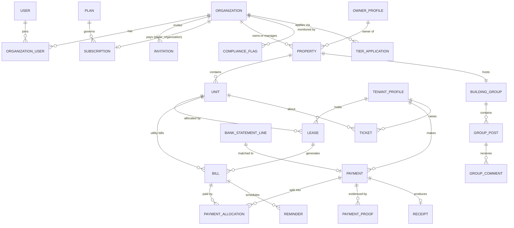

# GoProperty — Database Schema

Design baseline for MySQL 8, also compatible with MariaDB 10.6+ (common on cPanel/Plesk shared hosting). Conventions:

- Money is **integer kobo** (`_kobo` suffix). Never floats.
- All statuses are PHP backed enums persisted as strings; values listed here.
- Tenant-scoped tables carry `organization_id` (FK, indexed) unless noted. See [ARCHITECTURE.md § 4](ARCHITECTURE.md).
- Every table: `$table->id()`, `$table->timestamps()`, soft deletes only where stated.
- `activity_log`, `jobs`, `cache` etc. are implied and not repeated here. The media library's `media` table is described in § 1 (it carries `organization_id`, unlike Spatie's stock table); columns named `*_media_id` point at it.

## Domain Map

## 1. Identity & Organizations

### users
Customer-side people only (agency staff, owners, tenants). `name`, `email` (unique nullable — tenants may be phone-only), `phone` (unique nullable), `email_verified_at`, `phone_verified_at` (set when the user opens an invitation/reset link delivered to that number by WhatsApp, or when the agency confirms it in person), `phone_verification_method` (nullable: `whatsapp_link`, `agency_confirmed`), `phone_confirmed_by_user_id` (nullable), `password` (nullable until the invitation link is used to set it), `two_factor_secret` / `two_factor_recovery_codes` (encrypted), `preferences` (json: channel toggles), `last_active_organization_id`. Soft deletes. GoProperty staff are in `platform_staff` (§ 8), never here.

### user_devices
Browsers a customer has signed in from ([UX_DESIGN.md § 3.1, § 3.3](UX_DESIGN.md)): `user_id`, `token_hash` (SHA-256 of a random token kept in the browser's encrypted, HttpOnly `gp_device` cookie; unique per account, `(token_hash, user_id)`: a browser several accounts sign in from keeps one token), `user_agent`, `ip_address`, `two_factor_trusted_until` (set by "Don't ask again on this device", `auth.trust_device_days`), `last_seen_at`. A sign-in from a browser new to an account that already has one sends the new-device email.

### owner_profiles
Person/company details of a **property owner** (distinct from the user record — an owner may never log in).
`organization_id`, `type` (`person`, `company`), `first_name/last_name` (person) **or** `company_name` (company), `display_name` (the company name or "First Last", set on save; for lists, search and import matching), `email` (lower case), `phone` (E.164, `App\Support\PhoneNumber`), `address`, `state`, `lga`, `id_type` (`nin`, `cac`, `none`), `id_value` (encrypted; NIN 11 digits, CAC like `RC 1234567`; null when `none`), `notes`, `import_batch_id` / `external_ref` (import provenance, § 8A; no foreign key on `import_batch_id` until `import_batches` exists), soft deletes (archive). Unique `(organization_id, external_ref)`; indexes `(organization_id, import_batch_id)`, `(organization_id, deleted_at, display_name)`, `(organization_id, phone)`, `(organization_id, email)`. Built in P02-01a: `Modules\Properties\Models\OwnerProfile`, written only through `Modules\Properties\Owners\OwnerProfiles` (audited) and the Owners import sheet `Modules\Properties\Import\OwnersImportTarget` (P02-06c; matched by `external_ref`, then `phone`, then `display_name`, archived owners restored and audited).

### tenant_profiles
`organization_id`, `user_id` (nullable FK, null on delete — tenant may not have portal access yet), `first_name`, `last_name`, `email` (nullable, lower case), `phone` (required, E.164 through `App\Support\PhoneNumber`, unique per org), `address`, `occupation`, `emergency_contact` (json `{name, phone, relationship}`: the next of kin, phone in E.164), `kyc_status` (`unverified`, `pending`, `verified`; default `unverified`), `id_type` (`nin`, `passport`, `drivers_licence`, `voters_card`, `none`; default `none`), `id_value` (encrypted; kept in capitals without spaces or dashes; null when `none`), `import_batch_id` / `external_ref` (import provenance, § 8A; no foreign key on `import_batch_id`: `import_batches` belongs to the Import module), soft deletes (archive). Unique: `(organization_id, phone)` and `(organization_id, external_ref)`, archived rows included (an import restores an archived match instead of colliding); indexes `(organization_id, import_batch_id)`, `(organization_id, deleted_at, last_name, first_name)`, `(organization_id, email)`. Built in P02-06b: `Modules\Tenants\Models\TenantProfile` (organization-scoped), written so far only by the tenants import target (`Modules\Tenants\Import\TenantsImportTarget`); the tenant pages and their audited writer come in P03-01a.

### organizations
`name`, `slug` (unique; used in `goproperty.ng/o/{slug}`), `previous_slugs` (json, for redirects), `type` (`agency`, `property_owner`, `hybrid`), `cac_number` (nullable, encrypted), `address`, `state`, `lga`, `logo_media_id`, `status` (`onboarding`, `active`, `restricted`, `suspended`, `cancelled`), `transaction_tier` (`1`, `2`, `3` — the **approved** tier), `platform_covered` (bool — platform owner pays the bill), `branding` (json: trading name, primary/accent colours, letterhead address/RC/phone/email/website, `signature_media_id`, document prefixes, invoice notes, receipt footer, layout `modern`/`classic`/`compact`, email sender name, `hide_powered_by` — see [BRANDING_DOCUMENTS.md § 1](BRANDING_DOCUMENTS.md); as built in P01-05 the keys are `trading_name`, `primary_color`, `accent_color` (null = none), `address`, `rc_number`, `phone`, `email`, `website`, `invoice_prefix`, `receipt_prefix`, `lease_prefix`, `invoice_notes`, `receipt_footer`, `layout`, `email_sender_name`, `hide_powered_by`, `logo_media_id`, `signature_media_id`, `stamp_media_id` (ids of the organization's `branding` media, P02-05; `logo_media_id` equals the column of the same name; P01-05's interim `logo_file` / `signature_file` / `stamp_file` paths were moved into media rows by migration `2026_11_02_050002`); null branding means the defaults of `App\Branding\Branding::fromOrganization()`; written only by `App\Branding\BrandingSettings`), `online_payment_cap_kobo` (nullable), `trial_ends_at` (set when the signup wizard's plan step is first saved: 14 days, `plans.trial_days`), `signup_plan_key` (nullable; **interim**, P01-02: the plan chosen in the signup wizard, a key of the plan catalogue `config/plans.php`, until P06-01 creates the `subscriptions` row from it, after which the subscription is the source of truth), `suspended_at` (nullable), `status_before_suspension` (nullable; the status reactivation returns to, e.g. `restricted` stays `restricted`), soft deletes. Bank accounts moved to `organization_bank_accounts` (§ 4). `status` `suspended` or `cancelled` makes the organization read-only for its members ([ARCHITECTURE.md § 4](ARCHITECTURE.md)); staff suspend and reactivate through `App\Platform\Customers\OrganizationSuspension` (P01-06), which sets the two suspension columns and writes the reason and staff member to the audit log. `status` is `onboarding` while the signup wizard runs and becomes `active` when it ends. `platform_covered` is set at signup for type `property_owner` ([ONBOARDING_COMPLIANCE.md § 2](ONBOARDING_COMPLIANCE.md)); `transaction_tier` starts at `1` and changes only when compliance approves an application, through `App\Compliance\OrganizationTier` (P01-03; one audit entry `organization.tier_changed` with the staff member and reason).

### organization_user
Membership. `organization_id`, `user_id`, `is_default` (the organization the user last switched to; at most one per user, set by the organization switcher and used to choose where they land after signing in); unique `(organization_id, user_id)`. Roles are not a column here: they are spatie role assignments per organization (`model_has_roles.organization_id`, below). Read per organization through `App\Models\Membership` (organization-scoped); a user's own list through `User::organizations()`.

### organization_onboardings
The signup wizard's saved state, one row per organization that signed up through it (P01-02, [ONBOARDING_COMPLIANCE.md § 2](ONBOARDING_COMPLIANCE.md)); `App\Models\OrganizationOnboarding`, organization-scoped. `organization_id` (unique), `started_by_user_id` (nullable), `step` (`organization`, `tier`, `plan`, `collections`, `data`: the step the owner is on, so signing in again resumes there), `declared_annual_volume_kobo` (nullable: expected yearly collections stated at the Tier step), `requested_tier` (nullable `1`–`3`: the tier asked for; a Tier 2/3 request waits for its documents and review in P01-03 while `organizations.transaction_tier` stays the approved tier), `completed_at` (nullable: the wizard is over). Changed only through `App\Onboarding\OnboardingWizard`. Organizations made outside signup (seeders, staff) have no row and no wizard.

### onboarding_checklist_items
The setup checklist on the workspace dashboard (P01-02); `App\Models\OnboardingChecklistItem`, organization-scoped. `organization_id`, `item` (`tier`, `plan`, `collections`, `data`, `branding`), `status` (`pending`, `done`), `details` (json, e.g. `requested_tier`, `plan`), `completed_at`, `completed_by_user_id` (nullable); unique `(organization_id, item)`, index `(organization_id, status)`. Written only through `App\Onboarding\OnboardingChecklist` (`start()`, `complete()`, `reopen()`); the feature that finishes an item marks it done (bank account → `collections`, first import or property → `data`, branding saved → `branding`, Tier 2/3 approved → `tier`).

### roles, permissions, model_has_roles, model_has_permissions, role_has_permissions
spatie/laravel-permission with **teams** (team = organization, team column `organization_id`), shared by the `web` (customers) and `staff` guards ([ARCHITECTURE.md § 5](ARCHITECTURE.md)). Created in P01-01.
- `permissions`: `name`, `guard_name`; unique `(name, guard_name)`. Seeded from code: the customer catalogue is `App\Enums\OrganizationPermission` (`OrganizationRolesSeeder`), the staff catalogue `App\Platform\Staff\StaffPermission` (`StaffRolesSeeder`); both run by the installer.
- `roles`: `organization_id` (nullable FK), `name`, `guard_name`; unique `(organization_id, name, guard_name)`. `organization_id` is null for the five customer roles every organization shares (`org-owner`, `org-admin`, `agent`, `property-owner`, `tenant`, `App\Enums\OrganizationRole`) and for staff roles; set only for a role one organization defines for itself. MySQL allows repeated NULLs in the unique index, so shared roles are kept unique by the seeder and spatie's `create()`.
- `model_has_roles` / `model_has_permissions`: `id`, `role_id` / `permission_id` (FK, cascade), `model_type`, `model_id`, `organization_id` (nullable FK). For customers it is the organization the role applies in, always set (granting outside an organization or to a non-member is refused). For staff it is null: staff roles are global. Unique `(organization_id, role_id|permission_id, model_id, model_type)` and index `(model_id, model_type)`. Spatie's stub makes the team column part of the primary key, which cannot be null; the surrogate `id` allows staff rows.
- `role_has_permissions`: `permission_id`, `role_id`; primary key on both.

### invitations
A single-use link that brings a person into an organization (P01-04, [ONBOARDING_COMPLIANCE.md § 2](ONBOARDING_COMPLIANCE.md)); `App\Models\Invitation`, organization-scoped. `organization_id`, `kind` (`user`; `org_billing_transfer`: the link of a billing transfer, P02-04), `email` (nullable: tenants may be phone-only; lower-cased), `phone` (nullable), `roles` (json list of role names, one or more: an invitation may grant several roles, so this replaces the single `role` column first planned), `target_organization_id` (nullable FK, for org-to-org invites), `token_hash` (SHA-256 of the link's token, unique; the token itself is only in the link), `channel` (`email`; `whatsapp` and `link` — copy link / QR shared by the agency — come with tenant invitations, P03-01b), `status` (`pending`, `accepted`, `declined`, `expired`, `cancelled`), `expires_at` (14 days from the last send), `sent_at`, `send_count`, `opened_at` (first opening of the link), `invited_by_user_id`, `accepted_at`, `accepted_by_user_id`, `cancelled_at` (revoked); indexes `(organization_id, status, expires_at)`, `(organization_id, email)`, `(target_organization_id, status)`. A pending invitation past `expires_at` cannot be used and is recorded as `expired` when its link is opened. Sending again replaces `token_hash` (the old link dies) and restarts the 14 days. Member invitations (kind `user`) are written only by `App\Members\MemberInvitations` and `App\Members\InvitationAcceptance`, which ignore every other kind (the `/invitations/{token}` page and Settings → Members know only `user`). `billing_transfer_id` (nullable FK to `billing_transfer_requests`, restrict on delete; added by the SaasBilling module's migration `2026_11_05_040102`) is set on kind `org_billing_transfer`: the offering organization's invitation, `target_organization_id` the receiving one, no `email` (the receiving organization's owners are emailed), `roles` empty, its status following the transfer (`pending`, then `accepted`, `declined`, `cancelled` or `expired`); written only by `Modules\SaasBilling\Transfers\BillingTransferService`. No SMS channel.

### management_handovers (planned, P03-14)
A landlord's buildings handed to an agency for management, or returned ([BILLING_PAYMENTS.md § 7](BILLING_PAYMENTS.md), product owner decision 2026-10-27). Replaces `billing_transfer_requests` (below): P03-14 decides whether to rename that table with a new migration or create this one and retire the old one. Planned shape: organization-scoped to the **offering** organization. `organization_id` (FK: offering), `to_organization_id` (FK organizations: receiving), `landlord_organization_id` (FK: where the buildings return on `ended`), `status` (`pending`, `active`, `declined`, `cancelled`, `expired`, `ending`, `ended`), `rent_collected_by` (`agency`, `owner`), `notice_days` (0–180, default 30), `billable_units` / `monthly_before_kobo` / `monthly_after_kobo` (shown on the accept screen and recorded on acceptance), `initiated_by_user_id`, `responded_by_user_id`, `responded_at`, `cancelled_at`, `expires_at`, `accepted_at`, `notice_given_by_organization_id`, `notice_given_at`, `ends_at`, `ended_at`, timestamps. Child table `management_handover_buildings`: `organization_id`, `management_handover_id` (FK), `property_id` (the building's id at offer time; the moved building may get a new id only if the module cannot keep it), `unit_count`; unique `(management_handover_id, property_id)`; a building is in at most one open handover (checked in the service under a row lock). Written only by the handover service (AGENT.md § 3 rule 5).

### billing_transfer_requests
**Superseded by `management_handovers` (above); P03-14 reworks it.** Handover of the platform subscription bill between orgs as first planned; built in P02-04 as `Modules\SaasBilling\Models\BillingTransferRequest`, organization-scoped to the **offering** organization. `organization_id` (FK: the offering organization, the current payer, whose bill moves; it offers and may withdraw; this replaces the `from_organization_id` first planned, so the row is scoped like every customer row), `to_organization_id` (FK organizations: asked to take the bill over), `subscription_id` (nullable, **no foreign key** until P06-01 creates `subscriptions`), `status` (`pending`, `completed`, `declined`, `cancelled`, `expired`: the states of BILLING § 7; the `accepted` state first planned is folded into `completed`, which acceptance sets), `plan_key`, `billable_units`, `monthly_amount_kobo` (nullable; recorded on acceptance: the plan, units and monthly amount before VAT the receiving owner was shown and accepted), `initiated_by_user_id`, `responded_by_user_id`, `responded_at` (accepted or declined), `cancelled_at`, `expires_at` (14 days after the offer), `completed_at` (nullable: set by the payer switch, P06-06, when `subscriptions.payer_organization_id` and the payment method actually move; empty until then), timestamps. Indexes `(organization_id, status, expires_at)`, `(to_organization_id, status)`, `(status, expires_at)` (the hourly expiry). **How the receiving side reads it:** it never queries the model in its own context; `Modules\SaasBilling\Transfers\IncomingTransfers` reads `id` and `organization_id` of the rows whose `to_organization_id` is the current organization (from `OrganizationContext`, never from input), then loads each inside the offering organization's context (`OrganizationContext::run`), as P01-04 does for invitation links; no scope is removed. Written only by `Modules\SaasBilling\Transfers\BillingTransferService` (audited, log `billing_transfers`).

### media
The media library's files (P02-05, spatie/laravel-medialibrary 11, [ARCHITECTURE.md § 9](ARCHITECTURE.md)); `App\Media\Media`, organization-scoped (`BelongsToOrganization`), no soft deletes (a removed file's row and files go together; rows referenced by issued documents or branding are never removed; files in an evidence collection are never removed by a customer action, only hidden: integrity rule 7 and ARCHITECTURE.md § 9). `organization_id` (FK), `model_type` + `model_id` (the owner, e.g. `App\Models\Organization` for branding images), `uuid` (unique; in signed links and in the file path), `collection_name` (`photos`, `documents`, `branding`, `imports`; [config/media.php](config/media.php)), `name` (the uploader's file name without extension, a label only), `file_name` (random, with the extension of the sniffed type), `mime_type` (sniffed from the bytes), `disk` / `conversions_disk` (`media` or `media-s3`), `size` (bytes), `manipulations`, `custom_properties` (json: `sha256` of the original; `width`, `height` for images; `role` for branding images), `generated_conversions` (json: `thumb`, `large` → true once the queued job made them), `responsive_images` (json, unused), `order_column`. Files live at `{organization_id}/{uuid}/` on the disk. Indexes: `(organization_id, model_type, model_id, collection_name)`, `(organization_id, collection_name)`, `order_column`.

## 2. SaaS Billing (platform ↔ customers)

Full semantics in [BILLING_PAYMENTS.md](BILLING_PAYMENTS.md).

### plans
`name`, `description`, `cycle` (`monthly`, `annual`), `base_price_kobo`, `included_units`, `unit_price_kobo` (per extra unit), `tier_rules` (json, optional band pricing), `annual_discount_percent`, `trial_days`, `is_active`, `sort_order`.

### plan_feature
`plan_id`, `feature_key`, `enabled`, `limit_value` (nullable int). `feature_key` from registry (`building_group`, `tickets`, `sms_reminders`, `expenses`, …).

### subscriptions
`organization_id` (the customer), `plan_id`, `payer_organization_id` (nullable — defaults to `organization_id`; points at a platform-owned organization for platform-covered customers; no longer moved by org-to-org handovers, BILLING_PAYMENTS.md § 7), `status` (`trialing`, `active`, `past_due`, `grace`, `suspended`, `cancelled`), `current_period_start`, `current_period_end`, `cancel_at_period_end`, `last_billed_units` (int snapshot), `paystack_customer_code`, `paystack_authorization` (json), `ended_at`.

### subscription_unit_events
Metering ledger. `subscription_id`, `unit_count` (int), `counted_units` (int — after included-units adjustment), `effective_date`, `reason` (`unit_added`, `unit_removed`, `plan_change`, `initial`), `source_bill_id` (nullable).

### platform_invoices
`organization_id`, `subscription_id`, `number` (unique, `{PR}-{YYYY}-{seq}`), `subtotal_kobo`, `vat_kobo`, `total_kobo`, `units_billed`, `period_start`, `period_end`, `status` (`open`, `paid`, `void`, `uncollectible`), `due_date`, `paid_at`, `notes`.

### platform_payments
`platform_invoice_id`, `method` (`paystack`, `bank_transfer`), `amount_kobo`, `currency` (`NGN`), `paystack_reference` (unique nullable), `paystack_channel` (nullable), `bank_transfer_proof_media_id` (nullable), `status` (`pending`, `confirmed`, `rejected`, `refunded`), `confirmed_by_user_id` (platform staff, for bank transfers), `confirmed_at`, `rejection_reason`.

### webhook_log
`provider` (`paystack`), `event`, `reference`, `payload` (json), `signature_valid`, `processed_at`, `processing_error` (nullable).

### organization_feature_overrides
`organization_id`, `feature_key`, `enabled`, `limit_value`, `granted_by_user_id`, `reason`. Platform-owner grants outside the plan.

## 3. Properties & Leasing

### properties (buildings)
`organization_id`, `owner_profile_id` (nullable FK to `owner_profiles`: empty when the organization itself owns the building; an archived owner stays linked), `name`, `slug` (made from the name when the building is added, `-2`, `-3`… when taken, never `create`; kept when the building is renamed; pages use it in the URL), `property_type` (`block_of_flats`, `estate`, `duplex`, `bungalow`, `commercial`, `mixed`), `address`, `state` (`App\Support\NigerianStates`), `lga`, `landmark`, `description`, `amenities` (json list of short labels, at most 30 of 40 characters), `year_built`, `photo_media_id` (the cover: one of the building's `photos` media; no foreign key, like `organizations.logo_media_id`), `status` (`active`, `archived`: archiving is this status change, never a delete; an archived building is kept read-only and its units are not metered, [BILLING_PAYMENTS.md § 1.4](BILLING_PAYMENTS.md)), `import_batch_id` / `external_ref` (import provenance, § 8A; no foreign key on `import_batch_id`), soft deletes (left to import rollback; a soft-deleted building still holds its slug). Unique: `(organization_id, slug)`, `(organization_id, external_ref)`; indexes `(organization_id, import_batch_id)`, `(organization_id, status, name)`, `(organization_id, owner_profile_id)`. Photos are media rows (collection `photos`, owner `Modules\Properties\Models\Property`, at most 20 a building). Built in P02-01b: `Modules\Properties\Models\Property`, written only through `Modules\Properties\Buildings\Properties` and `PropertyPhotos` (audited, log `properties`) and the Buildings import sheet `Modules\Properties\Import\PropertiesImportTarget` (P02-06c; matched by `external_ref`, then `name`; soft-deleted buildings restored and audited, archived ones skipped); other modules read it through `Modules\Properties\Contracts\PropertyDirectory`.

### units (blocks/apartments)
`property_id` (FK to `properties`, restrict), `organization_id`, `unit_label` (e.g. `Block A`, `Flat 3B`; at most 60 characters, plain text, compared without case like the unique index), `unit_type` (`apartment`, `self_contain`, `shop`, `office`), `bedrooms`, `bathrooms` (0–20, nullable), `size_sqm` (whole square metres, nullable), `floor` (short text such as `Ground`, nullable), `base_rent_kobo` and `service_charge_kobo` (`App\Casts\MoneyCast`; the unit's **yearly** asking rent and service charge, default 0; a lease keeps its own amount and cycle), `status` (`vacant`, `reserved`, `occupied`, `under_maintenance`, `unavailable`; `occupied` and `reserved` are set only by Leasing through `UnitDirectory::setStatus` or an import of leases, people choose among the other three), `description`, `import_batch_id` / `external_ref` (import provenance, § 8A; no foreign key on `import_batch_id`), soft deletes (**archiving a unit is the soft delete**: the GoProperty bill counts units that are not soft-deleted, [BILLING_PAYMENTS.md § 1.4](BILLING_PAYMENTS.md); also used by import rollback). Unique: `(property_id, unit_label)` (soft-deleted units included: adding a unit with an archived unit's label restores that unit), `(organization_id, external_ref)`; indexes `(organization_id, import_batch_id)`, `(organization_id, property_id, status)` (the building page's counts), `(organization_id, status)`. Built in P02-02: `Modules\Properties\Models\Unit`, written only through `Modules\Properties\Units\Units` and `CreateUnitsInBulk` (audited, log `properties`) and the Units import sheet `Modules\Properties\Import\UnitsImportTarget` (P02-06c; matched by `external_ref`, then `(property_id, unit_label)`; archived units restored and audited; never sets `occupied`/`reserved`); other modules read it and set lease statuses through `Modules\Properties\Contracts\UnitDirectory`.

### leases
The allocation + contract. `organization_id`, `unit_id`, `tenant_profile_id`, `contract_number` (unique per org), `billing_cycle` (`daily`, `weekly`, `monthly`, `quarterly`, `semi_annual`, `annual`, `biennial`; `Modules\Leasing\Contracts\BillingCycle`), `start_date`, `end_date`, `rent_amount_kobo`, `deposit_kobo` (caution deposit held — a liability refunded at move-out), `paid_until` (date the tenant has paid up to; set on import or by confirmed payments), `next_billing_date` (next period start to bill — maintained by the leasing service via `Modules\Leasing\CycleCalculator`, ARCHITECTURE.md § 6.3), `other_charges` (json), `due_day_offset` (int, default 0 — the bill falls due N days after the period start; bills are generated the organization's `lead_days`, default 7, before the period starts; ARCHITECTURE.md § 6.3), `auto_renew` (bool), `status` (`draft`, `active`, `expired`, `terminated`, `renewed`), `renewal_of_lease_id` (nullable self FK), `terminated_at`, `termination_reason`, `notes`, `document_media_id` (generated contract PDF), soft deletes. Index: `(organization_id, status)`, `(unit_id, status)`.

### lease_renewal_offers
Optional but recommended: `lease_id`, `proposed_rent_kobo`, `proposed_cycle`, `expires_at`, `status` (`pending`, `accepted`, `declined`, `expired`), `responded_at`. (MVP can generate the renewal lease directly; the offer table supports tenant-facing accept flows later.)

### agent_building
Assignment narrowing (optional per agent, ARCHITECTURE.md § 5). `organization_id`, `user_id` (FK to `users`, cascade on delete), `property_id` (FK to `properties`, cascade on delete; buildings are never hard deleted), timestamps; no soft deletes (a row is a plain link: unassigning, or removing the member from the organization, deletes it, audited by the writer). Unique `(organization_id, user_id, property_id)` (the documented `(user_id, property_id)` pair with `organization_id` leading, ARCHITECTURE.md § 4; it also serves "this agent's buildings here"); index `(organization_id, property_id)` (a building's agents). An agent (holding `agent` and neither `org-owner` nor `org-admin`) with at least one row in the organization sees only those buildings; an agent with none sees every building. Built in P02-03: `Modules\Properties\Models\AgentAssignment`, written only through `Modules\Properties\Assignments\AgentAssignments` (audited, log `properties`); other modules read it through `Modules\Properties\Contracts\BuildingAccess`.

## 4. Customer Billing (rent, utilities, payments)

### utility_types
`organization_id`, `name` (e.g. Security levy, Water), `code`, `default_amount_kobo`, `default_cycle` (same enum as lease), `metered` (bool — electricity), `active`.

### unit_utility_settings
`organization_id`, `unit_id`, `utility_type_id`, `amount_kobo`, `cycle`, `metered`, `active`, `effective_from`. Unique: `(unit_id, utility_type_id)`.

### utility_readings
`unit_utility_setting_id`, `organization_id`, `reading_date`, `previous_value`, `current_value`, `consumption`, `rate_kobo` (per unit), `recorded_by_user_id`, `bill_id` (nullable FK).

### bills
`organization_id`, `type` (`rent`, `utility`, `opening_balance`, `other`), `billable` (morph: `Lease` or `Unit`), `lease_id` (nullable), `tenant_profile_id` (who must pay — always set), `payment_reference` (short unique code, e.g. `GP-7KQ2M`, globally unique, for transfer narrations), `number` (unique per org), `description`, `amount_kobo`, `due_date`, `period_start`, `period_end`, `status` (`unpaid`, `partially_paid`, `paid`, `overdue`, `void`), `voided_at`, `document_media_id`, `branding_snapshot` (json — branding as at issue), `verification_code` (unique), `import_batch_id` (nullable), soft deletes. Indexes: `(organization_id, status, due_date)`, `(billable_type, billable_id)`, `(type, status)`.

### bill_items
`bill_id`, `label`, `amount_kobo`, `quantity` (default 1), `meta` (json).

### payments
One incoming payment from a tenant (may cover several bills). `organization_id`, `tenant_profile_id`, `recorded_by_user_id` (nullable for automatic), `amount_kobo`, `method` (`bank_transfer`, `cash`, `pos`, `paystack`), `source` (`statement_match`, `paystack_webhook`, `proof_upload`, `manual`), `bank_statement_line_id` (nullable), `paystack_reference` (nullable, unique per org), `payer_name`, `payer_type` (`individual`, `corporate` — for cash-threshold checks), `paid_at`, `status` (`pending_confirmation`, `confirmed`, `rejected`, `refunded`), `reference` (org-provided or generated), `confirmation_note`, `confirmed_by_user_id`, `confirmed_at`, `rejection_reason`, `receipt_id` (nullable FK), soft deletes. Index: `(organization_id, status)`, `(organization_id, paid_at)`.

### payment_allocations
How a payment is split across bills. `payment_id`, `bill_id`, `amount_kobo`. Sum of allocations ≤ payment amount; the remainder goes to tenant credit.

### tenant_credit_entries
Simple credit ledger per tenant per org. `organization_id`, `tenant_profile_id`, `amount_kobo` (+ credit / − used), `reason` (`overpayment`, `applied_to_bill`, `refund`, `adjustment`), `payment_id` / `bill_id` (nullable), `created_by_user_id`.

### organization_bank_accounts
`organization_id`, `bank_code` (Paystack's code, `config/banks.php`), `bank_name`, `account_number` (encrypted, text), `account_number_last4` (for the masked display), `account_fingerprint` (HMAC-SHA256 of bank code and number with the app key: finds a duplicate without decrypting), `account_name` (the bank's spelling once matched), `name_check_status` (`unchecked`, `matched`, `mismatched`, `not_found`), `name_check_result` (account name returned by Paystack lookup), `name_checked_at`, `is_default` (the primary account on invoices; one among the usable ones), `active`, `created_by_user_id` (nullable), soft deletes. Indexes `(organization_id, active, is_default)`, `(organization_id, account_fingerprint)`. Usable (shown to tenants) = active and `matched` or `unchecked`. Organization-scoped (`App\Models\OrganizationBankAccount`), written only by `App\Banking\BankAccounts` (P01-05), audited under log `payment_settings` with the number masked.

### organization_paystack_connections
The organization's **own** Paystack account. `organization_id` (unique), `public_key`, `secret_key` (encrypted), `webhook_token` (part of `/webhooks/paystack/{org-ulid}`), `mode` (`test`, `live`), `status` (`pending_test`, `active`, `failing`, `disconnected`), `last_event_at`, `connected_by_user_id`.

### bank_statement_imports
`organization_id`, `organization_bank_account_id`, `media_id` (uploaded file), `format` (`csv`, `xlsx`, `pdf`), `column_mapping` (json, saved per bank), `period_start`, `period_end`, `lines_total`, `lines_matched`, `status` (`processing`, `ready`, `failed`), `uploaded_by_user_id`.

### bank_statement_lines
`bank_statement_import_id`, `organization_id`, `transaction_date`, `amount_kobo`, `direction` (`credit`, `debit`), `narration`, `counterparty_name`, `balance_kobo` (nullable), `line_hash` (unique per org — dedupes re-uploads), `match_status` (`unmatched`, `suggested`, `matched`, `ignored`), `match_confidence` (`high`, `medium`), `suggested_bill_id` (nullable), `payment_id` (nullable).

### payment_proofs
`payment_id`, `uploaded_by_user_id`, `media_id`, `note`, `uploaded_at`.

### receipts
`payment_id`, `organization_id`, `number` (unique), `verification_code` (unique, used in the QR code and `goproperty.ng/verify/{code}`), `issued_at`, `document_media_id`, `issued_by_user_id`, `voided_at`, `voided_by_user_id`, `void_approved_by_user_id` (second approver), `void_reason`.

### expenses
`organization_id`, `property_id` (nullable), `unit_id` (nullable), `category` (`repairs`, `utilities`, `staff`, `taxes`, `agency_ops`, `other`), `description`, `amount_kobo`, `spent_at`, `vendor_name`, `receipt_media_id`, `recorded_by_user_id`, `bill_id` (nullable — expense linked to a ticket/job), `ticket_id` (nullable).

### document_counters
Atomic sequence allocation. `organization_id`, `doc_type`, `year`, `last_seq`, unique `(organization_id, doc_type, year)`.

## 5. Maintenance Tickets

### tickets
`organization_id`, `unit_id`, `property_id`, `lease_id` (nullable), `raised_by_tenant_profile_id` (nullable) / `raised_by_user_id`, `category` (`plumbing`, `electrical`, `structural`, `cleaning`, `security`, `appliance`, `other`), `priority` (`low`, `medium`, `high`, `urgent`), `status` (`draft`, `submitted`, `under_review`, `in_progress`, `resolved`, `closed`, `reopened`), `title`, `description`, `assigned_to_user_id` (nullable), `resolved_at`, `closed_at`, `reopen_count`, soft deletes. Index: `(organization_id, status)`, `(assigned_to_user_id, status)`.

### ticket_messages
`ticket_id`, `author_user_id`, `body`, `is_internal` (bool — staff-only notes), `read_at_by_tenant`, `read_at_by_staff`.

### ticket_status_history
`ticket_id`, `from_status`, `to_status`, `changed_by_user_id`, `note`, `changed_at`. (Also mirrored to activity log.)

## 6. Building Group

### building_groups
`property_id`, `organization_id`, `name`, `description`, `settings` (json: who can post, image toggles), `is_active`.

### group_members
`building_group_id`, `user_id`, `member_type` (`tenant`, `agent`, `owner`, `platform_viewer`), `role` (`member`, `moderator`, `admin`), `muted_until`, `joined_at`, unique `(building_group_id, user_id)`.

### group_posts
`building_group_id`, `author_user_id`, `body` (sanitized HTML subset, max 5 000), `status` (`published`, `hidden`, `removed`), `pinned_at`, `edited_at`, `last_activity_at` (bump on comment), soft deletes. Index: `(building_group_id, status, last_activity_at)`.

### group_comments
`group_post_id`, `parent_id` (nullable self FK — one level of replies), `author_user_id`, `body`, `status` (`published`, `hidden`, `removed`), soft deletes.

### group_reactions
`user_id`, `reactable_type` (`group_post` / `group_comment`), `reactable_id`, `emoji` (from curated set), unique `(user_id, reactable_type, reactable_id, emoji)`.

### group_moderation_events
`building_group_id`, `actor_user_id`, `action` (`hide`, `remove`, `pin`, `unpin`, `mute_member`, `unmute_member`), `target` (morph), `reason`.

## 7. Reminders & Deliveries

### reminders
`organization_id`, `remindable_type` / `remindable_id` (Bill, Lease, Subscription…), `type` (`rent_due`, `utility_due`, `lease_renewal`, `bill_overdue`, `saas_invoice_due`), `due_date`, `offset_days`, `channel` (`email`, `sms`), `send_at`, `status` (`pending`, `sent`, `failed`, `skipped`), `recipient_user_id` (nullable), `recipient_phone`, `dedupe_key` (unique: `type|remindable|channel|offset|due_date`), `sent_at`.

### notifications
Laravel's database notifications: what a user is told in the app besides the email (first used by billing transfers, P02-04). `id` (uuid), `type` (the notification class), `notifiable_type` / `notifiable_id` (the user), `data` (json: event, record id, names, a link to the workspace page; never a link token), `read_at`, timestamps. Belongs to the user, not to an organization.

### notification_deliveries
`reminders` send outcomes + ad-hoc notifications. `notification_type`, `channel`, `recipient_user_id` (nullable), `recipient_contact`, `subject`, `status` (`queued`, `sent`, `delivered`, `failed`, `bounced`), `provider` (`termii`, `mailgun`, …), `provider_message_id`, `error`, `cost_kobo` (SMS), `sent_at`.

### organization_whatsapp_connections
The organization's **own** WhatsApp Business Platform account (optional). `organization_id` (unique), `waba_id`, `phone_number_id`, `display_phone_number`, `access_token` (encrypted), `app_secret` (encrypted), `webhook_verify_token`, `status` (`pending_test`, `active`, `failing`, `disconnected`), `templates_synced_at`, `connected_by_user_id`.

### whatsapp_templates
Synced from Meta. `organization_id`, `organization_whatsapp_connection_id`, `meta_template_id`, `name`, `language`, `category` (`utility`, `marketing`, `authentication`), `status` (`approved`, `pending`, `rejected`, `paused`, `disabled`), `components` (json), `variable_count`, `synced_at`. Unique `(organization_id, name, language)`.

### notification_channel_mappings
Per organization, per event. `organization_id`, `event_key` (`bill.issued`, `reminder.rent_due.t7`, `receipt.issued`, …), `channel_order` (json, e.g. `["whatsapp","sms"]`; email always also sent where the category requires), `whatsapp_template_id` (nullable), `variable_map` (json: template variable → GoProperty placeholder), `active`.

### whatsapp_opt_ins
`organization_id`, `tenant_profile_id`, `phone`, `opted_in_at`, `source` (`portal`, `import_confirmation`, `agent_recorded`), `opted_out_at`.

### sms_credit_entries
Ledger of SMS credits. `organization_id`, `credits` (+ allowance/purchase, − usage), `reason` (`monthly_allowance`, `purchase`, `usage`, `adjustment`, `expiry`), `notification_delivery_id` / `platform_invoice_id` (nullable), `created_at`. Balance = sum.

## 8. Platform Operations

### platform_staff
GoProperty staff (separate `staff` guard). `name`, `email` (unique), `phone`, `password`, `two_factor_secret` / `two_factor_recovery_codes` (encrypted, required), `status` (`invited`, `active`, `deactivated`), `ip_allowlist` (json, nullable), `last_login_at` (set on each staff sign-in), `remember_token`, `two_factor_confirmed_at`. Lifecycle columns (P01-07): `invited_by_staff_id` (nullable, the inviter; null for the installer's account), `invitation_token_hash` (SHA-256 of the emailed link's token, unique, cleared once used), `invitation_expires_at` (7 days), `invitation_accepted_at` (password set), `deactivated_at`. An invited account has an unusable random password until the invitee sets one; it becomes `active` once 2FA is enrolled (`App\Platform\Staff\StaffLifecycle`). Roles via spatie on the `staff` guard. The 2FA columns are nullable in the table: the command-line installer creates the first account before 2FA is enrolled, and the console refuses sign-in until it is (INSTALLER.md § 7). Created in P00-06; the guard and console come in P00-08.

### Staff roles & permissions
spatie `roles` / `permissions` / `role_has_permissions` / `model_has_roles` on the `staff` guard: the same tables as the customer roles (§ 1), with `organization_id` null on staff roles and staff assignments (`App\Platform\Console\HasStaffRoles` reads and grants them outside any organization context). Extra columns on `roles` (added in P01-07): `is_default` (shipped role), `is_protected` (`super-admin`, not editable), `description`, `active` (a deactivated role grants nothing). Customer roles keep the defaults. Permissions are seeded from code (one catalogue, `App\Platform\Staff\StaffPermission`; default roles in `DefaultStaffRole`) by `StaffRolesSeeder`, which never undoes console edits: a default role gets its default permissions when created and afterwards only permissions new to the catalogue; `super-admin` always holds the whole catalogue. Roles are data and editable in the console (`App\Models\StaffRole`, the staff-guard view of `roles`).

### approval_requests
Two-person rule (P01-07, `App\Platform\Approvals\ApprovalService`). `action` (`refund`, `production_restore`, `role_grant`, `write_impersonation`, `data_purge`), `subject` (nullable morph: e.g. the staff member a role is for, or the role getting protected permissions), `payload` (json: what runs on approval, e.g. `{kind: staff_role, role_id}` or `{kind: role_permissions, permissions}`), `summary` (one line for the queue), `reason` (requester's), `requested_by_staff_id`, `approved_by_staff_id`, `rejected_by_staff_id`, `status` (`pending`, `approved`, `rejected`, `expired`), `decision_note`, `expires_at` (per action: 1 hour for write impersonation, 1 day for production restore, 7 days otherwise; expired every 15 minutes by the scheduler), `decided_at`. Indexes `(status, action)`, `(status, expires_at)`. Rows are never deleted.

### impersonation_sessions
Support sessions (P01-08, [PLATFORM_CONSOLE.md § 6](PLATFORM_CONSOLE.md); written only by `App\Platform\Impersonation\Impersonations`, model `App\Models\ImpersonationSession`). `staff_id`, `user_id`, `organization_id` (the one organization the session may open), `reason` (required, max 500), `mode` (`read_only`, `write`), `approval_request_id` (nullable, unique: a write-mode session uses its approved `write_impersonation` request once), `started_at`, `expires_at` (`started_at` + 30 minutes), `handoff_token_hash` (SHA-256 of the one-time link's token; cleared once used or ended), `handoff_expires_at` (60 seconds after the start), `handed_off_at` (when the browser entered the customer app), `ended_at`, `ended_reason` (`manual`: ended by the staff member, by signing out, or by starting another session; `timeout`: the 30 minutes, or the hand-off link, ran out; `ended_by_staff`: a super-admin ended it from the console; `revoked`: the staff member lost the permission or was deactivated, or the user left the organization), `ended_by_staff_id` (nullable), `ip`, `user_agent` (the staff member's, at the start), timestamps. Indexes `(organization_id, started_at)`, `(staff_id, started_at)`, `(user_id, started_at)`, `(ended_at, expires_at)`. Rows are never deleted. Not organization-scoped: it is a platform record, read in the console's impersonation log and, on the customer side, only as the one session the browser holds. Start, hand-off, pages viewed, actions, blocked or refused attempts and the end go to `activity_log` (log name `impersonation`, the impersonated user as causer, `impersonator_staff_id` set, `session_id`, `organization_id`, `mode`, `ip` and `user_agent` in `properties`); business changes made during a session are in their own log with `impersonator_staff_id` set and `impersonation_session_id` in `properties`. There is no organization consent column: `organizations.allow_support_access` was dropped in P01-08 (product owner, 2026-10-26).

### authentication_logs
Both guards. `authenticatable_type` (`user`, `platform_staff`), `authenticatable_id` (nullable for unknown accounts), `attempted_identifier` (hashed email/phone for failed attempts), `event` (`login_success`, `login_failed`, `passkey_login`, `logout`, `2fa_passed`, `2fa_failed`, `recovery_code_used`, `turnstile_failed`, `invitation_accepted`, `reset_link_sent`, `agency_signin_link_created`, `password_reset`, `lockout`), `ip`, `user_agent`, `location` (Cloudflare's `CF-IPCountry` country code when present), `is_new_device`, `created_at`. `attempted_identifier` is an HMAC (keyed from `APP_KEY`) of the normalised email or phone. Rows older than a year are deleted nightly.

### activity_log (extra columns)
spatie activitylog (v5: `log_name`, `description`, `subject`, `event`, `causer`, `attribute_changes`, `properties`) plus `impersonator_staff_id`, `ip`, `user_agent`, `reason`, `prev_hash`, `hash` (append-only chain, P00-11). During a support session (P01-08) every entry carries the staff member in `impersonator_staff_id` and the session in `properties.impersonation_session_id` (`App\Audit\AuditContext`); index `(impersonator_staff_id, id)` serves the impersonation log. `hash` is an HMAC-SHA256, keyed from `APP_KEY`, of the entry's content and `prev_hash`; JSON columns are hashed with sorted keys so MySQL's JSON type does not break it. `audit_chain_head` (one row: `last_hash`) records the newest hash and is the row lock every append takes. `App\Audit\AuditEntry` refuses updates and deletes, `activitylog:clean` is refused, and `goproperty:audit-verify` (also nightly) reports the first changed, removed or reordered entry. Retention ([PLATFORM_CONSOLE.md § 7](PLATFORM_CONSOLE.md)) will need an archive that keeps the chain verifiable.

### email_templates / email_template_versions
`email_templates`: `key` (unique, e.g. `bill.issued`), `category` (`security`, `transactional`, `reminder`, `marketing`), `allowed_placeholders` (json), `current_version_id`, `active`. `email_template_versions`: `email_template_id`, `subject`, `body_markdown`, `version`, `created_by_staff_id`, `created_at`.

### backup_destinations
`name`, `driver` (`s3`, `google_drive`; `local` only outside production, for drills), `config` (encrypted json: S3 bucket/endpoint/keys, or the Google service account key with `shared_drive_id` and optional `folder_id`), `applies_to` (`db`, `files`, `both`), `active`. Added with `goproperty:backup-destination:add` until the console screen (P06-10).

### daily_platform_metrics
Nightly analytics snapshot. `date`, `metric` (e.g. `mrr_kobo`, `active_orgs`, `units_total`, `collections_recorded_kobo`), `dimension` (nullable, e.g. tier, channel, state), `value`. Unique `(date, metric, dimension)`.

### settings
`key`, `value` (json), `scope_type` + `scope_id` (`global`/0, or `organization`/the org's id; not NULL, because MySQL and MariaDB allow repeated NULLs in a unique index). Unique `(scope_type, scope_id, key)`. Keys are declared in a registry (`config/settings.php`, or `SettingsRegistry::define()` from a module) with type, default, rules, scope, secret flag, permission and step-up; `App\Settings\SettingsStore` validates, caches per scope and logs every change. Secret values (e.g. `auth.turnstile_secret_key`) are stored encrypted, cached encrypted, and logged only as `[secret]`. Global keys and their rules are listed in [PLATFORM_CONSOLE.md § 9](PLATFORM_CONSOLE.md); drafts and published versions of theme/site/SEO keys are kept in `setting_versions` (`version`, `keys` json, `status` `draft`/`published`/`archived`, `published_by_staff_id`, `published_at`).

### passkeys
WebAuthn credentials (Fortify passkeys). `authenticatable_type` (`user`, `platform_staff`), `authenticatable_id`, `name` ("iPhone", "Work laptop"), `credential_id` (unique), `credential` (json), `last_used_at`. A user can have several; removing the last one is allowed only if they still have a password.

### backup_runs
`type` (`db`, `files`), `filename`, `size_bytes`, `backup_destination_id`, `status` (`running`, `success`, `failed`), `verified_at` (nullable), `started_at`, `finished_at`, `triggered_by` (`schedule`, `manual`), `triggered_by_staff_id`, `notes`.

### backup_restores
`backup_run_id`, `target` (`temporary`, `staging`, `production`), `approval_request_id` (required for production), `requested_by_staff_id`, `status`, `started_at`, `finished_at`, `notes`.

### installation_state
The installer's database marker ([INSTALLER.md § 3](INSTALLER.md)). One row, `id` = 1 (tinyint primary key). `status` (`configured`, `migrating`, `owner_ready`, `finalized`), `version` (release that installed or last finalized), `finalized_at` (nullable), timestamps. With `storage/app/installed.lock` it decides whether the site is open; the installer stays closed if either says `finalized`.

## 8A. Data Import

### import_batches
Built in P02-06a: `Modules\Import\Models\ImportBatch`, organization-scoped, written only by `Modules\Import\Batches\ImportBatches` and the commit job ([DATA_IMPORT.md](DATA_IMPORT.md)). `organization_id` (FK), `kind` (`workbook`, or the key of the registered import target a one-sheet file holds: `owners`, `properties`, `units`, `tenants`, `leases`, `opening_balances`, `utilities`, `payment_history`, `staff`, …), `file_type` (`xlsx`, `csv`: from the sniffed type), `file_name` (the uploader's file name, a label only), `media_id` (nullable FK to `media`, null on delete: the uploaded file is the batch's media in the `imports` collection until the 30-day purge), `column_mapping` (json `{sheets: [{index, name, header_row, headers, target, columns: {column key: header position}}]}`), `status` (`uploaded`, `dry_run_failed`, `dry_run_passed`, `committing`, `committed`, `partially_failed`, `rolled_back`), `dry_run_report` (json: per sheet the rows, counts by action (`create`, `update`, `restore`, `skip`), error and warning counts with the first 100 of each (row, column key, header, letter, message), a preview of the first 5 rows; totals, units and expected yearly collections), `dry_run_at`, `rows_total` / `rows_done` (commit progress), `commit_cursor` (json `{target, row}`: where the queued commit resumes; saved with each chunk), `result_counts` (json `{targets: {key: {create, update, restore, skip}}, skipped: [{target, row, reason}]}`, the first 200 skipped rows), `failure_reason`, `created_by_user_id`, `committed_by_user_id`, `committed_at` (when the commit was started; the rollback window counts from it), `rolled_back_at`, `rolled_back_by_user_id`, `file_purged_at`, timestamps. Never deleted. Indexes `(organization_id, created_at)`, `(organization_id, status)`.

### import_column_mappings
Built in P02-06a: `Modules\Import\Models\ImportColumnMapping`, organization-scoped. Saved mappings for reuse. `organization_id` (FK), `kind` (the target key), `name` (e.g. "My GTBank sheet"; saving under an existing name replaces it), `mapping` (json: the file's header, normalised to lower-case letters and digits, => the target's column key), `created_by_user_id`, timestamps. Unique `(organization_id, kind, name)`.

**Import provenance:** `owner_profiles`, `properties`, `units`, `tenant_profiles`, `leases`, `bills`, `unit_utility_settings` and `payments` gain `import_batch_id` (nullable) and `external_ref` (nullable; unique per `organization_id` within each table) so re-imports update instead of duplicating and batches can be rolled back. A record the batch creates, or restores from the archive (matched by `external_ref` or natural key, archived rows included), carries the batch's id; a record it only updates keeps its own `import_batch_id`. Rollback soft deletes the rows carrying the batch's id. Built so far for `owner_profiles`, `properties`, `units` (P02-06c) and `tenant_profiles` (P02-06b).

## 9. Compliance & Transaction Tiers

Rules in [ONBOARDING_COMPLIANCE.md § 5](ONBOARDING_COMPLIANCE.md).

### transaction_tiers
Not built yet (P06-08): until then the launch limits and each tier's `required_documents` / `optional_documents` are in `config/tiers.php`. Configurable by platform staff; versioned (a new row per change). `tier` (`1`, `2`, `3`), `version`, `name`, `annual_volume_limit_kobo` (nullable = no cap), `single_payment_limit_kobo` (nullable = no cap), `review_threshold_kobo` (single payments above this are reviewed, e.g. ₦100m for Tier 3), `required_documents` (json list of document types), `review_sla_days`, `effective_from`, `proposed_by_staff_id`, `approval_request_id`. Launch values: Tier 1 ₦50m / ₦5m, Tier 2 ₦500m / ₦50m, Tier 3 no cap / review above ₦100m.

### organization_tier_overrides
Custom limits for one organization. `organization_id`, `annual_volume_limit_kobo`, `single_payment_limit_kobo`, `reason`, `expires_at`, `set_by_staff_id`.

### tier_applications
Built in P01-03; `App\Models\TierApplication`, organization-scoped (console read model `App\Platform\Compliance\ReviewApplication`). `organization_id`, `open_organization_id` (nullable, unique: equals `organization_id` while the application is open, null once decided, so an organization has at most one open application), `from_tier`, `requested_tier` (`2` or `3`), `declared_annual_volume_kobo` (nullable, from the signup Tier step), `status` (`draft`, `submitted`, `under_review`, `more_info_needed`, `approved`, `rejected`), `compliance_contact` (nullable, encrypted json `{name, email, phone}`: Tier 3's named compliance contact), `applicant_note` (nullable: the owner's answer to a request for more information), `started_by_user_id`, `submitted_by_user_id` (nullable), `submitted_at`, `reviewed_by_staff_id`, `review_note` (what compliance told the owner: the request for more information or the decision note; the internal reason is only in the audit log), `decided_at`. Indexes `(organization_id, status)`, `(status, submitted_at)`. The owner's changes go through `App\Compliance\TierApplications` (submitting is refused while a required document is missing, `App\Compliance\RequiredDocuments`); staff decisions through `App\Platform\Compliance\TierReview`. Every change is in the audit log (log `compliance`). Never deleted.

### compliance_documents
Built in P01-03; `App\Models\ComplianceDocument`, organization-scoped, soft deletes (a removed or replaced upload; its file is kept) (console read model `App\Platform\Compliance\ReviewDocument`). `organization_id`, `tier_application_id` (nullable), `type` (`owner_id`, `cac_certificate`, `cac_status_report`, `scuml_certificate`, `proof_of_address`, `director_id`, `beneficial_owners`, `aml_policy`, `state_regulator_registration`, `professional_membership`), `disk` + `path` (the file on the private compliance disk, `config/compliance.php`, under a random name; encrypted by the app with the application key; no `media_id`: compliance files stay out of the media library by design, [ARCHITECTURE.md § 9](ARCHITECTURE.md)), `original_name` (encrypted), `mime` (sniffed from the content: `application/pdf`, `image/jpeg`, `image/png`), `size_bytes`, `sha256` (of the plain file, checked when staff open it), `document_number` (encrypted, nullable), `holder_name` (encrypted, nullable: whose ID it is), `issued_at`, `expires_at` (nullable dates), `status` (`pending`, `accepted`, `rejected`, `expired`), `uploaded_by_user_id`, `reviewed_by_staff_id`, `review_note` (shown to the owner on a rejected document), `reviewed_at`, `expiring_notified_at` / `expired_notified_at` (the daily expiry check tells the owner once per stage). Indexes `(organization_id, tier_application_id, type)`, `(organization_id, status)`, `(status, expires_at)`. Only `pending` and `accepted` documents that have not expired count towards an application.

### compliance_flags
Not built yet (P06-09). Until then `document_expiring` / `document_expired` are recorded on the document itself (`compliance_documents.expiring_notified_at`, `expired_notified_at`, status `expired`) by the daily check of P01-03. `organization_id`, `type` (`volume_80`, `forecast_over`, `volume_100`, `single_over`, `cash_threshold`, `possible_structuring`, `spike`, `document_expiring`, `document_expired`), `subject` (morph, e.g. payment), `metric_value_kobo`, `limit_kobo`, `status` (`open`, `acknowledged`, `resolved`, `dismissed`), `assigned_staff_id`, `resolution_note`, `grace_ends_at` (for `volume_100`), `dedupe_key` (unique), timestamps.

### organization_volume_snapshots
Daily per org. `organization_id`, `date`, `rolling_12m_volume_kobo`, `forecast_12m_kobo`, `largest_payment_kobo`, `tier`. Unique `(organization_id, date)`.

## Integrity Rules Worth Enforcing in Code (and migrations where possible)

1. A unit has **at most one** active lease at a time — enforced in the leasing service inside a transaction with a lock on the unit row (`SELECT … FOR UPDATE`), plus a daily consistency check job.
2. Allocations to a bill cannot exceed its outstanding balance; any excess of a payment goes to `tenant_credit_entries` (never silently lost or rejected when the money has already arrived).
3. A bill in `void` state accepts no payments; a confirmed payment cannot be deleted — only reversed via a refund/credit record (activity-logged).
4. `management_handovers` (and, until P03-14 retires it, `billing_transfer_requests`) change **only** through their service, and buildings change organization **only** through a handover's accept or end, in one transaction (no direct writes to `organization_id` anywhere else).
5. Reminder `dedupe_key` unique index is the idempotency guarantee — jobs may re-run safely.
6. Deleting an organization is a soft-delete cascade *suspend* first; hard purge only via the NDPA erasure tooling after the 90-day retention window.
7. **Evidence files are records:** media in an evidence collection (payment proofs, expense receipts, signed papers, condition and inspection photos, ticket attachments; ARCHITECTURE.md § 9) are never hard-deleted by a customer action. "Remove" hides them (archived, audited) and keeps the file; only the NDPA erasure tooling purges them.

## Indexing & Volume Notes

- `bills`, `payments`, `reminders` grow fastest (per-tenant per-cycle). Composite indexes above cover the three hot paths: org dashboard (org+status), tenant portal (tenant/bill), reminder dispatch (status+send_at).
- Reporting aggregates (sales/expenses/occupancy) should query `bills`, `payments`, `expenses` by `organization_id + date` — covered by the indexes; add summary tables only if dashboards exceed ~200 ms.
