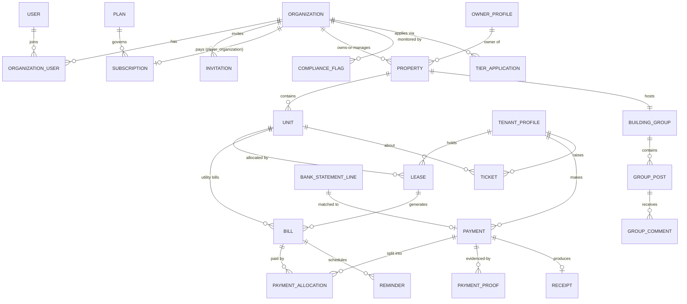

# GoProperty — Database Schema

Design baseline for MySQL 8, also compatible with MariaDB 10.6+ (common on cPanel/Plesk shared hosting). Conventions:

- Money is **integer kobo** (`_kobo` suffix). Never floats.
- All statuses are PHP backed enums persisted as strings; values listed here.
- Tenant-scoped tables carry `organization_id` (FK, indexed) unless noted. See [ARCHITECTURE.md § 4](ARCHITECTURE.md).
- Every table: `$table->id()`, `$table->timestamps()`, soft deletes only where stated.
- `media` table (spatie) and `activity_log`, `jobs`, `cache` etc. are implied and not repeated here.

## Domain Map

## 1. Identity & Organizations

### users
Customer-side people only (agency staff, owners, tenants). `name`, `email` (unique nullable — tenants may be phone-only), `phone` (unique nullable), `email_verified_at`, `phone_verified_at` (set when the user opens an invitation/reset link delivered to that number by WhatsApp, or when the agency confirms it in person), `phone_verification_method` (nullable: `whatsapp_link`, `agency_confirmed`), `phone_confirmed_by_user_id` (nullable), `password` (nullable until the invitation link is used to set it), `two_factor_secret` / `two_factor_recovery_codes` (encrypted), `preferences` (json: channel toggles), `last_active_organization_id`. Soft deletes. GoProperty staff are in `platform_staff` (§ 8), never here.

### user_devices
Browsers a customer has signed in from ([UX_DESIGN.md § 3.1, § 3.3](UX_DESIGN.md)): `user_id`, `token_hash` (SHA-256 of a random token kept in the browser's encrypted, HttpOnly `gp_device` cookie; unique), `user_agent`, `ip_address`, `two_factor_trusted_until` (set by "Don't ask again on this device", `auth.trust_device_days`), `last_seen_at`. A sign-in from a browser new to an account that already has one sends the new-device email.

### owner_profiles
Person/company details of a **property owner** (distinct from the user record — an owner may never log in).
`organization_id`, `first_name/last_name` **or** `company_name`, `email`, `phone`, `address`, `state`, `lga`, `id_type` (`nin`, `cac`, `none`), `id_value` (encrypted), `notes`.

### tenant_profiles
`organization_id`, `user_id` (nullable — tenant may not have portal access yet), `first_name`, `last_name`, `email` (nullable), `phone` (required, unique per org), `address`, `occupation`, `emergency_contact` (json), `kyc_status` (`unverified`, `pending`, `verified`), `id_type`, `id_value` (encrypted), soft deletes. Unique: `(organization_id, phone)`.

### organizations
`name`, `slug` (unique; used in `goproperty.ng/o/{slug}`), `previous_slugs` (json, for redirects), `type` (`agency`, `property_owner`, `hybrid`), `cac_number` (nullable, encrypted), `address`, `state`, `lga`, `logo_media_id`, `status` (`onboarding`, `active`, `restricted`, `suspended`, `cancelled`), `transaction_tier` (`1`, `2`, `3` — the **approved** tier), `allow_support_access` (bool, default true), `platform_covered` (bool — platform owner pays the bill), `branding` (json: trading name, primary/accent colours, letterhead address/RC/phone/email/website, `signature_media_id`, document prefixes, invoice notes, receipt footer, layout `modern`/`classic`/`compact`, email sender name, `hide_powered_by` — see [BRANDING_DOCUMENTS.md § 1](BRANDING_DOCUMENTS.md)), `online_payment_cap_kobo` (nullable), `trial_ends_at`, soft deletes. Bank accounts moved to `organization_bank_accounts` (§ 4).

### organization_user
`organization_id`, `user_id`, `role` set via spatie teams; unique `(organization_id, user_id)`. Extras: `is_default` (for org switching).

### invitations
`organization_id`, `email`, `phone` (nullable), `role`, `kind` (`user`, `org_billing_transfer`), `target_organization_id` (for org-to-org invites), `billing_transfer_id` (nullable FK), `token` (unique, single use), `channel` (`email`, `whatsapp`, `link` — copy link / QR shared by the agency), `expires_at` (14 days), `opened_at`, `status` (`pending`, `accepted`, `declined`, `expired`, `cancelled`), `invited_by_user_id`, `accepted_at`. No SMS channel.

### billing_transfer_requests
Handover of the platform subscription bill between orgs. `from_organization_id`, `to_organization_id`, `subscription_id`, `status` (`pending`, `accepted`, `declined`, `cancelled`, `completed`), `initiated_by_user_id`, `responded_by_user_id`, `responded_at`, `completed_at` (set when payer + payment method actually switch).

## 2. SaaS Billing (platform ↔ customers)

Full semantics in [BILLING_PAYMENTS.md](BILLING_PAYMENTS.md).

### plans
`name`, `description`, `cycle` (`monthly`, `annual`), `base_price_kobo`, `included_units`, `unit_price_kobo` (per extra unit), `tier_rules` (json, optional band pricing), `annual_discount_percent`, `trial_days`, `is_active`, `sort_order`.

### plan_feature
`plan_id`, `feature_key`, `enabled`, `limit_value` (nullable int). `feature_key` from registry (`building_group`, `tickets`, `sms_reminders`, `expenses`, …).

### subscriptions
`organization_id` (the customer), `plan_id`, `payer_organization_id` (nullable — defaults to `organization_id`; moves on billing transfer), `status` (`trialing`, `active`, `past_due`, `grace`, `suspended`, `cancelled`), `current_period_start`, `current_period_end`, `cancel_at_period_end`, `last_billed_units` (int snapshot), `paystack_customer_code`, `paystack_authorization` (json), `ended_at`.

### subscription_unit_events
Metering ledger. `subscription_id`, `unit_count` (int), `counted_units` (int — after included-units adjustment), `effective_date`, `reason` (`unit_added`, `unit_removed`, `plan_change`, `initial`), `source_bill_id` (nullable).

### platform_invoices
`organization_id`, `subscription_id`, `number` (unique, `{PR}-{YYYY}-{seq}`), `subtotal_kobo`, `vat_kobo`, `total_kobo`, `units_billed`, `period_start`, `period_end`, `status` (`open`, `paid`, `void`, `uncollectible`), `due_date`, `paid_at`, `notes`.

### platform_payments
`platform_invoice_id`, `method` (`paystack`, `bank_transfer`), `amount_kobo`, `currency` (`NGN`), `paystack_reference` (unique nullable), `paystack_channel` (nullable), `bank_transfer_proof_media_id` (nullable), `status` (`pending`, `confirmed`, `rejected`, `refunded`), `confirmed_by_user_id` (platform staff, for bank transfers), `confirmed_at`, `rejection_reason`.

### webhook_log
`provider` (`paystack`), `event`, `reference`, `payload` (json), `signature_valid`, `processed_at`, `processing_error` (nullable).

### organization_feature_overrides
`organization_id`, `feature_key`, `enabled`, `limit_value`, `granted_by_user_id`, `reason`. Platform-owner grants outside the plan.

## 3. Properties & Leasing

### properties (buildings)
`organization_id`, `owner_profile_id`, `name`, `slug`, `property_type` (`block_of_flats`, `estate`, `duplex`, `bungalow`, `commercial`, `mixed`), `address`, `state`, `lga`, `landmark`, `description`, `amenities` (json array), `year_built`, `photo_media_id`, `status` (`active`, `archived`), soft deletes. Unique: `(organization_id, slug)`.

### units (blocks/apartments)
`property_id`, `organization_id`, `unit_label` (e.g. `Block A`, `Flat 3B`), `unit_type` (`apartment`, `self_contain`, `shop`, `office`), `bedrooms`, `bathrooms`, `size_sqm`, `floor`, `base_rent_kobo`, `service_charge_kobo`, `status` (`vacant`, `reserved`, `occupied`, `under_maintenance`, `unavailable`), `description`, soft deletes. Unique: `(property_id, unit_label)`.

### leases
The allocation + contract. `organization_id`, `unit_id`, `tenant_profile_id`, `contract_number` (unique per org), `billing_cycle` (`daily`, `weekly`, `monthly`, `quarterly`, `semi_annual`, `annual`, `biennial`), `start_date`, `end_date`, `rent_amount_kobo`, `deposit_kobo` (caution deposit held — a liability refunded at move-out), `paid_until` (date the tenant has paid up to; set on import or by confirmed payments), `next_billing_date` (next period start to bill — maintained by the leasing service via `CycleCalculator`), `other_charges` (json), `due_day_offset` (int, default 0 — bill N days before period start), `auto_renew` (bool), `status` (`draft`, `active`, `expired`, `terminated`, `renewed`), `renewal_of_lease_id` (nullable self FK), `terminated_at`, `termination_reason`, `notes`, `document_media_id` (generated contract PDF), soft deletes. Index: `(organization_id, status)`, `(unit_id, status)`.

### lease_renewal_offers
Optional but recommended: `lease_id`, `proposed_rent_kobo`, `proposed_cycle`, `expires_at`, `status` (`pending`, `accepted`, `declined`, `expired`), `responded_at`. (MVP can generate the renewal lease directly; the offer table supports tenant-facing accept flows later.)

### agent_building
Assignment narrowing (optional per ARCHITECTURE § 5). `organization_id`, `user_id`, `property_id`, unique `(user_id, property_id)`.

## 4. Customer Billing (rent, utilities, payments)

### utility_types
`organization_id`, `name` (e.g. Security levy, Water), `code`, `default_amount_kobo`, `default_cycle` (same enum as lease), `metered` (bool — electricity), `active`.

### unit_utility_settings
`organization_id`, `unit_id`, `utility_type_id`, `amount_kobo`, `cycle`, `metered`, `active`, `effective_from`. Unique: `(unit_id, utility_type_id)`.

### utility_readings
`unit_utility_setting_id`, `organization_id`, `reading_date`, `previous_value`, `current_value`, `consumption`, `rate_kobo` (per unit), `recorded_by_user_id`, `bill_id` (nullable FK).

### bills
`organization_id`, `type` (`rent`, `utility`, `opening_balance`, `other`), `billable` (morph: `Lease` or `Unit`), `lease_id` (nullable), `tenant_profile_id` (who must pay — always set), `payment_reference` (short unique code, e.g. `GP-7KQ2M`, globally unique, for transfer narrations), `number` (unique per org), `description`, `amount_kobo`, `due_date`, `period_start`, `period_end`, `status` (`unpaid`, `partially_paid`, `paid`, `overdue`, `void`), `voided_at`, `document_media_id`, `branding_snapshot` (json — branding as at issue), `verification_code` (unique), `import_batch_id` (nullable), soft deletes. Indexes: `(organization_id, status, due_date)`, `(billable_type, billable_id)`, `(type, status)`.

### bill_items
`bill_id`, `label`, `amount_kobo`, `quantity` (default 1), `meta` (json).

### payments
One incoming payment from a tenant (may cover several bills). `organization_id`, `tenant_profile_id`, `recorded_by_user_id` (nullable for automatic), `amount_kobo`, `method` (`bank_transfer`, `cash`, `pos`, `paystack`), `source` (`statement_match`, `paystack_webhook`, `proof_upload`, `manual`), `bank_statement_line_id` (nullable), `paystack_reference` (nullable, unique per org), `payer_name`, `payer_type` (`individual`, `corporate` — for cash-threshold checks), `paid_at`, `status` (`pending_confirmation`, `confirmed`, `rejected`, `refunded`), `reference` (org-provided or generated), `confirmation_note`, `confirmed_by_user_id`, `confirmed_at`, `rejection_reason`, `receipt_id` (nullable FK), soft deletes. Index: `(organization_id, status)`, `(organization_id, paid_at)`.

### payment_allocations
How a payment is split across bills. `payment_id`, `bill_id`, `amount_kobo`. Sum of allocations ≤ payment amount; the remainder goes to tenant credit.

### tenant_credit_entries
Simple credit ledger per tenant per org. `organization_id`, `tenant_profile_id`, `amount_kobo` (+ credit / − used), `reason` (`overpayment`, `applied_to_bill`, `refund`, `adjustment`), `payment_id` / `bill_id` (nullable), `created_by_user_id`.

### organization_bank_accounts
`organization_id`, `bank_code`, `bank_name`, `account_number` (encrypted), `account_name`, `name_check_result` (account name returned by Paystack lookup), `name_checked_at`, `is_default`, `active`.

### organization_paystack_connections
The organization's **own** Paystack account. `organization_id` (unique), `public_key`, `secret_key` (encrypted), `webhook_token` (part of `/webhooks/paystack/{org-ulid}`), `mode` (`test`, `live`), `status` (`pending_test`, `active`, `failing`, `disconnected`), `last_event_at`, `connected_by_user_id`.

### bank_statement_imports
`organization_id`, `organization_bank_account_id`, `media_id` (uploaded file), `format` (`csv`, `xlsx`, `pdf`), `column_mapping` (json, saved per bank), `period_start`, `period_end`, `lines_total`, `lines_matched`, `status` (`processing`, `ready`, `failed`), `uploaded_by_user_id`.

### bank_statement_lines
`bank_statement_import_id`, `organization_id`, `transaction_date`, `amount_kobo`, `direction` (`credit`, `debit`), `narration`, `counterparty_name`, `balance_kobo` (nullable), `line_hash` (unique per org — dedupes re-uploads), `match_status` (`unmatched`, `suggested`, `matched`, `ignored`), `match_confidence` (`high`, `medium`), `suggested_bill_id` (nullable), `payment_id` (nullable).

### payment_proofs
`payment_id`, `uploaded_by_user_id`, `media_id`, `note`, `uploaded_at`.

### receipts
`payment_id`, `organization_id`, `number` (unique), `verification_code` (unique, used in the QR code and `goproperty.ng/verify/{code}`), `issued_at`, `document_media_id`, `issued_by_user_id`, `voided_at`, `voided_by_user_id`, `void_approved_by_user_id` (second approver), `void_reason`.

### expenses
`organization_id`, `property_id` (nullable), `unit_id` (nullable), `category` (`repairs`, `utilities`, `staff`, `taxes`, `agency_ops`, `other`), `description`, `amount_kobo`, `spent_at`, `vendor_name`, `receipt_media_id`, `recorded_by_user_id`, `bill_id` (nullable — expense linked to a ticket/job), `ticket_id` (nullable).

### document_counters
Atomic sequence allocation. `organization_id`, `doc_type`, `year`, `last_seq`, unique `(organization_id, doc_type, year)`.

## 5. Maintenance Tickets

### tickets
`organization_id`, `unit_id`, `property_id`, `lease_id` (nullable), `raised_by_tenant_profile_id` (nullable) / `raised_by_user_id`, `category` (`plumbing`, `electrical`, `structural`, `cleaning`, `security`, `appliance`, `other`), `priority` (`low`, `medium`, `high`, `urgent`), `status` (`draft`, `submitted`, `under_review`, `in_progress`, `resolved`, `closed`, `reopened`), `title`, `description`, `assigned_to_user_id` (nullable), `resolved_at`, `closed_at`, `reopen_count`, soft deletes. Index: `(organization_id, status)`, `(assigned_to_user_id, status)`.

### ticket_messages
`ticket_id`, `author_user_id`, `body`, `is_internal` (bool — staff-only notes), `read_at_by_tenant`, `read_at_by_staff`.

### ticket_status_history
`ticket_id`, `from_status`, `to_status`, `changed_by_user_id`, `note`, `changed_at`. (Also mirrored to activity log.)

## 6. Building Group

### building_groups
`property_id`, `organization_id`, `name`, `description`, `settings` (json: who can post, image toggles), `is_active`.

### group_members
`building_group_id`, `user_id`, `member_type` (`tenant`, `agent`, `owner`, `platform_viewer`), `role` (`member`, `moderator`, `admin`), `muted_until`, `joined_at`, unique `(building_group_id, user_id)`.

### group_posts
`building_group_id`, `author_user_id`, `body` (sanitized HTML subset, max 5 000), `status` (`published`, `hidden`, `removed`), `pinned_at`, `edited_at`, `last_activity_at` (bump on comment), soft deletes. Index: `(building_group_id, status, last_activity_at)`.

### group_comments
`group_post_id`, `parent_id` (nullable self FK — one level of replies), `author_user_id`, `body`, `status` (`published`, `hidden`, `removed`), soft deletes.

### group_reactions
`user_id`, `reactable_type` (`group_post` / `group_comment`), `reactable_id`, `emoji` (from curated set), unique `(user_id, reactable_type, reactable_id, emoji)`.

### group_moderation_events
`building_group_id`, `actor_user_id`, `action` (`hide`, `remove`, `pin`, `unpin`, `mute_member`, `unmute_member`), `target` (morph), `reason`.

## 7. Reminders & Deliveries

### reminders
`organization_id`, `remindable_type` / `remindable_id` (Bill, Lease, Subscription…), `type` (`rent_due`, `utility_due`, `lease_renewal`, `bill_overdue`, `saas_invoice_due`), `due_date`, `offset_days`, `channel` (`email`, `sms`), `send_at`, `status` (`pending`, `sent`, `failed`, `skipped`), `recipient_user_id` (nullable), `recipient_phone`, `dedupe_key` (unique: `type|remindable|channel|offset|due_date`), `sent_at`.

### notification_deliveries
`reminders` send outcomes + ad-hoc notifications. `notification_type`, `channel`, `recipient_user_id` (nullable), `recipient_contact`, `subject`, `status` (`queued`, `sent`, `delivered`, `failed`, `bounced`), `provider` (`termii`, `mailgun`, …), `provider_message_id`, `error`, `cost_kobo` (SMS), `sent_at`.

### organization_whatsapp_connections
The organization's **own** WhatsApp Business Platform account (optional). `organization_id` (unique), `waba_id`, `phone_number_id`, `display_phone_number`, `access_token` (encrypted), `app_secret` (encrypted), `webhook_verify_token`, `status` (`pending_test`, `active`, `failing`, `disconnected`), `templates_synced_at`, `connected_by_user_id`.

### whatsapp_templates
Synced from Meta. `organization_id`, `organization_whatsapp_connection_id`, `meta_template_id`, `name`, `language`, `category` (`utility`, `marketing`, `authentication`), `status` (`approved`, `pending`, `rejected`, `paused`, `disabled`), `components` (json), `variable_count`, `synced_at`. Unique `(organization_id, name, language)`.

### notification_channel_mappings
Per organization, per event. `organization_id`, `event_key` (`bill.issued`, `reminder.rent_due.t7`, `receipt.issued`, …), `channel_order` (json, e.g. `["whatsapp","sms"]`; email always also sent where the category requires), `whatsapp_template_id` (nullable), `variable_map` (json: template variable → GoProperty placeholder), `active`.

### whatsapp_opt_ins
`organization_id`, `tenant_profile_id`, `phone`, `opted_in_at`, `source` (`portal`, `import_confirmation`, `agent_recorded`), `opted_out_at`.

### sms_credit_entries
Ledger of SMS credits. `organization_id`, `credits` (+ allowance/purchase, − usage), `reason` (`monthly_allowance`, `purchase`, `usage`, `adjustment`, `expiry`), `notification_delivery_id` / `platform_invoice_id` (nullable), `created_at`. Balance = sum.

## 8. Platform Operations

### platform_staff
GoProperty staff (separate `staff` guard). `name`, `email` (unique), `phone`, `password`, `two_factor_secret` / `two_factor_recovery_codes` (encrypted, required), `status` (`invited`, `active`, `deactivated`), `ip_allowlist` (json, nullable), `last_login_at`, `remember_token`, `two_factor_confirmed_at`. Roles via spatie on the `staff` guard. The 2FA columns are nullable in the table: the command-line installer creates the first account before 2FA is enrolled, and the console refuses sign-in until it is (INSTALLER.md § 7). Created in P00-06; the guard and console come in P00-08.

### Staff roles & permissions
spatie `roles` / `permissions` / `role_has_permissions` / `model_has_roles` on the `staff` guard. Extra columns on `roles`: `is_default` (shipped role), `is_protected` (`super-admin`, not editable), `description`, `active`. Permissions are seeded from code (one catalogue); roles are data and editable in the console.

### approval_requests
Two-person rule. `action` (`refund`, `production_restore`, `role_grant`, `write_impersonation`, `data_purge`), `subject` (morph), `requested_by_staff_id`, `approved_by_staff_id`, `status` (`pending`, `approved`, `rejected`, `expired`), `reason`, `decided_at`.

### impersonation_sessions
`staff_id`, `user_id`, `organization_id`, `reason`, `mode` (`read_only`, `write`), `approval_request_id` (nullable), `started_at`, `ended_at`, `ended_reason` (`manual`, `timeout`), `ip`, `user_agent`.

### authentication_logs
Both guards. `authenticatable_type` (`user`, `platform_staff`), `authenticatable_id` (nullable for unknown accounts), `attempted_identifier` (hashed email/phone for failed attempts), `event` (`login_success`, `login_failed`, `passkey_login`, `logout`, `2fa_passed`, `2fa_failed`, `recovery_code_used`, `turnstile_failed`, `invitation_accepted`, `reset_link_sent`, `agency_signin_link_created`, `password_reset`, `lockout`), `ip`, `user_agent`, `location`, `is_new_device`, `created_at`.

### activity_log (extra columns)
spatie activitylog (v5: `log_name`, `description`, `subject`, `event`, `causer`, `attribute_changes`, `properties`) plus `impersonator_staff_id`, `ip`, `user_agent`, `reason`, `prev_hash`, `hash` (append-only chain). The base table exists since P00-07; the extra columns and the chain come in P00-11. `activitylog:clean` must never be scheduled (retention: [PLATFORM_CONSOLE.md § 7](PLATFORM_CONSOLE.md)).

### email_templates / email_template_versions
`email_templates`: `key` (unique, e.g. `bill.issued`), `category` (`security`, `transactional`, `reminder`, `marketing`), `allowed_placeholders` (json), `current_version_id`, `active`. `email_template_versions`: `email_template_id`, `subject`, `body_markdown`, `version`, `created_by_staff_id`, `created_at`.

### backup_destinations
`name`, `driver` (`s3`, `google_drive`), `config` (encrypted json), `applies_to` (`db`, `files`, `both`), `active`.

### daily_platform_metrics
Nightly analytics snapshot. `date`, `metric` (e.g. `mrr_kobo`, `active_orgs`, `units_total`, `collections_recorded_kobo`), `dimension` (nullable, e.g. tier, channel, state), `value`. Unique `(date, metric, dimension)`.

### settings
`key`, `value` (json), `scope_type` + `scope_id` (`global`/0, or `organization`/the org's id; not NULL, because MySQL and MariaDB allow repeated NULLs in a unique index). Unique `(scope_type, scope_id, key)`. Keys are declared in a registry (`config/settings.php`, or `SettingsRegistry::define()` from a module) with type, default, rules, scope, secret flag, permission and step-up; `App\Settings\SettingsStore` validates, caches per scope and logs every change. Secret values (e.g. `auth.turnstile_secret_key`) are stored encrypted, cached encrypted, and logged only as `[secret]`. Global keys and their rules are listed in [PLATFORM_CONSOLE.md § 9](PLATFORM_CONSOLE.md); drafts and published versions of theme/site/SEO keys are kept in `setting_versions` (`version`, `keys` json, `status` `draft`/`published`/`archived`, `published_by_staff_id`, `published_at`).

### passkeys
WebAuthn credentials (Fortify passkeys). `authenticatable_type` (`user`, `platform_staff`), `authenticatable_id`, `name` ("iPhone", "Work laptop"), `credential_id` (unique), `credential` (json), `last_used_at`. A user can have several; removing the last one is allowed only if they still have a password.

### backup_runs
`type` (`db`, `files`), `filename`, `size_bytes`, `backup_destination_id`, `status` (`running`, `success`, `failed`), `verified_at` (nullable), `started_at`, `finished_at`, `triggered_by` (`schedule`, `manual`), `triggered_by_staff_id`, `notes`.

### backup_restores
`backup_run_id`, `target` (`temporary`, `staging`, `production`), `approval_request_id` (required for production), `requested_by_staff_id`, `status`, `started_at`, `finished_at`, `notes`.

### installation_state
The installer's database marker ([INSTALLER.md § 3](INSTALLER.md)). One row, `id` = 1 (tinyint primary key). `status` (`configured`, `migrating`, `owner_ready`, `finalized`), `version` (release that installed or last finalized), `finalized_at` (nullable), timestamps. With `storage/app/installed.lock` it decides whether the site is open; the installer stays closed if either says `finalized`.

## 8A. Data Import

### import_batches
See [DATA_IMPORT.md](DATA_IMPORT.md). `organization_id`, `kind` (`workbook`, `owners`, `properties`, `units`, `tenants`, `leases`, `opening_balances`, `utilities`, `payment_history`, `staff`), `media_id` (uploaded file), `column_mapping` (json), `status` (`uploaded`, `dry_run_failed`, `dry_run_passed`, `committing`, `committed`, `partially_failed`, `rolled_back`), `dry_run_report` (json: counts, errors, warnings), `result_counts` (json), `created_by_user_id`, `committed_by_user_id`, `committed_at`, `rolled_back_at`, `rolled_back_by_user_id`.

### import_column_mappings
Saved mappings for reuse. `organization_id`, `kind`, `name` (e.g. "My GTBank sheet"), `mapping` (json).

**Import provenance:** `owner_profiles`, `properties`, `units`, `tenant_profiles`, `leases`, `bills`, `unit_utility_settings` and `payments` gain `import_batch_id` (nullable) and `external_ref` (nullable; unique per `organization_id` within each table) so re-imports update instead of duplicating and batches can be rolled back.

## 9. Compliance & Transaction Tiers

Rules in [ONBOARDING_COMPLIANCE.md § 5](ONBOARDING_COMPLIANCE.md).

### transaction_tiers
Configurable by platform staff; versioned (a new row per change). `tier` (`1`, `2`, `3`), `version`, `name`, `annual_volume_limit_kobo` (nullable = no cap), `single_payment_limit_kobo` (nullable = no cap), `review_threshold_kobo` (single payments above this are reviewed, e.g. ₦100m for Tier 3), `required_documents` (json list of document types), `review_sla_days`, `effective_from`, `proposed_by_staff_id`, `approval_request_id`. Launch values: Tier 1 ₦50m / ₦5m, Tier 2 ₦500m / ₦50m, Tier 3 no cap / review above ₦100m.

### organization_tier_overrides
Custom limits for one organization. `organization_id`, `annual_volume_limit_kobo`, `single_payment_limit_kobo`, `reason`, `expires_at`, `set_by_staff_id`.

### tier_applications
`organization_id`, `from_tier`, `requested_tier`, `declared_annual_volume_kobo`, `status` (`draft`, `submitted`, `under_review`, `more_info_needed`, `approved`, `rejected`), `reviewed_by_staff_id`, `review_note`, `submitted_at`, `decided_at`.

### compliance_documents
`organization_id`, `tier_application_id` (nullable), `type` (`owner_id`, `cac_certificate`, `cac_status_report`, `scuml_certificate`, `proof_of_address`, `director_id`, `beneficial_owners`, `aml_policy`, `state_regulator_registration`, `professional_membership`), `media_id` (compliance bucket), `document_number` (encrypted, nullable), `issued_at`, `expires_at` (nullable), `status` (`pending`, `accepted`, `rejected`, `expired`), `reviewed_by_staff_id`, `review_note`.

### compliance_flags
`organization_id`, `type` (`volume_80`, `forecast_over`, `volume_100`, `single_over`, `cash_threshold`, `possible_structuring`, `spike`, `document_expiring`, `document_expired`), `subject` (morph, e.g. payment), `metric_value_kobo`, `limit_kobo`, `status` (`open`, `acknowledged`, `resolved`, `dismissed`), `assigned_staff_id`, `resolution_note`, `grace_ends_at` (for `volume_100`), `dedupe_key` (unique), timestamps.

### organization_volume_snapshots
Daily per org. `organization_id`, `date`, `rolling_12m_volume_kobo`, `forecast_12m_kobo`, `largest_payment_kobo`, `tier`. Unique `(organization_id, date)`.

## Integrity Rules Worth Enforcing in Code (and migrations where possible)

1. A unit has **at most one** active lease at a time — enforced in the leasing service inside a transaction with a lock on the unit row (`SELECT … FOR UPDATE`), plus a daily consistency check job.
2. Allocations to a bill cannot exceed its outstanding balance; any excess of a payment goes to `tenant_credit_entries` (never silently lost or rejected when the money has already arrived).
3. A bill in `void` state accepts no payments; a confirmed payment cannot be deleted — only reversed via a refund/credit record (activity-logged).
4. `billing_transfer_requests` and `subscriptions.payer_organization_id` move **only** through the accept flow (single service method, no direct writes).
5. Reminder `dedupe_key` unique index is the idempotency guarantee — jobs may re-run safely.
6. Deleting an organization is a soft-delete cascade *suspend* first; hard purge only via the NDPA erasure tooling after the 90-day retention window.

## Indexing & Volume Notes

- `bills`, `payments`, `reminders` grow fastest (per-tenant per-cycle). Composite indexes above cover the three hot paths: org dashboard (org+status), tenant portal (tenant/bill), reminder dispatch (status+send_at).
- Reporting aggregates (sales/expenses/occupancy) should query `bills`, `payments`, `expenses` by `organization_id + date` — covered by the indexes; add summary tables only if dashboards exceed ~200 ms.
