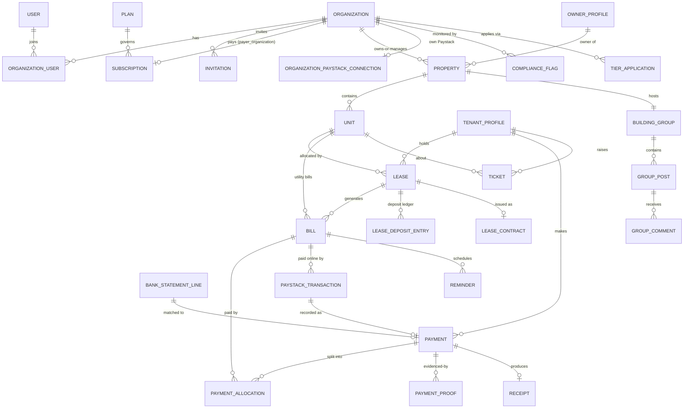

# GoProperty — Database Schema

Design baseline for MySQL 8, also compatible with MariaDB 10.6+ (common on cPanel/Plesk shared hosting). Conventions:

- Money is **integer kobo** (`_kobo` suffix). Never floats.
- All statuses are PHP backed enums persisted as strings; values listed here.
- Tenant-scoped tables carry `organization_id` (FK, indexed) unless noted. See [ARCHITECTURE.md § 4](ARCHITECTURE.md).
- Every table: `$table->id()`, `$table->timestamps()`, soft deletes only where stated.
- `activity_log`, `jobs`, `cache` etc. are implied and not repeated here. The media library's `media` table is described in § 1 (it carries `organization_id`, unlike Spatie's stock table); columns named `*_media_id` point at it.

## Domain Map

## 1. Identity & Organizations

### users
Customer-side people only (agency staff, owners, tenants). `name`, `email` (unique nullable — tenants may be phone-only), `phone` (unique nullable), `email_verified_at`, `phone_verified_at` (set when the user opens an invitation/reset link delivered to that number by WhatsApp, or when the agency confirms it in person), `phone_verification_method` (nullable: `whatsapp_link`, `agency_confirmed`), `phone_confirmed_by_user_id` (nullable), `password` (nullable until the invitation link is used to set it), `two_factor_secret` / `two_factor_recovery_codes` (encrypted), `preferences` (json: channel toggles; added in P05-02, migration `2026_11_30_110101`: `{"reminders": {"email": bool, "sms": bool}}`, unset is on, read and written only through `App\Notifications\Preferences\NotificationPreferences`), `last_active_organization_id`. Soft deletes. GoProperty staff are in `platform_staff` (§ 8), never here. The three phone-verification columns were added in P03-01b (migration `2026_11_08_010101`; `App\Enums\PhoneVerificationMethod`, set only through `App\Auth\PhoneVerification`: the number the account has now, once, never by SMS). A phone-only account (`email` null, a tenant invited by WhatsApp or a shared link) has no address to confirm, so it passes the `verified` middleware (`User::hasVerifiedEmail()`), but it cannot sign up an organization (`OrganizationPolicy::create` needs a confirmed address).

### user_devices
Browsers a customer has signed in from ([UX_DESIGN.md § 3.1, § 3.3](UX_DESIGN.md)): `user_id`, `token_hash` (SHA-256 of a random token kept in the browser's encrypted, HttpOnly `gp_device` cookie; unique per account, `(token_hash, user_id)`: a browser several accounts sign in from keeps one token), `user_agent`, `ip_address`, `two_factor_trusted_until` (set by "Don't ask again on this device", `auth.trust_device_days`), `last_seen_at`. A sign-in from a browser new to an account that already has one sends the new-device email.

### owner_profiles
Person/company details of a **property owner** (distinct from the user record — an owner may never log in).
`organization_id`, `user_id` (nullable FK to `users`, null on delete; P03-15: the owner's portal account, set and cleared only through `Modules\Properties\OwnerPortal\OwnerLinks` — the owner invitation's acceptance and the agency's "Remove access"; unique `(organization_id, user_id)`, so one owner profile per user in an organization; the owner portal finds a user's owner profiles across organizations by it, one unscoped read of `organization_id` and `id`, `OwnerPortal\LinkedOwnerProfiles`; Properties migration `2026_11_19_150101`), `type` (`person`, `company`), `first_name/last_name` (person) **or** `company_name` (company), `display_name` (the company name or "First Last", set on save; for lists, search and import matching), `email` (lower case), `phone` (E.164, `App\Support\PhoneNumber`), `address`, `state`, `lga`, `id_type` (`nin`, `cac`, `none`), `id_value` (encrypted; NIN 11 digits, CAC like `RC 1234567`; null when `none`), `notes`, `import_batch_id` / `external_ref` (import provenance, § 8A; no foreign key on `import_batch_id` until `import_batches` exists), soft deletes (archive). Unique `(organization_id, external_ref)`; indexes `(organization_id, import_batch_id)`, `(organization_id, deleted_at, display_name)`, `(organization_id, phone)`, `(organization_id, email)`. Built in P02-01a: `Modules\Properties\Models\OwnerProfile`, written only through `Modules\Properties\Owners\OwnerProfiles` (audited) and the Owners import sheet `Modules\Properties\Import\OwnersImportTarget` (P02-06c; matched by `external_ref`, then `phone`, then `display_name`, archived owners restored and audited).

### tenant_profiles
`organization_id`, `user_id` (nullable FK, null on delete — tenant may not have portal access yet), `first_name`, `last_name`, `email` (nullable, lower case), `phone` (required, E.164 through `App\Support\PhoneNumber`, unique per org), `address`, `occupation`, `emergency_contact` (json `{name, phone, relationship}`: the next of kin, phone in E.164), `kyc_status` (`unverified`, `pending`, `verified`; default `unverified`), `id_type` (`nin`, `passport`, `drivers_licence`, `voters_card`, `none`; default `none`), `id_value` (encrypted; kept in capitals without spaces or dashes; null when `none`), `import_batch_id` / `external_ref` (import provenance, § 8A; no foreign key on `import_batch_id`: `import_batches` belongs to the Import module), soft deletes (archive). Unique: `(organization_id, phone)` and `(organization_id, external_ref)`, archived rows included (an import restores an archived match instead of colliding); indexes `(organization_id, import_batch_id)`, `(organization_id, deleted_at, last_name, first_name)`, `(organization_id, email)`. Built in P02-06b: `Modules\Tenants\Models\TenantProfile` (organization-scoped), written only by the tenant pages' audited writer `Modules\Tenants\Profiles\TenantProfiles` (P03-01a: add, edit, archive, restore; a phone number of an archived tenant is refused with "restore instead") and the tenants import target (`Modules\Tenants\Import\TenantsImportTarget`); `user_id` is set only by the portal invitation's acceptance (`Modules\Tenants\Portal\PortalInvitationAcceptance`, P03-01b). The portal finds a user's tenant profiles across organizations by `user_id` (`Portal\LinkedTenantProfiles`: one unscoped read of `organization_id`, archived profiles left out; ARCHITECTURE.md § 4). `kyc_status` is set on the edit page; `pending`/`verified` need an ID on file. No building link: a tenant reaches a building only through a lease (P03-03a: agent narrowing reads the buildings of a tenant's leases through `Modules\Leasing\Contracts\TenantLeases`; archiving is refused while a draft or active lease holds a unit for them), so a management handover (P03-14) moves no tenant row by itself: P03-14 decides how the tenants of moved leases follow them into the receiving organization, where the phone number must again be unique. **Moved tenants (P04-04, BILLING § 7.4):** the record left behind when a tenant moves with their building keeps its history; archiving it is refused while it has unpaid bills or credit there, and it archives itself (soft delete, audited `tenant.archived` with reason `moved_and_settled`) once both are clear (`Modules\Tenants\Profiles\MovedTenantArchive`; no new column: where the tenant went is read from `management_handover_tenants` through Core's `App\Tenancy\Moves\MovedTenants`). A tenant coming back lands on that record (restored if archived) before any phone match.

### organizations
`name`, `slug` (unique; used in `goproperty.ng/o/{slug}`), `previous_slugs` (json, for redirects), `type` (`agency`, `property_owner`, `hybrid`), `cac_number` (nullable, encrypted), `address`, `state`, `lga`, `logo_media_id`, `status` (`onboarding`, `active`, `restricted`, `suspended`, `cancelled`), `transaction_tier` (`1`, `2`, `3` — the **approved** tier), `platform_covered` (bool — platform owner pays the bill), `branding` (json: trading name, primary/accent colours, letterhead address/RC/phone/email/website, `signature_media_id`, document prefixes, invoice notes, receipt footer, layout `modern`/`classic`/`compact`, email sender name, `hide_powered_by` — see [BRANDING_DOCUMENTS.md § 1](BRANDING_DOCUMENTS.md); as built in P01-05 the keys are `trading_name`, `primary_color`, `accent_color` (null = none), `address`, `rc_number`, `phone`, `email`, `website`, `invoice_prefix`, `receipt_prefix`, `lease_prefix`, `invoice_notes`, `receipt_footer`, `layout`, `email_sender_name`, `hide_powered_by`, `logo_media_id`, `signature_media_id`, `stamp_media_id` (ids of the organization's `branding` media, P02-05; `logo_media_id` equals the column of the same name; P01-05's interim `logo_file` / `signature_file` / `stamp_file` paths were moved into media rows by migration `2026_11_02_050002`); null branding means the defaults of `App\Branding\Branding::fromOrganization()`; written only by `App\Branding\BrandingSettings`), `online_payment_cap_kobo` (nullable: the largest outstanding amount tenants may pay online through the organization's own Paystack, ONBOARDING_COMPLIANCE.md § 4.2; null = the standard ₦1,000,000; set by org-owners on Settings → Online payments through `Modules\OnlinePayments\Connections\PaystackConnections`, ₦1,000–₦100,000,000, audited `paystack.online_cap_changed`; P03-08), `trial_ends_at` (set when the signup wizard's plan step is first saved: 14 days, `plans.trial_days`), `signup_plan_key` (nullable; **interim**, P01-02: the plan chosen in the signup wizard, a key of the plan catalogue `config/plans.php`, until P06-01 creates the `subscriptions` row from it, after which the subscription is the source of truth), `suspended_at` (nullable), `status_before_suspension` (nullable; the status reactivation returns to, e.g. `restricted` stays `restricted`), soft deletes. Bank accounts moved to `organization_bank_accounts` (§ 4). `status` `suspended` or `cancelled` makes the organization read-only for its members ([ARCHITECTURE.md § 4](ARCHITECTURE.md)); staff suspend and reactivate through `App\Platform\Customers\OrganizationSuspension` (P01-06), which sets the two suspension columns and writes the reason and staff member to the audit log. `status` is `onboarding` while the signup wizard runs and becomes `active` when it ends. `platform_covered` is set at signup for type `property_owner` ([ONBOARDING_COMPLIANCE.md § 2](ONBOARDING_COMPLIANCE.md)); `transaction_tier` starts at `1` and changes only when compliance approves an application, through `App\Compliance\OrganizationTier` (P01-03; one audit entry `organization.tier_changed` with the staff member and reason).

### organization_user
Membership. `organization_id`, `user_id`, `is_default` (the organization the user last switched to; at most one per user, set by the organization switcher and used to choose where they land after signing in); unique `(organization_id, user_id)`. Roles are not a column here: they are spatie role assignments per organization (`model_has_roles.organization_id`, below). Read per organization through `App\Models\Membership` (organization-scoped); a user's own list through `User::organizations()`. Tenants never get a row (P03 decision 4); a property owner who accepted an owner invitation gets one holding `property-owner` only (P03-15), which never opens the workspace, and loses it with "Remove access" when they hold nothing else there.

### organization_onboardings
The signup wizard's saved state, one row per organization that signed up through it (P01-02, [ONBOARDING_COMPLIANCE.md § 2](ONBOARDING_COMPLIANCE.md)); `App\Models\OrganizationOnboarding`, organization-scoped. `organization_id` (unique), `started_by_user_id` (nullable), `step` (`organization`, `tier`, `plan`, `collections`, `data`: the step the owner is on, so signing in again resumes there), `declared_annual_volume_kobo` (nullable: expected yearly collections stated at the Tier step), `requested_tier` (nullable `1`–`3`: the tier asked for; a Tier 2/3 request waits for its documents and review in P01-03 while `organizations.transaction_tier` stays the approved tier), `completed_at` (nullable: the wizard is over). Changed only through `App\Onboarding\OnboardingWizard`. Organizations made outside signup (seeders, staff) have no row and no wizard.

### onboarding_checklist_items
The setup checklist on the workspace dashboard (P01-02); `App\Models\OnboardingChecklistItem`, organization-scoped. `organization_id`, `item` (`tier`, `plan`, `collections`, `data`, `branding`), `status` (`pending`, `done`), `details` (json, e.g. `requested_tier`, `plan`), `completed_at`, `completed_by_user_id` (nullable); unique `(organization_id, item)`, index `(organization_id, status)`. Written only through `App\Onboarding\OnboardingChecklist` (`start()`, `complete()`, `reopen()`); the feature that finishes an item marks it done (bank account → `collections`, first import or property → `data`, branding saved → `branding`, Tier 2/3 approved → `tier`).

### roles, permissions, model_has_roles, model_has_permissions, role_has_permissions
spatie/laravel-permission with **teams** (team = organization, team column `organization_id`), shared by the `web` (customers) and `staff` guards ([ARCHITECTURE.md § 5](ARCHITECTURE.md)). Created in P01-01.
- `permissions`: `name`, `guard_name`; unique `(name, guard_name)`. Seeded from code: the customer catalogue is `App\Enums\OrganizationPermission` (`OrganizationRolesSeeder`), the staff catalogue `App\Platform\Staff\StaffPermission` (`StaffRolesSeeder`); both run by the installer.
- `roles`: `organization_id` (nullable FK), `name`, `guard_name`; unique `(organization_id, name, guard_name)`. `organization_id` is null for the five customer roles every organization shares (`org-owner`, `org-admin`, `agent`, `property-owner`, `tenant`, `App\Enums\OrganizationRole`) and for staff roles; set only for a role one organization defines for itself. MySQL allows repeated NULLs in the unique index, so shared roles are kept unique by the seeder and spatie's `create()`.
- `model_has_roles` / `model_has_permissions`: `id`, `role_id` / `permission_id` (FK, cascade), `model_type`, `model_id`, `organization_id` (nullable FK). For customers it is the organization the role applies in, always set (granting outside an organization or to a non-member is refused). For staff it is null: staff roles are global. Unique `(organization_id, role_id|permission_id, model_id, model_type)` and index `(model_id, model_type)`. Spatie's stub makes the team column part of the primary key, which cannot be null; the surrogate `id` allows staff rows.
- `role_has_permissions`: `permission_id`, `role_id`; primary key on both.

### invitations
A single-use link that brings a person into an organization (P01-04, [ONBOARDING_COMPLIANCE.md § 2](ONBOARDING_COMPLIANCE.md)); `App\Models\Invitation`, organization-scoped. `organization_id`, `kind` (`user`; `org_billing_transfer`: the link of a management handover, P03-14, first built as P02-04's billing transfer), `email` (nullable: tenants may be phone-only; lower-cased), `phone` (nullable), `roles` (json list of role names, one or more: an invitation may grant several roles, so this replaces the single `role` column first planned), `target_organization_id` (nullable FK, for org-to-org invites), `token_hash` (SHA-256 of the link's token, unique; the token itself is only in the link), `channel` (`email`; `whatsapp` and `link` — copy link / QR shared by the agency — come with tenant invitations, P03-01b), `status` (`pending`, `accepted`, `declined`, `expired`, `cancelled`), `expires_at` (14 days from the last send), `sent_at`, `send_count`, `opened_at` (first opening of the link), `invited_by_user_id`, `accepted_at`, `accepted_by_user_id`, `cancelled_at` (revoked); indexes `(organization_id, status, expires_at)`, `(organization_id, email)`, `(target_organization_id, status)`. A pending invitation past `expires_at` cannot be used and is recorded as `expired` when its link is opened. Sending again replaces `token_hash` (the old link dies) and restarts the 14 days. Member invitations (kind `user`) are written only by `App\Members\MemberInvitations` and `App\Members\InvitationAcceptance`, which ignore every other kind (the `/invitations/{token}` page and Settings → Members know only `user`). Kind `org_billing_transfer` (P02-04's name, kept) is the link of a **management handover** since P03-14: `management_handover_id` (nullable FK to `management_handovers`, restrict on delete; added by the Handovers module's migration `2026_11_21_090104`; P02-04's `billing_transfer_id` was dropped with its table) is set on it: the offering organization's invitation, `target_organization_id` the receiving one, no `email` (the receiving organization's owners are emailed), `roles` empty, its status following the handover (`pending`, then `accepted` once accepted, `declined`, `cancelled` or `expired`); written only by `Modules\Handovers\Handovers\HandoverService`, opened only at `/handovers/{token}`. No SMS channel.

**Tenant invitations and one-time sign-in links (P03-01b, P03 decision 4).** Two more kinds, written only by the Tenants module (`Modules\Tenants\Portal\TenantInvitations`, `PortalInvitationAcceptance`, `SignInLinks`), each opened only by its own page:
- `tenant`: invites a tenant to the portal. `tenant_profile_id` (nullable FK to `tenant_profiles`, restrict on delete; added by the Tenants module's migration `2026_11_08_010103` with the index `(organization_id, tenant_profile_id, kind, status)`), `roles` empty, `channel` `email` (then `email` is the tenant's address), `whatsapp` (the agency's own WhatsApp) or `link` (copy link / QR code), `phone` the tenant's number when sent. 14 days, single use; sending again (any channel) replaces `token_hash`, `channel`, `email`/`phone` and restarts the 14 days; at most one `pending`/`expired` row per tenant. Accepting sets `tenant_profiles.user_id` and never adds an `organization_user` row or a role.
- `sign_in_link`: the agency's one-time sign-in link for a tenant's existing account. `user_id` (nullable FK to `users`, null on delete; Core migration `2026_11_08_010102`) is the account it opens, `tenant_profile_id` the tenant, `phone` the account's number, `channel` `link` or `whatsapp`, `expires_at` 24 hours after it is made, single use (`accepted` when used); making a new one cancels the tenant's earlier pending ones.

For both, the page reads `organization_id` by the token's hash (one unscoped column) and loads the row inside that organization, as for kind `user`. `user_id` and `tenant_profile_id` are empty on the other kinds.

**Owner invitations (P03-15).** Kind `owner`, written only by the Properties module (`Modules\Properties\OwnerPortal\OwnerInvitations`, `OwnerInvitationAcceptance`) and opened only at `/owner/invitations/{token}`: invites a property owner to the owner portal. `owner_profile_id` (nullable FK to `owner_profiles`, restrict on delete; added by the Properties module's migration `2026_11_19_150102` with the index `(organization_id, owner_profile_id, kind, status)`), `roles` `["property-owner"]`, `channel` `email` (then `email` is the owner's address), `whatsapp` or `link` (both need the owner's phone number, kept in `phone`). 14 days, single use; sending again (any channel) replaces `token_hash`, `channel`, `email`/`phone` and restarts the 14 days; at most one `pending`/`expired` row per owner. Accepting sets `owner_profiles.user_id` and makes the user a member holding `property-owner` only (an `organization_user` row and the role; never a workspace role). The page finds the row as for the other kinds. `owner_profile_id` is empty on the other kinds.

### management_handovers
A landlord's buildings handed to an agency for management, and back ([BILLING_PAYMENTS.md § 7](BILLING_PAYMENTS.md), product owner decision 2026-10-27). **As built (P03-14, `Modules\Handovers\Models\ManagementHandover`, organization-scoped to the offering organization; migration `2026_11_21_090101`):** `organization_id` (FK, restrict: the offering organization, the landlord's), `to_organization_id` (FK `organizations`, restrict: the agency), `landlord_organization_id` (FK `organizations`, restrict: where the buildings return on `ended`; the offering organization for a management, the receiving one for a return), `kind` (`management` default, `return`; `Enums\HandoverKind`; P04-04 migration `2026_11_23_100101`: a `return` is an agency handing buildings it held without a handover to the landlord's own organization, BILLING § 7.1, and its `organization_id` is the agency's), `status` (`pending`, `active`, `declined`, `cancelled`, `expired`, `ending`, `ended`, `returned` (a return, accepted: final); `Enums\HandoverStatus`, BILLING § 7.2), `rent_collected_by` (`agency`, `owner`; only `agency` is offered until a per-building collection account exists, § 7.5; nullable since P04-04 migration `2026_11_23_100102`: null on a return), `notice_days` (0–180, default 30; 0 on a return), `plan_key` / `billable_units` / `monthly_before_kobo` / `monthly_after_kobo` (nullable; recorded on acceptance: the receiving organization's plan, the units the handover added to its bill, and its monthly bill before and after, before VAT, as the accept screen showed them), `owner_profile_id` (nullable FK `owner_profiles`, restrict: the landlord's owner profile in the receiving organization, linked to the landlord's user; unlinked at the end unless they own other buildings there; on a return, the landlord's owner profile in their own organization, not linked), `initiated_by_user_id` (the owner who offered: on a management the landlord's, linked as the buildings' owner; on a return the agency's), `responded_by_user_id`, `responded_at` (accepted or declined), `cancelled_at`, `expires_at` (14 days after the offer), `accepted_at`, `notice_given_by_organization_id` (FK `organizations`), `notice_given_by_user_id`, `notice_given_at`, `ends_at` (notice given + `notice_days`; the hourly `handovers-end` job ends it from then), `ended_at`, timestamps (every timestamp nullable). Indexes `(organization_id, status)`, `(to_organization_id, status)`, `(status, expires_at)` (hourly expiry), `(status, ends_at)` (hourly end). **How the receiving side reads it:** never in its own context; `Modules\Handovers\Handovers\IncomingHandovers` reads `id` and `organization_id` of the rows whose `to_organization_id` is the current organization, then loads each inside the offering organization's context (the P02-04 / P01-04 pattern); no scope is removed. Written only by `Modules\Handovers\Handovers\HandoverService` (audited, log `handovers`). The console reads pending and ending rows through its own read model (`App\Platform\Handovers\HandoverOverview`).

### management_handover_buildings
The buildings of a handover (P03-14, `Models\HandoverBuilding`, organization-scoped like its handover; migration `2026_11_21_090102`): `organization_id`, `management_handover_id` (FK, restrict), `property_id` (FK `properties`, restrict: a building keeps its id when it moves, so this names it in either organization), `property_name` (160) / `property_address` (300, nullable) as offered (each side reads the building itself only while it is theirs), `unit_count` (units the bill counts in it: at offer, then at acceptance), `previous_owner_profile_id` (nullable FK `owner_profiles`: its owner in the landlord's organization, restored on the return), timestamps. Unique `(management_handover_id, property_id)`; index `(organization_id, management_handover_id)`. A building is in at most one open handover (pending and in date, active or ending): `Handovers\OfferableBuildings` checks by building id across organizations (ids only) under the offering organization's row lock.

### management_handover_tenants
The tenants a handover moves and how each one's credit is settled (P03-14, P03 decision 11; `Models\HandoverTenant`, organization-scoped like its handover; migration `2026_11_21_090103`): `organization_id`, `management_handover_id` (FK, restrict), `tenant_profile_id` (FK `tenant_profiles`, restrict: the tenant in the offering organization (the landlord's; the agency's on a return), whose credit and unpaid bills stay there), `receiving_tenant_profile_id` (nullable FK `tenant_profiles`: the tenant standing for them where the buildings went, set on acceptance; P04-04 reads these pairs to return tenants to their original record (`Handovers\TenantOrigins`) and to mark the record left behind "Moved to …" (`Handovers\MovedTenantRecords`, Core's `MovedTenants`)), `tenant_name` (170), `credit_kobo` / `unpaid_bills` / `unpaid_kobo` (as they stood at offer, then at acceptance; the page shows the live credit), `settlement` (`pass_to_agency` default, `refund`; the offering organization's choice, changeable until settled; on a return `pass_to_agency` means passing it to the landlord), `settled_kobo`, `settled_at`, `settled_by_user_id`, `settled_by_organization_id`, timestamps. Unique `(management_handover_id, tenant_profile_id)`. Written only by `HandoverService` (the list, at offer and acceptance) and `Handovers\HandoverCredits` (choice and settlement, through Payments' `Contracts\HandoverCredits`).

**What a handover moves** (BILLING § 7.4; each module through `App\Tenancy\Moves\MovesBuildingRecords`, `organization_id` rewritten only by `BuildingMove::reassign()`, ids kept): `properties` (slug made free there, a taken `external_ref` cleared, `import_batch_id` cleared, `owner_profile_id` = the landlord's profile there), `units` of the buildings (archived ones too; same reference rules), `agent_building` rows of the buildings (deleted: they are the old organization's members'), `leases` in `draft` or `active` (tenant re-pointed, a taken `contract_number` or `external_ref` cleared, `import_batch_id` cleared) with their `lease_deposit_entries`, `unit_utility_settings` of the buildings (`utility_type_id` re-pointed to the receiving organization's type of the same code or name, made from the old one when missing) and every `utility_readings` row of them (removed ones too; billed ones keep `bill_id`), and the `media` rows (with their files, `{organization_id}/{uuid}/` on the disk) of every moved record. `tenant_profiles` are matched by phone or copied, never moved. Everything else is history and stays: `bills`, `bill_items`, `payments`, `payment_allocations`, `receipts`, `tenant_credit_entries`, `tenant_credit_balances`, `lease_contracts`, `document_verifications`, `document_counters`, `expenses`, `expense_receipts`, ended leases, `opening_balances`, invitations, audit entries.

### billing_transfer_requests
**Dropped in P03-14** (SaasBilling migrations `2026_11_21_090105`, which closes the pending links and drops `invitations.billing_transfer_id`, and `2026_11_21_090106`). P02-04's offer of a GoProperty bill to another organization recorded an answer and moved nothing (no payer switch was built), so no row was carried over; the audit log keeps every offer and answer (log `billing_transfers`). Replaced by `management_handovers`.

### media
The media library's files (P02-05, spatie/laravel-medialibrary 11, [ARCHITECTURE.md § 9](ARCHITECTURE.md)); `App\Media\Media`, organization-scoped (`BelongsToOrganization`), no soft deletes (a removed file's row and files go together; rows referenced by issued documents or branding are never removed; files in an evidence collection are never removed by a customer action, only hidden: integrity rule 7 and ARCHITECTURE.md § 9). `organization_id` (FK), `model_type` + `model_id` (the owner, e.g. `App\Models\Organization` for branding images), `uuid` (unique; in signed links and in the file path), `collection_name` (`photos`, `documents`, `branding`, `imports`, `statements` — uploaded bank statements, evidence, P03-07a —, `issued_documents` — PDFs of issued documents, P03-05a, `custom_properties.document_key` —, `payment_proofs` — evidence, added by the Payments module, P03-09 —, `expense_receipts` — evidence, added by the Expenses module, P03-12 —, `ticket_attachments` — evidence, owned by `Modules\Tickets\Models\TicketMessage`, added by the Tickets module, P04-02; each collection is an attachment or evidence kind in [config/media.php](config/media.php)), `name` (the uploader's file name without extension, a label only), `file_name` (random, with the extension of the sniffed type), `mime_type` (sniffed from the bytes), `disk` / `conversions_disk` (`media` or `media-s3`), `size` (bytes), `manipulations`, `custom_properties` (json: `sha256` of the original; `width`, `height` for images; `role` for branding images), `generated_conversions` (json: `thumb`, `large` → true once the queued job made them), `responsive_images` (json, unused), `order_column`. Files live at `{organization_id}/{uuid}/` on the disk. Indexes: `(organization_id, model_type, model_id, collection_name)`, `(organization_id, collection_name)`, `order_column`.

## 2. SaaS Billing (platform ↔ customers)

Full semantics in [BILLING_PAYMENTS.md](BILLING_PAYMENTS.md).

### plans
`name`, `description`, `cycle` (`monthly`, `annual`), `base_price_kobo`, `included_units`, `unit_price_kobo` (per extra unit), `tier_rules` (json, optional band pricing), `annual_discount_percent`, `trial_days`, `is_active`, `sort_order`.

### plan_feature
`plan_id`, `feature_key`, `enabled`, `limit_value` (nullable int). `feature_key` from registry (`building_group`, `tickets`, `sms_reminders`, `expenses`, …).

### subscriptions
`organization_id` (the customer), `plan_id`, `payer_organization_id` (nullable — defaults to `organization_id`; points at a platform-owned organization for platform-covered customers; no longer moved by org-to-org handovers, BILLING_PAYMENTS.md § 7), `status` (`trialing`, `active`, `past_due`, `grace`, `suspended`, `cancelled`), `current_period_start`, `current_period_end`, `cancel_at_period_end`, `last_billed_units` (int snapshot), `paystack_customer_code`, `paystack_authorization` (json), `ended_at`.

### subscription_unit_events
Metering ledger. `subscription_id`, `unit_count` (int), `counted_units` (int — after included-units adjustment), `effective_date`, `reason` (`unit_added`, `unit_removed`, `plan_change`, `initial`), `source_bill_id` (nullable).

### platform_invoices
`organization_id`, `subscription_id`, `number` (unique, `{PR}-{YYYY}-{seq}`), `subtotal_kobo`, `vat_kobo`, `total_kobo`, `units_billed`, `period_start`, `period_end`, `status` (`open`, `paid`, `void`, `uncollectible`), `due_date`, `paid_at`, `notes`.

**As built so far (P05-03, SaasBilling migrations `2026_12_02_030104`–`_030106`; `Modules\SaasBilling\Models\PlatformInvoice`, organization-scoped):** SMS credit bundles only. `organization_id` (FK restrict), `number` (30, unique, `PR-2026-000123` from `platform_invoice_counters`: `year` (Lagos, primary key), `last_seq`, locked inside the invoice's transaction), `kind` (`sms_credits`; `subscription` comes with P06-02, which adds `subscription_id`, `units_billed` and the period), `sms_credits` (the bundle), `subtotal_kobo`, `vat_kobo` (7.5 %), `total_kobo`, `status` (`open`, `paid`, `void`: the checkout failed), `due_date`, `paid_at`, `voided_at`, `notes`, `created_by_user_id` (the member who bought), timestamps. A paid invoice never changes; never deleted.

### platform_payments

**As built so far (P05-03; `Modules\SaasBilling\Models\PlatformPayment`, organization-scoped):** Paystack checkouts of SMS credit bundles into GoProperty's own account. `organization_id` (FK restrict), `platform_invoice_id` (FK restrict), `method` (`paystack`), `amount_kobo` (asked), `currency`, `paystack_reference` (unique, `PINV-{number}-a1`), `paystack_channel`, `status` (`pending`, `confirmed`, `failed`: Paystack says failed or reversed, the invoice is void; `held`: paid but not as asked — amount, currency or mode — or paid after the invoice was voided: for platform staff, never applied), `hold_reason` (300), `paid_amount_kobo`, `verified_at`, `confirmed_at`, timestamps. Bank transfers (`bank_transfer_proof_media_id`, `confirmed_by_user_id`, `rejected`) and refunds come with P06-03/P06-04/P06-07. A confirmed or held payment never changes.
`platform_invoice_id`, `method` (`paystack`, `bank_transfer`), `amount_kobo`, `currency` (`NGN`), `paystack_reference` (unique nullable), `paystack_channel` (nullable), `bank_transfer_proof_media_id` (nullable), `status` (`pending`, `confirmed`, `rejected`, `refunded`), `confirmed_by_user_id` (platform staff, for bank transfers), `confirmed_at`, `rejection_reason`.

### webhook_log
`provider` (`paystack`), `event`, `reference`, `payload` (json), `signature_valid`, `processed_at`, `processing_error` (nullable).

**As built (P03-08, Core migration `2026_11_14_080102`):** `organization_id` (nullable FK, restrict: the organization whose **own** Paystack account sent it, through `/webhooks/paystack/{webhook_token}`; null for GoProperty's own account, P06-03 — orchestrator decision 2), `provider` (`paystack`), `event` (60), `reference` (100), `payload` (**longText: the raw body exactly as received**, not json — a json column may reorder keys, and the signature is over the raw bytes; a body that is not UTF-8 is kept as its length and SHA-256 only), `signature_valid` (HMAC-SHA512 with that organization's secret matched), `ip_address`, `received_at` (`useCurrent`), `processed_at`, `outcome` (`rejected` — bad signature, never processed —, `confirmed`, `held`, `duplicate`, `not_paid`, `ignored`), `processing_error` (500), timestamps. Index `(organization_id, reference)`, `(organization_id, received_at)`, `(provider, processed_at)`. Organizations' rows are read and written only by `Modules\OnlinePayments` (`Models\PaystackWebhookLog`, organization-scoped: the platform's null rows are never seen there); kept before processing, never deleted, and the delivery itself (body, signature result, event, reference) never changes. Bodies over 64 KB are refused (413) and not kept; unknown or disconnected tokens get a plain 404 and are not kept.

**GoProperty's own Paystack (P05-03):** `/webhooks/paystack` keeps its deliveries here with `organization_id` null and `provider` `paystack`, signed with GoProperty's secret key; `outcome` `confirmed`, `held`, `duplicate`, `ignored`, `not_paid` or `rejected` (bad signature).

**Email providers (P05-04):** the bounce and complaint webhook `/webhooks/email/{postmark|mailgun}/{token}` keeps its calls here too: `organization_id` null, `provider` `postmark` or `mailgun`, `event` (Postmark's `RecordType Type`, Mailgun's event), `signature_valid` (Mailgun's HMAC-SHA256 when its signing key is set; true otherwise, the URL token being the proof), `outcome` (`suppressed`, `duplicate`, `ignored`, `rejected`). Read and written only by `App\Mail\Suppression\EmailWebhookDelivery` (scoped to those providers' null-organization rows). Bodies over 256 KB are refused (413); a wrong or unset token gets a plain 404; neither is kept.

### organization_feature_overrides
`organization_id`, `feature_key`, `enabled`, `limit_value`, `granted_by_user_id`, `reason`. Platform-owner grants outside the plan.

## 3. Properties & Leasing

### properties (buildings)
`organization_id`, `owner_profile_id` (nullable FK to `owner_profiles`: empty when the organization itself owns the building; an archived owner stays linked), `name`, `slug` (made from the name when the building is added, `-2`, `-3`… when taken, never `create`; kept when the building is renamed; pages use it in the URL), `property_type` (`block_of_flats`, `estate`, `duplex`, `bungalow`, `commercial`, `mixed`), `address`, `state` (`App\Support\NigerianStates`), `lga`, `landmark`, `description`, `amenities` (json list of short labels, at most 30 of 40 characters), `year_built`, `photo_media_id` (the cover: one of the building's `photos` media; no foreign key, like `organizations.logo_media_id`), `status` (`active`, `archived`: archiving is this status change, never a delete; an archived building is kept read-only and its units are not metered, [BILLING_PAYMENTS.md § 1.4](BILLING_PAYMENTS.md)), `import_batch_id` / `external_ref` (import provenance, § 8A; no foreign key on `import_batch_id`), soft deletes (left to import rollback; a soft-deleted building still holds its slug). Unique: `(organization_id, slug)`, `(organization_id, external_ref)`; indexes `(organization_id, import_batch_id)`, `(organization_id, status, name)`, `(organization_id, owner_profile_id)`. Photos are media rows (collection `photos`, owner `Modules\Properties\Models\Property`, at most 20 a building). Built in P02-01b: `Modules\Properties\Models\Property`, written only through `Modules\Properties\Buildings\Properties` and `PropertyPhotos` (audited, log `properties`) and the Buildings import sheet `Modules\Properties\Import\PropertiesImportTarget` (P02-06c; matched by `external_ref`, then `name`; soft-deleted buildings restored and audited, archived ones skipped); other modules read it through `Modules\Properties\Contracts\PropertyDirectory`.

### units (blocks/apartments)
`property_id` (FK to `properties`, restrict), `organization_id`, `unit_label` (e.g. `Block A`, `Flat 3B`; at most 60 characters, plain text, compared without case like the unique index), `unit_type` (`apartment`, `self_contain`, `shop`, `office`), `bedrooms`, `bathrooms` (0–20, nullable), `size_sqm` (whole square metres, nullable), `floor` (short text such as `Ground`, nullable), `base_rent_kobo` and `service_charge_kobo` (`App\Casts\MoneyCast`; the unit's **yearly** asking rent and service charge, default 0; a lease keeps its own amount and cycle), `status` (`vacant`, `reserved`, `occupied`, `under_maintenance`, `unavailable`; `occupied` and `reserved` are set only by Leasing through `UnitDirectory::setStatus` or an import of leases, people choose among the other three), `description`, `import_batch_id` / `external_ref` (import provenance, § 8A; no foreign key on `import_batch_id`), soft deletes (**archiving a unit is the soft delete**: the GoProperty bill counts units that are not soft-deleted, [BILLING_PAYMENTS.md § 1.4](BILLING_PAYMENTS.md); also used by import rollback). Unique: `(property_id, unit_label)` (soft-deleted units included: adding a unit with an archived unit's label restores that unit), `(organization_id, external_ref)`; indexes `(organization_id, import_batch_id)`, `(organization_id, property_id, status)` (the building page's counts), `(organization_id, status)`. Built in P02-02: `Modules\Properties\Models\Unit`, written only through `Modules\Properties\Units\Units` and `CreateUnitsInBulk` (audited, log `properties`) and the Units import sheet `Modules\Properties\Import\UnitsImportTarget` (P02-06c; matched by `external_ref`, then `(property_id, unit_label)`; archived units restored and audited; never sets `occupied`/`reserved`); other modules read it and set lease statuses through `Modules\Properties\Contracts\UnitDirectory`.

### leases
The allocation + contract. `organization_id`, `property_id` (the unit's building, FK restrict; kept on the lease so agent narrowing and a management handover find a building's leases without joining the Properties module's tables; a unit never changes building), `unit_id` (FK restrict), `tenant_profile_id` (FK restrict), `contract_number` (given at activation by `App\Documents\DocumentNumberer`, type `lease_contract`, e.g. `LS-ADR-2027-000012`; an imported lease keeps the number its file gives (any text up to 40 characters that does not look like the organization's own numbering) or is numbered the same way; null for a draft; unique per org), `billing_cycle` (`daily`, `weekly`, `monthly`, `quarterly`, `semi_annual`, `annual`, `biennial`; `Modules\Leasing\Contracts\BillingCycle`), `start_date`, `end_date` (the last day), `rent_amount_kobo` (one period's rent), `deposit_kobo` (caution deposit held — a liability refunded at move-out; its history is in `lease_deposit_entries`), `paid_until` (date the tenant has paid up to; set on import (P03-13a) or typed on the draft: billing starts with the first period after it — for an imported lease never with a period that started before the import, DATA_IMPORT.md § 3; confirmed payments do not move it yet), `next_billing_date` (next period start to bill — maintained by the leasing service via `Modules\Leasing\CycleCalculator`, ARCHITECTURE.md § 6.3; null for a draft), `other_charges` (json, not used yet), `due_day_offset` (int, default 0 — the bill falls due N days after the period start, at most 0 daily / 6 weekly / 27 otherwise; bills are generated the organization's `lead_days`, default 7, before the period starts; ARCHITECTURE.md § 6.3), `auto_renew` (bool; kept active and flagged at the end date instead of expiring), `status` (`draft`, `active`, `expired`, `terminated`, `renewed`), `renewal_of_lease_id` (nullable self FK, restrict), `reserved_until` (a draft's hold on its unit: today + `leasing.reservation_days`, default 14; null once active or ended), `activated_at`, `expired_at`, `terminated_at`, `termination_reason` (also why a draft was cancelled), `ending_soon_flagged_at` (set once by `leases:expire-and-flag`), `notes`, `document_media_id` (unused: P03-03b keeps the generated contract PDF on the issued contract, `lease_contracts.document_media_id`; no FK), `created_by_user_id` (nullable FK, null on delete), `import_batch_id` / `external_ref` (import provenance, § 8A; no FK on `import_batch_id`), `active_unit_id` (stored generated column: `unit_id` while `active` and not soft deleted, else null; **unique**, so the database keeps one active lease per unit as well as the service's unit lock), soft deletes (left to import rollback). Unique: `(organization_id, contract_number)`, `(organization_id, external_ref)`, `active_unit_id`. Index: `(organization_id, status)`, `(unit_id, status)`, `(organization_id, property_id, status)`, `(organization_id, tenant_profile_id)`, `(organization_id, status, end_date)` (the daily job), `(organization_id, status, next_billing_date)` (bill generation), `(organization_id, import_batch_id)`. Built in P03-03a: `Modules\Leasing\Models\Lease` (organization-scoped), written only by `Modules\Leasing\Leases\LeaseService` (state machine `LeaseStatus`, audited, log `leases`; ARCHITECTURE.md § 6.3), imports included: `LeaseService::importOngoing()` (P03-13a, the Leases sheet `Modules\Leasing\Import\LeasesImportTarget`) creates an ongoing lease `active` at once (`activated_at` = the import time, `import_batch_id`, the deposit as a `held` entry, the unit let through `LeaseImported`; no contract issued, nobody told) or a past one `expired` (history: no `next_billing_date`, the unit left alone), restores one a rollback archived, and `rollBackImport()` soft deletes a batch's leases (`LeaseImportRolledBack` frees their units); other modules read it through `Modules\Leasing\Contracts\LeaseBillingSchedule` (Billing), `TenantLeases` (Tenants) and `ImportedLeases` (imports). **Management handover (P03-14):** a lease is a live, building-linked record and moves with its building (`property_id`, `unit_id` and the tenant re-pointed to the receiving organization's copy, see `tenant_profiles`), with its `lease_deposit_entries` (the deposit is a liability the receiving organization now holds); its contract number was issued by the landlord's organization and stays as printed (the receiving organization numbers its own next contracts).

### lease_deposit_entries
A lease's caution deposit as a ledger (P03 decision 5: records only, no money moves through GoProperty). `organization_id`, `lease_id` (FK restrict), `type` (`held` at activation, `carried_in`/`carried_out` when a renewal is activated, `refunded` and `kept` once the lease has ended), `amount_kobo` (signed: what is taken from the balance is negative; the balance is the sum), `note` (why part is kept; the other lease's contract number when carried), `recorded_by_user_id` (nullable FK, null on delete), timestamps. Index `(organization_id, lease_id)`. Built in P03-03a: `Modules\Leasing\Models\LeaseDepositEntry` (organization-scoped), written only by `LeaseService`; entries are never changed or deleted (the model refuses).

### lease_contracts
A lease's contract as issued (P03-03b; [BRANDING_DOCUMENTS.md § 4–5](BRANDING_DOCUMENTS.md) "How it is built (P03-03b)"): one row per activated lease, written right after the activation commits. `organization_id` (FK restrict), `lease_id` (FK restrict, **unique**), `contract_number` (the lease's, as printed; unique per org), `verification_code` (char 10, unique; the same code as in `document_verifications`, kind `lease_contract`), `branding_snapshot` (json — `App\Documents\BrandingSnapshot::toArray()` at issue, images embedded), `details` (json — the parties and rent schedule at issue: `tenant` {name, phone, email}, `building` {name, address}, `unit`, `landlord` (the building's owner, or null), `renewal_of` (the renewed lease's contract number), `terms` {billing_cycle, start_date, end_date, rent_kobo, deposit_kobo, due_day_offset, first_due, paid_until}; read back by value, never by key order), `clauses` (text — the agency's clause template `leasing.contract_clauses` at issue, rendered with whitelisted placeholders only), `issued_at` (the activation time), `document_media_id` (the kept PDF in this row's `issued_documents` media, no FK; filled once), timestamps. Index `(organization_id, lease_id)`; unique `(organization_id, contract_number)`. `Modules\Leasing\Models\LeaseContract` (organization-scoped), written only by `Modules\Leasing\Documents\LeaseContracts`; never changed (except filling `document_media_id` once) or deleted (the model refuses). It supersedes `leases.document_media_id`, which stays unused (the PDF belongs to the contract row, history of the issuing organization, not to the live lease). **Management handover (P03-14):** history — stays with the organization that issued it, with its PDF and verification code, even when the lease moves.

### lease_renewal_offers
Optional but recommended: `lease_id`, `proposed_rent_kobo`, `proposed_cycle`, `expires_at`, `status` (`pending`, `accepted`, `declined`, `expired`), `responded_at`. (MVP can generate the renewal lease directly; the offer table supports tenant-facing accept flows later.)

### agent_building
Assignment narrowing (optional per agent, ARCHITECTURE.md § 5). `organization_id`, `user_id` (FK to `users`, cascade on delete), `property_id` (FK to `properties`, cascade on delete; buildings are never hard deleted), timestamps; no soft deletes (a row is a plain link: unassigning, or removing the member from the organization, deletes it, audited by the writer). Unique `(organization_id, user_id, property_id)` (the documented `(user_id, property_id)` pair with `organization_id` leading, ARCHITECTURE.md § 4; it also serves "this agent's buildings here"); index `(organization_id, property_id)` (a building's agents). An agent (holding `agent` and neither `org-owner` nor `org-admin`) with at least one row in the organization sees only those buildings; an agent with none sees every building. Built in P02-03: `Modules\Properties\Models\AgentAssignment`, written only through `Modules\Properties\Assignments\AgentAssignments` (audited, log `properties`); other modules read it through `Modules\Properties\Contracts\BuildingAccess`.

## 4. Customer Billing (rent, utilities, payments)

### utility_types
`organization_id`, `name` (e.g. Security levy, Water), `code`, `default_amount_kobo`, `default_cycle` (same enum as lease), `metered` (bool — electricity), `active`.

**As built (P03-06a, `Modules\Billing\Models\UtilityType`, organization-scoped; migration `2026_11_16_060101`):** `organization_id` (FK, restrict), `name` (80), `code` (20; capital letters, digits and dashes), `charging_mode` (`Modules\Billing\Enums\ChargingMode`: `flat` or `metered`; replaces the documented `metered` bool), `unit_of_measure` (nullable, metered only: `Enums\MeterUnit` — `kwh`, `cubic_metre`, `litre`, `unit`), `default_amount_kobo` (flat: the amount each cycle; metered: the rate per unit of measure), `default_cycle` (`Modules\Leasing\Contracts\BillingCycle`), `active` (default true; false = archived), timestamps. Unique `(organization_id, code)`, `(organization_id, name)` (archived types included); index `(organization_id, active)`. Written only by `Utilities\UtilityTypes` (audited, log `utilities`); never deleted (the model refuses); charging and unit of measure fixed once a unit uses the type. **Import provenance (P03-13b, migration `2026_11_20_080101`):** `import_batch_id` (nullable, no FK; index `(organization_id, import_batch_id)`): the Utilities import sheet adds a type the organization does not have yet (code made from the name, unique, archived types included) and its rollback archives it; a later import of the same name brings it back. **Management handover (P03-14):** organization-wide configuration, it does not move; the receiving organization's type is found by code (else name) or created from the moved one, and the moved settings point to it.

### unit_utility_settings
`organization_id`, `unit_id`, `utility_type_id`, `amount_kobo`, `cycle`, `metered`, `active`, `effective_from`. Unique: `(unit_id, utility_type_id)`.

**As built (P03-06a, `Modules\Billing\Models\UnitUtilitySetting`, organization-scoped; migration `2026_11_16_060102`):** `organization_id` (FK, restrict), `property_id` (FK `properties`, restrict: the unit's building, kept for agent narrowing without joining the Properties module's tables), `unit_id` (FK `units`, restrict), `utility_type_id` (FK, restrict), `amount_kobo` (nullable: null = the type's default), `cycle` (nullable: null = the type's default), `active` (default true; a unit pays a utility only while its setting is active), `effective_from` (date), `starting_reading` (decimal 15,3, nullable: a metered utility's meter on `effective_from`, the first reading's previous value; null = 0), `import_batch_id` (no FK) / `external_ref` (64; import provenance, § 8A, for DATA_IMPORT.md § 1 row 7, filled by P03-13b), timestamps. No `metered` column: the type decides how it charges. Unique `(unit_id, utility_type_id)`, `(organization_id, external_ref)`; index `(organization_id, property_id)`, `(organization_id, utility_type_id)`, `(organization_id, active)`, `(organization_id, import_batch_id)`. Written only by `Utilities\UnitUtilitySettings` (audited); switched off, never deleted (the model refuses). **Billing state (P03-06b, migration `2026_11_18_070101`):** `next_billing_date` (date, nullable: the first day of the next period to bill; null = from `effective_from`; moved on by `Bills\UtilityBillGenerator`, and to the first period starting on or after the day a switched-off utility is switched on again), `billing_hold` (20, nullable: `no_tenant` or `no_reading`, `Enums\UtilityBillingHold`: why it is not being billed) and `billing_hold_since` (date, nullable: the first period start the hold applies to), both cleared by the next bill; index `(organization_id, active, next_billing_date)`. **Management handover (P03-14):** a live, building-linked record: moves with its unit (with its billing state) (`organization_id` rewritten; `property_id` and `unit_id` keep their ids) and its `utility_type_id` is re-pointed to the receiving organization's type (see `utility_types`); an `external_ref` that clashes there is cleared.

### utility_readings
`unit_utility_setting_id`, `organization_id`, `reading_date`, `previous_value`, `current_value`, `consumption`, `rate_kobo` (per unit), `recorded_by_user_id`, `bill_id` (nullable FK).

**As built (P03-06a, `Modules\Billing\Models\UtilityReading`, organization-scoped, soft deletes; migration `2026_11_16_060103`):** `organization_id` (FK, restrict), `unit_utility_setting_id` (FK, restrict), `reading_date` (date), `previous_value`, `current_value`, `consumption` (decimal 15,3 each, read as `Utilities\MeterValue`: exact thousandths, never floats; consumption = current − previous), `meter_replaced` (bool, default false: a new meter; `previous_value` is then the new meter's first value), `rate_kobo` (the rate per unit of measure when read: the setting's override, else the type's default), `note` (255, nullable), `recorded_by_user_id` (nullable FK, null on delete), `bill_id` (nullable FK `bills`, restrict; filled once, by `Bills\UtilityBillGenerator` in the transaction that issues the utility bill billing it (P03-06b), only while still empty), `live` (bool, nullable, default true: null once removed), `removed_by_user_id` (nullable FK, null on delete), `removal_reason` (255, nullable), timestamps, `deleted_at`. Unique `(unit_utility_setting_id, reading_date, live)`: no two kept readings of a meter on one day (a removed reading has `live` null and frees its day; NULLs never collide in a unique index on MySQL and MariaDB). Index `(organization_id, unit_utility_setting_id, reading_date)`, `(organization_id, reading_date)`, `(organization_id, bill_id)`. Written only by `Utilities\MeterReadings`, under the setting's row lock: dated after the latest kept reading, on or after the setting's `effective_from`, not in the future (Lagos), and never below the previous value unless the meter was replaced. Only the latest kept reading not yet billed may be corrected or removed (soft delete with who and why); a billed reading never changes and nothing is deleted for good (the model refuses). The meter photo is the reading's media in the evidence collection `meter_photos`. **Management handover (P03-14):** live, building-linked: every reading of a moved setting moves with it (`organization_id` rewritten, ids kept), with its photo (media move to the receiving organization's folder). `bill_id` of a billed reading points to a bill that stays with the issuing organization (history): the move keeps it as it is (a link into the old organization's history, not readable by the new one) or P03-14 clears it on the moved row and keeps the link in the old organization's records — to be decided there; `recorded_by_user_id` / `removed_by_user_id` are users, not organization records, and stay.

### bills
`organization_id`, `type` (`rent`, `utility`, `opening_balance`, `other`), `billable` (morph: `Lease` or `Unit`), `lease_id` (nullable), `tenant_profile_id` (who must pay — always set), `payment_reference` (short unique code, e.g. `GP-7KQ2M9X`, globally unique, for transfer narrations), `number` (unique per org), `description`, `amount_kobo`, `due_date`, `period_start`, `period_end`, `status` (`unpaid`, `partially_paid`, `paid`, `overdue`, `void`), `voided_at`, `document_media_id`, `branding_snapshot` (json — branding as at issue: `App\Documents\BrandingSnapshot::toArray()`, settings plus the images as PNG data URIs), `verification_code` (unique), `import_batch_id` (nullable), soft deletes. Indexes: `(organization_id, status, due_date)`, `(billable_type, billable_id)`, `(type, status)`.

**As built (P03-04b, `Modules\Billing\Models\Bill`, organization-scoped; migration `2026_11_09_040201`):** `organization_id` (FK, restrict), `type`, `billable_type` (a short key, `lease` or `unit` — `Modules\Billing\Enums\BillableType` —, not a class name: the lease and unit belong to other modules) + `billable_id`, `lease_id` (nullable FK `leases`, restrict), `tenant_profile_id` (FK, restrict), `property_id` / `unit_id` (nullable FKs, restrict: the building and unit billed, kept on the bill so agent narrowing finds a building's bills without joining the Properties module's tables), `payment_reference` (`GP-` + 7 characters of Crockford base 32, drawn at random: `Modules\Billing\Bills\PaymentReferences`; **unique** across organizations), `number` (the invoice number, `App\Documents\DocumentNumberer` type `invoice`, e.g. `INV-ADR-2027-000142`; unique per org), `description`, `amount_kobo` (the sum of the lines), `paid_kobo` (default 0: what payments and tenant credit have settled, kept by the bill ledger, `Modules\Billing\Contracts\BillLedger`; outstanding = amount − paid; added by this task, because the Payments module's `payment_allocations` are not Billing's to read), `due_date`, `period_start` / `period_end` (nullable), `status` (`Modules\Billing\Enums\BillStatus`, values = `App\Documents\Invoice\InvoiceStatus`'s: paid in full → `paid`; else past the due date in Lagos → `overdue` (a partly paid bill past its due date stays overdue); else `partially_paid` or `unpaid`; `void` is final), `issued_at`, `voided_at`, `voided_by_user_id` (nullable FK, null on delete), `void_reason` (500), `document_media_id` (no FK; the first kept PDF of the invoice, in this bill's `issued_documents` media, filled once by P03-05c's `Documents\Invoices`), `branding_snapshot` (json), `details` (json, nullable; added by P03-05c, migration `2026_11_12_050501`: the parties as at issue — `tenant` {name, phone, email}, `building` {name, address}, `unit`, `lease` {number, cycle}; read back by value, never by key order; null on bills issued before it, which print their parties as they are now), `verification_code` (char 10, unique; also recorded in `document_verifications` with kind `invoice`), `created_by_user_id` (nullable FK, null on delete; null for generated bills), `import_batch_id` (no FK) / `external_ref` (import provenance, § 8A), timestamps, soft deletes (left to import rollback; bills are voided, never deleted). Unique: `payment_reference`, `(organization_id, number)`, `verification_code`, **`(lease_id, type, period_start)`** (the natural key of a generated bill: a rerun or two runs at once never bill a lease's period twice; bills without a lease are not constrained by it), `(organization_id, external_ref)`. Index: `(organization_id, status, due_date)`, `(billable_type, billable_id)`, `(organization_id, type, status)`, `(organization_id, property_id, status)`, `(organization_id, tenant_profile_id, status)`, `(organization_id, due_date)`, `(organization_id, import_batch_id)`. Written only by the Billing module: `Bills\BillIssuer` creates a bill and its lines (number, payment reference, verification code, branding snapshot, inside the issuing transaction; audited `bill.issued`), `Bills\BillService` voids it (with a reason, audited `bill.voided`; refused once money is applied) and flags it overdue, `Bills\Ledger` applies and releases payments under the bill's row lock. **Management handover (P03-14):** bills are history: they stay with the organization that issued them (their receivables), with their numbers, references and codes; nothing in `bills` or `bill_items` moves. The live billing state of a moved lease (`leases.next_billing_date`) moves with the lease, so the receiving organization bills its next periods. A bill keeps the ids of the moved building, unit and lease (foreign keys hold: the rows keep their ids), but the issuing organization can no longer read their names through the contracts; Since P03-05c the party names are kept on the bill at issue (`details`), and the bill pages and list fall back to them when the contracts no longer find the tenant, unit or building. The issue-time columns (`number`, `payment_reference`, `verification_code`, `issued_at`, `branding_snapshot`, `details`) never change and `document_media_id` is filled once (`Bill` refuses otherwise).

**Utility bills (P03-06b, migration `2026_11_18_070102`):** `unit_utility_setting_id` (nullable FK `unit_utility_settings`, restrict: the unit's utility a `utility` bill is for; null on every other bill). Unique **`(unit_utility_setting_id, period_start)`** (`bills_utility_setting_period_unique`): the natural key of a generated utility bill, so a rerun or two runs at once never bill a utility's period twice (NULLs never collide: other bills are not constrained). Utility bills have `billable_type` `unit`, `lease_id` null (the rent key `(lease_id, type, period_start)` would make two utilities of one lease collide) and the paying lease's number and cycle in `details`. Management handover (P03-14): utility bills are history like every bill and stay; their setting may move with its building.

**Opening balances (P03-13b):** `type` `opening_balance`: ONE bill for what a tenant owed on the as-of date of an import's Opening balances sheet, issued by `Bills\OpeningBalanceBillRecords` (Billing's `Contracts\OpeningBalanceBills`, called by the Payments module's import target) through `BillIssuer`: `due_date` = the as-of date (overdue at once when it has passed: arrears), `period_start`/`period_end` null (never billed per period), `billable` the tenant's lease on the unit when there is one (else the unit), one line "Opening balance" (meta `as_of`), `import_batch_id` = the batch (the bill events carry `imported`, so tenant notices leave it alone). The import's rollback soft deletes it while nothing was paid on it and it is not void; a later import of the same balance restores it (same number and reference, the new batch). The rent key `(lease_id, type, period_start)` never collides with it (its `type` differs).

### bill_items
`bill_id`, `label`, `amount_kobo`, `quantity` (default 1), `meta` (json).

**As built (P03-04b, `Modules\Billing\Models\BillItem`, organization-scoped; migration `2026_11_09_040202`):** `organization_id` (FK, restrict), `bill_id` (FK, restrict), `label` (120), `note` (nullable, 255), `amount_kobo` (the line's total; `quantity` is shown, not multiplied), `quantity` (default 1), `period_start` / `period_end` (nullable: a line's own period), `meta` (json, nullable; a rent line keeps the cycle, the lease's contract number and the period number; a utility line (P03-06b) the setting's id, the utility's code and `charging` — flat: the cycle; metered: the reading's id and date, previous, current and consumption as decimal strings, the unit of measure, `rate_kobo` and `meter_replaced`, which the utility bill prints), timestamps. Index `(organization_id, bill_id)`. Written with its bill by `Bills\BillIssuer`; never changed or deleted (the model refuses both).

### payments
One incoming payment from a tenant (may cover several bills). `organization_id`, `tenant_profile_id`, `recorded_by_user_id` (nullable for automatic), `amount_kobo`, `method` (`bank_transfer`, `cash`, `pos`, `paystack`), `source` (`statement_match`, `paystack_webhook`, `proof_upload`, `manual`), `bank_statement_line_id` (nullable), `paystack_reference` (nullable, unique per org), `payer_name`, `payer_type` (`individual`, `corporate` — for cash-threshold checks), `paid_at`, `status` (`pending_confirmation`, `confirmed`, `rejected`, `refunded`), `reference` (org-provided or generated), `confirmation_note`, `confirmed_by_user_id`, `confirmed_at`, `rejection_reason`, `receipt_id` (nullable FK), soft deletes. Index: `(organization_id, status)`, `(organization_id, paid_at)`.

**As built (P03-10a, `Modules\Payments\Models\Payment`, organization-scoped; migration `2026_11_10_100101`):** `organization_id` (FK, restrict), `tenant_profile_id` (FK, restrict), `bill_id` (nullable FK `bills`, restrict: the bill the payment was made for — chosen by the member, the reference in a narration, the bill paid online; confirming settles it first), `amount_kobo`, `method` (`bank_transfer`, `cash`, `pos`, `paystack`; `Modules\Payments\Contracts\PaymentMethod`, public for the recorder contract; members record the first three, Paystack payments come from the webhook only), `source` (`manual`, `proof_upload`, `statement_match`, `paystack_webhook`; `Contracts\PaymentSource`), `status` (`pending_confirmation`, `confirmed`, `rejected`, `refunded` — the last reserved for reversals, not built; `Enums\PaymentStatus`), `paid_at` (a **date**: the day the money arrived, Lagos), `payer_name` (150), `payer_type` (`individual`, `corporate`; `Contracts\PayerType`), `reference` (100: the narration, session ID or POS slip the member typed), `note` (500: required for cash and POS, ONBOARDING_COMPLIANCE.md § 4.3), `idempotency_key` (120, nullable: what makes a recorded payment unique for `Contracts\PaymentRecorder` — a statement line, a Paystack transaction), `paystack_reference` (100, nullable), `bank_statement_line_id` (FK `bank_statement_lines` since P03-07b, restrict, added by a Collections migration; not unique: a line whose matched payment was rejected and that was matched again is named by both payments), `recorded_by_user_id`, `confirmed_at`, `confirmed_by_user_id` (null when the system confirmed it), `confirmation_note` (500), `rejected_at`, `rejected_by_user_id`, `rejection_reason` (500), `receipt_id` (FK `receipts` since P03-10b, restrict), `import_batch_id` (no FK) / `external_ref` (import provenance, § 8A), timestamps, soft deletes (left to import rollback; refused for a confirmed payment). Unique: `(organization_id, idempotency_key)`, `(organization_id, paystack_reference)`, `(organization_id, external_ref)`. Index: `(organization_id, status, paid_at)` (the confirmation queue), `(organization_id, paid_at)`, `(organization_id, tenant_profile_id, status)`, `(organization_id, bank_statement_line_id)`, `(organization_id, import_batch_id)`. Written only by `Modules\Payments\Payments\PaymentService` (record, confirm, reject; audited under log `payments`); the model refuses to delete (soft or hard) or change a confirmed payment (only `receipt_id`, and a later move to `refunded`, may change). **Imported history (P03-13b):** `source` `import` (the Payment history sheet, DATA_IMPORT.md § 1 row 8): `confirmed` at once by nobody (`confirmed_by_user_id` and `recorded_by_user_id` null), with **no allocation and no credit** (records and statements only), no receipt unless the row asked for one, never told to the tenant; the one exception to the rule above: while it has no receipt, its import's rollback may soft delete it and a later import of it restore it (`deleted_at`, `import_batch_id`; DATA_IMPORT.md § 2 "Undo", integrity rule 3). **Management handover (P03-14):** payments are history: they stay with the organization that recorded them, with their allocations; nothing in `payments`, `payment_allocations`, `tenant_credit_entries` or `tenant_credit_balances` moves.

### payment_allocations
How a payment is split across bills. `payment_id`, `bill_id`, `amount_kobo`. Sum of allocations ≤ payment amount; the remainder goes to tenant credit.

**As built (P03-10a, `Modules\Payments\Models\PaymentAllocation`, organization-scoped; migration `2026_11_10_100102`):** `organization_id`, `payment_id` (FK, restrict: a payment with allocations cannot be dropped), `bill_id` (FK `bills`, restrict), `amount_kobo`, timestamps. Unique `(payment_id, bill_id)`; index `(organization_id, bill_id)`. Written once, when the payment is confirmed, in the same transaction as the bill's `paid_kobo` (Billing's `Contracts\BillLedger::apply`, under the bill's row lock), never changed or deleted.

### tenant_credit_entries
Simple credit ledger per tenant per org. `organization_id`, `tenant_profile_id`, `amount_kobo` (+ credit / − used), `reason` (`overpayment`, `applied_to_bill`, `refund`, `adjustment`), `payment_id` / `bill_id` (nullable), `created_by_user_id`.

**As built (P03-10a, `Modules\Payments\Models\TenantCreditEntry`, organization-scoped; migration `2026_11_10_100103`):** the columns above (`amount_kobo` signed; `payment_id` and `bill_id` FKs, restrict; `reason` `Enums\CreditReason`) plus `applied_bill_id` (equals `bill_id` on an `applied_to_bill` entry, else null; **unique**, so credit is applied to a bill at most once even if `BillIssued` is handled twice), `note` (500), `import_batch_id` / `external_ref` (provenance for imported opening credit, P03-13b; `external_ref` unique per organization), timestamps. Index `(organization_id, tenant_profile_id)`, `(organization_id, payment_id)`, `(organization_id, import_batch_id)`. Written only by `Modules\Payments\Credit\TenantCredit`; never changed or deleted.

**Opening credit (P03-13b):** reasons `opening_balance` (+, credit a tenant had before GoProperty, from the Opening balances import sheet; `import_batch_id` = the batch, `note` = the row's description) and `import_rolled_back` (−, that credit taken back by the import's rollback: entries are never deleted). The next bill issued to the tenant takes opening credit like any credit.

**Management handover (P03-14, P03 decision 11):** reasons `refund` (−, the landlord refunded a moving tenant's credit outside GoProperty: closes it), `handed_over` (−, passed to the agency outside GoProperty, written on the landlord's books when the agency confirms the money arrived) and `brought_over` (+, the same amount as the tenant's opening credit at the agency, in the same transaction), each through `Credit\TenantCredit` (`closeForHandover`, `addBroughtOver`) behind `Contracts\HandoverCredits`, for exactly the amount shown (else nothing changes). The rows themselves never move.

### opening_balances
Added in P03-13b (migration `2026_11_20_080201`; `Modules\Payments\Models\OpeningBalance`, organization-scoped, soft deletes): one row per row of the Opening balances import sheet (DATA_IMPORT.md § 1 row 6, § 3). `organization_id` (FK, restrict), `tenant_profile_id` (FK, restrict), `property_id` / `unit_id` (nullable FKs, restrict: the unit the balance belongs to; required for an amount owed), `lease_id` (nullable FK, restrict: the tenant's lease on that unit when there was one), `as_of_date` (date), `amount_kobo` (**signed**: positive = owed, negative = credit), `description` (255, nullable), `bill_id` (nullable FK `bills`, restrict: the ONE `opening_balance` bill an amount owed became, issued through Billing's `Contracts\OpeningBalanceBills`, due on the as-of date), `credit_entry_id` (nullable FK `tenant_credit_entries`, restrict: the `opening_balance` credit entry a credit became), `import_batch_id` (no FK) / `external_ref` (100; unique per organization), timestamps, `deleted_at`. Index `(organization_id, tenant_profile_id, as_of_date)`, `(organization_id, import_batch_id)`, `(organization_id, unit_id)`. Matched by `external_ref`, else tenant + unit + as-of date (rolled-back rows included: restored). Written only by `Modules\Payments\Import\OpeningBalancesImportTarget`; soft deleted by the import's rollback (the bill withdrawn, the credit reversed), never deleted for good (the model refuses). **Management handover (P03-14):** history of the organization that imported it; never moved (its bill and credit entry stay too).

### tenant_credit_balances
Added in P03-10a beside the ledger above (migration `2026_11_10_100104`; `Modules\Payments\Models\TenantCreditBalance`, organization-scoped): one row per tenant with credit history, `organization_id`, `tenant_profile_id` (FK, restrict), `balance_kobo` (≥ 0: the sum of the tenant's credit entries), timestamps; unique `(organization_id, tenant_profile_id)`. Taking credit must be serialised, so `TenantCredit` locks this row (`SELECT … FOR UPDATE`) before adding an overpayment or applying credit to a new bill, after the bills it touches (lock order: payment, bills in id order, credit), and writes the entry beside it. Never deleted.

### organization_bank_accounts
`organization_id`, `bank_code` (Paystack's code, `config/banks.php`), `bank_name`, `account_number` (encrypted, text), `account_number_last4` (for the masked display), `account_fingerprint` (HMAC-SHA256 of bank code and number with the app key: finds a duplicate without decrypting), `account_name` (the bank's spelling once matched), `name_check_status` (`unchecked`, `matched`, `mismatched`, `not_found`), `name_check_result` (account name returned by Paystack lookup), `name_checked_at`, `is_default` (the primary account on invoices; one among the usable ones), `active`, `created_by_user_id` (nullable), soft deletes. Indexes `(organization_id, active, is_default)`, `(organization_id, account_fingerprint)`. Usable (shown to tenants) = active and `matched` or `unchecked`. Organization-scoped (`App\Models\OrganizationBankAccount`), written only by `App\Banking\BankAccounts` (P01-05), audited under log `payment_settings` with the number masked.

### organization_paystack_connections
The organization's **own** Paystack account. `organization_id` (unique), `public_key`, `secret_key` (encrypted), `webhook_token` (part of `/webhooks/paystack/{webhook_token}`), `mode` (`test`, `live`), `status` (`pending_test`, `active`, `failing`, `disconnected`), `last_event_at`, `connected_by_user_id`.

**As built (P03-08, `Modules\OnlinePayments\Models\PaystackConnection`, organization-scoped; module migration `2026_11_14_080101`):** `organization_id` (unique FK, restrict), `public_key` (150, nullable), `secret_key` (text, nullable, **encrypted cast**), `secret_key_last4` (for the masked display `sk_live_····b21c`), `webhook_token` (64, **unique**: 48 random lowercase letters and digits, rotatable; orchestrator decision 2), `mode` (`test`/`live`, from the key prefixes; test keys are refused in production), `status` (`pending_test` — saved while Paystack could not be reached —, `active` — Paystack accepted the secret key at the last test; online payment is offered only now —, `failing` — refused at a later test —, `disconnected`), `last_tested_at`, `last_test_error` (300), `last_event_at` (last correctly signed delivery), `connected_by_user_id` (FK users, null on delete), `connected_at`, `disconnected_at`, timestamps (all TIMESTAMPs nullable). Both keys, `secret_key_last4` and `webhook_token` are hidden from arrays/JSON; screens show the keys masked and never send them back to the browser. Disconnecting empties both keys (the row and its token stay; webhooks to the token answer 404). Written only by `Modules\OnlinePayments\Connections\PaystackConnections` (org-owners: `organization.payment_settings`; never while staff impersonate), audited under log `payment_settings` with the keys masked. **Management handover (P03-14):** settings of the organization, nothing moves.

### paystack_transactions
**New in P03-08** (`Modules\OnlinePayments\Models\PaystackTransaction`, organization-scoped; module migration `2026_11_14_080103`): the online payments GoProperty started in the organization's own Paystack account. `organization_id` (FK, restrict), `bill_id` (FK `bills`, restrict), `tenant_profile_id` (FK, restrict), `reference` (40, **unique everywhere**: `GPO-` and 20 hex digits, sent to Paystack; it also finds the organization when the payer returns from the checkout), `amount_kobo` (what was asked: the bill's outstanding when started), `currency` (`NGN`), `mode`, `status` (`initialized`, `confirmed`, `held`, `failed`; the last three final), `hold_reason` (300), `paid_amount_kobo`, `paid_currency`, `channel`, `paid_at`, `verified_at` (what Paystack answered to `GET /transaction/verify/{reference}` with the organization's key), `payment_id` (nullable FK `payments`, restrict: the payment recorded — confirmed, or pending when held), timestamps. Index `(organization_id, status)`, `(organization_id, bill_id)`. Written only by `Modules\OnlinePayments\Transactions\PaystackTransactions`; settled once under the row lock; the bill, amount and reference never change; never deleted. The payment itself stays unique per `(organization_id, paystack_reference)` and per `(organization_id, idempotency_key)` = `paystack:{reference}` in `payments`. **Management handover (P03-14):** history of the organization that started it; nothing moves.

### bank_statement_imports
`organization_id`, `organization_bank_account_id`, `media_id` (uploaded file), `format` (`csv`, `xlsx`, `pdf`), `column_mapping` (json, saved per bank), `period_start`, `period_end`, `lines_total`, `lines_matched`, `status` (`processing`, `ready`, `failed`), `uploaded_by_user_id`.

**As built (P03-07a, `Modules\Collections\Models\BankStatementImport`, organization-scoped; migration `2026_11_13_070101`):** `organization_id` (FK, restrict), `organization_bank_account_id` (FK, restrict; any account of the organization not removed, deactivated ones too), `media_id` (no FK: the uploaded file, this row's media in the **evidence** collection `statements`), `file_name` (150: the uploader's file name, a label only), `format` (`csv`, `xlsx`; `Enums\StatementFormat` from the sniffed type; `pdf` later, not built), `column_mapping` (json: `StatementMapping::toArray()` — `header_row`, `columns` field => column position, `headers` field => header text, `date_order`; read by key, never by key order), `period_start` / `period_end` (the first and last transaction dates read, nullable), the report's counts — `lines_total` (transaction rows read), `lines_added` (new lines), `lines_credit` / `lines_debit` (of them, credits and debits), `lines_duplicate` (rows an earlier statement had already brought in), `lines_unreadable`, `lines_matched` (P03-07b: lines of this statement whose payment is confirmed, counted up by `Matching\LineMatches`) —, `report` (json: `unreadable` = the first 100 unreadable rows as `{row, reason}`, `not_transactions` = titles, balances and totals skipped), `status` (`processing`, `ready`, `failed`; `Enums\StatementStatus`), `failure_reason` (500), `uploaded_by_user_id` (nullable FK, null on delete), `processed_at`, timestamps. Index `(organization_id, organization_bank_account_id)`, `(organization_id, status)`. Written only by `Statements\StatementImports` (upload) and `Statements\StatementReader` (the `imports`-queue job that reads the lines and fills the report); never deleted (the model refuses: the file is evidence, its lines may become payments).

### bank_statement_column_mappings
Added in P03-07a (migration `2026_11_13_070103`; `Modules\Collections\Models\BankStatementColumnMapping`, organization-scoped): ONBOARDING_COMPLIANCE.md § 4.1's "column mapping is saved per bank", kept per bank account. `organization_id` (FK, restrict), `organization_bank_account_id` (FK, restrict), `columns` (json: field => the header text of the bank's export, e.g. `{"date": "Trans. Date", "credit": "Credits"}`), `date_order` (`dmy`, `mdy`, `ymd`; `Enums\DateOrder`, default `dmy`), `saved_by_user_id` (nullable FK, null on delete), timestamps; unique `(organization_id, organization_bank_account_id)`. Replaced by each upload of the account (`StatementImports`), and offered for the account's next statement when all its headers are in the file.

### bank_statement_lines
`bank_statement_import_id`, `organization_id`, `transaction_date`, `amount_kobo`, `direction` (`credit`, `debit`), `narration`, `counterparty_name`, `balance_kobo` (nullable), `line_hash` (unique per org — dedupes re-uploads), `match_status` (`unmatched`, `suggested`, `matched`, `ignored`), `match_confidence` (`high`, `medium`), `suggested_bill_id` (nullable), `payment_id` (nullable).

**As built (P03-07a, `Modules\Collections\Models\BankStatementLine`, organization-scoped; migration `2026_11_13_070102`):** `organization_id` (FK, restrict), `bank_statement_import_id` (FK, restrict: the statement that first brought the line in), `organization_bank_account_id` (FK, restrict), `row_number` (the row in that statement's file), `transaction_date` (a date, as the bank printed it), `direction` (`credit`, `debit`), `amount_kobo` (always positive), `narration` (500, as printed, trimmed), `counterparty_name` (150, nullable: a sender or beneficiary column when the export has one), `reference` (100, nullable: the bank's own reference column), `balance_kobo` (signed, nullable: the running balance), `line_hash` (char 64), `occurrence` (the line's number among identical lines of its statement, default 1), `match_status` (default `unmatched`; **debits are `ignored` from the start**, and the model refuses any other state for a debit), `match_confidence`, `suggested_bill_id` / `payment_id` (no FKs; P03-07b), timestamps. Unique `(organization_id, line_hash)`; index `(organization_id, bank_statement_import_id, row_number)`, `(organization_id, organization_bank_account_id, transaction_date)`, `(organization_id, direction, match_status)`. **`line_hash`** (`Statements\LineHash`) = SHA-256 of a version tag, the bank account, the date, the direction, the amount in kobo, the narration normalised (lower case, letters and digits, single spaces), the running balance when the statement has one, the bank reference when it has one, and the occurrence. Lines are inserted with `INSERT IGNORE` on the unique key, so the same statement uploaded again (CSV or Excel) or an overlapping statement adds only lines the organization does not have, even when two uploads run at once; two genuinely identical credits of one day differ by balance or reference, or else by occurrence (which assumes statements cover whole days, as bank exports do). Lines are the organization's history: never deleted (the model refuses).

**Matching (P03-07b; migrations `2026_11_15_070201`–`070203` in `Modules/Collections`):** new columns `tenant_profile_id` (nullable FK `tenant_profiles`, restrict: the tenant of the line's payment), `match_attempts` (unsigned small int, default 0: payments recorded from the line, a rejected one included), `matched_at` (nullable), `matched_by_user_id` (nullable FK `users`, null on delete; null = the matcher); `payment_id` is now **unique** and an FK to `payments` (restrict), so a payment is the match of one line at most. `match_status`: `unmatched` (a credit nobody matched; the only state matching works on, `offeredForMatching()`), `suggested` (a payment recorded from it **waits for confirmation**), `matched` (its payment is confirmed), `ignored` (debits). `match_confidence`: `high` (a bill's payment reference in the narration), `medium` (the amount an open bill owes and a payer name like its tenant's), `manual` (matched by hand by an owner or administrator). `suggested_bill_id` (no FK): the bill the match was for. Written only by `Matching\LineMatches`: a match records the payment through Payments' `Contracts\PaymentRecorder` with the key `statement-line:{id}` (`statement-line:{id}:{n}` for the n-th attempt after a rejection) under the line's row lock; a confirmed payment makes the line `matched`, a rejected one makes it `unmatched` again (payment, tenant, bill and confidence cleared, the attempt count kept: the matcher only tries lines with `match_attempts` 0).

**Management handover (P03-14):** nothing in `bank_statement_imports`, `bank_statement_lines` or `bank_statement_column_mappings` moves: statements are the organization's bank account history (no building link), uploaded files are evidence, and the payments matched from lines stay with the organization that recorded them. A matched line's `tenant_profile_id` and `suggested_bill_id` are history like the payment's `tenant_profile_id` and `bill_id`: if P03-14 moves a tenant's row to the receiving organization, the old organization's matched lines keep pointing at it (the statement page then shows "A tenant", as the tenant is no longer found in that organization) — P03-14 must not move or rewrite them.

### payment_proofs
`payment_id`, `uploaded_by_user_id`, `media_id`, `note`, `uploaded_at`.

**As built (P03-09, `Modules\Payments\Models\PaymentProof`, organization-scoped; migration `2026_11_14_090901`):** `organization_id` (FK, restrict), `payment_id` (FK `payments`, restrict, **unique**: each proof records its own payment, source `proof_upload`, waiting for confirmation; the payment's status is the proof's review), `tenant_profile_id` (FK, restrict), `bill_id` (nullable FK `bills`, restrict), `amount_kobo`, `paid_on` (date), `sender_name` (150), `bank_name` (100), `reference` (100, nullable: the narration or session ID), `note` (500, nullable), `media_id` (the file, in this row's `payment_proofs` media collection — evidence; no FK; filled once), `file_sha256` (char 64: the SHA-256 of the file's bytes), `first_upload_sha256` (char 64, nullable: set only on the organization's first proof with that hash; **unique `(organization_id, first_upload_sha256)`**, so two uploads of the same file cannot both be the first), `duplicate_of_proof_id` (nullable FK `payment_proofs`, restrict: the first proof with the same file — flagged for the reviewer, never refused), `submitted_by` (`tenant` from the portal, `member` for the tenant; `Enums\ProofSubmitter`), `submitted_by_user_id` (FK `users`, null on delete), `submitted_at` (`useCurrent()`, set by the writer), `archived_at`, `archived_by_user_id`, `archive_reason` (500) — "remove" archives, the file is kept —, timestamps. Index `(organization_id, file_sha256)`, `(organization_id, tenant_profile_id, submitted_at)`, `(organization_id, bill_id)`. Written only by `Modules\Payments\Proofs\ProofSubmissions` (audited `payment_proof.submitted` / `payment_proof.archived`, log `payments`); the model refuses delete and every change except `media_id` once and the archive once. The DB § 4 columns map as `uploaded_by_user_id` → `submitted_by_user_id`, `uploaded_at` → `submitted_at`. **Management handover (P03-14):** history — proofs stay with the organization that received them, with their payments and files; nothing here moves.

### receipts
`payment_id`, `organization_id`, `number` (unique), `verification_code` (unique, used in the QR code and `goproperty.ng/verify/{code}`), `issued_at`, `document_media_id`, `issued_by_user_id`, `voided_at`, `voided_by_user_id`, `void_approved_by_user_id` (second approver), `void_reason`.

**As built (P03-10b, `Modules\Payments\Models\Receipt`, organization-scoped; migration `2026_11_12_100201`):** `organization_id` (FK, restrict), `payment_id` (FK `payments`, restrict, **unique**: one receipt per payment), `tenant_profile_id` (FK, restrict; the payment's tenant, for lists and narrowing), `number` (40; **unique per `(organization_id, number)`**, P03 decision 7 — numbers run per organization and year, `document_counters`), `verification_code` (char 10, unique; the same code as in `document_verifications`, kind `receipt`), `amount_kobo`, `issued_at` (`useCurrent()`), `issued_by_user_id` (the member who confirmed the payment; null when the system did), `branding_snapshot` (json — `BrandingSnapshot::toArray()` at issue, images embedded), `details` (json — what the receipt prints, as at issue: `tenant` {name, phone, email}, `property` {building, unit, address, lease_number, cycle}, `payment` {method, paid_on, reference, source}, `allocations` [{bill_id, invoice_number, description, amount_kobo, settled}], `outstanding_after_kobo`, `credit_balance_kobo`, `confirmed_by`, `confirmed_at`, `sent_via`; read back by key, never by key order), `document_media_id` (the PDF as issued in this row's `issued_documents` media, key `receipt`; no FK; filled once), `void_requested_at`, `void_requested_by_user_id`, `void_request_reason` (500) — a void waiting for its second approver, cleared when withdrawn or declined —, `voided_at`, `voided_by_user_id` (who asked), `void_approved_by_user_id` (who approved: another owner or administrator), `void_reason` (500), `void_single_approver` (bool: voided alone in an organization with a single owner and no administrator, P03 decision 4), `void_document_media_id` (the VOID copy, key `receipt-void`, a second file; the original is kept), timestamps. Index `(organization_id, issued_at)`, `(organization_id, tenant_profile_id)`, `(organization_id, void_requested_at)`, `(organization_id, voided_at)`. Written only by `Modules\Payments\Receipts\Receipts` (issue, in the confirming transaction) and `Receipts\ReceiptVoids` (void request, approval, dismissal), audited under log `payments`; the model refuses to delete a receipt or change what was issued (only the media ids, once each, the void request while valid, and the void itself, once). `payments.receipt_id` has its foreign key to `receipts` since this task (migration `2026_11_12_100202`, restrict). **Management handover (P03-14):** history — receipts stay with the organization that issued them, with their PDFs and verification codes; nothing here moves.

### payment_notices
Added in P03-10b (migration `2026_11_12_100203`; `Modules\Payments\Models\PaymentNotice`, organization-scoped): what the tenant was told about each payment, one row per payment and transition. `organization_id` (FK, restrict), `payment_id` (FK, restrict), `event` (`payment.recorded`, `payment.confirmed`, `payment.rejected`, `receipt.voided`), `channels` (json list: `database`, `mail`, `whatsapp`; never SMS), timestamps. Unique `(payment_id, event)` — written before the notification is sent, so a transition handled twice tells the tenant once; index `(organization_id, payment_id)`. Written only by `Modules\Payments\Notices\TenantNotices`; never changed or deleted. Delivery outcomes belong to `notification_deliveries` (P05). **Management handover (P03-14):** history, stays.

### expenses
`organization_id`, `property_id` (nullable), `unit_id` (nullable), `category` (`repairs`, `utilities`, `staff`, `taxes`, `agency_ops`, `other`), `description`, `amount_kobo`, `spent_at`, `vendor_name`, `receipt_media_id`, `recorded_by_user_id`, `bill_id` (nullable — expense linked to a ticket/job), `ticket_id` (nullable).

**As built (P03-12, `Modules\Expenses\Models\Expense`, organization-scoped, soft deletes; migration `2026_11_17_120101`):** `organization_id` (FK, restrict), `property_id` (nullable FK `properties`, restrict; empty = the organization's own expense: office costs, salaries), `unit_id` (nullable FK `units`, restrict; a unit of that building), `property_name` (150) and `unit_label` (100) as recorded (nullable; the list shows the live names while the building and unit are here, these afterwards), `category` (the six above; `Enums\ExpenseCategory` with Nigerian examples), `description` (500), `amount_kobo` (unsigned big int, > 0, at most ₦10bn), **`spent_on`** (date, not after today in Lagos, from 2000; the doc's `spent_at`, a date), `vendor_name` (150, nullable; "paid to"), **`payment_method`** (`bank_transfer`, `cash`, `pos`, `cheque`, `other`; `Enums\ExpensePaymentMethod`), **`reference`** (100, nullable), **`note`** (text, nullable), `ticket_id` and `bill_id` (nullable, **no foreign key, nothing writes them yet**: the maintenance ticket, P04, and a bill that charged the cost on, when those flows exist), `recorded_by_user_id`, **`updated_by_user_id`**, **`archived_by_user_id`** (FKs `users`, null on delete), **`archive_reason`** (500), timestamps, `deleted_at` (archive). Indexes `(organization_id, spent_on)`, `(organization_id, property_id, spent_on)`, `(organization_id, category, spent_on)` (reports by date, building and category, P08), `(organization_id, unit_id)`, `(organization_id, ticket_id)`. **`receipt_media_id` is not built:** an expense keeps its receipt files as rows of `expense_receipts` (below), so it can keep several and "remove" one by archiving it. Written only by `Modules\Expenses\Recording\ExpenseBook` (audited, log `expenses`); never deleted for good (`forceDelete` throws). **Management handover (P03-14):** history, stays with the organization that recorded it, whether or not its building moves (the names recorded on the row keep it readable there); nothing in this table moves.
 **Charged to owner (P08-05, migration `2026_11_22_110001`):** `charged_to_owner` (boolean, default false, after `reference`): the agency deducts the expense from what the building's owner is due, in the month of `spent_on` (BILLING_PAYMENTS.md § 7.9); set on the expense form, shown in the list, on the expense's page and in the export ("Charged to owner"), audited with the other edits. `ExpenseBook` refuses one charged into a month already settled with the owner, or a change to the amount, date, building or charge of a charged one there, until the month is unsettled (OwnerStatements' `Contracts\SettledMonths`); only an expense of a building can be charged.

### expense_receipts
Added in P03-12 (migration `2026_11_17_120102`; `Modules\Expenses\Models\ExpenseReceipt`, organization-scoped): one row per receipt file kept for an expense — a vendor's receipt, an invoice, a photographed page — the file itself a media row of the expense in the evidence collection `expense_receipts` (JPEG, PNG, WebP or PDF, 10 MB; ARCHITECTURE.md § 9). `organization_id` (FK, restrict), `expense_id` (FK `expenses`, restrict), `media_id` (unique, no FK), `file_sha256`, `uploaded_by_user_id` (FK `users`, null on delete), `uploaded_at` (`useCurrent()`), `archived_at`, `archived_by_user_id`, `archive_reason` (500), timestamps. Index `(organization_id, expense_id, archived_at)`. At most 5 files an upload and 10 kept (not archived) an expense. Evidence (integrity rule 7): never deleted; which file it is never changes; archived once, the file kept. Written only by `ExpenseBook`. **Management handover (P03-14):** stays with its expense.

### owner_statement_terms
Added in P08-05 (migration `2026_11_22_110101`; `Modules\OwnerStatements\Models\OwnerStatementTerms`, organization-scoped): what the agency agreed with one owner (BILLING_PAYMENTS.md § 7.9). `organization_id` (FK, restrict), `owner_profile_id` (FK `owner_profiles`, restrict), `commission_bps` (unsigned int, nullable: not set; 0–10000, a percentage of rent collected with up to two decimals), `utilities_to_owner` (boolean, default false), `updated_by_user_id` (FK `users`, null on delete), timestamps. Unique `(organization_id, owner_profile_id)`; made on the first change. `share_tenant_contacts` (P08-05's per-owner switch) was dropped in P03-16 (migration `2026_11_28_090101`; down() adds it back, off): owners always see their tenants' details. Written only by `Statements\StatementTermsBook` (audited, log `owner-statements`). **Management handover:** stays with the organization (its terms with that owner).

### owner_statement_settlements
Added in P08-05 (migration `2026_11_22_110102`; `Modules\OwnerStatements\Models\OwnerStatementSettlement`, organization-scoped, media owner of the kept statement PDFs): the agency's Settled / Unsettled mark on one owner's month. `organization_id` (FK, restrict), `owner_profile_id` (FK, restrict), `month` (date: the month's first day, Lagos months), `status` (`settled`, `unsettled`; `Enums\SettlementStatus`), `paid_on` (date the owner was paid), `reference` (100), `net_due_kobo` (signed big int), **`figures`** (json: the statement as settled, `Statements\OwnerStatement::toArray()` — format, terms, per building the figures, units, amounts counted, bills issued and charged expenses, totals — read back by key), `branding_snapshot` (json, `BrandingSnapshot::toArray()` of the day it was settled), `version` (unsigned small int: how many times settled; the kept PDF's key is `owner-statement-v{version}`), `settled_at`, `settled_by_user_id`, `unsettled_at`, `unsettled_by_user_id`, `unsettle_reason` (500), timestamps (nullable). Unique `(organization_id, owner_profile_id, month)` (the natural key; the row is made on the first mark), index `(organization_id, month)`. Written only by `Statements\Settlements` (audited); never deleted; a settled month is shown and printed from `figures` only, so it never changes. **Management handover:** history, stays with the organization.

### document_verifications
Verification codes of issued documents (P03-05a, Core; BRANDING_DOCUMENTS.md § 5 "How it is built"). `organization_id` (FK, restrict), `kind` (the issuing module's resolver key, e.g. `invoice`, `receipt`), `code` (char 10, Crockford base 32, **unique across all kinds and organizations**; written by `App\Documents\Verification\VerificationCodes`), timestamps. Index `(organization_id, kind)`. `App\Documents\Verification\DocumentVerification`, organization-scoped; rows are never changed or deleted (a printed code keeps working). The document's own row keeps the same code (`bills.verification_code`, `receipts.verification_code`). The public verify page reads `organization_id` and `kind` by code with one unscoped read, then works inside that organization. History: a management handover (P03-14) leaves these rows with the organization that issued the document.

### document_counters
Atomic sequence allocation (P03-04a, Core; ARCHITECTURE.md § 6.5). `organization_id` (FK, restrict), `doc_type` (`App\Documents\DocumentType`: `invoice` — rent and utility bills share it —, `receipt`, `lease_contract`, `ticket` — maintenance tickets, P04-01, one sequence that never restarts, kept under year 0), `year` (the year of issue in Lagos; 0 for `ticket`), `last_seq` (the last number given out; default 0), timestamps, unique `(organization_id, doc_type, year)`. `App\Documents\DocumentCounter`, organization-scoped, written only by `App\Documents\DocumentNumberer::next()` under a row lock inside the issuing transaction; rows are never deleted. A year's first number creates its row at 0 on a separate connection, committed at once, so a rolled-back issue never takes the row away from issues waiting for it (when the organization row is not committed yet, the row is created in the caller's transaction instead). History: a management handover (P03-14) leaves counters with the organization that issued the numbers.

## 5. Maintenance Tickets

### tickets
`organization_id`, `unit_id`, `property_id`, `lease_id` (nullable), `raised_by_tenant_profile_id` (nullable) / `raised_by_user_id`, `category` (`plumbing`, `electrical`, `structural`, `cleaning`, `security`, `appliance`, `other`), `priority` (`low`, `medium`, `high`, `urgent`), `status` (`draft`, `submitted`, `under_review`, `in_progress`, `resolved`, `closed`, `reopened`), `title`, `description`, `assigned_to_user_id` (nullable), `resolved_at`, `closed_at`, `reopen_count`, soft deletes. Index: `(organization_id, status)`, `(assigned_to_user_id, status)`.

**As built (P04-01, `Modules\Tickets\Models\Ticket`, organization-scoped, soft deletes; migration `2026_11_24_100101`):** `organization_id` (FK, restrict), **`number`** (20, nullable: `TKT-000001`, one sequence per organization through `App\Documents\DocumentNumberer` (type `ticket`, `document_counters` year 0, never restarting; docs/plans/P04-subtasks.md default 4), given when the ticket is sent, so a draft has none and numbers have no gaps; **unique `(organization_id, number)`**), `property_id` (FK `properties`, restrict; the unit's building, for agent narrowing without a join), `unit_id` (FK `units`, restrict; a common area is a unit with no tenant), `lease_id` (nullable FK `leases`, restrict: the tenant's live lease the ticket is about), **`tenant_profile_id`** (nullable FK `tenant_profiles`, restrict: the tenant the ticket is about and who sees it in the portal; empty for a unit with no tenant — the doc's `raised_by_tenant_profile_id`, also set when staff raise it for a tenant), **`source`** (`portal`, `staff`: who raised it), `raised_by_user_id` (FK `users`, null on delete), `category` (the seven above, `Enums\TicketCategory`), `priority` (the four above, default `medium`), `status` (the seven above, default `draft`; `Enums\TicketStatus`), `title` (120), `description` (text, nullable while a draft), `assigned_to_user_id` (FK `users`, null on delete), **`assigned_at`**, **`submitted_at`**, `resolved_at` (the latest resolution: the tenant's reopen window and the auto-close count from it), `closed_at` (cleared when reopened), **`reopened_at`**, `reopen_count` (unsigned small int, default 0), timestamps, `deleted_at` (only a tenant's unsent draft is ever discarded). Every TIMESTAMP nullable. Indexes `(organization_id, status)`, `(assigned_to_user_id, status)`, `(organization_id, property_id, status)`, `(organization_id, tenant_profile_id)`, `(organization_id, lease_id)`, `(organization_id, status, resolved_at)` (tickets-auto-close). Written only by `Modules\Tickets\Tickets\TicketService` (AGENT.md § 3 rule 5; audited, log `tickets`); never deleted for good (`forceDelete` throws). A ticket never changes `units.status` (default 6). **Management handover:** a ticket never changes organization; an open one moves with its building as a new ticket of the receiving organization (P04-05, below).

**Added in P04-05** (migration `2026_11_26_100101`; ARCHITECTURE.md § 6.6, BILLING_PAYMENTS.md § 7.4): on the receiving organization's copy of a ticket that moved with its building, `moved_from_ticket_id` (nullable FK `tickets`, restrict: the ticket left behind, in the other organization; kept for the audit trail, never shown or followed by a page), `moved_from_organization` (160, nullable: that organization's name at the move) and `moved_from_number` (20, nullable: its number there; empty for a draft), shown as "Moved from {organization}, was TKT-000012"; on the ticket left behind, `moved_to_organization` (160, nullable) and `moved_out_at` (TIMESTAMP, nullable): closed for good, "Building moved to {organization} on {date}", no further moves. Written only by `TicketService::receiveMoved()` / `closeMovedOut()` inside the handover's transaction.

**Added in P04-06** (migration `2026_11_27_100101`; ARCHITECTURE.md § 5 "Tickets shared with the owner", § 6.6; [docs/plans/owner-visibility-2026-10-29.md](docs/plans/owner-visibility-2026-10-29.md)): **`shared_with_owner_at`** (TIMESTAMP, nullable: when a member shared the ticket with the owner of its building; null — every ticket that existed before the migration, every new ticket and every ticket that arrives with its building on a handover — means the owner does not see it in `/owner` and is told nothing about it) and `shared_with_owner_by_user_id` (nullable FK `users`, null on delete: who shared it; both cleared when the share is stopped, the audit log keeps who and when). Index `(organization_id, property_id, shared_with_owner_at)` (the owner portal's list). Written only by `TicketService::shareWithOwner()` / `stopSharingWithOwner()` (audited `ticket.shared_with_owner` / `ticket.unshared_with_owner`). **Management handover:** the receiving organization's copy starts unshared.

### ticket_messages
`ticket_id`, `author_user_id`, `body`, `is_internal` (bool — staff-only notes), `read_at_by_tenant`, `read_at_by_staff`.

**As built (P04-02, `Modules\Tickets\Models\TicketMessage`, organization-scoped; migration `2026_11_25_100101`):** one message of a ticket's thread — a reply by the ticket's tenant (portal), a member (workspace) or the building's owner (`/owner`, only while no agent is assigned), or a member's internal note. `organization_id` (FK, restrict), `ticket_id` (FK `tickets`, restrict), **`author_kind`** (`tenant`, `staff`, `owner`; `Enums\MessageAuthor`), `author_user_id` (FK `users`, null on delete), `body` (text, nullable: a message may be only files; at most 4,000 characters), `is_internal` (boolean, default false: only staff ever see it — the tenant's and the owner's queries leave it out, `Messages\TicketThread`), **`attachment_count`** (unsigned tiny int, default 0: the files kept with it, set in the posting transaction), timestamps (nullable). Indexes `(organization_id, ticket_id, is_internal)`, `(organization_id, created_at)`. The files are media rows of the message in the evidence collection **`ticket_attachments`** (JPEG, PNG, WebP, HEIC or PDF, 10 MB each, at most 5 a message; ARCHITECTURE.md § 9); no table of their own (nothing removes or archives one). Written only by `Modules\Tickets\Messages\TicketMessages` (the ticket row locked; drafts and closed tickets refused; audited, log `tickets`: `ticket.message_posted`, `ticket.note_added`); evidence: never changed or deleted (the model throws; no soft deletes). **`read_at_by_tenant` / `read_at_by_staff` are not built**: unread markers belong with the inboxes and notifications (P04-03 or later). **Management handover:** stays with its ticket (history).

### ticket_status_history
`ticket_id`, `from_status`, `to_status`, `changed_by_user_id`, `note`, `changed_at`. (Also mirrored to activity log.)

**As built (P04-01, `Modules\Tickets\Models\TicketStatusChange`, organization-scoped; migration `2026_11_24_100102`):** `organization_id` (FK, restrict), `ticket_id` (FK `tickets`, restrict), `from_status` (nullable: the row of the ticket's creation, `draft` from the portal or `submitted` from staff), `to_status`, `changed_by_user_id` (FK `users`, null on delete; empty for the system: tickets-auto-close), `note` (1000, nullable: what was done, why it is reopened; the tenant sees it), `changed_at` (`useCurrent()`), timestamps (nullable). Indexes `(organization_id, ticket_id)`, `(organization_id, to_status, changed_at)`. One row per move of the state machine, written by `TicketService` in the move's transaction with its audit entry (log `tickets`: `ticket.drafted`, `.submitted`, `.raised`, `.review_started`, `.work_started`, `.resolved`, `.closed`, `.reopened`; also `.draft_updated`, `.draft_discarded`, `.assigned`, `.unassigned`, `.updated` for changes that are not moves); never changed or deleted (the model throws).

### ticket_notices
Added in P04-03 (migration `2026_11_24_100301`; `Modules\Tickets\Models\TicketNotice`, organization-scoped): who was told what about a ticket, one row per announcement and recipient (docs/plans/P04-subtasks.md default 9). `organization_id` (FK, restrict), `ticket_id` (FK `tickets`, restrict), `key` (80: the announcement — `status:{ULID}` for a move, `assignment:{ULID}` for an assignment, `moved:{ULID}` for a ticket that arrived with its building (P04-05), `shared:{ULID}` for a share with the building's owner (P04-06), the ULID being the event's `key`; `message:{id}` for a message of the thread), `recipient` (40: `user:{id}`, or `tenant:{id}` for a tenant told by email only, with no portal account), `user_id` (nullable FK `users`, null on delete), `side` (`tenant`, `staff`; `owner` since P04-06: the building's owner, about a ticket shared with them), `event` (40: `ticket.raised`, `.under_review`, `.in_progress`, `.resolved`, `.closed`, `.reopened`, `.assigned`, `.replied`, `.note_added` — a note only ever to staff; `.moved_in` since P04-05; `.shared` since P04-06), `channels` (json list: `database`, `mail`), `notification_id` (uuid, **unique**: the in-app notification's `notifications.id`), `mailed_at` (nullable: the email went), timestamps (nullable). **Unique `(ticket_id, key, recipient)`** — written by `Notices\TicketNotifier` before the notification is queued, in the same transaction, so a retried job or a replayed event tells each party once; index `(organization_id, ticket_id)`. Never deleted; only `mailed_at` is filled in afterwards (a retried mail job then sends nothing). Delivery outcomes belong to `notification_deliveries` (P05). **Management handover:** history, stays.

## 6. Building Group

### building_groups
`property_id`, `organization_id`, `name`, `description`, `settings` (json: who can post, image toggles), `is_active`.

### group_members
`building_group_id`, `user_id`, `member_type` (`tenant`, `agent`, `owner`, `platform_viewer`), `role` (`member`, `moderator`, `admin`), `muted_until`, `joined_at`, unique `(building_group_id, user_id)`.

### group_posts
`building_group_id`, `author_user_id`, `body` (sanitized HTML subset, max 5 000), `status` (`published`, `hidden`, `removed`), `pinned_at`, `edited_at`, `last_activity_at` (bump on comment), soft deletes. Index: `(building_group_id, status, last_activity_at)`.

### group_comments
`group_post_id`, `parent_id` (nullable self FK — one level of replies), `author_user_id`, `body`, `status` (`published`, `hidden`, `removed`), soft deletes.

### group_reactions
`user_id`, `reactable_type` (`group_post` / `group_comment`), `reactable_id`, `emoji` (from curated set), unique `(user_id, reactable_type, reactable_id, emoji)`.

### group_moderation_events
`building_group_id`, `actor_user_id`, `action` (`hide`, `remove`, `pin`, `unpin`, `mute_member`, `unmute_member`), `target` (morph), `reason`.

## 7. Reminders & Deliveries

### reminders
`organization_id`, `remindable_type` / `remindable_id` (Bill, Lease, Subscription…), `type` (`rent_due`, `utility_due`, `lease_renewal`, `bill_overdue`, `saas_invoice_due`), `due_date`, `offset_days`, `channel` (`email`, `sms`), `send_at`, `status` (`pending`, `sent`, `failed`, `skipped`), `recipient_user_id` (nullable), `recipient_phone`, `dedupe_key` (unique: `type|remindable|channel|offset|due_date`), `sent_at`.

As built in P05-01 (`Modules\Reminders\Models\Reminder`, organization-scoped; migration `2026_11_29_090101`; [ARCHITECTURE.md § 6.7](ARCHITECTURE.md) "How the reminder engine is built"): one row per rung, channel and recipient. `organization_id` (FK), `type` (`rent_due`, `utility_due`, `bill_overdue`, `lease_renewal`; `saas_invoice_due` comes with P06), `remindable_type` (`bill`, `lease`: short keys, no foreign key, the records belong to Billing and Leasing) / `remindable_id`, `lease_id` and `period_start` (nullable: the lease period a rent reminder is about, also before its bill exists), `due_date` (the bill's due date; the lease's last day for a renewal alert), `offset_days` (signed: T−7 is −7, overdue +1 is 1), `send_on` (the Lagos day it belongs to), `channel` (`email`, `in_app`; `sms` with P05-02, `whatsapp` with P05-06), `recipient` (`user:{id}` or `tenant:{id}`), `recipient_user_id` (nullable FK `users`, null on delete), `recipient_tenant_profile_id` (nullable, no FK: Tenants' table), `recipient_email` (nullable), `send_at` (08:00 Lagos that day), `status` (`pending`, `sent`, `skipped`), `skip_reason` (nullable: `missed`, `settled`, `lease_ended`, `renewal_drafted`, `unreachable`, `organization_inactive`, `suppressed` — the email address is on the suppression list, P05-04 —, `opted_out` — the account turned the channel off, P05-02; P05-02 also adds `channel` `sms` and `recipient_phone` (20, the verified number planned, migration `2026_11_30_110104`); P05-06 adds `channel` `whatsapp` (`recipient_phone` then holds the opted-in WhatsApp number planned) and `skip_reason` `fell_back` — WhatsApp could not be used when it was time to send, so the event's next channel was planned instead (a fallback row is the same rung on the next channel, `send_at` the moment it was planned; at most one phone channel per rung and recipient)), `dedupe_key` (unique per organization: `type|subject|channel|offset|due_date|recipient`, the subject `lease:{id}@{period start}` for rent, `bill:{id}` for utilities and overdue bills, `lease:{id}` for renewals), `notification_id` (uuid, unique: the notification's id, so the in-app row is written once), `sent_at`, `delivered_at` (the email went or the in-app row was written), timestamps. Indexes `(organization_id, status, send_at)`, `(organization_id, remindable_type, remindable_id)`, `(organization_id, recipient_tenant_profile_id)`. Written only by `Reminders\ReminderPlanner` (new rows) and `Reminders\ReminderSender` (status, skip reason, sent and delivered times); what was planned never changes and rows are never deleted (the model refuses).

### notifications
Laravel's database notifications: what a user is told in the app besides the email (first used by billing transfers, P02-04). `id` (uuid), `type` (the notification class), `notifiable_type` / `notifiable_id` (the user), `data` (json: event, record id, names, a link to the workspace page; never a link token), `read_at`, timestamps. Belongs to the user, not to an organization.

### notification_deliveries
`reminders` send outcomes + ad-hoc notifications. `notification_type`, `channel`, `recipient_user_id` (nullable), `recipient_contact`, `subject`, `status` (`queued`, `sent`, `delivered`, `failed`, `bounced`), `provider` (`gotext`, `mailgun`, …), `provider_message_id` (GoText: the message `uid`), `error`, `cost_kobo` (SMS), `sent_at`.

**As built (P05-02, Core migration `2026_11_30_110103`; ARCHITECTURE.md § 6.7 "How SMS is built"):** SMS only so far (email deliveries are a follow-up). `organization_id` (FK restrict, organization-scoped `App\Models\NotificationDelivery`), `notification_type` (60, e.g. `reminder.rent_due`), `channel` (`sms`), `recipient_user_id` (FK users, null on delete), `recipient_contact` (32, E.164 as sent), `subject` (nullable, unused for SMS), `body` (text as sent, so a retry sends the same words), `status` (`queued`, `sending`, `sent`, `delivered`, `undelivered`, `failed`), `provider` (`gotext`, `log`), `provider_message_id` (GoText's `uid`), `provider_status` (40, GoText's own word), `error` (500, never the token), `attempts`, `pages`, `cost_kobo` (as GoText reports them, when it does), `source_type` / `source_id` (`reminder` and its id), `dedupe_key` (unique), `queued_at` (`useCurrent`), `sent_at`, `delivered_at`, `failed_at`, `status_checked_at`, timestamps. Indexes `(organization_id, status, queued_at)`, `(organization_id, source_type, source_id)`, `(status, queued_at)`. Written only by `App\Sms\SmsOutbox`, `SendSms` and `CheckSmsStatus` (and, P05-06, the WhatsApp module's `Sending\CloudWhatsAppSender` and `Webhooks\StatusUpdates`); the number, text and source never change; never deleted. **WhatsApp (P05-06):** `channel` `whatsapp`, `provider` `meta` (or `log` outside production), `subject` the template (`rent_reminder (en_US)`), `body` the template as filled in, `provider_message_id` Meta's `wamid`, `provider_status` Meta's last word (`accepted`, `delivered`, `read`, `failed`), `status` `sent` → `delivered` (also for read) or `undelivered` (Meta reported it failed after taking it); `failed` when Meta refused it or the outcome is unknown; `dedupe_key` `whatsapp:{key}` (`whatsapp:reminder:{id}` for reminders); no cost (Meta bills the agency). Index `(organization_id, provider_message_id)` (Core migration `2026_12_02_120100`) for the status webhook. The console reads it across organizations through `App\Platform\Deliveries\DeliveryLogEntry` (read-only).

**P05-03 (Core migration `2026_12_02_030103`):** status `no_credit` (the organization had no SMS credit left: GoText was never called; final, not a failure of the provider), and `outcome_unknown` (boolean, default false: an attempt ended without knowing whether GoText took the message, so its credit is never given back).

### organization_whatsapp_connections
The organization's **own** WhatsApp Business Platform account (optional). `organization_id` (unique), `waba_id`, `phone_number_id`, `display_phone_number`, `access_token` (encrypted), `app_secret` (encrypted), `webhook_verify_token`, `status` (`pending_test`, `active`, `failing`, `disconnected`), `templates_synced_at`, `connected_by_user_id`.

As built in P05-06 (`Modules\WhatsApp\Models\WhatsAppConnection`, organization-scoped; module migration `2026_12_02_120101`; ARCHITECTURE.md § 6.7 "How WhatsApp is built"): `organization_id` (FK restrict, unique), `waba_id` / `phone_number_id` (32, digits), `display_phone_number` (32) and `verified_name` (120) as Meta reported them, `access_token` (text, encrypted) with `access_token_last4` (masked display), `app_secret` (text, encrypted) — both emptied on disconnect —, `webhook_ulid` (26, unique, lower case: the `{org-ulid}` of `/webhooks/whatsapp/{ulid}`), `webhook_verify_token` (64), `status` (20, default `pending_test`), `last_tested_at`, `last_test_error` (300), `last_event_at` (last signed webhook call), `templates_synced_at`, `last_sync_error` (300), `connected_by_user_id` (FK users, null on delete), `connected_at`, `disconnected_at`, timestamps. Token, secret, last four and verify token hidden from arrays/JSON. Written only by `Connections\WhatsAppConnections` (and the sync, sender and webhook for status and times).

### whatsapp_templates
Synced from Meta. `organization_id`, `organization_whatsapp_connection_id`, `meta_template_id`, `name`, `language`, `category` (`utility`, `marketing`, `authentication`), `status` (`approved`, `pending`, `rejected`, `paused`, `disabled`), `components` (json), `variable_count`, `synced_at`. Unique `(organization_id, name, language)`.

As built in P05-06 (`Modules\WhatsApp\Models\WhatsAppTemplate`, organization-scoped; migration `2026_12_02_120102`): as above, plus `meta_status` (40, Meta's own word: IN_APPEAL, PENDING_DELETION, DELETED, … map to `pending` or `disabled`), `name` 512, `language` 16; index `(organization_id, status)`. Written only by `Templates\TemplateSync`; a template gone from Meta stays as `disabled`; never deleted (the model refuses).

### notification_channel_mappings
Per organization, per event. `organization_id`, `event_key` (`bill.issued`, `reminder.rent_due.t7`, `receipt.issued`, …), `channel_order` (json, e.g. `["whatsapp","sms"]`; email always also sent where the category requires), `whatsapp_template_id` (nullable), `variable_map` (json: template variable → GoProperty placeholder), `active`.

As built in P05-06 (`Modules\WhatsApp\Models\ChannelMapping`, organization-scoped; migration `2026_12_02_120103`): `event_key` (60) is a key of Core's `WhatsAppEvents` — `reminder.rent_due.t{n}`, `reminder.rent_upcoming.t{n}`, `reminder.utility_due.t{n}`, `reminder.bill_overdue.p{n}`, `tenant_invitation`, `owner_invitation`, `tenant_sign_in_link`, `payment_recorded`, `receipt_issued`, `payment_rejected`, `receipt_voided` (no `bill.issued` yet: P05-01 default 4); `channel_order` holds `whatsapp` and, for a reminder on an SMS rung, `sms`; `whatsapp_template_id` (FK `whatsapp_templates`, restrict); `variable_map` keys are template variables (`body.1`, `header.1`, `button.0`, `body.first_name`); `active` (default false); `disabled_reason` (40, nullable: why a sync switched it off, e.g. `template_paused`, `template_changed`); `updated_by_user_id` (FK users, null on delete); timestamps. Unique `(organization_id, event_key)`, index `(organization_id, whatsapp_template_id)`. No row for an event: WhatsApp off, `["sms"]` for reminders. Written only by `Mappings\ChannelMappings` and `Templates\TemplateSync`.

### whatsapp_opt_ins
`organization_id`, `tenant_profile_id`, `phone`, `opted_in_at`, `source` (`portal`, `import_confirmation`, `agent_recorded`), `opted_out_at`.

As built in P05-06 (`Modules\WhatsApp\Models\WhatsAppOptIn`, organization-scoped; migration `2026_12_02_120104`): one row per opt-in, open while `opted_out_at` is null; `tenant_profile_id` (no FK: Tenants' table), `phone` (20, E.164: the tenant's portal account's number, else the record's), `opted_in_at` (`useCurrent`), `source` (24), `recorded_by_user_id` (FK users, null on delete), `opted_out_at`, `opt_out_source` (24: `portal`, `agent_recorded`, or `replaced` when they opted in again at another number), `opted_out_by_user_id`, timestamps. Indexes `(organization_id, tenant_profile_id, opted_out_at)`, `(organization_id, phone)`. Written only by `OptIns\WhatsAppOptIns`; how and when consent was given never change; never deleted. `import_confirmation` is reserved (no import writes it yet).

### sms_credit_entries
Ledger of SMS credits. `organization_id`, `credits` (+ allowance/purchase, − usage), `reason` (`monthly_allowance`, `purchase`, `usage`, `adjustment`, `expiry`), `notification_delivery_id` / `platform_invoice_id` (nullable), `created_at`. Balance = sum.

**As built (P05-03, Core migration `2026_12_02_030102`; `App\Models\SmsCreditEntry`, organization-scoped; ARCHITECTURE.md § 6.7 "How SMS credits are built"):** append-only (the model refuses updates and deletes). `organization_id` (FK restrict), `reason` (as above), `pool` (`allowance`: the month's allowance, expires; `purchased`: bought or added by staff, never expires), `credits` (signed int), `balance_after` (the whole balance once written), `month` (char 7, the Lagos month, e.g. `2026-12`; for an `expiry`, the month whose allowance expired), `notification_delivery_id` (FK restrict; a `usage` and its give-back), `platform_invoice_id` (nullable, no foreign key across the SaasBilling module; a `purchase`), `platform_staff_id` (FK restrict; a staff `adjustment`), `note` (300: the invoice number, the staff member's reason, "Given back: GoText refused the SMS…"), `idempotency_key` (80, unique per organization: `allowance:{month}:{allowance}`, `expiry:{month}`, `usage:{delivery}:{pool}`, `give_back:{delivery}:{pool}`, `purchase:{invoice}`, `adjustment:{ulid}`), timestamps. Indexes `(organization_id, id)`, `(organization_id, reason, created_at)`, `(organization_id, platform_invoice_id)`.

### sms_credit_balances
**Added in P05-03** (Core migration `2026_12_02_030101`; `App\Models\SmsCreditBalance`, organization-scoped, never deleted): one row per organization, the row every credit change locks, always equal to the sum of its `sms_credit_entries`. `organization_id` (unique, FK restrict), `allowance_credits` (left of the month's allowance), `purchased_credits`, `allowance_month` (char 7, the month the allowance pool belongs to), `allowance_granted` (that month's allowance, so a bigger plan adds only the difference), `low_notified_month` / `empty_notified_month` (owners and administrators told at 20 % / zero that month), timestamps. Written only by `App\Sms\Credits\SmsCredits`.

## 8. Platform Operations

### platform_staff
GoProperty staff (separate `staff` guard). `name`, `email` (unique), `phone`, `password`, `two_factor_secret` / `two_factor_recovery_codes` (encrypted, required), `status` (`invited`, `active`, `deactivated`), `ip_allowlist` (json, nullable), `last_login_at` (set on each staff sign-in), `remember_token`, `two_factor_confirmed_at`. Lifecycle columns (P01-07): `invited_by_staff_id` (nullable, the inviter; null for the installer's account), `invitation_token_hash` (SHA-256 of the emailed link's token, unique, cleared once used), `invitation_expires_at` (7 days), `invitation_accepted_at` (password set), `deactivated_at`. An invited account has an unusable random password until the invitee sets one; it becomes `active` once 2FA is enrolled (`App\Platform\Staff\StaffLifecycle`). Roles via spatie on the `staff` guard. The 2FA columns are nullable in the table: the command-line installer creates the first account before 2FA is enrolled, and the console refuses sign-in until it is (INSTALLER.md § 7). Created in P00-06; the guard and console come in P00-08.

### Staff roles & permissions
spatie `roles` / `permissions` / `role_has_permissions` / `model_has_roles` on the `staff` guard: the same tables as the customer roles (§ 1), with `organization_id` null on staff roles and staff assignments (`App\Platform\Console\HasStaffRoles` reads and grants them outside any organization context). Extra columns on `roles` (added in P01-07): `is_default` (shipped role), `is_protected` (`super-admin`, not editable), `description`, `active` (a deactivated role grants nothing). Customer roles keep the defaults. Permissions are seeded from code (one catalogue, `App\Platform\Staff\StaffPermission`; default roles in `DefaultStaffRole`) by `StaffRolesSeeder`, which never undoes console edits: a default role gets its default permissions when created and afterwards only permissions new to the catalogue; `super-admin` always holds the whole catalogue. Roles are data and editable in the console (`App\Models\StaffRole`, the staff-guard view of `roles`).

### approval_requests
Two-person rule (P01-07, `App\Platform\Approvals\ApprovalService`). `action` (`refund`, `production_restore`, `role_grant`, `write_impersonation`, `data_purge`), `subject` (nullable morph: e.g. the staff member a role is for, or the role getting protected permissions), `payload` (json: what runs on approval, e.g. `{kind: staff_role, role_id}` or `{kind: role_permissions, permissions}`), `summary` (one line for the queue), `reason` (requester's), `requested_by_staff_id`, `approved_by_staff_id`, `rejected_by_staff_id`, `status` (`pending`, `approved`, `rejected`, `expired`), `decision_note`, `expires_at` (per action: 1 hour for write impersonation, 1 day for production restore, 7 days otherwise; expired every 15 minutes by the scheduler), `decided_at`. Indexes `(status, action)`, `(status, expires_at)`. Rows are never deleted.

### impersonation_sessions
Support sessions (P01-08, [PLATFORM_CONSOLE.md § 6](PLATFORM_CONSOLE.md); written only by `App\Platform\Impersonation\Impersonations`, model `App\Models\ImpersonationSession`). `staff_id`, `user_id`, `organization_id` (the one organization the session may open), `reason` (required, max 500), `mode` (`read_only`, `write`), `approval_request_id` (nullable, unique: a write-mode session uses its approved `write_impersonation` request once), `started_at`, `expires_at` (`started_at` + 30 minutes), `handoff_token_hash` (SHA-256 of the one-time link's token; cleared once used or ended), `handoff_expires_at` (60 seconds after the start), `handed_off_at` (when the browser entered the customer app), `ended_at`, `ended_reason` (`manual`: ended by the staff member, by signing out, or by starting another session; `timeout`: the 30 minutes, or the hand-off link, ran out; `ended_by_staff`: a super-admin ended it from the console; `revoked`: the staff member lost the permission or was deactivated, or the user left the organization), `ended_by_staff_id` (nullable), `ip`, `user_agent` (the staff member's, at the start), timestamps. Indexes `(organization_id, started_at)`, `(staff_id, started_at)`, `(user_id, started_at)`, `(ended_at, expires_at)`. Rows are never deleted. Not organization-scoped: it is a platform record, read in the console's impersonation log and, on the customer side, only as the one session the browser holds. Start, hand-off, pages viewed, actions, blocked or refused attempts and the end go to `activity_log` (log name `impersonation`, the impersonated user as causer, `impersonator_staff_id` set, `session_id`, `organization_id`, `mode`, `ip` and `user_agent` in `properties`); business changes made during a session are in their own log with `impersonator_staff_id` set and `impersonation_session_id` in `properties`. There is no organization consent column: `organizations.allow_support_access` was dropped in P01-08 (product owner, 2026-10-26).

### authentication_logs
Both guards. `authenticatable_type` (`user`, `platform_staff`), `authenticatable_id` (nullable for unknown accounts), `attempted_identifier` (hashed email/phone for failed attempts), `event` (`login_success`, `login_failed`, `passkey_login`, `logout`, `2fa_passed`, `2fa_failed`, `recovery_code_used`, `turnstile_failed`, `invitation_accepted`, `reset_link_sent`, `agency_signin_link_created`, `password_reset`, `lockout`), `ip`, `user_agent`, `location` (Cloudflare's `CF-IPCountry` country code when present), `is_new_device`, `created_at`. `attempted_identifier` is an HMAC (keyed from `APP_KEY`) of the normalised email or phone. Rows older than a year are deleted nightly.

### activity_log (extra columns)
spatie activitylog (v5: `log_name`, `description`, `subject`, `event`, `causer`, `attribute_changes`, `properties`) plus `impersonator_staff_id`, `ip`, `user_agent`, `reason`, `prev_hash`, `hash` (append-only chain, P00-11). During a support session (P01-08) every entry carries the staff member in `impersonator_staff_id` and the session in `properties.impersonation_session_id` (`App\Audit\AuditContext`); index `(impersonator_staff_id, id)` serves the impersonation log. `hash` is an HMAC-SHA256, keyed from `APP_KEY`, of the entry's content and `prev_hash`; JSON columns are hashed with sorted keys so MySQL's JSON type does not break it. `audit_chain_head` (one row: `last_hash`) records the newest hash and is the row lock every append takes. `App\Audit\AuditEntry` refuses updates and deletes, `activitylog:clean` is refused, and `goproperty:audit-verify` (also nightly) reports the first changed, removed or reordered entry. Retention ([PLATFORM_CONSOLE.md § 7](PLATFORM_CONSOLE.md)) will need an archive that keeps the chain verifiable.

### email_templates / email_template_versions
`email_templates`: `key` (unique, e.g. `bill.issued`), `category` (`security`, `transactional`, `reminder`, `marketing`), `allowed_placeholders` (json), `current_version_id`, `active`. `email_template_versions`: `email_template_id`, `subject`, `body_markdown`, `version`, `created_by_staff_id`, `created_at`.

**As built (P05-04, Core migrations `2026_11_30_100101`, `_100102`; [PLATFORM_CONSOLE.md § 5](PLATFORM_CONSOLE.md) "How it is built (P05-04)"):** platform tables, no `organization_id` (the wording is GoProperty's; an agency's branding comes in through the layout and the placeholders). `email_templates`: `key` (80, unique, `area.name`, e.g. `reminder.rent_due`), `name` (120), `description` (255, nullable), `category` (`security`, `transactional`, `reminder`, `marketing`), `channel` (P05-02, migration `2026_11_30_110102`: `email`, or `sms` for a one-page GSM text with an empty subject), `allowed_placeholders` (json list: the whitelist, copied from the code's `App\Mail\Templates\TemplateCatalog` by the seeder; rendering uses the catalog's), `current_version_id` (no foreign key: the versions point back here), `active` (off: the code's own wording is sent), timestamps; index `(category, key)`. `email_template_versions`: `email_template_id` (FK restrict), `version` (unsigned int; unique with the template), `subject` (200), `body_markdown` (text, up to 20,000 characters), `action_label` (60, nullable: the button's words; the link comes from the sending code and the button shows only when it gives one), `restored_from_version` (nullable: a rollback copies the version it goes back to as a new version), `created_by_staff_id` (FK `platform_staff`, restrict; null for version 1 seeded from code), `created_at` (`useCurrent`). Models `App\Models\EmailTemplate` (never deleted) and `EmailTemplateVersion` (never changed or deleted); written only by `App\Mail\Templates\EmailTemplates`, seeded by `Database\Seeders\EmailTemplatesSeeder` (in InstallSeeder; idempotent, never undoes staff edits).

### email_suppressions
**As built (P05-04, Core migration `2026_11_30_100103`):** addresses no email goes to (PLATFORM_CONSOLE.md § 5 "Delivery"). Platform table: an address is suppressed for every organization at once. `email` (191, unique, lower-cased), `reason` (`bounce`, `complaint`, `manual`), `provider` (`postmark`, `mailgun`, null for staff), `detail` (255, nullable: the provider's description or the staff member's reason), `suppressed_at` (`useCurrent`), `lifted_at` (nullable: email goes there again), `lifted_by_staff_id` (FK `platform_staff`, restrict), timestamps; index `(lifted_at, suppressed_at)`. One row per address: a lifted address that bounces again is suppressed again on the same row. Model `App\Models\EmailSuppression` (never deleted); written only by `App\Mail\Suppression\Suppressions`, every change audited (log `email`). Personal data (an email address): NDPA erasure tooling must lift and blank it with the person's other records.

### backup_destinations
`name`, `driver` (`s3`, `google_drive`; `local` only outside production, for drills), `config` (encrypted json: S3 bucket/endpoint/keys, or the Google service account key with `shared_drive_id` and optional `folder_id`), `applies_to` (`db`, `files`, `both`), `active`. Added with `goproperty:backup-destination:add` until the console screen (P06-10).

### daily_platform_metrics
Nightly analytics snapshot. `date`, `metric` (e.g. `mrr_kobo`, `active_orgs`, `units_total`, `collections_recorded_kobo`), `dimension` (nullable, e.g. tier, channel, state), `value`. Unique `(date, metric, dimension)`.

### settings
`key`, `value` (json), `scope_type` + `scope_id` (`global`/0, or `organization`/the org's id; not NULL, because MySQL and MariaDB allow repeated NULLs in a unique index). Unique `(scope_type, scope_id, key)`. Keys are declared in a registry (`config/settings.php`, or `SettingsRegistry::define()` from a module) with type, default, rules, scope, secret flag, permission and step-up; `App\Settings\SettingsStore` validates, caches per scope and logs every change. Secret values (e.g. `auth.turnstile_secret_key`) are stored encrypted, cached encrypted, and logged only as `[secret]`. Global keys and their rules are listed in [PLATFORM_CONSOLE.md § 9](PLATFORM_CONSOLE.md); drafts and published versions of theme/site/SEO keys are kept in `setting_versions` (`version`, `keys` json, `status` `draft`/`published`/`archived`, `published_by_staff_id`, `published_at`).

### passkeys
WebAuthn credentials (Fortify passkeys). `authenticatable_type` (`user`, `platform_staff`), `authenticatable_id`, `name` ("iPhone", "Work laptop"), `credential_id` (unique), `credential` (json), `last_used_at`. A user can have several; removing the last one is allowed only if they still have a password.

### backup_runs
`type` (`db`, `files`), `filename`, `size_bytes`, `backup_destination_id`, `status` (`running`, `success`, `failed`), `verified_at` (nullable), `started_at`, `finished_at`, `triggered_by` (`schedule`, `manual`), `triggered_by_staff_id`, `notes`.

### backup_restores
`backup_run_id`, `target` (`temporary`, `staging`, `production`), `approval_request_id` (required for production), `requested_by_staff_id`, `status`, `started_at`, `finished_at`, `notes`.

### installation_state
The installer's database marker ([INSTALLER.md § 3](INSTALLER.md)). One row, `id` = 1 (tinyint primary key). `status` (`configured`, `migrating`, `owner_ready`, `finalized`), `version` (release that installed or last finalized), `finalized_at` (nullable), timestamps. With `storage/app/installed.lock` it decides whether the site is open; the installer stays closed if either says `finalized`.

## 8A. Data Import

### import_batches
Built in P02-06a: `Modules\Import\Models\ImportBatch`, organization-scoped, written only by `Modules\Import\Batches\ImportBatches` and the commit job ([DATA_IMPORT.md](DATA_IMPORT.md)). `organization_id` (FK), `kind` (`workbook`, or the key of the registered import target a one-sheet file holds: `owners`, `properties`, `units`, `tenants`, `leases`, `opening_balances`, `utilities`, `payment_history`, `staff`, …), `file_type` (`xlsx`, `csv`: from the sniffed type), `file_name` (the uploader's file name, a label only), `media_id` (nullable FK to `media`, null on delete: the uploaded file is the batch's media in the `imports` collection until the 30-day purge), `column_mapping` (json `{sheets: [{index, name, header_row, headers, target, columns: {column key: header position}}]}`), `status` (`uploaded`, `dry_run_failed`, `dry_run_passed`, `committing`, `committed`, `partially_failed`, `rolled_back`), `dry_run_report` (json: per sheet the rows, counts by action (`create`, `update`, `restore`, `skip`), error and warning counts with the first 100 of each (row, column key, header, letter, message), a preview of the first 5 rows; totals, units and expected yearly collections), `dry_run_at`, `rows_total` / `rows_done` (commit progress), `commit_cursor` (json `{target, row}`: where the queued commit resumes; saved with each chunk), `result_counts` (json `{targets: {key: {create, update, restore, skip}}, skipped: [{target, row, reason}]}`, the first 200 skipped rows), `failure_reason`, `created_by_user_id`, `committed_by_user_id`, `committed_at` (when the commit was started; the rollback window counts from it), `rolled_back_at`, `rolled_back_by_user_id`, `file_purged_at`, timestamps. Never deleted. Indexes `(organization_id, created_at)`, `(organization_id, status)`.

### import_column_mappings
Built in P02-06a: `Modules\Import\Models\ImportColumnMapping`, organization-scoped. Saved mappings for reuse. `organization_id` (FK), `kind` (the target key), `name` (e.g. "My GTBank sheet"; saving under an existing name replaces it), `mapping` (json: the file's header, normalised to lower-case letters and digits, => the target's column key), `created_by_user_id`, timestamps. Unique `(organization_id, kind, name)`.

**Import provenance:** `owner_profiles`, `properties`, `units`, `tenant_profiles`, `leases`, `bills`, `unit_utility_settings`, `payments`, `tenant_credit_entries` and `opening_balances` (and `utility_types`: `import_batch_id` only) gain `import_batch_id` (nullable) and `external_ref` (nullable; unique per `organization_id` within each table) so re-imports update instead of duplicating and batches can be rolled back. A record the batch creates, or restores from the archive (matched by `external_ref` or natural key, archived rows included), carries the batch's id; a record it only updates keeps its own `import_batch_id`. Rollback soft deletes the rows carrying the batch's id. Built so far for `owner_profiles`, `properties`, `units` (P02-06c), `tenant_profiles` (P02-06b) and `leases` (P03-13a: matched by `external_ref`, then tenant + unit + start date; leases a rollback archived are restored); and (P03-13b) `opening_balances` (by `external_ref`, then tenant + unit + as-of date), the `opening_balance` bills and credit entries they made, `unit_utility_settings` (by `external_ref`, then unit + utility; a rollback switches them off, a re-import back on), `utility_types` the Utilities sheet added (archived by a rollback) and `payments` of source `import` (by `external_ref`, then tenant + date + amount + method + reference). A batch's record counts as used (no rollback) once another module's record the batch did not create names it: a lease, bill, utility setting or opening balance for its units, a lease, bill, payment or opening balance for its tenants, a bill or opening balance for its leases (each module answers through `Modules\Import\Contracts\ImportUsages`, P03-13a/13b).

## 9. Compliance & Transaction Tiers

Rules in [ONBOARDING_COMPLIANCE.md § 5](ONBOARDING_COMPLIANCE.md).

### transaction_tiers
Not built yet (P06-08): until then the launch limits and each tier's `required_documents` / `optional_documents` are in `config/tiers.php`. Configurable by platform staff; versioned (a new row per change). `tier` (`1`, `2`, `3`), `version`, `name`, `annual_volume_limit_kobo` (nullable = no cap), `single_payment_limit_kobo` (nullable = no cap), `review_threshold_kobo` (single payments above this are reviewed, e.g. ₦100m for Tier 3), `required_documents` (json list of document types), `review_sla_days`, `effective_from`, `proposed_by_staff_id`, `approval_request_id`. Launch values: Tier 1 ₦50m / ₦5m, Tier 2 ₦500m / ₦50m, Tier 3 no cap / review above ₦100m.

### organization_tier_overrides
Custom limits for one organization. `organization_id`, `annual_volume_limit_kobo`, `single_payment_limit_kobo`, `reason`, `expires_at`, `set_by_staff_id`.

### tier_applications
Built in P01-03; `App\Models\TierApplication`, organization-scoped (console read model `App\Platform\Compliance\ReviewApplication`). `organization_id`, `open_organization_id` (nullable, unique: equals `organization_id` while the application is open, null once decided, so an organization has at most one open application), `from_tier`, `requested_tier` (`2` or `3`), `declared_annual_volume_kobo` (nullable, from the signup Tier step), `status` (`draft`, `submitted`, `under_review`, `more_info_needed`, `approved`, `rejected`), `compliance_contact` (nullable, encrypted json `{name, email, phone}`: Tier 3's named compliance contact), `applicant_note` (nullable: the owner's answer to a request for more information), `started_by_user_id`, `submitted_by_user_id` (nullable), `submitted_at`, `reviewed_by_staff_id`, `review_note` (what compliance told the owner: the request for more information or the decision note; the internal reason is only in the audit log), `decided_at`. Indexes `(organization_id, status)`, `(status, submitted_at)`. The owner's changes go through `App\Compliance\TierApplications` (submitting is refused while a required document is missing, `App\Compliance\RequiredDocuments`); staff decisions through `App\Platform\Compliance\TierReview`. Every change is in the audit log (log `compliance`). Never deleted.

### compliance_documents
Built in P01-03; `App\Models\ComplianceDocument`, organization-scoped, soft deletes (a removed or replaced upload; its file is kept) (console read model `App\Platform\Compliance\ReviewDocument`). `organization_id`, `tier_application_id` (nullable), `type` (`owner_id`, `cac_certificate`, `cac_status_report`, `scuml_certificate`, `proof_of_address`, `director_id`, `beneficial_owners`, `aml_policy`, `state_regulator_registration`, `professional_membership`), `disk` + `path` (the file on the private compliance disk, `config/compliance.php`, under a random name; encrypted by the app with the application key; no `media_id`: compliance files stay out of the media library by design, [ARCHITECTURE.md § 9](ARCHITECTURE.md)), `original_name` (encrypted), `mime` (sniffed from the content: `application/pdf`, `image/jpeg`, `image/png`), `size_bytes`, `sha256` (of the plain file, checked when staff open it), `document_number` (encrypted, nullable), `holder_name` (encrypted, nullable: whose ID it is), `issued_at`, `expires_at` (nullable dates), `status` (`pending`, `accepted`, `rejected`, `expired`), `uploaded_by_user_id`, `reviewed_by_staff_id`, `review_note` (shown to the owner on a rejected document), `reviewed_at`, `expiring_notified_at` / `expired_notified_at` (the daily expiry check tells the owner once per stage). Indexes `(organization_id, tier_application_id, type)`, `(organization_id, status)`, `(status, expires_at)`. Only `pending` and `accepted` documents that have not expired count towards an application.

### compliance_flags
Not built yet (P06-09). Until then `document_expiring` / `document_expired` are recorded on the document itself (`compliance_documents.expiring_notified_at`, `expired_notified_at`, status `expired`) by the daily check of P01-03. `organization_id`, `type` (`volume_80`, `forecast_over`, `volume_100`, `single_over`, `cash_threshold`, `possible_structuring`, `spike`, `document_expiring`, `document_expired`), `subject` (morph, e.g. payment), `metric_value_kobo`, `limit_kobo`, `status` (`open`, `acknowledged`, `resolved`, `dismissed`), `assigned_staff_id`, `resolution_note`, `grace_ends_at` (for `volume_100`), `dedupe_key` (unique), timestamps.

### organization_volume_snapshots
Daily per org. `organization_id`, `date`, `rolling_12m_volume_kobo`, `forecast_12m_kobo`, `largest_payment_kobo`, `tier`. Unique `(organization_id, date)`.

## Integrity Rules Worth Enforcing in Code (and migrations where possible)

1. A unit has **at most one** active lease at a time — enforced in the leasing service inside a transaction with a lock on the unit row (`SELECT … FOR UPDATE`), plus a daily consistency check job.
2. Allocations to a bill cannot exceed its outstanding balance; any excess of a payment goes to `tenant_credit_entries` (never silently lost or rejected when the money has already arrived).
3. A bill in `void` state accepts no payments; a confirmed payment cannot be deleted — only reversed via a refund/credit record (activity-logged). The one exception (P03-13b, DATA_IMPORT.md § 2 "Undo"): a payment imported as history (source `import`, no allocation, no credit) that has no receipt is soft deleted by its import's rollback within the 7 days.
4. `management_handovers` change **only** through their service (`Modules\Handovers\Handovers\HandoverService`), and buildings and their live records change organization **only** through a handover's accept or end, in one transaction, through `App\Tenancy\Moves\BuildingMove::reassign()` (no direct writes to `organization_id` anywhere else; `BelongsToOrganization` refuses them on every save).
5. Reminder `dedupe_key` unique index is the idempotency guarantee — jobs may re-run safely. Likewise `receipts.payment_id` (one receipt per confirmed payment) and `payment_notices (payment_id, event)` (the tenant is told once per transition), P03-10b.
6. Deleting an organization is a soft-delete cascade *suspend* first; hard purge only via the NDPA erasure tooling after the 90-day retention window.
7. **Evidence files are records:** media in an evidence collection (payment proofs, expense receipts, signed papers, condition and inspection photos, ticket attachments; ARCHITECTURE.md § 9) are never hard-deleted by a customer action. "Remove" hides them (archived, audited) and keeps the file; only the NDPA erasure tooling purges them.
8. **A receipt is voided only by two people** (P03-10b, P03 decision 4): the member who asked is never the one who approves (`receipts.voided_by_user_id` ≠ `void_approved_by_user_id`), except in an organization with a single owner and no administrator, where the void is flagged `void_single_approver`. A voided receipt keeps its original PDF; the VOID copy is a second file.

## Indexing & Volume Notes

- `bills`, `payments`, `reminders` grow fastest (per-tenant per-cycle). Composite indexes above cover the three hot paths: org dashboard (org+status), tenant portal (tenant/bill), reminder dispatch (status+send_at).
- Reporting aggregates (sales/expenses/occupancy) should query `bills`, `payments`, `expenses` by `organization_id + date` — covered by the indexes; add summary tables only if dashboards exceed ~200 ms.
