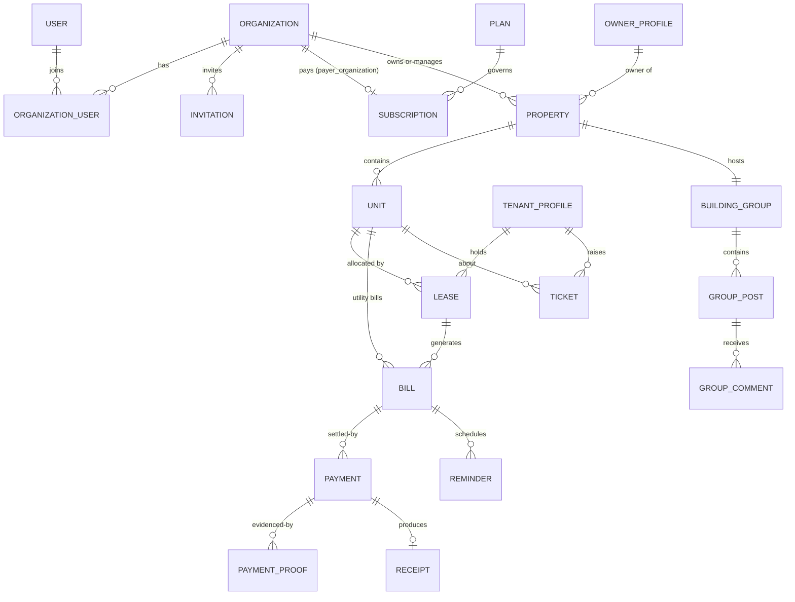

# GoProperty — Database Schema

Design baseline for MySQL 8. Conventions:

- Money is **integer kobo** (`_kobo` suffix). Never floats.
- All statuses are PHP backed enums persisted as strings; values listed here.
- Tenant-scoped tables carry `organization_id` (FK, indexed) unless noted. See [ARCHITECTURE.md § 4](ARCHITECTURE.md).
- Every table: `$table->id()`, `$table->timestamps()`, soft deletes only where stated.
- `media` table (spatie) and `activity_log`, `jobs`, `cache` etc. are implied and not repeated here.

## Domain Map

## 1. Identity & Organizations

### users
`name`, `email` (unique), `phone` (unique nullable), `email_verified_at`, `phone_verified_at`, `password`, `is_platform_staff` (bool), `preferences` (json: channel toggles), `last_active_organization_id`, soft deletes.

### owner_profiles
Person/company details of a **property owner** (distinct from the user record — an owner may never log in).
`organization_id`, `first_name/last_name` **or** `company_name`, `email`, `phone`, `address`, `state`, `lga`, `id_type` (`nin`, `cac`, `none`), `id_value` (encrypted), `notes`.

### tenant_profiles
`organization_id`, `user_id` (nullable — tenant may not have portal access yet), `first_name`, `last_name`, `email` (nullable), `phone` (required, unique per org), `address`, `occupation`, `emergency_contact` (json), `kyc_status` (`unverified`, `pending`, `verified`), `id_type`, `id_value` (encrypted), soft deletes. Unique: `(organization_id, phone)`.

### organizations
`name`, `type` (`agency`, `property_owner`, `hybrid`), `cac_number` (nullable, encrypted), `address`, `state`, `lga`, `logo_media_id`, `status` (`onboarding`, `active`, `suspended`, `cancelled`), `platform_covered` (bool — platform owner pays the bill), `document_settings` (json: invoice prefix, footer, logo, colors), `bank_accounts` (json: `[ {bank, account_number_enc, account_name} ]`), `trial_ends_at`, soft deletes.

### organization_user
`organization_id`, `user_id`, `role` set via spatie teams; unique `(organization_id, user_id)`. Extras: `is_default` (for org switching).

### invitations
`organization_id`, `email`, `phone` (nullable), `role`, `kind` (`user`, `org_billing_transfer`), `target_organization_id` (for org-to-org invites), `billing_transfer_id` (nullable FK), `token` (unique), `expires_at`, `status` (`pending`, `accepted`, `declined`, `expired`, `cancelled`), `invited_by_user_id`, `accepted_at`.

### billing_transfer_requests
Handover of the platform subscription bill between orgs. `from_organization_id`, `to_organization_id`, `subscription_id`, `status` (`pending`, `accepted`, `declined`, `cancelled`, `completed`), `initiated_by_user_id`, `responded_by_user_id`, `responded_at`, `completed_at` (set when payer + payment method actually switch).

## 2. SaaS Billing (platform ↔ customers)

Full semantics in [BILLING_PAYMENTS.md](BILLING_PAYMENTS.md).

### plans
`name`, `description`, `cycle` (`monthly`, `annual`), `base_price_kobo`, `included_units`, `unit_price_kobo` (per extra unit), `tier_rules` (json, optional band pricing), `annual_discount_percent`, `trial_days`, `is_active`, `sort_order`.

### plan_feature
`plan_id`, `feature_key`, `enabled`, `limit_value` (nullable int). `feature_key` from registry (`building_group`, `tickets`, `sms_reminders`, `expenses`, …).

### subscriptions
`organization_id` (the customer), `plan_id`, `payer_organization_id` (nullable — defaults to `organization_id`; moves on billing transfer), `status` (`trialing`, `active`, `past_due`, `grace`, `suspended`, `cancelled`), `current_period_start`, `current_period_end`, `cancel_at_period_end`, `last_billed_units` (int snapshot), `paystack_customer_code`, `paystack_authorization` (json), `ended_at`.

### subscription_unit_events
Metering ledger. `subscription_id`, `unit_count` (int), `counted_units` (int — after included-units adjustment), `effective_date`, `reason` (`unit_added`, `unit_removed`, `plan_change`, `initial`), `source_bill_id` (nullable).

### platform_invoices
`organization_id`, `subscription_id`, `number` (unique, `{PR}-{YYYY}-{seq}`), `subtotal_kobo`, `vat_kobo`, `total_kobo`, `units_billed`, `period_start`, `period_end`, `status` (`open`, `paid`, `void`, `uncollectible`), `due_date`, `paid_at`, `notes`.

### platform_payments
`platform_invoice_id`, `method` (`paystack`, `bank_transfer`), `amount_kobo`, `currency` (`NGN`), `paystack_reference` (unique nullable), `paystack_channel` (nullable), `bank_transfer_proof_media_id` (nullable), `status` (`pending`, `confirmed`, `rejected`, `refunded`), `confirmed_by_user_id` (platform staff, for bank transfers), `confirmed_at`, `rejection_reason`.

### webhook_log
`provider` (`paystack`), `event`, `reference`, `payload` (json), `signature_valid`, `processed_at`, `processing_error` (nullable).

### organization_feature_overrides
`organization_id`, `feature_key`, `enabled`, `limit_value`, `granted_by_user_id`, `reason`. Platform-owner grants outside the plan.

## 3. Properties & Leasing

### properties (buildings)
`organization_id`, `owner_profile_id`, `name`, `slug`, `property_type` (`block_of_flats`, `estate`, `duplex`, `bungalow`, `commercial`, `mixed`), `address`, `state`, `lga`, `landmark`, `description`, `amenities` (json array), `year_built`, `photo_media_id`, `status` (`active`, `archived`), soft deletes. Unique: `(organization_id, slug)`.

### units (blocks/apartments)
`property_id`, `organization_id`, `unit_label` (e.g. `Block A`, `Flat 3B`), `unit_type` (`apartment`, `self_contain`, `shop`, `office`), `bedrooms`, `bathrooms`, `size_sqm`, `floor`, `base_rent_kobo`, `service_charge_kobo`, `status` (`vacant`, `reserved`, `occupied`, `under_maintenance`, `unavailable`), `description`, soft deletes. Unique: `(property_id, unit_label)`.

### leases
The allocation + contract. `organization_id`, `unit_id`, `tenant_profile_id`, `contract_number` (unique per org), `billing_cycle` (`daily`, `weekly`, `monthly`, `quarterly`, `semi_annual`, `annual`, `biennial`), `start_date`, `end_date`, `rent_amount_kobo`, `deposit_kobo`, `other_charges` (json), `due_day_offset` (int, default 0 — bill N days before period start), `auto_renew` (bool), `status` (`draft`, `active`, `expired`, `terminated`, `renewed`), `renewal_of_lease_id` (nullable self FK), `terminated_at`, `termination_reason`, `notes`, `document_media_id` (generated contract PDF), soft deletes. Index: `(organization_id, status)`, `(unit_id, status)`.

### lease_renewal_offers
Optional but recommended: `lease_id`, `proposed_rent_kobo`, `proposed_cycle`, `expires_at`, `status` (`pending`, `accepted`, `declined`, `expired`), `responded_at`. (MVP can generate the renewal lease directly; the offer table supports tenant-facing accept flows later.)

### agent_building
Assignment narrowing (optional per ARCHITECTURE § 5). `organization_id`, `user_id`, `property_id`, unique `(user_id, property_id)`.

## 4. Customer Billing (rent, utilities, payments)

### utility_types
`organization_id`, `name` (e.g. Security levy, Water), `code`, `default_amount_kobo`, `default_cycle` (same enum as lease), `metered` (bool — electricity), `active`.

### unit_utility_settings
`organization_id`, `unit_id`, `utility_type_id`, `amount_kobo`, `cycle`, `metered`, `active`, `effective_from`. Unique: `(unit_id, utility_type_id)`.

### utility_readings
`unit_utility_setting_id`, `organization_id`, `reading_date`, `previous_value`, `current_value`, `consumption`, `rate_kobo` (per unit), `recorded_by_user_id`, `bill_id` (nullable FK).

### bills
`organization_id`, `type` (`rent`, `utility`), `billable` (morph: `Lease` or `Unit`), `number` (unique per org), `description`, `amount_kobo`, `due_date`, `period_start`, `period_end`, `status` (`unpaid`, `partially_paid`, `paid`, `overdue`, `void`), `voided_at`, `document_media_id`, soft deletes. Indexes: `(organization_id, status, due_date)`, `(billable_type, billable_id)`, `(type, status)`.

### bill_items
`bill_id`, `label`, `amount_kobo`, `quantity` (default 1), `meta` (json).

### payments
`organization_id`, `bill_id`, `tenant_profile_id`, `recorded_by_user_id`, `amount_kobo`, `method` (`bank_transfer`, `cash`, `pos`, `online`), `paid_at`, `status` (`pending_confirmation`, `confirmed`, `rejected`, `refunded`), `reference` (org-provided or generated), `confirmation_note`, `confirmed_by_user_id`, `confirmed_at`, `rejection_reason`, `receipt_id` (nullable FK), soft deletes. Index: `(organization_id, status)`, `(bill_id)`.

### payment_proofs
`payment_id`, `uploaded_by_user_id`, `media_id`, `note`, `uploaded_at`.

### receipts
`payment_id`, `organization_id`, `number` (unique), `issued_at`, `document_media_id`, `issued_by_user_id`.

### expenses
`organization_id`, `property_id` (nullable), `unit_id` (nullable), `category` (`repairs`, `utilities`, `staff`, `taxes`, `agency_ops`, `other`), `description`, `amount_kobo`, `spent_at`, `vendor_name`, `receipt_media_id`, `recorded_by_user_id`, `bill_id` (nullable — expense linked to a ticket/job), `ticket_id` (nullable).

### document_counters
Atomic sequence allocation. `organization_id`, `doc_type`, `year`, `last_seq`, unique `(organization_id, doc_type, year)`.

## 5. Maintenance Tickets

### tickets
`organization_id`, `unit_id`, `property_id`, `lease_id` (nullable), `raised_by_tenant_profile_id` (nullable) / `raised_by_user_id`, `category` (`plumbing`, `electrical`, `structural`, `cleaning`, `security`, `appliance`, `other`), `priority` (`low`, `medium`, `high`, `urgent`), `status` (`draft`, `submitted`, `under_review`, `in_progress`, `resolved`, `closed`, `reopened`), `title`, `description`, `assigned_to_user_id` (nullable), `resolved_at`, `closed_at`, `reopen_count`, soft deletes. Index: `(organization_id, status)`, `(assigned_to_user_id, status)`.

### ticket_messages
`ticket_id`, `author_user_id`, `body`, `is_internal` (bool — staff-only notes), `read_at_by_tenant`, `read_at_by_staff`.

### ticket_status_history
`ticket_id`, `from_status`, `to_status`, `changed_by_user_id`, `note`, `changed_at`. (Also mirrored to activity log.)

## 6. Building Group

### building_groups
`property_id`, `organization_id`, `name`, `description`, `settings` (json: who can post, image toggles), `is_active`.

### group_members
`building_group_id`, `user_id`, `member_type` (`tenant`, `agent`, `owner`, `platform_viewer`), `role` (`member`, `moderator`, `admin`), `muted_until`, `joined_at`, unique `(building_group_id, user_id)`.

### group_posts
`building_group_id`, `author_user_id`, `body` (sanitized HTML subset, max 5 000), `status` (`published`, `hidden`, `removed`), `pinned_at`, `edited_at`, `last_activity_at` (bump on comment), soft deletes. Index: `(building_group_id, status, last_activity_at)`.

### group_comments
`group_post_id`, `parent_id` (nullable self FK — one level of replies), `author_user_id`, `body`, `status` (`published`, `hidden`, `removed`), soft deletes.

### group_reactions
`user_id`, `reactable_type` (`group_post` / `group_comment`), `reactable_id`, `emoji` (from curated set), unique `(user_id, reactable_type, reactable_id, emoji)`.

### group_moderation_events
`building_group_id`, `actor_user_id`, `action` (`hide`, `remove`, `pin`, `unpin`, `mute_member`, `unmute_member`), `target` (morph), `reason`.

## 7. Reminders & Deliveries

### reminders
`organization_id`, `remindable_type` / `remindable_id` (Bill, Lease, Subscription…), `type` (`rent_due`, `utility_due`, `lease_renewal`, `bill_overdue`, `saas_invoice_due`), `due_date`, `offset_days`, `channel` (`email`, `sms`), `send_at`, `status` (`pending`, `sent`, `failed`, `skipped`), `recipient_user_id` (nullable), `recipient_phone`, `dedupe_key` (unique: `type|remindable|channel|offset|due_date`), `sent_at`.

### notification_deliveries
`reminders` send outcomes + ad-hoc notifications. `notification_type`, `channel`, `recipient_user_id` (nullable), `recipient_contact`, `subject`, `status` (`queued`, `sent`, `delivered`, `failed`, `bounced`), `provider` (`termii`, `mailgun`, …), `provider_message_id`, `error`, `cost_kobo` (SMS), `sent_at`.

## 8. Platform Operations

### staff_profiles
`user_id`, `display_name`, `department`, `is_active` (platform staff only; roles via spatie platform team).

### settings
`key`, `value` (json), `scope` (`global` or morph to org). Unique `(scope_type, scope_id, key)`.

### backup_runs
`filename`, `size_bytes`, `destination`, `status` (`success`, `failed`), `started_at`, `finished_at`, `triggered_by` (`schedule`, `manual`), `notes`.

## Integrity Rules Worth Enforcing in Code (and migrations where possible)

1. A unit has **at most one** active lease at a time — enforced in the leasing service inside a transaction with a lock on the unit row (`SELECT … FOR UPDATE`), plus a daily consistency check job.
2. Payment amount cannot exceed outstanding bill balance on confirmation (overpayment routes to credit — post-MVP; MVP rejects with message).
3. A bill in `void` state accepts no payments; a confirmed payment cannot be deleted — only reversed via a refund/credit record (activity-logged).
4. `billing_transfer_requests` and `subscriptions.payer_organization_id` move **only** through the accept flow (single service method, no direct writes).
5. Reminder `dedupe_key` unique index is the idempotency guarantee — jobs may re-run safely.
6. Deleting an organization is a soft-delete cascade *suspend* first; hard purge only via the NDPR erasure tooling after the 90-day retention window.

## Indexing & Volume Notes

- `bills`, `payments`, `reminders` grow fastest (per-tenant per-cycle). Composite indexes above cover the three hot paths: org dashboard (org+status), tenant portal (tenant/bill), reminder dispatch (status+send_at).
- Reporting aggregates (sales/expenses/occupancy) should query `bills`, `payments`, `expenses` by `organization_id + date` — covered by the indexes; add summary tables only if dashboards exceed ~200 ms.
