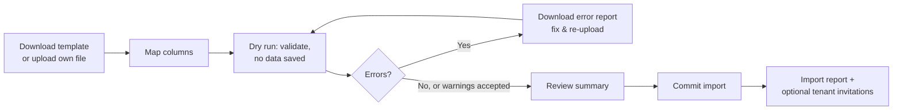

# GoProperty — Data Import (Excel / CSV)

Companion documents: [ONBOARDING_COMPLIANCE.md § 2](ONBOARDING_COMPLIANCE.md) · [DATABASE_SCHEMA.md](DATABASE_SCHEMA.md) · [ARCHITECTURE.md § 6.3–6.4](ARCHITECTURE.md)

Most agencies run on Excel, notebooks and WhatsApp. They can only switch to GoProperty if they can bring **everything** across, including rents already running and money already owed, without retyping.

## 1. What Can Be Imported

| # | Sheet | Key columns | Notes |
| --- | --- | --- | --- |
| 1 | Owners | Name (a person's first and last name, or the company name), type (person or company), phone, email, address, state, LGA, ID type and number (NIN or CAC number), notes | Landlords whose buildings the agency manages. Bank details are not imported yet: owner profiles have no bank fields |
| 2 | Properties (the "Buildings" sheet) | Building name, owner, type, address, state, LGA, landmark, amenities (comma separated), year built, description | Owner named by name, phone or Your ID, from sheet 1 or existing data; empty when the agency owns the building. Each building in a file needs its own name |
| 3 | Units | Building (name or Your ID), unit label, type, bedrooms, bathrooms, size, floor, rent and service charge (yearly), status, description | Status can be left blank (vacant): occupied and reserved come from leases, so the sheet imports them as vacant with a warning and never changes the status of a unit a lease holds |
| 4 | Tenants | First/last name (a full name under First name is split), phone (required), email, address, occupation, next of kin (name, phone, relationship), ID type and number (NIN, international passport, driver's licence, voter's card) | Phone is the matching key; the ID number is kept encrypted and never shown in reports; imported tenants are unverified (KYC) |
| 5 | Leases (ongoing rents) | Unit, tenant, start date, end date, billing cycle, rent amount, service charge, **paid until**, deposit held, auto-renew | Creates active leases without back-billing (§ 3) |
| 6 | Opening balances | Tenant, unit, amount owed (or credit), as-of date, description | Creates one "Opening balance" bill or a credit per tenant |
| 7 | Utility settings | Unit, utility type, amount, cycle, metered?, last meter reading | Utility types created if missing |
| 8 | Payment history (optional) | Tenant, date, amount, method, reference | For records and statements only; never re-issues receipts unless asked |
| 9 | Staff (optional) | Name, email, phone, role | Sends invitations only after the import is committed |

Agencies can import everything at once (one workbook, one sheet per type) or step by step.

## 2. How It Works

1. **Template:** a downloadable `.xlsx` with one sheet per type, an "Instructions" sheet, example rows, and dropdowns for fixed values (cycles, unit types, states/LGAs).
2. **Own file:** agencies can upload their own spreadsheet instead. GoProperty suggests a column mapping from the headers, and the agency confirms or changes it. Mappings are saved for next time.
3. **Dry run (always first):** the whole file is validated and simulated. **Nothing is saved.** The agency sees:
   - counts of what would be created or updated per sheet;
   - **errors** (blocking: missing phone, unknown property, invalid date, negative rent, duplicate unit label);
   - **warnings** (non-blocking: tenant phone already exists in another lease, rent differs from unit default, lease already expired, unit count will raise the subscription bill);
   - a preview of the first rows of each sheet as they will look in GoProperty;
   - the effect on the subscription (units counted) and on the Transaction Tier forecast (expected yearly collections).
   An error report can be downloaded as Excel with an "Error" column next to each bad row.
4. **Commit:** only after a successful dry run. Runs as queued jobs with a progress bar, one sheet after another in dependency order (owners → properties → units → tenants → leases → balances → utilities → history). Shared hosts give a job under a minute, so a sheet is written in chunks of rows, each chunk in its own database transaction together with the import's progress: a stopped import resumes from the last saved chunk and never writes a row twice, and one that cannot finish is marked "stopped part-way" and can be rolled back. Rows are checked again as they are written; one that no longer passes (say, its property was archived after the dry run) is skipped and listed in the report.
5. **Report:** what was created, what was skipped and why, plus links to review imported records.
6. **Invitations:** tenants and staff are **not** contacted automatically. After reviewing, the agency chooses "Invite tenants now" (email, the agency's WhatsApp, or a printable sheet of QR invitation links) or later.

### Re-running and updates

- Each row can carry the agency's own ID (`external_ref`). Re-importing the same file updates existing records instead of duplicating them.
- Without an `external_ref`, matching uses natural keys: owner by phone, then by name (an owner on file with another phone number is a different owner, and the dry run says so), tenant by phone, property by name, unit by property + label (without case). A name shared by two records on file is an error asking for the phone or Your ID. A unit never moves to another building by import.
- Matching includes archived records: an archived match is brought back (restored) instead of being added twice, and the dry run warns about it. A building archived on its page is the exception: its row and its units' rows are skipped with a warning (restoring it would put its units back on the GoProperty bill, and a rollback could not archive it again), so the agency restores it on its page first.
- On an update, an empty cell keeps what is on file (built so far for tenants); a tenant whose ID number changes becomes unverified again.

### Undo

An import batch can be **rolled back within 7 days** if none of its records have been used since (no payments recorded, no bills sent). Rollback soft-deletes the batch's records and is audited. After that, records are edited individually.

"Used" so far: a tenant given portal access; a unit a lease holds (occupied or reserved); a building holding a unit that is not the batch's own; an owner named by a building that is not the batch's own (including one the import itself gave that owner). Rolling back never strands a record that is not the batch's. Leases, bills and payments are added with them (P03-13a).

## 3. Ongoing Rents and Balances (the important part)

Importing a lease that started years ago must not bill the tenant for past years or send a flood of reminders.

- **Paid until** is the key column: the date up to which the tenant has already paid. GoProperty sets the lease's next billing date from it, so the first bill it creates is for the period after "paid until". Bills follow the normal lead time (e.g. an annual rent paid until 31/12/2026 is billed ahead of 01/01/2027).
- **No back-billing:** past periods are never generated as bills.
- **Arrears** go in the Opening Balances sheet. Each becomes one bill of type `opening_balance` dated on the as-of date, so it appears in the tenant's statement, can be paid and receipted, and counts in arrears reports.
- **Tenant credit** (overpaid before switching) is imported as a credit entry and applied automatically to the next bill.
- **Deposits held** (caution fees) are recorded on the lease as a liability for refund at move-out. They don't create a bill.
- **Reminders** are calculated only from the commit date forwards. Nothing is sent for dates in the past.
- **Units and occupancy** are set from active leases.
- **Expired leases** in the file are imported as `expired` (history), unless "Treat as month-to-month" is chosen.
- **Lease numbers:** existing contract numbers can be kept. Otherwise GoProperty numbers them.

## 4. Limits & Performance

- Up to 10,000 rows per sheet in one file. Larger files are split.
- Files are read in chunks with a streaming reader (OpenSpout / `spatie/simple-excel`) so memory stays low. This matters on shared hosting.
- Formats: `.xlsx` and `.csv` (UTF-8; Windows-1252 as saved by Excel on Windows is read too; comma, semicolon or tab separated). Old `.xls` files are not read by the streaming reader: save them as `.xlsx` first. Uploads up to 20 MB, checked by content (an `.xlsx` must be a real Excel workbook without macros, a `.csv` plain text). Dates accepted as DD/MM/YYYY or Excel date cells. Amounts accepted with or without ₦ (or N, NGN) and commas.
- Uploaded files are stored privately for 30 days for support purposes, then deleted.

## 5. Permissions & Audit

- Only `org-owner` and `org-admin` can run imports.
- Every batch is recorded (`import_batches`) with who ran it, file, dry-run results, commit time and counts. Every created record links to its batch.
- During impersonation, staff can view import results but cannot commit or roll back imports.

## 6. Also Supported

- **Export** of every list to Excel/CSV, so agencies are never locked in. Built in P02-07 ([ARCHITECTURE.md § 6.13](ARCHITECTURE.md)): each list's Export button downloads what the list shows now (filters, search, the member's narrowing), streamed, audited; the owners, buildings and units exports use this page's import headers, so an exported file imports again (ID numbers are exported masked only, so they are not re-imported).
- A GoProperty "assisted import" service (staff run the import for the customer) can be offered on higher plans. Staff prepare the file, mapping and dry run; the org-owner reviews the dry-run summary and clicks **Commit** themselves.
